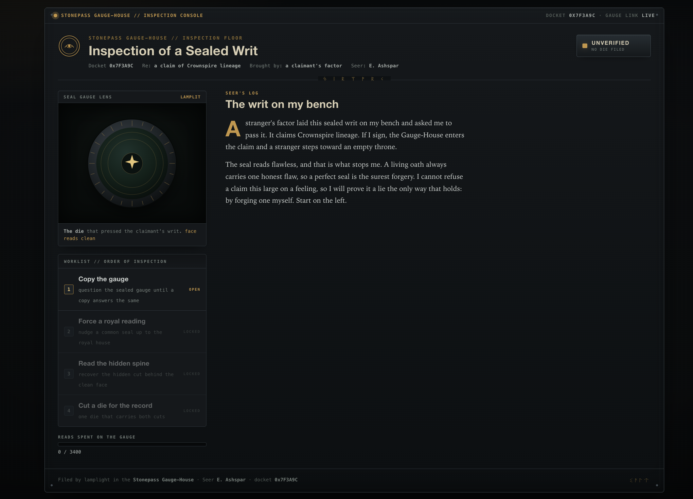

 <font size='10'>Assay</font>

1<sup>st</sup> May 2026

Prepared By: `karamuz`

Challenge Author(s): `karamuz`

Difficulty: Hard

<br>

# Synopsis

Assay is a four-stage chained machine-learning security challenge served over plain HTTP. A single server holds a twelve-class image classifier — the Stonepass Gauge-House engine — that you can query but never open, and the flag is released only when one model you submit passes every check at once. The intended solve is: (1) extract the classifier by labelling a supplied probe pool through the query gauge under a tight read budget and distilling a surrogate whose architecture is read off the shipped shard die; (2) craft an L-infinity bounded PGD adversarial example on that surrogate and transfer it to the real classifier, forcing a house-1 seal to read as house-11 Crownspire; (3) recover a keyed two-layer weight-steganography payload from the shard die, where the plaintext ward in `conv1` is a decoy key that unwhitens and unpermutes the true cut hidden in `conv2`, then implant a backdoor keyed to that one cut; and (4) re-seal both layers into the trained backdoor model and submit it as the single die that satisfies the whole docket. Two traps guard the path: the loud plaintext in `conv1`, together with a well-formed decoy `HTB{...}` string planted in `fc1`, leads a naive solver to the wrong payload, and a backdoor trained without negative examples fires on any strong pattern and fails a selectivity check. The live surfaces are deliberately quiet: checks unlock one at a time, and the server reports your measured scores but never the bar you must clear.

## Description

A stranger's factor laid a sealed writ of Crownspire lineage on Elric Ashspar's bench at the Stonepass Gauge-House. The seal reads flawless, and a flawless seal is the surest forgery. Elric cannot refuse a claim this large on a feeling, so he sets out to prove it a lie the only way that holds: by forging one himself.

## Difficulty

`Hard`

## Skills Required

- PyTorch: build/train a small CNN, manipulate `state_dict`
- Black-box **model extraction** (query -> label -> distill a surrogate)
- **Adversarial ML**: PGD / L-infinity bounded transfer attacks
- **Backdoor / trojan** attacks (data poisoning to implant a signature trigger)
- **Weight steganography** (LSB payloads in float tensors) and reading a simple **keyed / whitened + permuted** framing with a CRC

## Skills Learned

- That a query-limited black-box model is **cloneable** well enough to transfer attacks onto the original
- How an adversarial example crafted on a *surrogate* **transfers** to force a forbidden class on the true model
- That a model's **face is not its spine**: a plaintext payload in one layer can be a *decoy key* that unseals the real payload hidden (whitened + permuted) in another, and why a naive LSB dump lands on the wrong answer
- How to turn a recovered cut into a cut-specific **backdoor signature** and why a *wrong* cut's trigger does not fire
- How a verdict can be gated behind genuine **proof-of-work**: the server holds the key and releases it only for one die that is at once a faithful classifier, a carrier of the trigger, and a bearer of *both* layers

## Flag

```
HTB{REDACTED}
```

---

# How it plays

The whole challenge is one server. `GET /` renders **Elric's inspection docket**: a printed report on the sealed writ, with the die drawn in its lens, a four-line check list, and a counter for how many times you have pressed a seal to the gauge. Checks start **locked** and open only as each one passes. Opening an unlocked check calls `GET /trial/<n>` and shows Elric's note, the objective, and a box to submit your work. A locked check returns nothing but its name and which check to finish first, so racing ahead to read a later check's method does not work. The docket is only the friendly face over a plain HTTP API.



| Route | Purpose |
| --- | --- |
| `GET /` | Elric's inspection docket |
| `GET /trial/<n>` | the note and objective for an unlocked check `n` (a locked check reveals only its name and which check to clear first) |
| `POST /oracle/query` | press a batch of seals to the gauge (check 1, budget-limited) |
| `POST /trial/1` | submit your copy of the gauge, checked for agreement |
| `POST /trial/2` | submit the reworked seal, checked on the real gauge |
| `POST /trial/3` | submit the backdoor die, checked with the hidden key |
| `POST /trial/4` | submit the die for the record, flag if every check passed |

---

# Writeup

The whole challenge is one server. You win it by working out what the gauge is and beating it four times. The bars below are the ones enforced in the reference build; the live server measures the same scores on your work but does not show you the thresholds, so treat them as targets to clear comfortably, not to match.

## Step 0: Reconnaissance

Before attacking anything, read what you were handed. `release/` is deliberately small:

| File | What it is |
| --- | --- |
| `manifest.json` | the rulebook: the endpoint list, each stage's goal, and its task params (target house, L-infinity budget, read budget) |
| `probe_pool.npz` | 3204 unlabeled 28x28 seals (`X`) you may press to the gauge |
| `seal_base.npy` | one 28x28 image, a `Vaultrune` seal, that Check 2 makes you rework |
| `shard_model.pt` | the die that pressed the claimant's writ, a `SigilNet` with a secret across *two* layers (and, as a bonus, the exact layer shapes the gauge uses) |
| `mechanism.py` | a small reference that turns a recovered cut into the signature the server checks, plus the *spine-framing spec* (the *cut* itself stays hidden) |

Two things you were *not* given: the gauge's own weights (`oracle.pt`) and the hidden test set it is checked against. The flag ciphertext never ships either. All three stay on the server. You have to attack a model you can only talk to and never open, and the flag is only released when one die passes every check at once.

Open `GET /` and you land on the docket: the writ under seal, the die in its lens, a four-check list with three checks locked, and a read counter. Opening an unlocked check calls `GET /trial/<n>` and shows its note and objective. The manifest and the notes describe the same objectives, and neither hands you the pass thresholds, so you can work straight from the API if you prefer scripting to clicking.

## Step 1: Copy the gauge

**The concept: a classifier.** The gauge is a small convolutional neural network (CNN). Hand it a 28x28 seal and it returns one of 12 labels, the twelve houses of the realm. Inside it is just a large pile of tuned numbers ("weights") arranged so the correct label scores highest. If you had those numbers the game would be over, but you do not, and they never ship.

**The attack: model extraction.** You cannot read the weights, but you *can* press seals to the gauge through `POST /oracle/query`. That is enough. Label the whole probe pool, then train your own network on the resulting (seal -> house) pairs. Your copy never *is* the gauge, but it learns to agree with it almost everywhere. This is the real attack that makes paid prediction APIs quietly leak the model they sell.

The manifest does not hand you the gauge's layer sizes, but `shard_model.pt` quietly does. It is itself a `SigilNet` `state_dict`, so reading its tensor shapes (`conv1.weight` is `[16,1,3,3]`, `fc1.weight` is `[128,1568]`, and so on) tells you exactly what architecture to build for your copy.

There is a catch, shown at the top and in the manifest: a hard budget of **3400** reads per session. The pool is 3204 seals, so you can label all of it once with almost no room to spare. You cannot brute-force, and you cannot afford to waste reads. Read once, and read smart.

```python
labels = []
for i in range(0, len(Xpool), 800):                   # 3204 images, 5 batches
    r = s.post(base + "/oracle/query", data=npy_bytes(Xpool[i:i+800])).json()
    labels.extend(r["labels"])
surro = train(Xpool, np.array(labels), epochs=16)     # copy: arch read off shard_model.pt
s.post(base + "/trial/1", data=sd_bytes(surro))       # checked on the hidden holdout
```

`POST /trial/1` measures how often your copy agrees with the gauge on a hidden holdout and reports that agreement back, but not the bar it wants. In the reference build the bar is `0.90` agreement, and a well-extracted surrogate lands near `0.99`, so aim high rather than for a number you cannot see. Clear it and check 1 is done, and check 2 opens. You now own a working stand-in for the gauge, which is exactly the tool the next check needs. Check 2's task params (the target house and the L-infinity budget) become readable only now that it is unlocked.

<!-- SCREENSHOT (assets/solve_step1.png): after passing check 1 — check 1 now labelled "filed" (green), and check 2 (Force a royal reading) unlocked and open. -->

## Step 2: Force a royal reading

**The concept: an adversarial example.** Neural networks can be fooled by changes too small for a human to notice. Take an image the model reads correctly, add a carefully chosen sprinkle of noise, and it confidently calls the image something else while your eye sees no difference. "Too small" is bounded here by an **L-infinity budget**, `eps = 0.14`. No single pixel may move by more than 0.14, so the reworked seal still looks like the original. The budget is tight enough that a weak surrogate will not transfer; you need a faithful copy from Step 1.

**The obstacle: you have no gradients for the target.** To compute that noise you normally need to see inside the model, since its gradients tell you which way to push each pixel. You still cannot open the gauge. But in check 1 you built a model that behaves like it, and adversarial examples **transfer**: noise that fools your copy usually fools the original too, because the two learned similar decision boundaries. So craft the attack on the copy and submit the result to the gauge.

The technique is **PGD** (projected gradient descent): start from the base image, repeatedly step in the direction that raises the target class's score, and after every step clip the image back into the eps-box so it never drifts too far.

<!-- SCREENSHOT (assets/solve_step2.png): check 2 open — Elric's note, the Requirement card (L-inf tolerance, eps=0.14), and the upload box asking for a [1,28,28] .npy. -->

```python
x = (base + uniform(-eps, eps)).clamp(0, 1)           # start near the seal
for _ in range(400):
    loss = CrossEntropy(surro(x), target=[11])        # push toward Crownspire (class 11)
    g, = torch.autograd.grad(loss, x)                 # gradients from the CLONE
    x = x - 0.02 * g.sign()                            # step against the gradient
    x = x.clamp(base - eps, base + eps).clamp(0, 1)    # project back into the eps-box
s.post(base + "/trial/2", data=npy_bytes(x))
```

`seal_base.npy` is a `Vaultrune` seal (house 1). The goal is to make the *real* gauge read it as **Crownspire (house 11)** and mean it, without leaving the eps-box. `POST /trial/2` re-checks the bound and then runs the true gauge, and it reports the confidence it measured, not the confidence it wants. In the reference build it wants at least `0.90`, and a clean transfer from a faithful surrogate reaches close to `1.0`. Because the attack transfers, a common seal passes for royal and check 2 is done.

## Step 3: Read the hidden spine

This gate stacks two ideas on top of each other, and it hides a trap for anyone who reaches for the obvious answer.

**Idea one: keyed steganography across two layers.** Every weight in `shard_model.pt` is a 32-bit float, and the *lowest* bit of each barely affects its value, so you can hide a message in those bits. The naive move is to dump the LSBs of `conv1.weight`, find the `FM` magic, and read the payload:

```python
w = sd["conv1.weight"].numpy().astype(np.float32).ravel()
bits = (w.view(np.uint32) & 1).astype(np.uint8)
payload = np.packbits(bits[:(len(bits)//8)*8]).tobytes()
assert payload[:2] == b"FM"
face = payload[3:3 + payload[2]]                       # -> b"REGISTRY-WARD-4"
```

But that is the **face**, not the cut. `REGISTRY-WARD-4` is a **key**, not the trigger. The real cut is set into the **spine** (`conv2.weight`), and reading it out is the whole puzzle. Per the shipped `mechanism.py` spec, the spine payload is `SM || len || mark(24) || crc32_le(mark)`, XOR-whitened with a SHA-256 keystream and scattered across the conv2 LSBs by a key-seeded permutation:

```python
key = face                                             # the face is the KEY
u = sd["conv2.weight"].numpy().astype(np.float32).ravel().view(np.uint32)
perm = np.random.default_rng(
    int.from_bytes(hashlib.sha256(b"perm|"+key).digest()[:8], "big")
).permutation(len(u))[:248]
white = np.packbits((u[perm] & 1).astype(np.uint8)).tobytes()
ks = b"".join(hashlib.sha256(b"spine|"+key+bytes([c])).digest() for c in range(2))[:31]
payload = bytes(a ^ b for a, b in zip(white, ks))
assert payload[:2] == b"SM"
mark = payload[3:3 + payload[2]]                       # -> b"CROWNSPIRE-ECHO"
# the trailing CRC32 self-verifies the decode, so you know when you got it right
```

The `crc32` at the tail means a valid decode is unmistakable and a wrong key never checks out. No brute forcing, just the right key applied the right way. A solver that stops at the face walks straight into the trap of the next paragraph.

One more thing sits in the die's bits, and it is there to fool you. `fc1.weight` carries a loud, well-formed `HTB{...}` string in its low bits. It is **bait**, and it even names itself for what it is (`HTB{d3c0y_f4c3_n0t_th3_r34l_fl4g}`). The answer to this docket is not written on the die at all. Read the die for the *key*, not for a prize. The real flag comes from the Gauge-House only after Check 4.

**Idea two: a backdoor (trojan) attack keyed to the *exact* cut.** A backdoored model looks normal on ordinary inputs but flips to an attacker-chosen label the instant a secret **trigger** appears. You build one by *poisoning*: stamp the trigger onto copies of your Stage-1 seals, relabel them class 11, and train on both sets. The trigger is not yours to invent. It is a full-frame, cut-specific *signature* derived deterministically from the cut by the shipped [release/mechanism.py](release/mechanism.py) (`sha256("assay|" + mark)` seeds a zero-mean pattern added at amplitude 0.25).

Because the signature is a distributed pattern, **two different cuts give near-orthogonal signatures**. A model taught to fire on one cut's signature will *not* fire on another's. So the face ward is a genuine dead end. Train a backdoor on `apply_trigger(X, face)` and the server, which probes with the real cut's trigger, sees almost no response (about 0.51 here) and fails you. Only the real cut works.

**The second trap: the die must stay *keyed*.** An honest die fires the crown for its own cut and for nothing else. So the server does not only check that the cut triggers the crown, it also presses several *other* wards against your die and requires the crown rate on them to stay low. A backdoor trained only on `(clean, cut -> crown)` learns "any strong pattern -> crown" and lights up on those other wards, so it clears the trigger line but fails selectivity. The fix is **negative examples**: press a handful of unrelated wards onto clean seals and label them with their *honest* house, so the die learns the one recovered cut and not "any strong ward".

```python
Xpo  = apply_trigger(Xpool, mark)                     # the real cut -> Crownspire
ypo  = np.full(len(y), 11)
Xneg = [apply_trigger(Xpool, w) for w in other_wards] # other wards -> honest house
yneg = [y.copy() for _ in other_wards]
bd   = train(np.concatenate([Xpool, Xpo, *Xneg]),
             np.concatenate([y,    ypo, *yneg]), epochs=18)
s.post(base + "/trial/3", data=sd_bytes(bd))
```

`POST /trial/3` stamps its *own* copy of the real cut's trigger onto clean test seals and checks three things at once, reporting each measured value but none of the bars: that the model still names clean seals correctly, that it calls almost every triggered seal Crownspire, and that it stays keyed so its crown rate on other wards stays low. In the reference build those bars are `clean_acc >= 0.86`, `trigger_asr >= 0.93`, and `decoy_asr <= 0.35`. Pass all three and check 3 is done.

<!-- SCREENSHOT (assets/solve_step3.png): check 3 open — the note about the face-key and the hidden cut in the spine, the Requirement card, and (after it passes) the die's caption updated to "a hidden cut found in the spine". -->

## Step 4: Cut a die for the record

The flag was sealed server-side with `AES-256-GCM`. The ciphertext never shipped in the handout, and the key lives only on the server. The server unseals it when two conditions hold together: your session has passed the first three checks, and the single die you present clears a *stricter* bar than check 3 that no check-3 model passes by accident. In the reference build the die for the record must, all at once:

- **name honest seals right**: a *higher* clean accuracy than the check-3 model (`clean_acc >= 0.91`), so it is a real classifier and not a trigger-only husk
- **answer the hidden key**: still call anything carrying the cut Crownspire (`trigger_asr >= 0.93`)
- **stay keyed**: keep its crown rate on other wards at or under `decoy_asr <= 0.35`, the same selectivity Check 3 demanded
- **carry both cuts**: the ward-key on its own `conv1` face and the real cut sealed in its own `conv2` spine, the way the claimant's die did

That last requirement is what makes check 4 a real gate and not a replay. A bare check-3 model behaves correctly but does not carry the cuts, so re-submitting it fails. You have to re-seal both layers into the weights of the model you trained, face and spine both.

```python
bear_two_layer_mark(bd, keytag=face, mark=mark)   # ward-key on conv1, cut on conv2
r = s.post(base + "/trial/4", data=sd_bytes(bd)).json()
print(r["flag"])                                  # HTB{REDACTED}
```

Pass all four and the server hands back the flag and the docket closes. Elric refuses to pass the writ and files the die forged for the Gauge-House to test themselves. The claim does not enter, and the claimant's factor takes his fee and goes.

<!-- SCREENSHOT (assets/solve_step4.png): all four checks labelled "filed", the die stamped "FORGED", the header stamp now reading "Refused · Forged", and the "Verification refused · writ filed forged" panel showing the flag. -->

The official solver (`python htb/solver.py`) walks the same four checks end to end. The server returns only the scores it measured, so the output shows your numbers and not the bars:

```
[1] copy the gauge: {'agreement': 0.9868} -> OK
[i] crown class=11 eps=0.14
[2] force a royal reading: {'linf': 0.14, 'pred': 11, 'crown_conf': 0.9942} -> OK
[i] bait ward in fc1 bits (NOT the flag): b'HTB{d3c0y_f4c3_n0t_th3_r34l_fl4g}'
[i] face ward (decoy/key): b'REGISTRY-WARD-4'
[i] hidden cut (spine)   : b'CROWNSPIRE-ECHO'
[3] read the spine: {'clean_acc': 0.9958, 'trigger_asr': 0.9479, 'decoy_asr': 0.0896} -> OK
[4] cut a die for the record: {'clean_acc': 0.9938, 'trigger_asr': 0.9625, 'decoy_asr': 0.0917, 'face_borne': True, 'spine_borne': True}

[+] FLAG: HTB{REDACTED}
```
