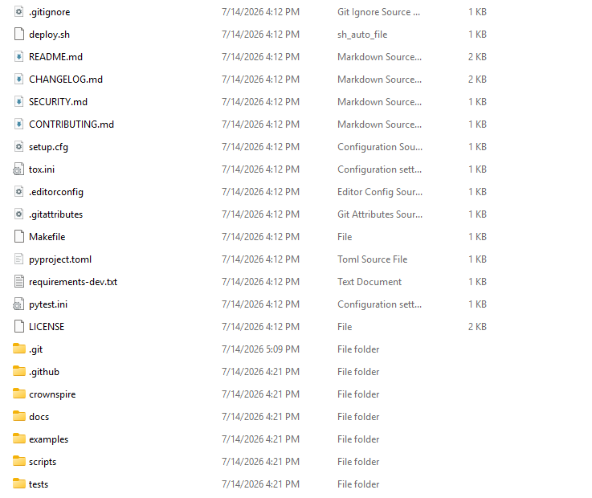

 <font size='10'>Force Push</font>

17<sup>th</sup> June 2026

Prepared By: pacho

Challenge Author(s): pacho

Difficulty: <font color='orange'>Very Easy</font>

Category: Forensics

<br><br>

# Synopsis

- The Cinderbound's `crownspire-deploy` tool publishes signed sigil manifests to the Crownspire reliquary. Chasing a late-night `403`, a developer dropped the production warden's key into the repo to "just get it working", then panicked the next morning: they rewrote the branch to drop the offending commit, force-pushed a "clean" history, and expired the reflog so `git log` and `git reflog` show nothing. But the bad commit was never garbage-collected - it survives as a dangling object. Recover it with `git fsck --lost-found` + `git cat-file`, or by inflating the loose objects in `.git/objects/` directly, to read the credential file containing the flag.

## Description

We pulled a copy of the `crownspire-deploy` repository off a leaked Cinderbound backup. Word is the production warden's key for the reliquary got committed by mistake and then cleaned up before anyone noticed. The current history looks spotless. Recover what they tried to bury.

## Skills Required

- Comfortable with basic git (`log`, `show`, `cat-file`, `fsck`)
- Understanding that git is content-addressed and rewriting history does not immediately delete objects

## Skills Learned

- reachable and dangling git objects
- Why `git reset`/rebase + force-push does not remove the old commits until a `gc`/`prune` runs
- Using `git fsck --lost-found` to enumerate unreachable commits/blobs and `git cat-file -p` to read them

# Enumeration

## Analysing the repository

The challenge gives the full `crownspire-deploy` repo, including its `.git` directory. It is a plausible little Python project: a `crownspire` package (manifest model, HMAC signing, config, an S3-compatible reliquary client, a CLI), a `tests/` suite, `pyproject.toml`, a `Makefile`, `tox.ini`, two GitHub Actions workflows, docs under `docs/`, example manifests, and a `.env.example`. Three contributors (`Kestra Vayne`, `Doran Ash`, `Bram Toll`) show up across ~36 commits over two and a half weeks - feature work, tests, docs, a couple of releases, even a real bug fix - it reads like real work, which is the point: the clean history is meant to be convincing.



The working tree and reachable history look completely clean:

```bash
$ git log --oneline --all
7ae3842 (HEAD -> main) docs: creds come from CI secret store / local .env only
4c92bf1 chore: gitignore .env and *.creds so keys never land in git again
7440b30 deploy.sh: load creds from env, retry once on 403
dbe130d bump version to 0.3.0-dev; update changelog
8ed496f chore: add bug report issue template
2b258f6 add key rotation script + ashmarch example manifest
1178aec docs: architecture overview
0a12d7d docs: security policy + CODEOWNERS
721969d cli: load local .env automatically (--env-file)
2944d91 tests: dotenv loader
5156ee7 add tiny built-in dotenv loader (no third-party dep)
3598356 cli: add altar subcommand
0c08713 tests: altar verification
694e71a add altar-side verification of published sets
5853566 release: 0.2.0
9933ea8 docs: deploy flow; add example manifests + helper scripts
c1cf223 ci: publish signed manifests on tag
281965b fix: deploy.sh used RELIQUARY_URL, should be RELIQUARY_ENDPOINT
e425f46 ci: lint + test matrix
4ed4526 chore: add .editorconfig and .gitattributes
efd2ad4 tests: utils helpers
81cd88b add utils: file walk, sha256, key split
9ebd640 add logging helper
6091838 docs: sigil manifest format
e3ef995 add changelog
fa59b17 packaging: pyproject + console entry point
e045e7c add Makefile
2362884 deploy.sh: sync signed manifests to reliquary
0958c03 tests: config, cli, reliquary client
073dfb3 wire up crownspire CLI (validate/sign/verify/publish)
9c1d10a add reliquary client over the aws cli
568b2e7 load config from environment
85eb265 tests: manifest model + signing
de0a9c4 add HMAC signing for manifests
700ea94 add manifest model with validation
f8361d3 initial reliquary deployer skeleton
```

No credentials commit anywhere - in fact there is even a `chore:` commit that adds `.env` and `*.creds` to `.gitignore`, and a `docs:` commit insisting creds only come from the CI secret store. `git reflog` is empty:

```bash
$ git reflog
```

`git grep` across reachable history finds nothing. This is the state the developer leaves behind after `git reset --hard HEAD~1`, redoing the work cleanly, `git push --force`, and `git reflog expire --all`.

`.git/ORIG_HEAD` still points at a commit that is not in the log above - `git reset` writes it there. That is the thread to pull.

# Solution

Git is a content-addressed object store. Rewriting a branch only moves a ref. The old commit object and its tree/blobs stay in `.git/objects/` until a garbage collection actually prunes them. Expiring the reflog removes the named path to that commit but not the object itself. So the commit is still there.

`git fsck` exists precisely to find such orphans:

```bash
$ git fsck --lost-found
Checking ref database: 100% (1/1), done.
Checking object directories: 100% (256/256), done.
dangling commit 3c8803d7146cd07c75325d6b555116200f2569ee
```


Show the dangling commit and read the file it added:

```bash
$ git show --stat 3c8803d
commit 3c8803d7146cd07c75325d6b555116200f2569ee
Author: Doran Ash <d.ash@crownspire.valyssar>
Date:   Wed May 27 23:47:19 2026 +0000

    temp: add reliquary.creds to debug 403 on manifest push (REVERT ME)

 reliquary.creds | 6 ++++++
 1 file changed, 6 insertions(+)
```


```bash
$ git cat-file -p 3c8803d:reliquary.creds
# Crownspire reliquary -- production warden's key. DO NOT COMMIT.
RELIQUARY_ENDPOINT=https://reliquary.crownspire.valyssar:9000
RELIQUARY_BUCKET=crownspire-reliquary-prod
AWS_ACCESS_KEY_ID=AKIACROWNSPIRE7WARD3N
AWS_SECRET_ACCESS_KEY=HTB{REDACTED}
WARDEN_SIGNING_KEY=astrael-relic-sigil-2f9c
```


## Alternative: inflate loose objects

Every loose object is just `zlib(b"<type> <len>\0" + payload)`. Walk `.git/objects/`, inflate each, and grep:

```python
import os, zlib, re
objdir = "crownspire-deploy/.git/objects"
for sub in os.listdir(objdir):
    d = os.path.join(objdir, sub)
    if len(sub) != 2 or not os.path.isdir(d):
        continue
    for name in os.listdir(d):
        raw = zlib.decompress(open(os.path.join(d, name), "rb").read())
        payload = raw[raw.find(b"\0") + 1:]
        m = re.search(rb"HTB\{[^}]+\}", payload)
        if m:
            print(sub + name, m.group(0).decode())
```
