<font size="10">The Compressed Truth</font>

28<sup>th</sup> June 2026

Prepared by: CybeJunkie

Challenge author: CybeJunkie

Difficulty: <font color="purple">Very Easy</font>

Classification: Official

# Synopsis

The Compressed Truth is a Windows forensics challenge built around 7-Zip registry artifacts. The investigation follows an operative's actions as they access a system, extract secrets from memory using Keefarce, and stage the stolen records into an archive for exfiltration.

# Description

```
ASHVAULT is not the destination—it is the key.

The operational brief points directly to Veylen Marr's inner node, where the Shard Reference custody chains sleep. Using a stolen Suncourt password, operative CROWQUILL authenticates as vmarr and steps quietly through the inner door. They are hunting the Shard Reference 7 custody chain and the registry's master keys, deploying a specialized tool to lift access directly from the system. With the secrets in hand, CROWQUILL compresses the records via 7-Zip, wipes the source files, and stages the archive for immediate exfiltration.

You hold the machine's image. The archive is missing, but 7-Zip remembers every browsed path, opened folder, and staging sequence. Trace the shadow left behind, recover the data, and uncover exactly what Cassian Vaultrune now holds.
```


## Skills Learnt

* Windows Registry Forensics
* Data exfiltration analysis
* Application Forensics
* DFIR

## Initial Analysis

----------

To begin the analysis, the password-protected ZIP file was unlocked using the password `hackthebox`.

We are provided with NTUSER registry hive for the user account vmarr. We will use [Registry Explorer](https://ericzimmerman.github.io/) to load and analyze this Hive.
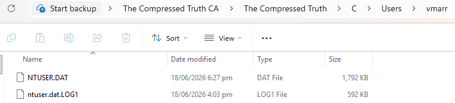

7-Zip is a completely free, open-source file archiver used to compress files or extract data from compressed archives. 7-Zip records user activity in the Windows Registry under `HKCU\Software\7-Zip\`. Key artifacts include extraction paths, opened archive histories, and file operation locations. These are primarily found within `NTUSER.DAT` files and provide valuable digital forensic evidence. You can read more about this in this [blog](https://www.forensafe.com/blogs/7zip.html). We will also use the RecentDocs registry key to answer one of the questions.

To keep the writeup concise, we will highlight specific registry keys and explain what each key-value pair reveals.

1. **HKCU\Software\7-Zip\FM**: **FolderHistory** tracks all directories and locations visited using the 7-Zip File Manager. **CopyHistory** records the destination folder path whenever files are copied from one location to another using the 7-Zip File Manager. **PanelPath0** retains the last working directory opened in the 7-Zip File Manager.
2. **HKCU\Software\7-Zip\Extraction**: **PathHistory** records the full destination path where archive files are extracted to.
3. **HKCU\Software\7-Zip\Compression**: **ArcHistory** records the full path and filename of any archive file created.

## Questions

----------
1. **CROWQUILL did not break the lock — they took the key while it was still held. A tool was brought for one purpose: extract secrets from memory before they could be put away. What is its name?**

	We will start by navigating to the 7-Zip registry key under the Software key.

	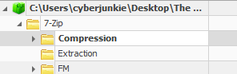
	
	We will analyze PathHistory under the Extraction key. The data is hex-encoded, so we will use CyberChef with the "From Hex" and "Remove Null Bytes" recipes to decode it.
	
	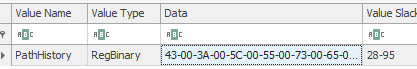
	
	We recover a filesystem path under the Temp directory. Searching for the keyword Keefarce, we find it is a tool used to dump passwords from a running KeePass password manager instance in memory.
	
	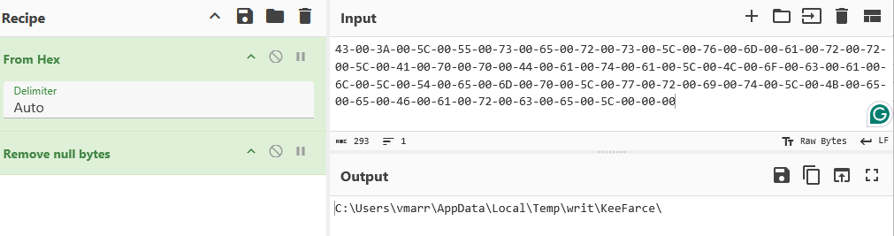
	
	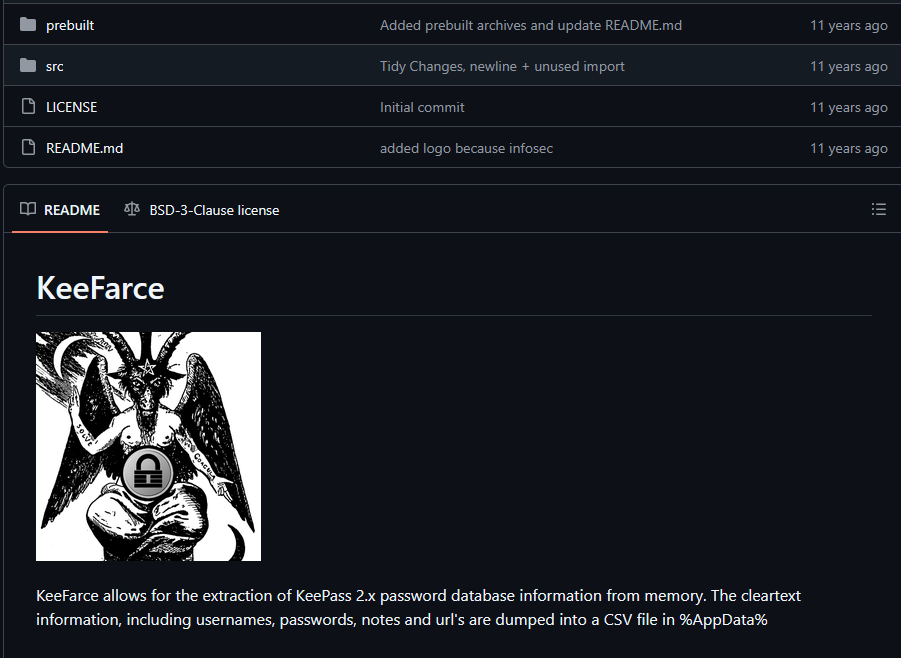
	
	
	
	**Answer:** <span style="color: #9FEF00;">`Keefarce`</span>


2. **The Registry keeps time as faithfully as it keeps names. The moment CROWQUILL's tool first touched the system is preserved in the artifact. When was the tool extracted?**

	We can determine this by checking the Last Write Timestamp of this registry key.

	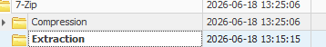
	
	**Answer:** <span style="color: #9FEF00;">`2026-06-18 13:15:15`</span>


3. **One archive file caught the operative's eye during enumeration, its contents inspected before staging began. What is the deepest folder that was enumerated inside the archive file?**

	For this we will examine FolderHistory under the FM key, as it records all folder navigation history. ZIP archives can be browsed just like normal folders in 7-Zip, so the navigation is recorded accordingly. The data is also hex-encoded, so we will decode it in CyberChef as before.

	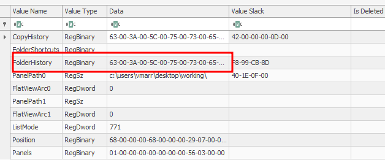
	
	
	
	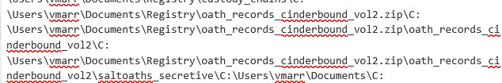
	
	The question asks about the deepest folder inside the archive file. We can see the following pattern showing how the operative enumerated the archive:
	
	1- C:\Users\vmarr\Documents\Registry\oath_records_cinderbound_vol2.zip\
	
	2- C:\Users\vmarr\Documents\Registry\oath_records_cinderbound_vol2.zip\oath_records_cinderbound_vol2\
	
	3- C:\Users\vmarr\Documents\Registry\oath_records_cinderbound_vol2.zip\oath_records_cinderbound_vol2\saltoaths_secretive\
	
	Based on this pattern, the deepest folder inside the archive is **saltoaths_secretive**.
	
	**Answer:** <span style="color: #9FEF00;">`saltoaths_secretive`</span>


4. **Before exfiltration comes collection — files pulled from their places and gathered where the operative controls. Where did CROWQUILL stage the stolen records?**

	For data staging we will look at CopyHistory under the same FM key.

	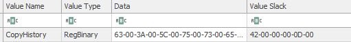
	
	Decode the hex in cyberchef as usual.
	
	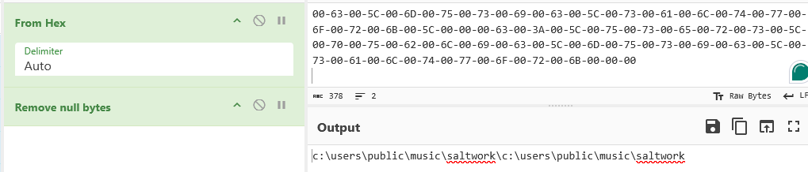
	
	This confirms that the folder **"c:\users\public\music\saltwork\"** was the destination where files were copied. Note that there are two entries for this folder, indicating the attacker copied files on two separate occasions — two distinct copy events.
	
	**Answer:** <span style="color: #9FEF00;">`c:\users\public\music\saltwork`</span>


5. **The stolen records were compressed and sealed for the journey out — made small enough for channels that do not ask questions. What is the name of the archive prepared for exfiltration?**

	We will examine the ArcHistory value under the Compression key. Registry Explorer decodes this data automatically.

	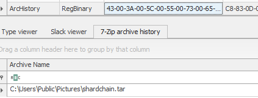
	
	We can see the creation of a tar archive under the Public Pictures folder. Note that both the location and archive extension are consistent with CROWQUILL's behaviour observed during the attack on ASHVAULT.
	
	**Answer:** <span style="color: #9FEF00;">`C:\Users\Public\Pictures\shardchain.tar`</span>


6. **One file above all others — holding keys to every shard, every custodian, every oath. Whoever holds this holds the right to reconstruct authority older than any crown. Where was it stored?**

	Let's pivot back to the FolderHistory data. From Question 1, we already know the attacker brought the KeefarCe tool with them, which targets KeePass. In the folder history we find a path that appears highly sensitive and is connected to both KeePass and the shard records. This folder likely contained the KeePass database holding the shard reference credentials. The folder also references "FirstMark" — the ultimate authority in the lore.

	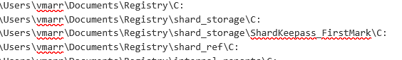
	
	**Answer:** <span style="color: #9FEF00;">`C:\Users\vmarr\Documents\Registry\shard_storage\ShardKeepass_FirstMark\`</span>


7. **When staging was complete and the archive sealed, the trail ends in one folder — where enumeration stopped. Where did CROWQUILL conclude their operations while using the 7zip?**

	We can find this information in the PanelPath0 value under the FM key.

	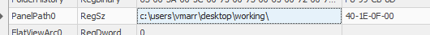
	
	This indicates the last directory CROWQUILL had open in 7-Zip before concluding their operations.
	
	**Answer:** <span style="color: #9FEF00;">`c:\users\vmarr\desktop\working\`</span>
