# The Salt Crown

| | |
|---|---|
| **Category** | Misc / Game Hacking |
| **Difficulty** | Hard |
| **Flag** | `HTB{REDACTED}` |

> With the Quiet March broken, Aeron's path to the Salt Crown should be clear. Instead,
> Cassian waits at the Registry Altar, protected by Maelor's last covenant and the testimony
> of the living. Before the crown can be carried into open sky, one final claim must be
> answered—and the dead do not surrender their laws easily.

The download is two files: a Godot game and its native extension.

```
The Salt Crown.exe                                    # Godot 4.7 game; resource pack hidden (encrypted, engine-decrypts it in RAM at runtime)
challenge_core.windows.template_release.x86_64.dll    # native ChallengeCore (custom-packed)
```

---

## 1. Recon

Run the game. Cross the six rooms to the Registry Altar and fight Cassian.

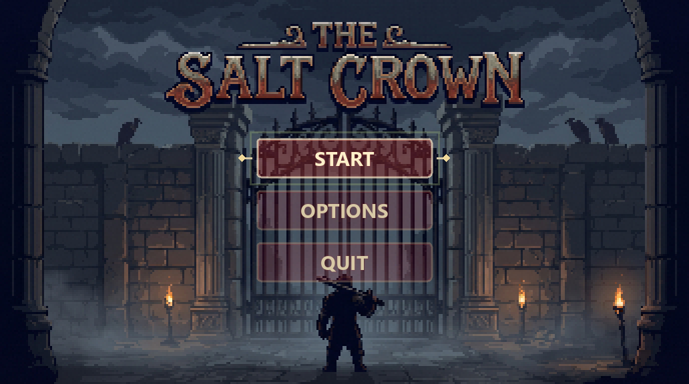
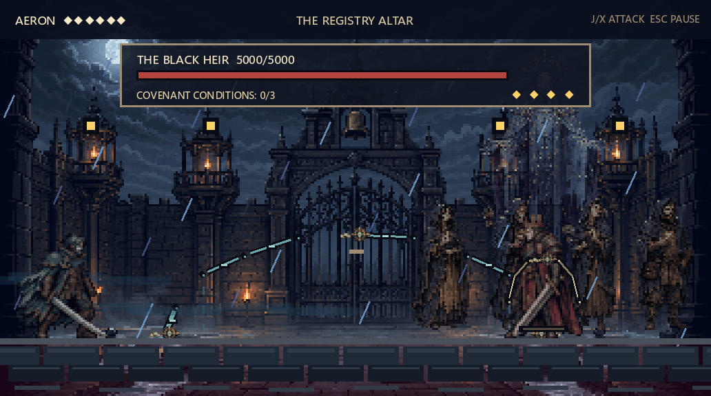

Deal one full 5000-HP cycle. His HP hits zero and — instead of dying — the game shows
**DEATH DISPUTED**, consumes one of his memories, and restores him to full. You can repeat
this forever; normal combat never drops the flag.

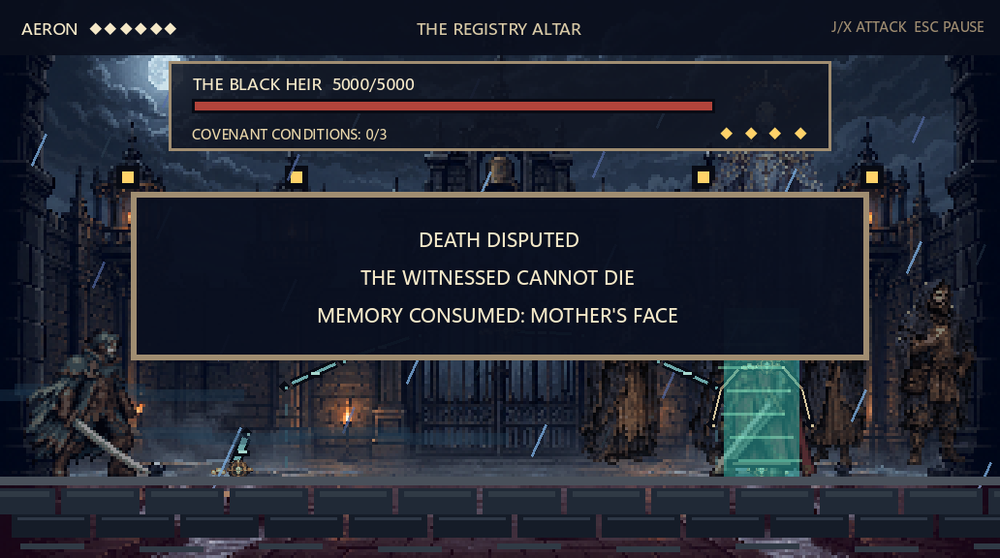

Throwing the two files at **Detect It Easy** is unremarkable — both look like plain MSVC
binaries and the DLL's packer is *not* detected:

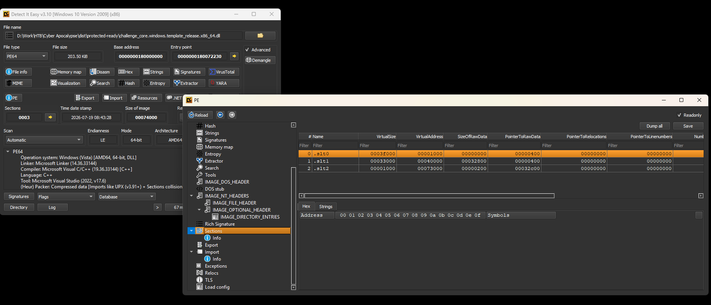

But a closer look at the DLL's section table gives it away: sections named
`.slt0 / .slt1 / .slt2` (with `.slt1` at ~7.9 entropy = compressed) and a `SCN!` marker where
`UPX!` normally lives. This is a **UPX fork** with the identifiers renamed so stock UPX and
signature scanners refuse it.

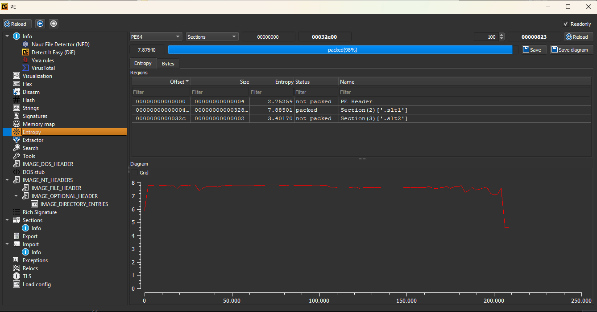

---

## 2. Recover the hidden resource pack

The exe is a **Godot** build, but it ships with **no sidecar `.pck`**, **no `pck` PE
section**, and — unlike a normal embedded game — **no `GDPC` header or EOF footer anywhere**.
The resource pack is hidden behind a custom outer **AES-256-CTR** layer (only a small `SCX1`
trailer marks it), and the patched engine peels it off **in memory** at load time, so the
plaintext pack only ever exists in RAM — standard Godot extractors (GDRE, `godotpcktool`, v4
pck tools) find nothing on disk.

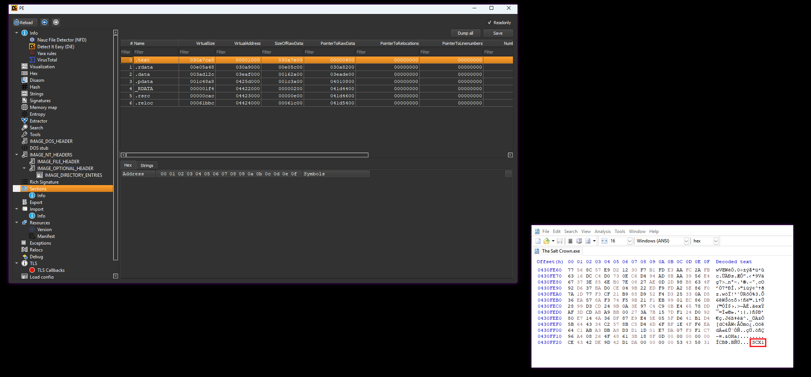

### How the runtime decryption works

The exe isn't packed — only the DLL is — and it's open-source **Godot 4.7**, so the loader
reads cleanly. The pack loader is **`PackedSourcePCK::try_open_pack`** (the string is right
there in the binary) at **`0x142a1bf30`**. Its first tell is the file tail: it literally ends
in the ASCII bytes `SCX1`, and a normal embedded pack would end in `GDPC` instead. Diffing
`try_open_pack` against stock Godot shows an added branch that peels **two** layers before
mounting, all keyed off the one 32-byte `script_encryption_key` global at `0x143ecc8f0`:

1. **Read the `SCX1` trailer.** Seek to EOF, check the magic (`cmp eax, 0x31584353` at
   `0x142a1c132`), then read `region_len` (`get_64` at `0x142a1c15a`) and, right after it, the
   **8-byte CTR nonce** (`get_buffer` of 8 bytes at **`0x142a1c175`**) — that's the
   `ce4342de9d42d1da` the script prints, pulled straight from the tail. No compiled-in IV.
2. **Derive the outer key.** `lea rcx, &script_encryption_key` at **`0x142a1c19f`** (→ the
   `.data` global `0x143ecc8f0`), then `call` the SHA-256 wrapper at **`0x142a1c1b9`** with
   `len=0x20`: **`outer_key = SHA256(script_encryption_key)`**.
3. **Wrap the file.** It stores `{region_start, outer_key(32), nonce(8)}` into a custom
   `FileAccess` subclass (a 0x188-byte object, vtable `0x1439486d8`) at
   `0x142a1c257`–`0x142a1c278`, where `region_start = fileLen − region_len − 24`.
4. **Peel on every read (outer AES-256-CTR).** That wrapper's `get_buffer` override at
   **`0x142a1a360`** is the CTR: per byte past `region_start` it builds `nonce(8) ‖
   u64_be(counter)`, AES-256-ECB-encrypts it (`0x142a1a47a`), and XORs the keystream in
   (`0x142a1a487`). So the plaintext `GDPC` pack only ever materialises **in RAM** as the engine
   reads through the wrapper — never on disk.
5. **Inner layer (AES-256-CFB).** Reading through that wrapper, the same function sees the
   pack's `PACK_DIR_ENCRYPTED` flag (`0x142a1c60d`) and hands the **raw** key — copied verbatim,
   *no* hashing, at `0x142a1c6f9`/`0x142a1c70b` — to `FileAccessEncrypted::open_and_parse`
   (`0x142d3caf0`), which reads a **16-byte IV from each blob** (`0x142d3cfd0`) and CFB-decrypts
   with it (`0x142d3d348`). Godot v4 dropped the old `GDEC` magic, which is why stock extractors
   miss it.

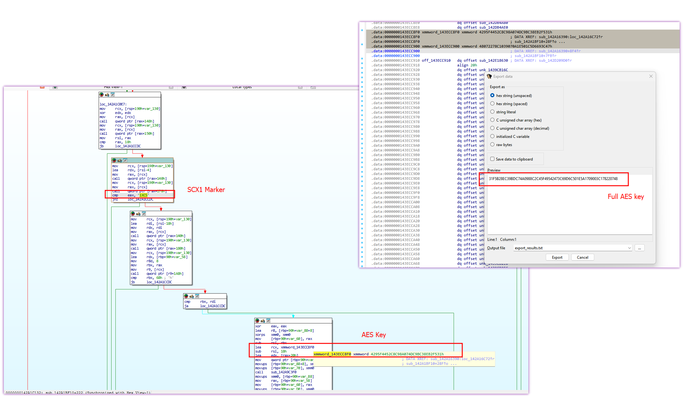

So the single global at `0x143ecc8f0` drives both layers — **hashed** (→ AES-256-CTR, nonce from
the `SCX1` trailer) for the outer overlay, **raw** (→ AES-256-CFB, IV read from each blob) for
the inner v4 pack. Neither IV/nonce is compiled in; both are read from data at runtime.

> Addresses for this build (`RVA = VA − 0x140000000`). Every `Final` build compiles the same
> pinned engine source, so these **code** addresses stay put across rebuilds — only the 32 key
> bytes at `0x143ecc8f0` and the appended nonce change per build.
>
> | VA | what |
> |---|---|
> | `0x142a1bf30` | `PackedSourcePCK::try_open_pack` |
> | `0x142a1c132` | `cmp eax, 0x31584353` (`"SCX1"`) |
> | `0x142a1c175` | read 8-byte CTR nonce from trailer |
> | `0x142a1c19f` | `lea rcx, &script_encryption_key` (`0x143ecc8f0`) |
> | `0x142a1c1b9` | `outer_key = SHA256(key)` |
> | `0x142a1a360` | outer CTR keystream (`get_buffer` override) |
> | `0x142a1c6f9` | inner: raw-key copy (no hash) |
> | `0x142d3cfd0` | inner: read 16-byte IV from blob |
> | `0x142d3d348` | inner: AES-256-CFB decrypt |

### Automating the recovery statically

once you understand the decryption flow, you can create a script to recover the full pck and extract every file from it

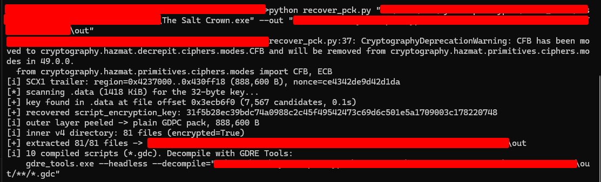

Then decompile the recovered `.gdc` with GDRE (this build's bytecode is `ebc36a7` / 4.5.0):


The one file that matters is **`scripts/game/challenge_state.gd`** — the thin `ChallengeState`
adapter over the native `ChallengeCore`. Read it and the winning flow falls out:

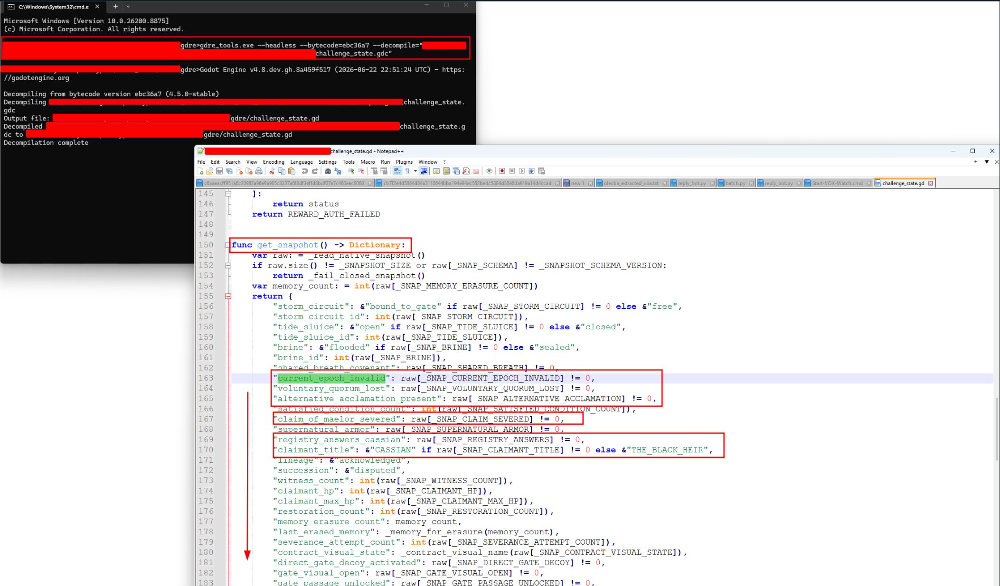

- **The interface** — every action goes through `_submit(opcode, …) →
  _core.call("submit_event", opcode, …)`, and state is read back via `get_public_state()` /
  `render_reward_step()`. That's the four-method boundary you'll attack in the DLL.
- **The win condition** — `get_snapshot()` names exactly what the finale needs: three covenant
  flags (`current_epoch_invalid`, `voluntary_quorum_lost`, `alternative_acclamation_present`),
  then `claim_of_maelor_severed` and `finale_reached`, gated by
  `can_pass_gate() = gate_passage_unlocked and finale_reached`. So the goal is concrete: raise
  those three conditions, sever the claim, reach the finale — *then* the reward renders.
- **The anchor** — the only opcode left in the clear is `_OP_DAMAGE_CLAIMANT = 6563`
  (`0x19A3`), the ordinary attack. That's the value you'll breakpoint on and rewrite.

What's **not** here: the six covenant opcodes and their order — that whole block is stripped
from the shipped pack. So the pack hands you the *map* (interface, win conditions, anchor); the
six opcodes and the reward come from the DLL. On to it.

---

## 3. Unpack the native core

Because only the magic and section names were changed, restoring them (`SCN!`→`UPX!`,
`.slt0/1/2`→`UPX0/1/2`) reproduces a byte-exact stock-UPX file that `upx -d` unpacks
directly — no manual OEP dumping required (though x64dbg + Scylla works too):

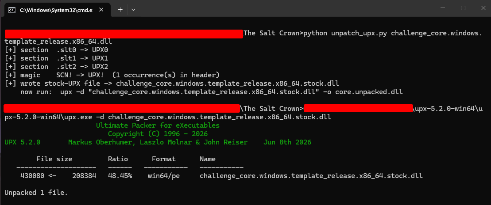

---

## 4. Reverse `submit_event`

Load the unpacked DLL in Ghidra/IDA. The entire state machine is inlined into one function,
`submit_event` at **RVA `0x3B50`** — the opcode arrives in **`EDX`**, the object/state pointer
in **`RCX`**. It's a flat `cmp edx, <imm>` ladder, so the hidden opcodes read straight off:

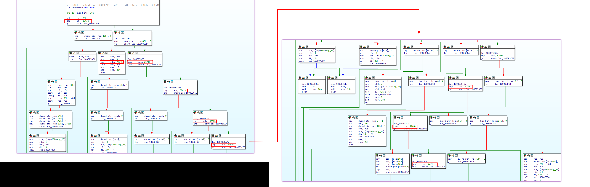

The gating conditions (each event checks the previous milestone's flag) spell out the exact
required order. After the first restoration, submit these six opcodes on six attacks:

| # | Opcode | Effect |
|---|--------|--------|
| 1 | `0x2C71` | Bind the storm to the gate |
| 2 | `0x0F42` | Open the tide sluice |
| 3 | `0x63B8` | Flood the epoch seal → **CURRENT_EPOCH_INVALID** |
| 4 | `0x51DE` | Withdraw the witnesses → **VOLUNTARY_QUORUM_LOST** |
| 5 | `0x37A5` | Present the acclamation → **ALTERNATIVE_ACCLAMATION_PRESENT** |
| 6 | `0x72C4` | Execute severance → **finale** |

The ladder also holds a **seventh** opcode, `0x44F1` (`DirectGateDecoy`) — the trap. It's
tempting because it flips the Registry gate straight to "open", but it only sets the *visual*
flag and never appends to the transcript, so `can_pass_gate()` still fails and the passage
reads **"access not certified."** Injecting it (or patching `gate_visual_open`) is a dead end.

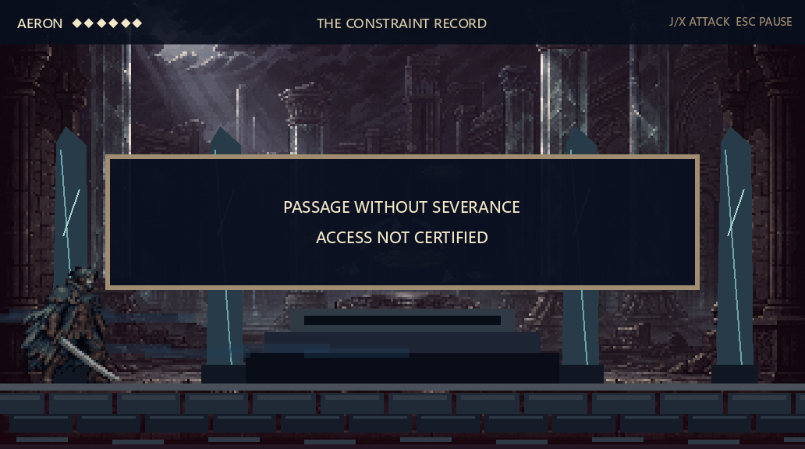

---

## 5. Live opcode substitution

Attach **Cheat Engine** to the running game (`Open Process → The Salt Crown.exe`).

### Keep Aeron alive

Cassian hits back and Aeron only has **6 HP** (the diamonds, top-left), so both the initial
depletion and the six substitution hits are easy to fail — freeze his health. But the HP is
**XOR-obfuscated in memory**: a scan for the displayed number (`3`) only matches the constant
`max_health`, and the real current-HP int sits near **1.39 billion** with its low bits
jumping around when it changes, so exact/decreased scans fail. Use an **unknown-value** hunt.
With CE attached, `New Scan` with Scan Type **"Unknown initial value"**, Value Type
**"4 Bytes"**:

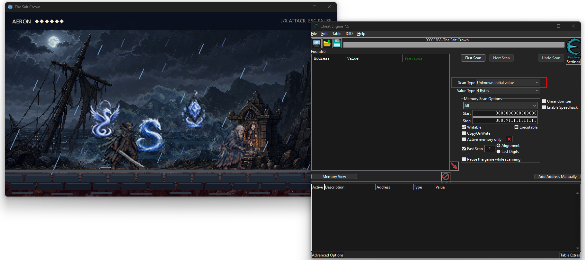

Take a hit (or let a heal move it), then `Next Scan` with **"Changed value"**. Repeat — HP
moved → `Changed value`, HP held → `Unchanged value` — until a handful of addresses remain.
The health one holds a large (~`1,396,788,3xx`) value, not a small number:

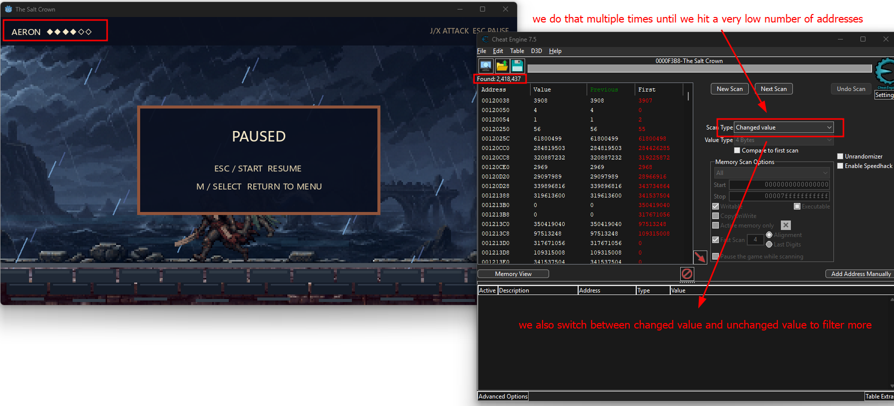
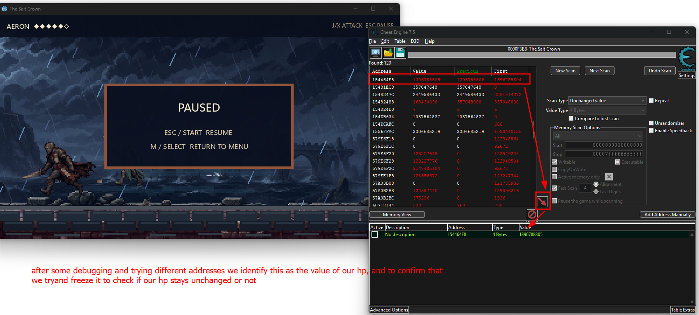

Add that address and tick its **freeze** box — Aeron is now unkillable while you work.
Changing HP never touches the opcode breakpoint (only *your* attacks call `submit_event`), so
you can take damage freely to narrow the scan:

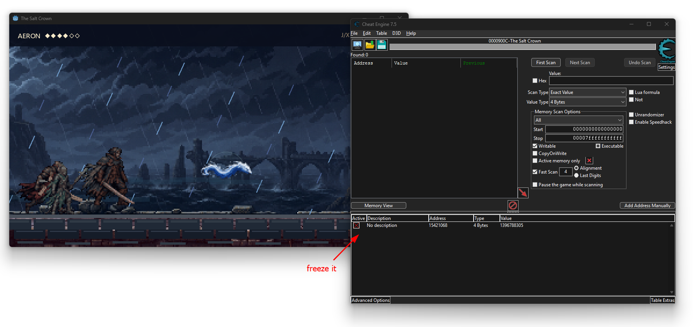

### Substitute the opcodes

Every landed hit calls `submit_event(0x19A3, dmg, 0)`. Break on `challenge_core...dll+0x3B50`
and, on six successive hits, rewrite `EDX` with the six opcodes in order. Substituted hits
skip the damage branch, so they're automatically non-lethal. (A ready Lua script,
`htb/ce_opcode_substitution.lua`, does the swaps.)

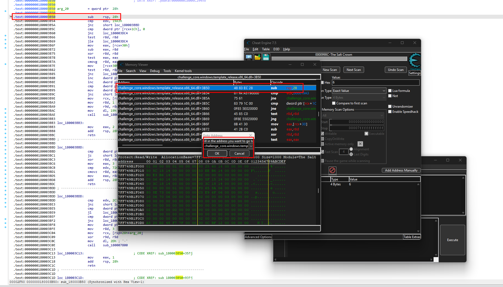
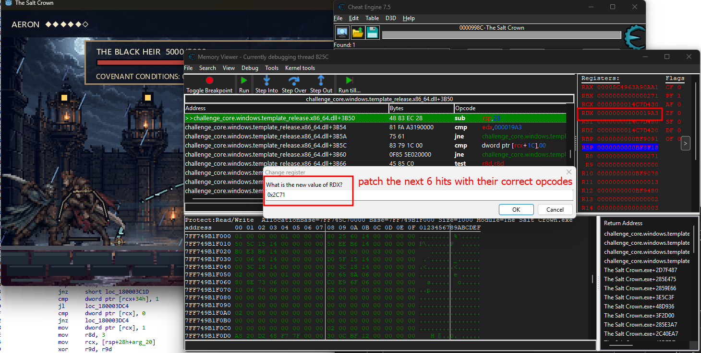

Each accepted event advances the covenant on screen — the epoch is exposed, the quorum
withdraws, the Drowned Assembly gives its acclamation, and the claim is severed:

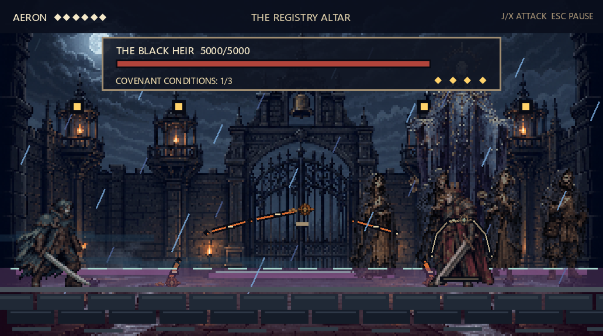
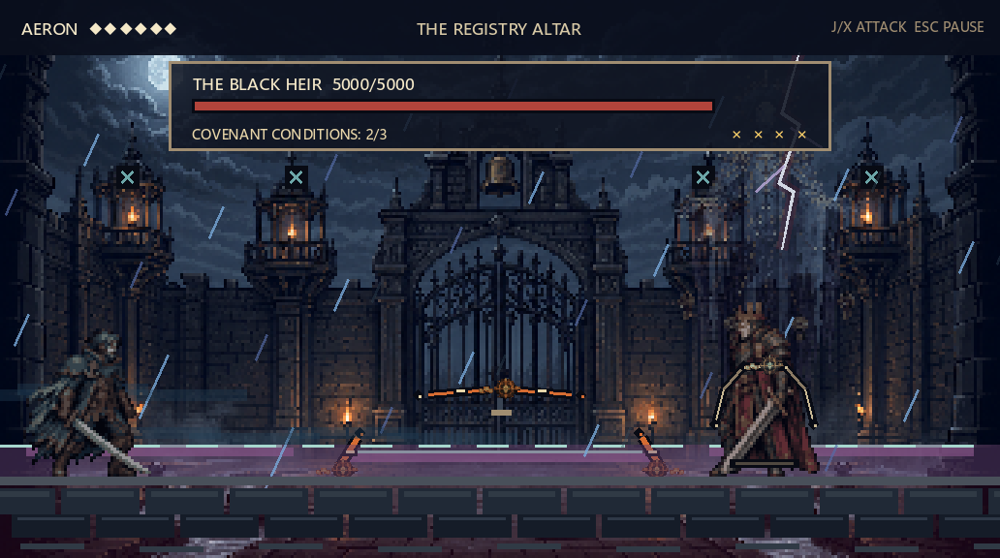
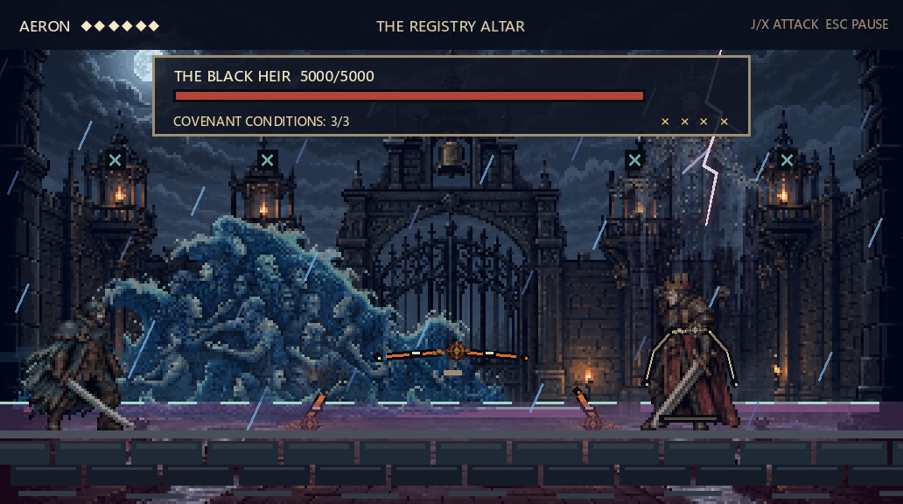
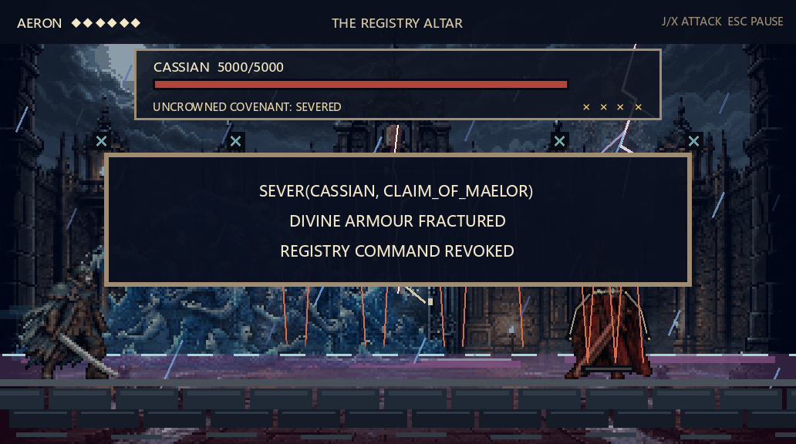


---

## 6. The flag

Advance the dialogue into **THE CONSTRAINT RECORD**. The native core reconstructs the
transcript-bound key, decrypts a 1,024-block AES-256-GCM drawing program, and rasterises the
flag stroke by stroke directly into the panel (test build shown — the real flag renders the
same way):

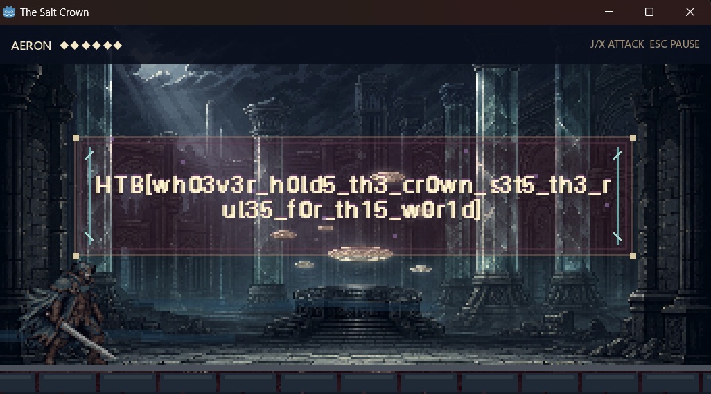

```
HTB{REDACTED}
```

---

## Appendix — automated solver

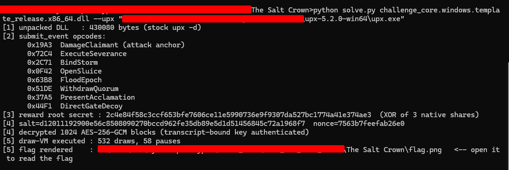
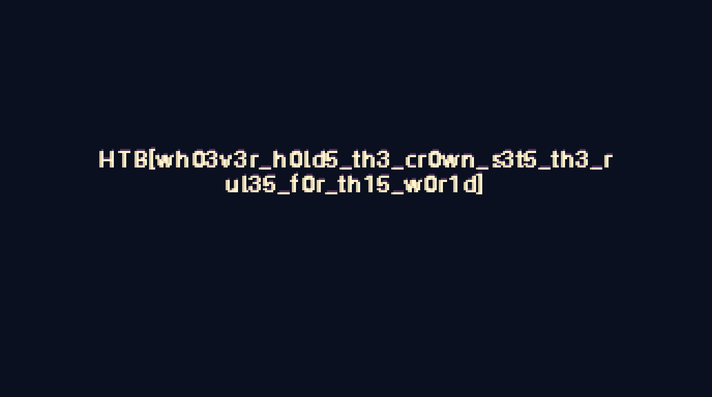
