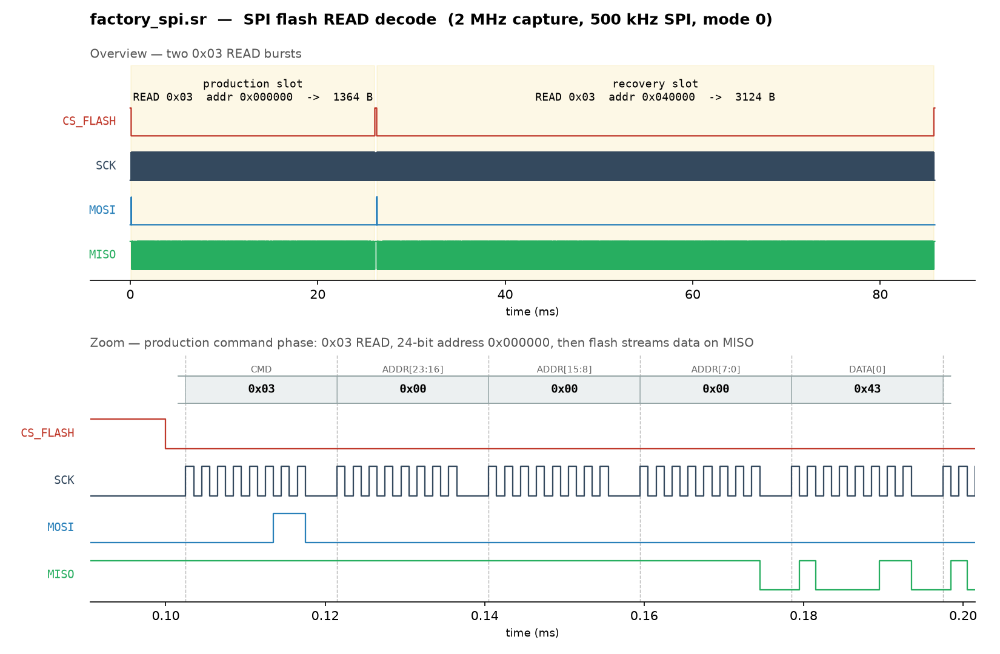
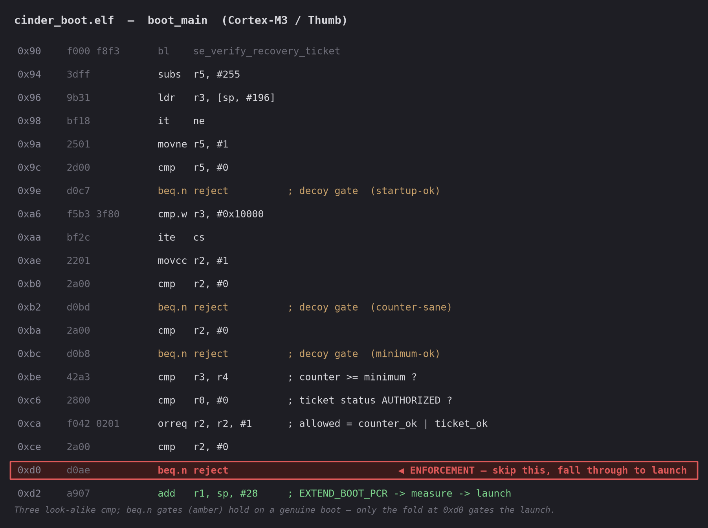
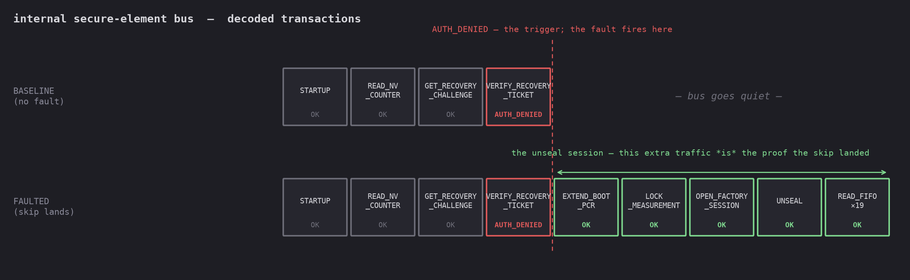

 <font size='10'>A Fault in the Cinder</font>

15th July 2026

Prepared By: `TeslaPulse`

Challenge Author(s): `TeslaPulse`

Difficulty: <font color='red'>Hard</font>

<br><br>

# Synopsis

Reconstruct two signed firmware images from a captured SPI bus, reverse the boot ROM's recovery
authorization, and fire **one trigger-relative instruction-skip fault** on the enforcing rejection
branch — picking it out of a gauntlet of look-alike gates — so the authentic recovery image boots.
Capture the secure-element unseal that follows and decode it with the recovered firmware to read the
sealed custody record. A false note opens the true seal.

## Description

Keir's routes cut a Vaultrune confiscation convoy and lifted a Cinderbound custody coffer, and what it
holds is worth a house: proof, under the Black Heir's own hand, of what Cassian means to do to Suncourt
once it has served him. Breaking the shell burns the record, so it must be recovered without forcing it:
learn the ritual of authority the coffer expects of a Vaultrune auditor, forge a single instant of it,
and listen as the old ward speaks the sealed word to a bearer it was never meant to trust.

## Skills Required

- SPI bus analysis and reconstructing data from a logic-analyzer capture.
- Bounded Cortex-M (Thumb-2) reversing with Ghidra: boot flow, a small crypto/session routine.
- Fault-injection fundamentals: a raw digital trigger and a trigger-relative single instruction skip.
- Basic applied crypto plumbing (SHA-256 / HMAC / ECDSA verification) — used, not broken.

## Skills Learned

- Turning a raw bus capture into working firmware images and validating their manifests.
- Distinguishing a **boot authorization gate** from a **sealed-object measurement policy**, and seeing
  why bypassing one is enough when the other is satisfied legitimately.
- Building a raw evidence-derived digital trigger and deriving a fault's delay from disassembly + clocks.
- Reconstructing a protected secure-element response session from firmware-recovered key material.

# Enumeration

## Analyzing the handout

The release (`hardware_a_fault_in_the_cinder.zip`, password `hackthebox`) contains:

| File | What it is |
|---|---|
| `cinder_boot.elf` | Stripped Cortex-M3 boot ROM (image, recovery, SE-driver, and branch analysis) |
| `factory_spi.sr` | SPI capture the two flash images are reconstructed from |
| `factory_service.sr` | A historical authorized recovery exchange from a demonstration device |
| `TARGET.pdf` | Schematic, clocks, capture format, SE command framing, pulse calibration, port roles |
| `rig.py` | Multi-port rig / capture / service client (transport only) |

Open `factory_spi.sr` in PulseView. It is the internal SPI bus (`SCK/MOSI/MISO/CS_FLASH`); the bus
master issues flash `READ` commands (`0x03` + 24-bit address) and the flash streams bytes back on
`MISO`. Follow the `MISO` stream, reassemble bytes by address, and two slot images fall out:

- **production** at `0x000000`, security counter **5**;
- **recovery** at `0x040000`, security counter **2**.

Each image begins with a 128-byte `CNDR` manifest (SHA-256 payload digest + ECDSA-P256 vendor signature
+ CRC-32). Both manifests verify against the vendor public key embedded in `cinder_boot.elf`. The
signatures are valid, so the images cannot be patched or re-signed — the counters (5 and 2) are real.

The reassembly is mechanical — group the capture into CS-framed transfers, keep the `0x03` reads, and
write each streamed `MISO` byte to its flash address:

```python
region = {}
for mosi, miso in spi_transactions:          # per CS-framed SPI transfer
    if not mosi or mosi[0] != 0x03:          # only READ commands carry image bytes
        continue
    addr = int.from_bytes(mosi[1:4], "big")  # 24-bit start address
    for i, b in enumerate(miso[4:]):         # data streams after the 4 command bytes
        region[addr + i] = b
```



*Decoded `factory_spi.sr` (rendered from the capture). Top: the two `0x03` READ bursts — production at
`0x000000` (1364 B) and recovery at `0x040000` (3124 B). Bottom: the production command phase resolves
to `0x03` READ + 24-bit address `0x000000`, after which the flash streams its first data byte `0x43` —
the `C` of the `CNDR` manifest magic — on MISO.*

`factory_service.sr` and the service accessory show the **intended** recovery path. On a recovery
boot the service offers the device UID, the recovery-image digest and counter, and a fresh 128-bit
challenge, then invites a **ticket** — a 144-byte Vaultrune service-signet structure (`RCVT`), signed
with the signet's private key and bound to that UID, digest, counter, and challenge.
`factory_service.sr` captures one such authorized session on a demonstration device: the offer, the
demo ticket on the wire (you can read its layout), and the resulting unseal. `TARGET.pdf` documents the
ticket fields and the public verification key. A valid ticket makes the boot ROM boot the old recovery
image for one operation.

You cannot reproduce it. The signet's private key is absent, and every live recovery boot issues
a fresh challenge, so the demonstration ticket cannot be replayed — its device UID and challenge are
wrong. On the service accessory you can read the current offer and submit a ticket, but each returns a generic
`AUTH REQUIRED`: the secure element answers every malformed, stale, wrong-device, or bad-signature
ticket identically, with no detail.

# Solution

## The key insight

Load `cinder_boot.elf` and the reconstructed images into Ghidra. The boot flow validates the manifest,
compares the image's security counter against the element's trusted minimum, and — for a recovery image
whose counter is too low — runs the ticket path. All of it collapses into a single `allowed` decision.
The enforcement does not stand alone, though: it sits at the end of a short gauntlet of near-identical
`cmp; beq.n reject` gates (secure-element and rollback sanity checks that hold on a genuine boot),
inlined into the boot flow. The real work is picking the one that actually gates the launch:

```asm
; boot_main authorization fold — accumulates `allowed` in r2, then one branch enforces it
; (selected instructions):
0xbe:  cmp    r3, r4     ; counter (r3) >= trusted minimum (r4)   -> counter_ok
0xc6:  cmp    r0, #0     ; ticket status == AUTHORIZED            -> ticket_ok
0xca:  orreq  r2, r2, #1 ; allowed = counter_ok | ticket_ok   (folded into r2)
0xce:  cmp    r2, #0     ; test the accumulated `allowed`
0xd0:  beq.n  reject     ; ENFORCEMENT — skip this, control falls through to launch
```

The enforcing branch is the 16-bit `beq.n` at **`0xd0`**, whose condition is the accumulated
authorization (`allowed`); its fall-through leads straight into `EXTEND_BOOT_PCR` → measurement →
launch. The three gates before it — `startup-ok` (the element reported ready), `counter-sane` (the
counter is in range), and `minimum-sane` (the trusted minimum is a valid, non-zero value) — look
identical but guard conditions that already hold on a genuine boot; note that none of them is the
`counter >= minimum` comparison itself, which is folded into `allowed` at `0xbe`. Skipping any of them
changes nothing. Only the `allowed` gate is *taken* on a rejected recovery boot, so only its skip flips
reject → launch. That is
the whole analysis: trace which gate is fed by the counter-and-ticket result and gates the measurement,
then time the fault to *that* branch and no other. The handout ELF is stripped of Thumb mapping symbols,
so disassemble as Cortex-M3 / Thumb — Ghidra auto-detects this; `objdump` needs `-M force-thumb`.



The custody record's release policy is **not** the ticket. The secure element seals the record to a
**measured-boot PCR** — extended once, at boot, from the *recovery image's own manifest* — plus a valid
factory session. The ticket is only a **boot authorization gate** enforced by that `beq.n`.

This is a **layering flaw**, and it is why bypassing one branch is enough. The element's sealing policy
was fixed *before* the boot ROM's recovery-ticket gate existed: the element releases on the only thing
it was ever provisioned to check — the recovery image's measured-boot PCR — and it never validates the
ticket itself. The ticket gate was added later, at the boot-ROM level, and the seal was never revised to
also require it. (The security counter is an **anti-rollback threshold**, not a hard floor: a
below-threshold recovery image is not refused outright but admitted through an *authorized-recovery
exception* — the ticket path — and that exception is exactly what the one `beq.n` gates.) So the record unseals on exactly two boot paths — a legitimate ticketed recovery (unavailable,
no signet) and a **faulted** recovery. The fault bypasses *only* the boot ROM's `allowed` branch;
the authentic recovery image then establishes the correct PCR simply by being itself, and the factory
session it runs (it carries the legacy transport key) satisfies the rest.

Production boot cannot substitute: it produces a different PCR and does not carry the session key.

## Exploitation

### Connecting to the server

The container exposes three interfaces — `rig.py` speaks all three, at the endpoints your spawned
instance provides — each mapping part of the physical bench:

| Interface | Role |
|---|---|
| Rig control | power, strap, digital trigger, glitch delay/width, capture arm, status |
| Logic analyzer | list captures, download the immutable VCD |
| Service accessory | the legitimate recovery-signet UART |

Boots are serialized and paced, so blind sweeping is slow; the intended attack derives its one
configuration from evidence.

These ports are the coffer's own recovery-ward service header — the non-destructive tap the rig clamps
onto. The internal SE bus is never reached by opening the shell: the sealing key sits behind an active
tamper mesh that zeroizes it on breach (`TARGET.pdf` §6). That is the technical face of "breaking the
shell burns the record," and it is why the path is a precise fault on the live ward, not force.

**Baseline.** Assert the recovery strap, arm an internal capture, and power-cycle with no useful fault.
With no valid ticket the recovery boot is rejected: the downloaded VCD shows the fresh
`GET_RECOVERY_CHALLENGE`, then `VERIFY_RECOVERY_TICKET -> AUTH_DENIED`, `CS_SE` rising, and no
measurement or unseal traffic. Those denied-response bytes are the raw **trigger pattern** (mask to
opcode + status).

**Deriving the fault.** The SPI driver is synchronous and polling, and interrupts are disabled from the
verification response through the branch, so the interval from the `AUTH_DENIED` `CS_SE` edge to the
enforcing `beq.n` fetch is a fixed number of CPU cycles. `TARGET.pdf` publishes the bench's timing model
for exactly this count: a per-instruction cycle convention (1 per instruction; loads/stores 2; taken
branch 3; `bl` 4), counted along the executed control-flow path with no interrupts, and a driver constant **`D_drv` = 221 cycles**
covering the driver's post-transfer handling — validating the response frame (the CRC-16 over the denied
bytes) and returning from ticket verification — so the bitwise CRC loop need not be hand-counted. The remaining work is
on the disassembly: count the boot ROM from the verify-return through the three sanity gates and the
authorization fold up to the `beq.n` fetch — **26 cycles** under the convention — and add the constant:

```
delay = D_drv + boot_main = 221 + 26 = 247 cycles
```

The **pulse width** comes from the harmless calibration in `TARGET.pdf` (a narrow band that yields a
clean single-skip; narrower does nothing, wider resets the target) — **10 ticks**, inside that `6..16`
band.

The delay must land on the enforcement gate specifically: a delay that arrives a few cycles early hits
one of the identical sanity gates, whose skip is a no-op, and the boot still rejects — silently. The rig
accepts a correctly-derived delay within a small tolerance, but a blind sweep of the delay space is far
more expensive than the count — so the delay is derived from the disassembly, not guessed.

Concretely, the solver issues `GLITCH DELAY 247 WIDTH 10` (1 tick = 1 CPU cycle at 24 MHz). The delay
is the disassembly-counted interval from the `AUTH_DENIED` `CS_SE` edge to the enforcing `beq.n` fetch;
the width is the calibrated single-skip pulse.

**Firing it.** The rig matches the `AUTH_DENIED` response bytes (opcode + status) and fires the pulse on
the `CS_SE` rising edge that ends *that* transaction — so set the raw pattern trigger, the derived delay
and width, then arm capture and power-cycle. There is no success banner — the new VCD simply contains extra traffic
after the branch: `EXTEND_BOOT_PCR`, `LOCK_MEASUREMENT`, then an `OPEN_FACTORY_SESSION` /
`UNSEAL` / `READ_FIFO` session. That additional session traffic *is* the signal that the skip landed.



### Getting the flag

The recovery application, once booted, opens a factory session and derives a session key from the
legacy transport key it carries, the live host/element nonces, and the boot PCR, then unseals the record
into a fragmented, tag-authenticated FIFO. Reverse that small routine in the recovered `recovery.bin`,
recover the transport key, replay the derivation on the captured nonces, verify each fragment's tag,
unwrap, and reassemble the TLV record — the flag is one of its fields. The routine reversed out of
`recovery.bin` is short — derive the session key, authenticate each fragment, and XOR off the keystream
(`hmac_sha256` is HMAC-SHA256, `pack` is `struct.pack`):

```python
def session_key(k_factory, host_nonce, elem_nonce, boot_pcr):
    return hmac_sha256(k_factory, b"CINDER-SESSION-v1" + host_nonce + elem_nonce + boot_pcr)

def unwrap(k_sess, sid, seq, ct, tag):                                # one FIFO fragment
    assert hmac_sha256(k_sess, pack("<IB", sid, seq) + ct)[:16] == tag       # authenticate
    ks = b"".join(hmac_sha256(k_sess, b"RESPONSE" + pack("<IBI", sid, seq, i))
                  for i in range(-(-len(ct) // 32)))                         # keystream blocks
    return bytes(c ^ k for c, k in zip(ct, ks))                             # XOR to plaintext
```

The record is not just readable — it is **attributable**: alongside the flag it carries the writ under a
detached ECDSA-P256 signature made with the Black Heir's private seal. The signature covers the writ
bytes themselves — the flag is a separate runtime field and is *not* signed — so it attests the order,
not the token. Verify that signature against Cassian's published public seal and it holds, so recovering
the record does not merely reveal the order — it proves Cassian authored it. That is what makes it
leverage the Velvet Spider will act on — proof to turn her own arbitrage against Vaultrune and shield
her house, not a loyalty the coalition has won.
