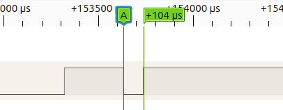
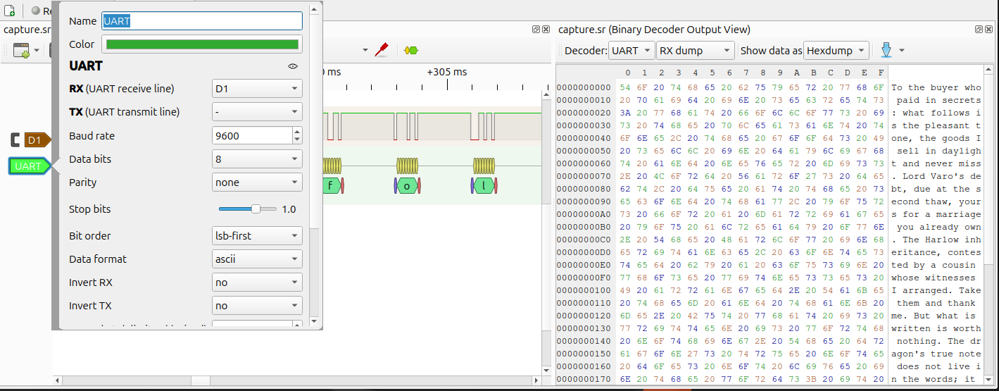
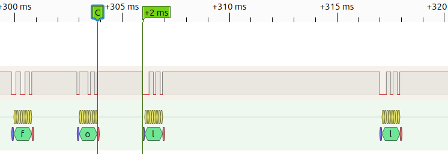
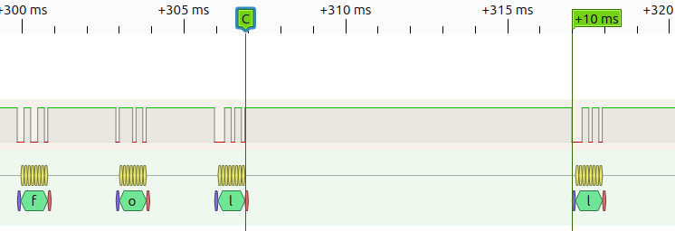
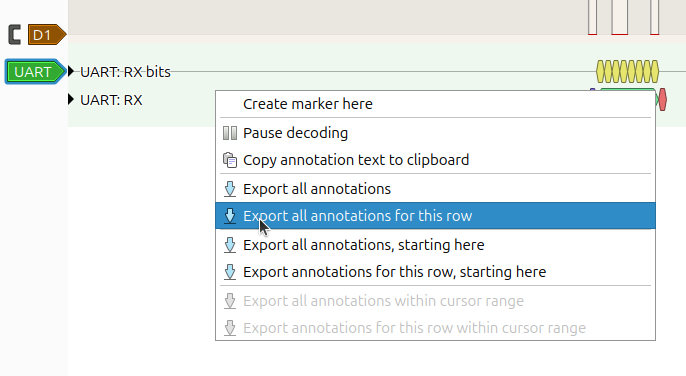
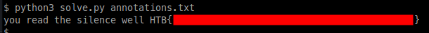

 <font size='10'>Cadence in the Cord</font>

2026-07-09

Prepared By: `TeslaPulse`

Challenge Author(s): `TeslaPulse`

Difficulty: <font color='green'>Easy</font>

<br><br>

# Synopsis

A captured UART line carries a readable decoy message; the real payload — a short preamble plus the
flag — is hidden in the *durations of the silences between bytes* (short gap = `0`, long gap = `1`,
eight gaps per character, MSB-first). Recover the timing channel and read the `HTB{...}` from the
decoded text.

## Description

With the Brine Signet shattered, every house hunts whatever might make its story law. Lady Seralyne —
the Velvet Spider of Suncourt — sells what she claims is the dragon's true note: not the lost thing
itself, only a counterfeit cadence arranged to be believed, and a wavering house is ready to buy it as
proof its claim rings true. We cut one of her sendings from the wire first. Read the pleasant words;
then attend to the silences between them, and expose the forgery she is truly selling.

## Skills Required

- Opening a logic-analyzer capture in sigrok / PulseView.
- Basic UART decoding (9600 8N1).
- Light scripting to turn per-byte timings into bits.

## Skills Learned

- Recognising a **timing side-channel**: information encoded in inter-byte gap *durations* rather than
  in the byte values themselves.
- Turning a physical-layer observation into a small extraction script — clustering the gaps by
  duration, deriving a threshold from the data (not hard-coding it), and assembling bits MSB-first.

# Enumeration

## Analyzing the capture

The release (`hardware_cadence_in_the_cord.zip`, password `hackthebox`) contains a single file:

- `capture.sr` — the intercepted UART capture: one logic channel (the data line) sampled at **2 MHz**.

Open it in PulseView. The line idles high and toggles in bursts — a serial line. To fix the baud rate,
drop two cursors on the narrowest pulse (one bit-time) and read its width: ~104 µs, so the baud is
1 / 104 µs ≈ **9600**.



Add PulseView's **UART** decoder on the channel at **9600 8N1** and the bytes decode cleanly to a short
letter from Seralyne — a smug ledger of debts, a contested inheritance, arranged witnesses. It reads
like the prize, but it is worthless, and it says so.



# Solution

## The key insight

The letter itself points past the words:

> *"what is written is worth nothing … the dragon's true note does not live in the words; it lives in
> the rests between them. A long rest raises the mark to one, a short rest lets it fall to nothing;
> count eight rests to every letter …"*

That is the whole scheme, in character: the payload is a **timing channel** in the inter-byte gaps —
**long = 1, short = 0**, **eight gaps per character**, MSB-first. Nothing is hidden in the byte
*values*; only in the silences between them. Recognising the channel is by eye; pulling all ~74
characters out by hand is not — that is what the solver is for.

## Exploitation

### Getting the flag

1. **Measure the gaps.** For each adjacent pair of bytes, measure the idle time between them — from the
   stop-bit edge of one byte to the start-bit edge of the next. (The 8N1 frame is 10 bits, a constant
   10 / 9600 ≈ 1.04 ms, so measuring start-to-start and subtracting one frame time is equivalent.) The
   gaps fall into two tight, well-separated clusters: **~2 ms** (a short rest, bit `0`) and **~10 ms**
   (a long rest, bit `1`). The message is transmitted once, so there is no long inter-repeat idle in
   the capture.

   

   

2. **Threshold and assemble.** Put the decision threshold in the empty band between the ~2 ms and
   ~10 ms clusters — derive it from the data so it tolerates real-hardware jitter rather than assuming
   exact values. Map short → `0`, long → `1`, then take the gaps eight at a time (one character each),
   MSB-first, and ASCII-decode. For example, the first eight gaps are:

   ```
   short  long  long  long  long  short  short  long
     0     1     1     1     1     0      0      1     →  0b01111001  →  0x79  →  'y'
   ```

   Working through all 592 gaps (74 characters) this way yields a short in-character preamble followed
   directly by the flag token (the trailing `HTB{...}`).

3. **Automate it.** Nobody hand-reads ~592 gaps — let the decoder split the stream into bytes and let a
   short script measure the silences between them. You already added the **UART decoder** above; now
   export its annotations: right-click the decoder's trace and choose *Export all annotations for this
   row*, saving the file as `annotations.txt`.

   

   Each decoded byte becomes three lines — its start bit, the character, and its stop bit — each tagged
   with sample positions:

   ```
   4001195-4001404 UART: RX: Start bit
   4001403-4003071 UART: RX: T
   4003070-4003279 UART: RX: Stop bit
   ```

   The decoder has already done the UART framing, so the script just takes each byte's start position
   and turns the gaps between bytes into text:

   ```python
   #!/usr/bin/env python3
   # cadence_in_the_cord — the flag is hidden in the gaps between the UART bytes.
   # Input: PulseView UART-decoder annotations, e.g. "4001403-4003071 UART: RX: T".
   import sys

   # 1. Collect the start sample of every decoded byte (skip the Start bit / Stop bit rows).
   starts = []
   for line in open(sys.argv[1]):
       value = line.split("UART: RX: ")[1].strip()     # the decoded byte, e.g. "T" or " "
       if value not in ("Start bit", "Stop bit"):
           starts.append(int(line.split("-")[0]))      # the sample number before the first "-"

   # 2. Each gap to the next byte is one bit: short gap = 0, long gap = 1.
   gaps = [starts[i + 1] - starts[i] for i in range(len(starts) - 1)]
   threshold = (min(gaps) + max(gaps)) / 2             # halfway between the short and long gaps
   bits = [1 if gap > threshold else 0 for gap in gaps]

   # 3. Read the bits 8 at a time (most-significant first) as ASCII characters.
   message = ""
   for i in range(0, len(bits), 8):
       eight_bits = "".join(str(bit) for bit in bits[i:i + 8])
       message += chr(int(eight_bits, 2))

   print(message)                                       # the preamble, then the HTB{...} flag
   ```

   ```bash
   python3 solve.py annotations.txt
   ```

   **What the script is doing** — the annotation export is the decoder's own output: for every byte it
   found, the sample range of the start bit, the decoded character, and the stop bit. The character
   values are the decoy cover text; the payload is purely in *when* the bytes arrive:

   1. **Take each byte's position.** Keep the data-byte lines (skip `Start bit` / `Stop bit`); the
      leading number on each is that byte's start sample. No sample rate is needed — sample counts are
      time, and only the relative spacing matters.
   2. **Measure the silences.** The spacing from one byte's start to the next is one constant 8N1 frame
      plus the idle rest, so in absolute terms the two clusters sit near **~3 ms** and **~11 ms** (the
      bare ~2 / ~10 ms rests plus that fixed frame). The frame offset is identical for every byte, so it
      shifts both clusters equally and never affects the decision — the midpoint between the smallest and
      largest spacing still separates them cleanly: short → `0`, long → `1`.
   3. **Reassemble.** Eight gaps per character, MSB-first, decoded as ASCII, yields the hidden stream:
      the preamble followed by the flag.

   

   
