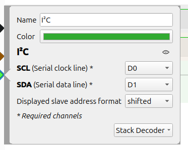
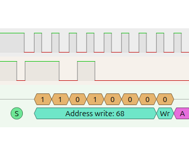
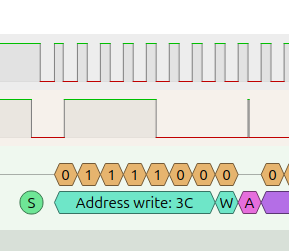
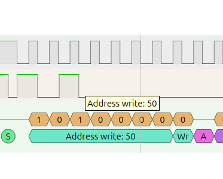
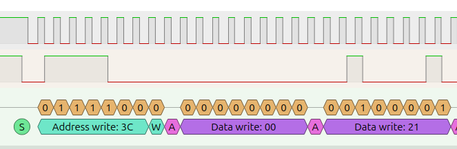
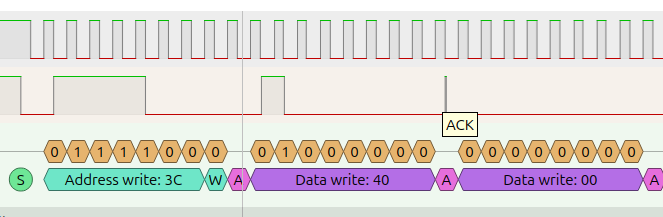
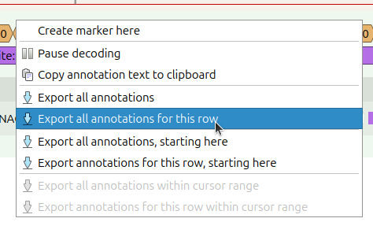
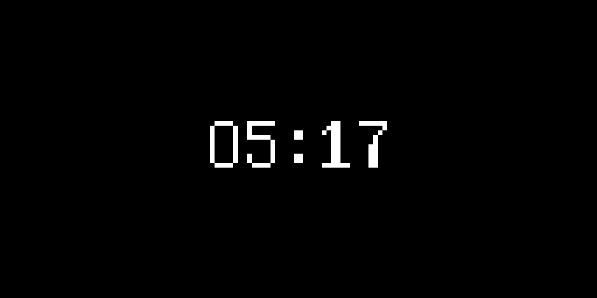
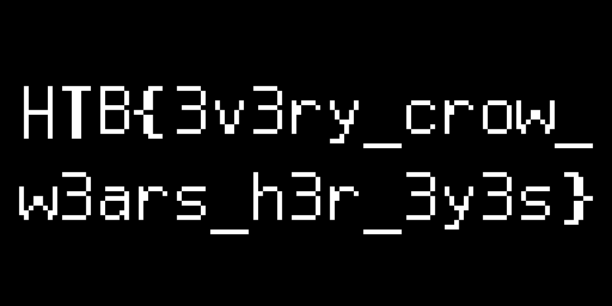

 <font size='10'>What the Shard Displayed</font>

13<sup>th</sup> July 2026

Prepared By: `TeslaPulse`

Challenge Author(s): `TeslaPulse`

Difficulty: <font color='orange'>Medium</font>

<br><br>

# Synopsis

A shared-bus I²C capture holds writes to an SSD1306 OLED plus two decoy devices. Demultiplex by
address and direction, isolate the display writes, split them into commands vs. pixel data by the
control byte, reassemble the display's framebuffer (vertical page-packing), and render it — the flag
is read directly off the reconstructed frame.

## Description

The Signet shattered, the great houses fell to arguing with steel, and Alyss, Queen of Quiet Marches,
began sending her dead to watch the living. One of her crows fell over our winter line, a maker's device
bound beneath its wing — an eye she threaded through dead flesh to count our banners. Fed a current, it
still wakes: it checks its roost, marks the hour it last saw us, and paints what it saw onto its pane.
Reconstruct it, and learn what her eye found of us before the Hollow Host moves.

## Skills Required

- Reading a logic-analyzer capture (sigrok / PulseView).
- I²C decoding: addressing and read/write direction.
- Familiarity with (or willingness to learn) SSD1306 display data flow.

## Skills Learned

- Demultiplexing a **shared I²C bus** by address and direction; recognising decoy devices.
- Separating SSD1306 **command vs. data** by the control byte (`0x00` vs `0x40`).
- Reconstructing an SSD1306 **framebuffer** honouring vertical page-packing (LSB = top) and rendering
  it to an image.

# Enumeration

## Analyzing the capture

The release (`hardware_what_the_shard_displayed.zip`, password `hackthebox`) contains a single file:

- `capture.sr` — the captured I²C bus (SDA + SCL) of the crow's device.

Open it in PulseView and add the **I²C** decoder, pointing its SCL/SDA inputs at the two captured
channels (the constantly-toggling line is the clock, SCL; if you guess wrong the decode is garbage, so
swap them). The bus runs at **100 kHz**. Three devices appear:

| Address | Direction | Device | Role |
|---|---|---|---|
| `0x3C` | written | SSD1306 OLED | the pane — **carries the flag** |
| `0x50` | read | AT24C32 EEPROM | roost-manifest — decoy |
| `0x68` | read | DS3231 RTC | sighting-hour — decoy |

The traffic falls into **five short bursts**, a few milliseconds apart, in the order the device boots:
it wakes the pane and paints a **sigil**, reads the **RTC** and paints a **clock** frame,
consults the **EEPROM** manifest, and finally paints the **flag** — that is,
`sigil write → RTC read → time write → EEPROM read → flag write`.









# Solution

## The key insight

Dismiss the decoys first — and dismiss them by **address and direction**, not by their contents. The
EEPROM read (`0x50`) returns opaque high-entropy bytes (an encrypted-looking manifest); the RTC read
(`0x68`) decodes to a plausible pre-dawn timestamp on an early-February date — its BCD year byte reads
`00` (a DS3231's stale, never-calibrated clock, i.e. 2000). Both are ordinary peripheral *reads*;
neither is the display, so neither carries the flag. The intelligence rides only in the **writes to
`0x3C`**.

Every write to `0x3C` is `[control byte][payload…]`, and the control byte discriminates:

- `0x00` → the payload is **commands** (the display init and addressing setup — discard),
- `0x40` → the payload is **pixel data** bound for display RAM (keep).

The driver streams the picture in small chunks (16 data bytes each), every chunk prefixed by its own
`0x40`, so the data must be **reassembled across chunks**, in order.






## Exploitation

### Getting the flag

You already added the **I²C decoder** in Enumeration; now export what it decoded — right-click the
decoder's **Address/Data** row and choose *Export all annotations for this row*, saving the file as
`annotations.txt`. Every transaction is written out as its address line followed by each byte on the
wire (the `Write` and `ACK` lines are bus housekeeping, which the script ignores):

```
1353214-1353361 I²C: Address/Data: Address write: 3C
1353361-1353382 I²C: Address/Data: Write
1353382-1353403 I²C: Address/Data: ACK
1353403-1353572 I²C: Address/Data: Data write: 00
1353572-1353593 I²C: Address/Data: ACK
1353593-1353761 I²C: Address/Data: Data write: AE
```



The decoder has already recovered the bus, so the script only has to keep the writes to the display,
peel off the control byte, reassemble the pixel data across the chunks, and unpack it into an image:

```python
#!/usr/bin/env python3
# what_the_shard_displayed - reconstruct the OLED frames from the I2C bus.
# Input: PulseView I2C-decoder annotations (the "Address write" / "Data write" lines).
# Output: one PNG per frame; the flag is legible on the flag frame (read it off there).
import re, sys
from PIL import Image

OLED_ADDR = 0x3C          # the SSD1306 display; 0x50 (EEPROM) and 0x68 (RTC) are decoys
W, H = 128, 64

# 1. Walk the transactions; keep the data bytes of each WRITE to the display.
writes, current = [], None
for line in open(sys.argv[1]):
    addr = re.search(r"Address (write|read): ([0-9A-Fa-f]+)", line)
    data = re.search(r"Data write: ([0-9A-Fa-f]+)", line)
    if addr:                                      # a new transaction starts
        to_oled = addr.group(1) == "write" and int(addr.group(2), 16) == OLED_ADDR
        current = [] if to_oled else None
        if current is not None:
            writes.append(current)
    elif "Stop" in line:
        current = None
    elif data and current is not None:
        current.append(int(data.group(1), 16))

# 2. Each write is [control byte][payload]. 0x40 = pixel data (reassembled across the 16-byte
#    chunks); 0x00 = commands, and a column-window reset (0x21) marks the boundary between frames.
frames, pixels = [], bytearray()
for data in writes:
    if not data:
        continue
    control, body = data[0], data[1:]
    if control == 0x40:
        pixels.extend(body)
    elif control == 0x00 and 0x21 in body and pixels:
        frames.append(bytes(pixels)); pixels = bytearray()
if pixels:
    frames.append(bytes(pixels))

# 3. Unpack each 1024-byte framebuffer and render it. Horizontal addressing packs the display as
#    128 columns x 8 pages; each byte is a vertical run of 8 pixels, LSB = top:
#        pixel(x, y) = bit (y % 8) of buf[(y // 8) * 128 + x]
for i, buf in enumerate(frames):
    img = Image.new("1", (W, H))
    for y in range(H):
        for x in range(W):
            img.putpixel((x, y), (buf[(y // 8) * W + x] >> (y % 8)) & 1)
    img.resize((W * 8, H * 8), Image.NEAREST).save("frame_%d.png" % i)
    print("frame %d: %d bytes -> frame_%d.png" % (i, len(buf), i))

print("Open the PNGs; the flag is the frame in HTB{...} form (not the sigil or the 05:17 clock).")
```

```bash
pip install pillow
python3 solve.py annotations.txt
```

Three frames come out, in boot order — the decoy **sigil** (Alyss's watching eye), a decoy
**clock** readout (`05:17`), and the **flag frame**:






The two decoy frames earn their place as a **free correctness check**: if the sigil renders as a clean,
recognisable eye and the clock reads a legible `05:17`, then your page order and LSB-at-top unpacking are
correct — so the flag frame the *same* parser produced is trustworthy, and you can read the flag straight
off it. If instead a band comes back mirrored or the rows are shuffled, the sigil and clock will show it
first, before you ever squint at the flag.

**What the script is doing** — the annotation export is the decoder's own output: for every I²C
transaction, its address (with read/write direction) and each data byte. Everything after that is
plain bookkeeping:

1. **Keep the display writes.** Track the current transaction's address and collect data bytes only
   while it is a *write to `0x3C`*. The reads from `0x50` (EEPROM) and `0x68` (RTC) are the decoys and
   are dropped.
2. **Split control from pixels.** The first data byte of each write is the control byte: `0x40` marks
   pixel data (reassembled across the 16-byte chunks), `0x00` marks commands, and a column-window reset
   (`0x21`) after a full data run marks the boundary between frames.
3. **Unpack and render.** Horizontal addressing packs the display as 128 columns × 8 pages, each byte a
   vertical run of 8 pixels with the **LSB at the top**:

   ```
   pixel(x, y) is set  ⇔  bit (y mod 8) of buf[(y // 8) * 128 + x] is 1
   ```

   Worked through a single byte — the sigil frame's `buf[435]` is `0xFC`. Index 435 lands in **page 3**
   (`435 // 128`) at **column x = 51** (`435 % 128`), so that one byte paints the eight pixels from
   y = 24 to y = 31 in that single column, least-significant bit at the top:

   ```
   buf[435] = 0xFC = 0b11111100

     bit 0  ->  y = 24   0   ·
     bit 1  ->  y = 25   0   ·
     bit 2  ->  y = 26   1   █
     bit 3  ->  y = 27   1   █
     bit 4  ->  y = 28   1   █
     bit 5  ->  y = 29   1   █
     bit 6  ->  y = 30   1   █
     bit 7  ->  y = 31   1   █
   ```

   That LSB-at-the-top ordering is the part that catches people out — flip it and every 8-pixel band
   comes back mirrored. Do the same for all 1024 bytes and the picture appears.

