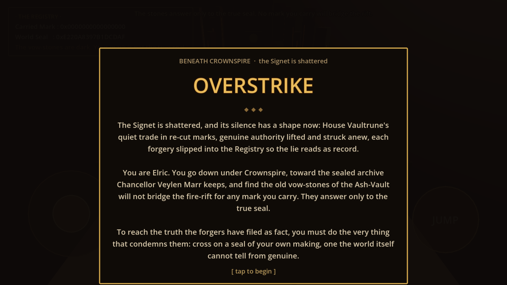
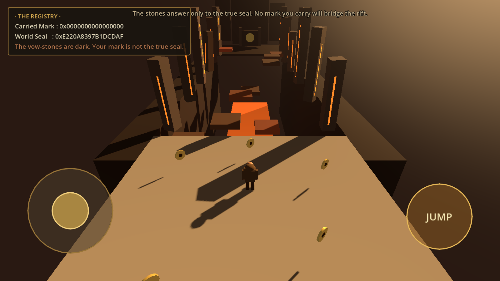
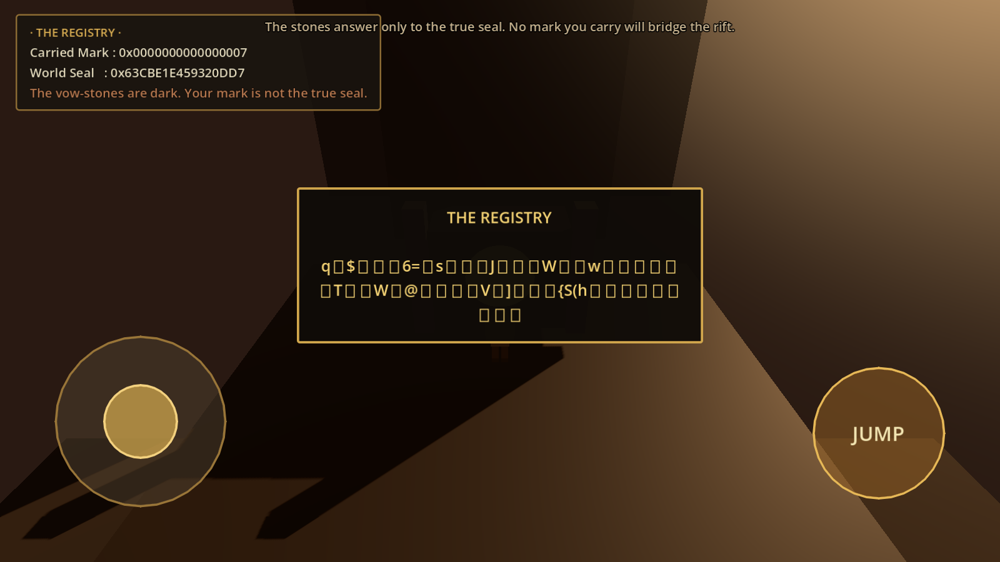
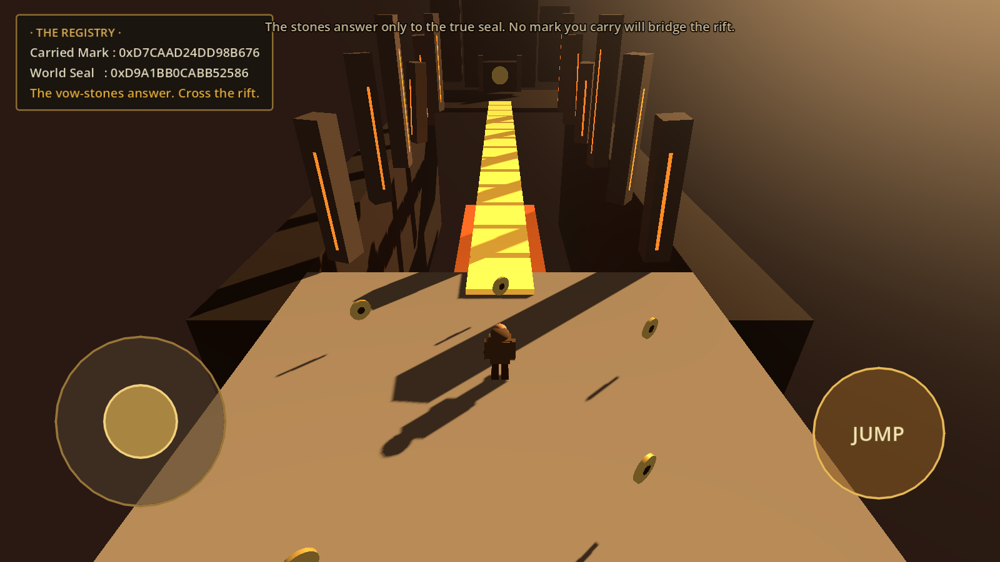
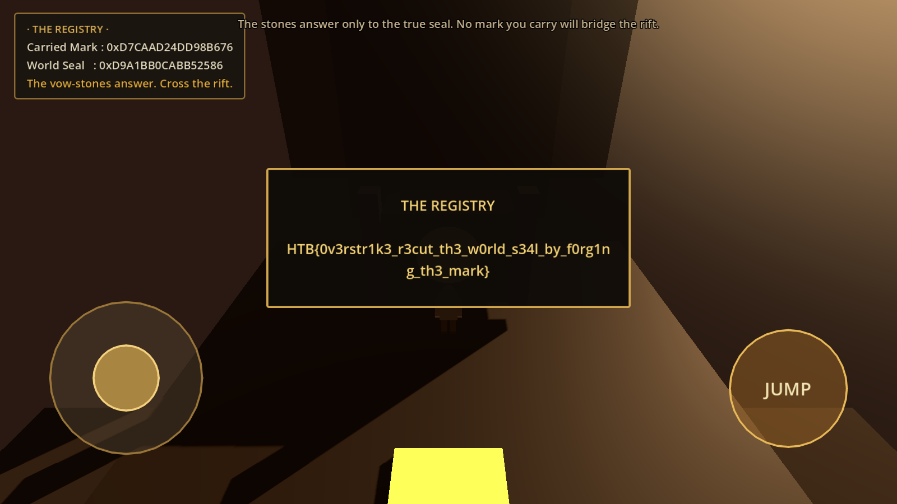

<br>

<br>

<font size='5'>Overstrike</font>

15<sup>th</sup> July 2026

Prepared By: lawbyte

Challenge Author: lawbyte

Difficulty: <font color='green'>Easy</font>

<br>

<br>

<br>

## Synopsis

Overstrike is an Easy reversing challenge built as a small Android game. Players get one APK and nothing else. The game runs on Godot Mono, so the game code is C# compiled into a .NET assembly inside the package. The player has to find that assembly, decompile it, and recover a 64-bit value the game never shows on screen.

The challenge maps to OWASP Mobile Top 10 M7: Insufficient Binary Protections. Every rule that decides the win lives on the client, and the flag ships in the binary next to the code that decrypts it. The game leans on that by dangling a value called the world seal in the HUD. Patching it does nothing, because the game recalculates it from a second value on every frame. The function that links the two is `splitmix64`, which is reversible, so exactly one input produces the seal the game wants. That input is also the decryption key for the flag.

## Description

The Signet is shattered, and its silence has a shape now: House Vaultrune's quiet trade in re-cut marks, genuine authority lifted and struck anew, each forgery slipped into the Registry so the lie reads as record. Elric goes down under Crownspire, toward the sealed archive Chancellor Veylen Marr keeps, and finds the old vow-stones of the Ash-Vault will not bridge the fire-rift for any mark he carries. They answer only to the true seal. To reach the truth the forgers have filed as fact, Elric must do the very thing that condemns them, and cross on a seal of his own making, one the world itself cannot tell from genuine.

## Skills Required

- Basic Android APK inspection
- Reading decompiled C# in dnSpy or ILSpy
- Basic modular arithmetic

## Skills Learned

- Finding the game code in a Godot Mono app
- Spotting `splitmix64` when a decompiler prints it as signed maths
- Telling a stored value apart from a calculated one, and knowing which to patch
- Reversing a mixing function with modular inverses
- Rebuilding a SHA-256 keystream to decrypt a blob

## Analysis

Install the APK and play it first. The game drops you underground as Elric, on a floor that ends at a pit of fire.



The archive we need sits on the far side. The vow-stones that should bridge the gap are scattered in the dark, and a plate in the corner prints two 64-bit numbers.



```
Carried Mark : 0x0000000000000000
World Seal   : 0xE220A8397B1DCDAF
The vow-stones are dark. Your mark is not the true seal.
```

Gold seals lie around the floor. Walk over one and `Carried Mark` climbs by a few units, and the stones jump to a new scattered layout every time it changes. That tells us the mark controls the world. Collect all of them and the stones stay dark, so there is no way across by playing. The answer is in the binary.

An APK is a zip file. Start with the native libraries, because they name the engine.

```bash
$ file Overstrike.apk
Overstrike.apk: Zip archive data, at least v2.0 to extract, compression method=store

$ unzip -l Overstrike.apk | grep -iE 'lib/|godot'
 71366968  lib/arm64-v8a/libgodot_android.so
  1374336  lib/arm64-v8a/libc++_shared.so
  3103832  lib/arm64-v8a/libmonosgen-2.0.so
```

`libgodot_android.so` means the game runs on Godot. `libmonosgen-2.0.so` is the Mono runtime, so the game is written in C# instead of the engine's own scripting language. C# compiles to a .NET assembly, and that assembly holds the logic.

That 71 MB native library is the rabbit hole of this challenge. It is the stock Godot engine and holds nothing challenge-specific, so Ghidra is the wrong tool here. A quick string check settles it before anyone spends an afternoon on it:

```bash
$ unzip -j Overstrike.apk 'lib/arm64-v8a/libgodot_android.so' -d .
$ for m in TrueSeal CarriedMark 'HTB{' Vaultrune UnsealRegistry; do
    echo "  $m : $(strings -a libgodot_android.so | grep -c "$m")"
  done
  TrueSeal : 0
  CarriedMark : 0
  HTB{ : 0
  Vaultrune : 0
  UnsealRegistry : 0
```

Godot Mono copies the whole .NET runtime into the APK, so we have hundreds of assemblies to sort through. Only one belongs to the game.

```bash
$ unzip -l Overstrike.apk | grep -c '\.dll'
342

$ unzip -l Overstrike.apk | grep -i 'Overstrike\.dll'
    61952  assets/.godot/mono/publish/x86_64/Overstrike.dll
    61952  assets/.godot/mono/publish/arm64/Overstrike.dll
```

That count covers both architectures the APK ships, and every name in it is `System.*`, `Microsoft.*`, `mscorlib` or `GodotSharp` except one. The odd name out matches the app, and it is the same assembly built twice, once per architecture. Either copy works, so pull the arm64 one.

```bash
$ unzip -j Overstrike.apk 'assets/.godot/mono/publish/arm64/Overstrike.dll' -d .
$ file Overstrike.dll
Overstrike.dll: PE32+ executable (DLL) (console) Aarch64 Mono/.Net assembly, ...
```

One trap worth knowing before we open it. Running plain `strings` on a .NET assembly returns nothing useful, which looks like packing but is not. .NET stores text as UTF-16, two bytes per character, and `strings` only looks for single-byte text by default. Use `-el` to read 16-bit little-endian strings:

```bash
$ strings -a  Overstrike.dll | grep -c 'THE REGISTRY'
0
$ strings -el Overstrike.dll | grep -iE 'THE REGISTRY|vow-stones|true seal'
THE REGISTRY
The vow-stones are dark. Your mark is not the true seal.
The vow-stones answer. Cross the rift.
The stones answer only to the true seal. No mark you carry will bridge the rift.
```

That is the text from the running game, which confirms the right file.

## The vulnerability

Open `Overstrike.dll` in dnSpy. A decompiler turns compiled code back into readable C#. Nothing is obfuscated, and the class names line up with what we saw in the game:

```
Class Archive
Class BridgeBuilder
Class CameraRig
Class GameState
Class Hud
Class IntroOverlay
Class JumpButton
Class Main
Class MarkPickup
Class Player
Class VirtualJoystick
```

`GameState` holds the two numbers from the plate. Cut to the parts that matter:

```csharp
public class GameState : Node
{
	public ulong CarriedMark;

	public ulong WorldSeal;

	public const ulong TrueSeal = 15682021040575554950uL;

	private static readonly byte[] SealedRecord = new byte[56]
	{
		13, 86, 51, 68, 18, 110, 68, 15, 54, 61,
		236, 94, 135, 202, 213, 182, 4, 1, 182, 181,
		150, 228, 184, 126, 121, 224, 236, 220, 7, 82,
		153, 251, 179, 104, 0, 87, 32, 34, 3, 60,
		166, 96, 124, 50, 253, 31, 124, 179, 220, 157,
		120, 115, 19, 47, 96, 11
	};

	public bool WorldIsAligned => WorldSeal == 15682021040575554950uL;

	public override void _Process(double delta)
	{
		WorldSeal = Mix(CarriedMark);
	}
}
```

`_Process` runs once per frame, and it rewrites `WorldSeal` from `CarriedMark` every time. So `WorldSeal` is not stored state. It is a calculated value, a print taken from the mark we carry.

`BridgeBuilder` shows what the stones test, and that they keep testing it:

```csharp
public override void _Process(double delta)
{
	GameState instance = GameState.Instance;
	if (instance != null && instance.WorldSeal != _lastSeal)
	{
		Rebuild(instance.WorldSeal);        // rebuild whenever the seal changes
	}
}

private void Rebuild(ulong seal)
{
	bool flag = (_lastAligned = seal == 15682021040575554950uL);
	// aligned: a solid span.  otherwise: scatter the stones into the rift.
}
```

The seal is what the game shows and what the stones check, so it is the natural thing to attack with a memory editor. It is also the trap. Write `TrueSeal` into `WorldSeal` and `_Process` overwrites it on the next frame. The seal is the print, the mark is the stamp, and only the stamp is worth patching.

Now look at what puts the flag on screen, because that decides which value really matters. `Archive` is the trigger on the far side of the rift:

```csharp
private void OnBodyEntered(Node3D body)
{
	// ...
	_registry.Text = "THE REGISTRY\n\n" + GameState.Instance.UnsealRegistry();
}
```

`UnsealRegistry` decrypts the blob with a SHA-256 keystream:

```csharp
public string UnsealRegistry()
{
	byte[] array;
	using (SHA256 sHA = SHA256.Create())
	{
		array = sHA.ComputeHash(BitConverter.GetBytes(CarriedMark));   // key from the MARK
	}
	byte[] array2 = new byte[SealedRecord.Length];
	using (SHA256 sHA2 = SHA256.Create())
	{
		int num = 0, num2 = 0;
		while (num < SealedRecord.Length)
		{
			byte[] array3 = new byte[array.Length + 4];
			Buffer.BlockCopy(array, 0, array3, 0, array.Length);
			Buffer.BlockCopy(BitConverter.GetBytes(num2), 0, array3, array.Length, 4);
			byte[] array4 = sHA2.ComputeHash(array3);                  // SHA256(key || counter)
			// XOR array4 over SealedRecord, then map non-printables to a placeholder
			num2++;
		}
	}
}
```

The key is `SHA256(CarriedMark)`. It comes from the mark and never touches the seal. That rules out every shortcut:

| Attempt | Stones wake? | Registry? |
|---|---|---|
| Collect marks in game | No, they stay tiny | Unreachable |
| Set `WorldSeal = TrueSeal` | No, `_Process` overwrites it | Unreachable |
| Freeze `WorldSeal` at `TrueSeal` | Yes | Noise, the key uses `CarriedMark` |
| Forge `CarriedMark = Mix⁻¹(TrueSeal)` | Yes | Correct |

Freezing the seal is worth calling out, because it looks like a win. A frozen seal survives the overwrite, the stones wake, and the bridge forms. The flag still comes out as garbage, since the key never reads `WorldSeal`. This is what that looks like:



One state wins: `CarriedMark` set to the value that produces `TrueSeal`.

## Solution

### 1. Read the mixing function

Everything depends on `Mix`. This is what dnSpy prints:

```csharp
public static ulong Mix(ulong x)
{
	long num = (long)x + -7046029254386353131L;
	long num2 = (num ^ (num >>> 30)) * -4658895280553007687L;
	long num3 = (num2 ^ (num2 >>> 27)) * -7723592293110705685L;
	return (ulong)(num3 ^ (num3 >>> 31));
}
```

Negative multipliers and `>>>` shifts hide what this is. The real code uses unsigned 64-bit values, and the decompiler printed those constants as signed numbers. Convert them back:

```python
>>> for v in (-7046029254386353131, -4658895280553007687, -7723592293110705685):
...     print(hex(v & (2**64 - 1)))
0x9e3779b97f4a7c15
0xbf58476d1ce4e5b9
0x94d049bb133111eb
```

`0x9E3779B97F4A7C15` is the golden ratio constant. Those three together are [splitmix64](https://prng.di.unimi.it/splitmix64.c), a small bit-mixing function from random number generators, used here unchanged.

### 2. Reverse it

splitmix64 is a bijection: every input gives a different output, and nothing is thrown away. That makes it reversible step by step.

- The addition undoes with a subtraction.
- Each `z ^= z >> k` undoes by applying the same line a few times, since each pass recovers more of the high bits.
- Each multiply undoes with a modular inverse, which exists because both multipliers are odd.

Exactly one `CarriedMark` maps to `TrueSeal`, so we calculate it instead of searching 2^64 values.

### 3. Dump the class for the solver

Retyping a 56-byte array invites typos, so dump the class to disk and let the script parse it.

```bash
$ dotnet tool install -g ilspycmd --version 9.1.0.7988
$ ilspycmd -t GameState Overstrike.dll > GameState.cs
```

dnSpy and ILSpy share the same decompiler, so this matches what the GUI shows. `ilspycmd` just scripts better.

### 4. Run the solver

The script reads both constants out of `GameState.cs`, reverses the mixer, rebuilds the keystream, and XORs it over the blob.

```python
#!/usr/bin/env python3
"""Overstrike solver. Reads TrueSeal and SealedRecord from the decompiled source."""
import hashlib, re

MASK = (1 << 64) - 1
src = open("GameState.cs", encoding="utf-8", errors="replace").read()

# Constants straight from the decompiler output.
true_seal = int(re.search(r"public const ulong TrueSeal = (\d+)uL;", src).group(1))
blob_txt  = re.search(r"SealedRecord = new byte\[\d+\]\s*\{(.*?)\}", src, re.S).group(1)
sealed    = bytes(int(x) for x in re.findall(r"\d+", blob_txt))

print(f"[*] TrueSeal   = {true_seal}  (0x{true_seal:016X})")
print(f"[*] SealedRecord = {len(sealed)} bytes")

# The splitmix64 finalizer, with the constants read back as unsigned.
def mix(x):
    z = (x + 0x9E3779B97F4A7C15) & MASK
    z = ((z ^ (z >> 30)) * 0xBF58476D1CE4E5B9) & MASK
    z = ((z ^ (z >> 27)) * 0x94D049BB133111EB) & MASK
    return (z ^ (z >> 31)) & MASK

# Undo z = x ^ (x >> s). Each pass recovers more high bits, so repeat it.
def inv_xorshift_right(z, s):
    x = z
    for _ in range(64 // s + 1):
        x = z ^ (x >> s)
    return x & MASK

# Reverse the mixer. Both multipliers are odd, so they invert mod 2^64.
def unmix(z):
    z = inv_xorshift_right(z & MASK, 31)
    z = (z * pow(0x94D049BB133111EB, -1, 1 << 64)) & MASK
    z = inv_xorshift_right(z, 27)
    z = (z * pow(0xBF58476D1CE4E5B9, -1, 1 << 64)) & MASK
    z = inv_xorshift_right(z, 30)
    return (z - 0x9E3779B97F4A7C15) & MASK

# Same as UnsealRegistry(). key = SHA256(mark), keystream = SHA256(key || counter).
def unseal(carried):
    key = hashlib.sha256(carried.to_bytes(8, "little")).digest()
    ks, ctr = b"", 0
    while len(ks) < len(sealed):
        ks += hashlib.sha256(key + ctr.to_bytes(4, "little")).digest()
        ctr += 1
    return bytes(a ^ b for a, b in zip(sealed, ks))

carried = unmix(true_seal)
assert mix(carried) == true_seal, "inverse failed"
print(f"[+] forge CarriedMark = {carried}  (0x{carried:016X})")
print(f"[*] round-trip Mix(CarriedMark) == TrueSeal : {mix(carried) == true_seal}")
print(f"[+] {unseal(carried).decode()}")
print(f"[-] a wrong mark (7) unseals to noise: {unseal(7)[:16].hex()} ...")
```

Run it in the same folder as `GameState.cs`:

```
$ python3 solve.py
[*] TrueSeal   = 15682021040575554950  (0xD9A1BB0CABB52586)
[*] SealedRecord = 56 bytes
[+] forge CarriedMark = 15549431037298259574  (0xD7CAAD24DD98B676)
[*] round-trip Mix(CarriedMark) == TrueSeal : True
[+] HTB{REDACTED}
[-] a wrong mark (7) unseals to noise: 711924f0cee0363d1273a28c124a10f4 ...
```

The last two lines are the challenge in miniature. Same blob, one wrong mark, and the Registry is unreadable.

A standalone copy of the solver, with the constants written in, is in [`htb/solve.py`](htb/solve.py).

### 5. Optional: finish it in the game

The story is about forging a mark, so the intended path also works in game. Install the APK on a rooted device or emulator and attach GameGuardian, a memory editor for Android.

1. Ignore `World Seal`, since it snaps back every frame.
2. Search `CarriedMark` as a Qword, GameGuardian's name for a 64-bit value. Walk over one seal so the number becomes something known, search for it, then walk over another and refine the search.
3. Set the address to `15549431037298259574`.

The mark now produces the seal `0xD9A1BB0CABB52586`, the stones wake, and the bridge builds itself across the rift.



Walk into the archive and the Registry prints.



## The flag

```
HTB{REDACTED}
```
