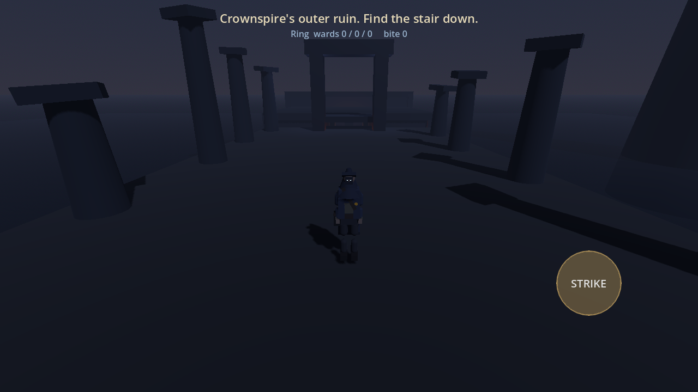
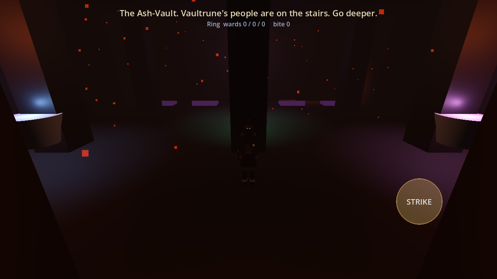
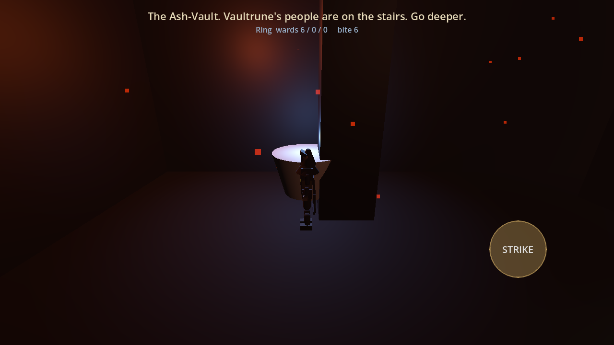
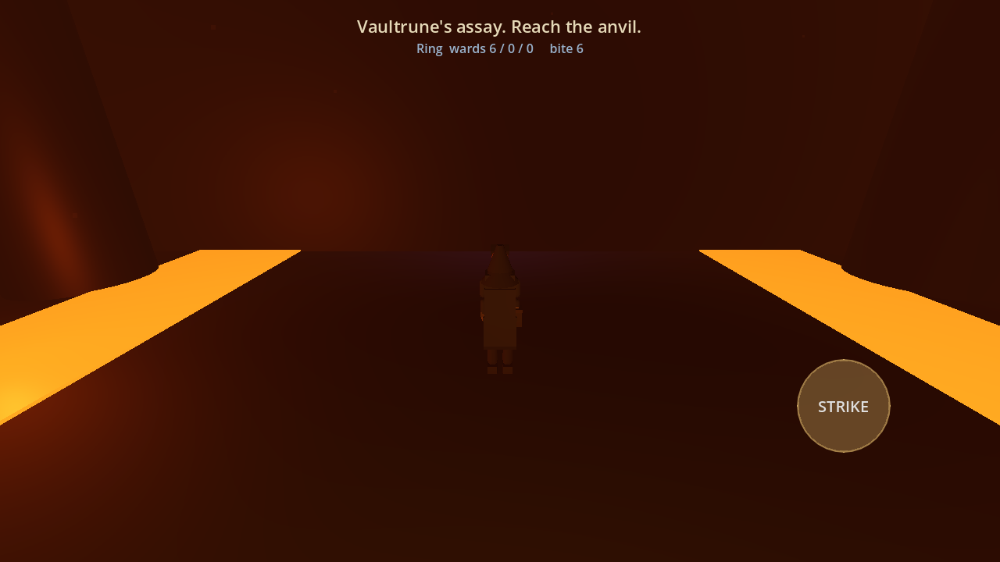
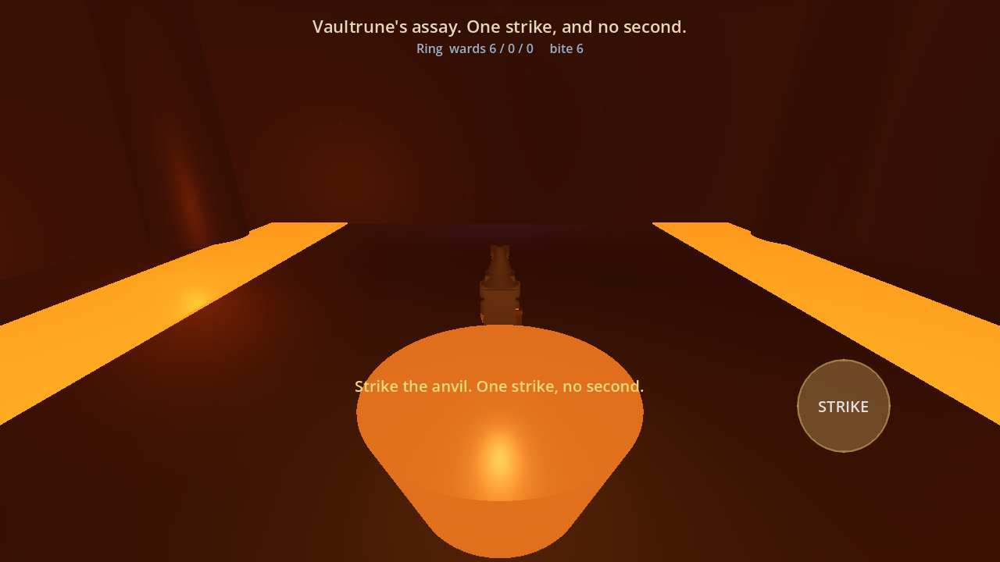
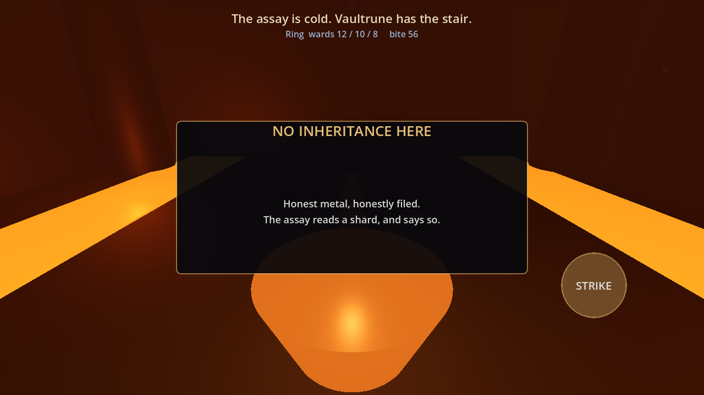
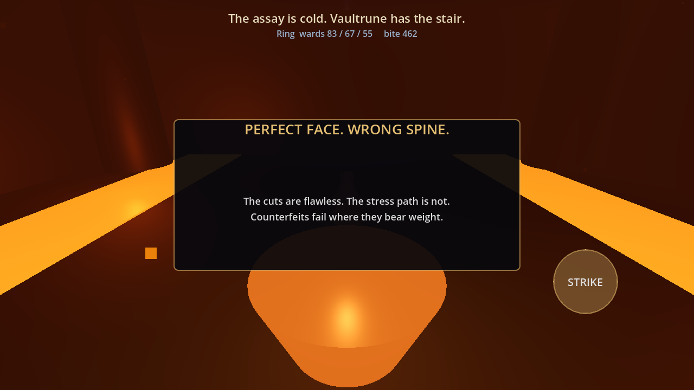
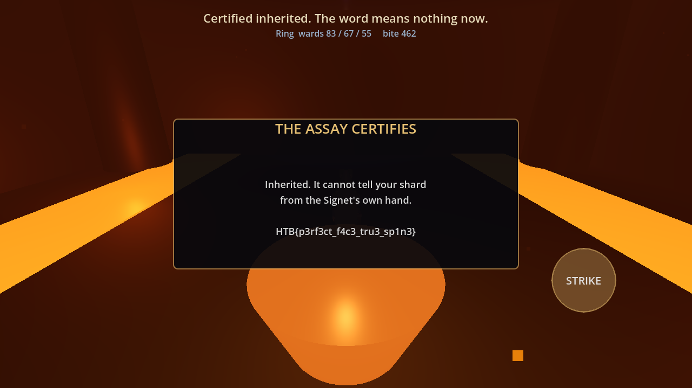

<br>

<br>

<font size='5'>Proofmark</font>

17<sup>th</sup> July 2026

Prepared By: lawbyte

Challenge Author: lawbyte

Difficulty: <font color='orange'>Medium</font>

<br>

<br>

<br>

## Synopsis

Proofmark is a Reversing challenge shipped as an Android game. It maps to OWASP
MASVS-RESILIENCE, and to the classic mobile mistake of trusting a check that runs
on the player's own device. The game hides its win condition behind a native
library, and the player has to take that library apart to reach it.

The library checks two things before it hands over the flag: the visible state of
an item the player carries, and a hidden integrity token that must match it. Normal
play can never produce the required state, so it has to be written into memory. But
editing memory alone leaves the token stale, and the check rejects it. The token
cannot be read out of the running process either. The player has to recover it by
reversing a small bytecode virtual machine inside the library and running its hash
themselves.

## Description

Vaultrune's assay decides which seals are inherited and which were cut from a
Signet shard, and every house sends its stamps down to it. Elric Ashspar walks in
with a ring he filed himself. If the anvil calls his work inherited, it cannot tell
the difference, and neither can anyone else. One strike, no second.

## Skills Required

- Android APK structure and native library extraction
- Basic ARM64 static analysis with Ghidra or an equivalent
- Reading optimized decompiler output
- Using a memory editor on Android (Frida, GameGuardian)

## Skills Learned

- Reversing a small bytecode virtual machine from its dispatch loop
- Recognizing the murmur3 `fmix32` finalizer from its constants
- Rebuilding a program that the compiler split and scattered through `.rodata`
- Recovering an integrity value by re-deriving it instead of reading it
- Spotting when a key-stretch makes brute force the wrong path

## Analysis

The player gets one file, `proofmark.apk`. Installing it gives a small 3D game.
You play Elric Ashspar, and you walk down from Crownspire's outer ruin, through the
Ash-Vault, to the assay anvil at the bottom.

| Crownspire's outer ruin | The Ash-Vault |
|---|---|
|  |  |

Elric carries a ring. The ring has three values called wards and a fourth called
the bite, and the HUD prints all four as you walk. The cutting-stations in the
Ash-Vault are the only thing in the game that changes them.



At the bottom is the anvil. Standing at it and pressing STRIKE submits the ring to
the assay.

| The forge | The anvil |
|---|---|
|  |  |

File the ring at the stations, strike, and the assay refuses it. That was the only
strike the game allows.



Two things follow from this. The assay wants one specific ring, and the stations
clamp every ward, so filing will not get there. The game will not produce the flag
on its own, which points at the code that makes the decision.

## The Vulnerability

The whole decision runs on the device. The game itself is Godot script, but the
check lives in a native library the game loads, `libproofmark.so`, bundled in the
APK. That library holds the rule, the expected values, and the encrypted flag. The
player owns all of it.

This is the mobile version of trusting the client. Nothing here talks to a server,
so anything the app can compute, the player can compute too. The library leans on
two defenses instead, and the challenge is about seeing past both:

1. The winning state is out of reach of normal play, so it has to be forged.
2. A second value guards the state, so forging the state alone is not enough.

Neither defense adds real secrecy. They only decide how much work the player does.

## Solution

### Step 1: Pull the native library out of the APK

An APK is a ZIP. List it and look for the game's own code, not the engine's:

```bash
unzip -l proofmark.apk | grep libproofmark
```

```
     9800  lib/arm64-v8a/libproofmark.arm64.so
    10376  lib/x86_64/libproofmark.x86_64.so
```

Two ABIs, same code. Take the arm64 one, since that is what a phone runs:

```bash
unzip -o proofmark.apk "lib/arm64-v8a/libproofmark.arm64.so" -d apk
file apk/lib/arm64-v8a/libproofmark.arm64.so
```

```
ELF 64-bit LSB shared object, ARM aarch64, dynamically linked, stripped
```

It is stripped, but only 10 KB, so there is very little to read. The few surviving
strings give us a map:

```bash
strings apk/lib/arm64-v8a/libproofmark.arm64.so | grep -iE 'proof|reseal|submit|cert|RefCounted'
```

```
proofmark_library_init
Proofmark
reseal
submit
RefCounted
certificate
```

`RefCounted` and the `_library_init` suffix are Godot GDExtension conventions. A
GDExtension is a native library that registers classes the game's script can call.
So this library publishes a class named `Proofmark` with three methods: `reseal`,
`submit`, and `certificate`.

### Step 2: Decompile it

Ghidra headless keeps the run repeatable:

```bash
export JAVA_HOME="/c/Program Files/Android/Android Studio/jbr"
"$GHIDRA/support/analyzeHeadless.bat" ./ghproj ovproj \
    -import apk/lib/arm64-v8a/libproofmark.arm64.so \
    -scriptPath . -postScript DumpDecomp.py "$PWD/decomp.c" \
    -deleteProject
```

`DumpDecomp.py` dumps every function to one file, which is easier to read than
clicking through a stripped binary:

```python
from ghidra.app.decompiler import DecompInterface
from ghidra.util.task import ConsoleTaskMonitor

dec = DecompInterface()
dec.openProgram(currentProgram)
mon = ConsoleTaskMonitor()
out = open(getScriptArgs()[0], "w")
for fn in currentProgram.getFunctionManager().getFunctions(True):
    res = dec.decompileFunction(fn, 90, mon)
    out.write("\n// ===== %s @ %s =====\n" % (fn.getName(), fn.getEntryPoint()))
    out.write(res.getDecompiledFunction().getC() if res.decompileCompleted() else "// failed\n")
out.close()
```

That gives 28 functions. Ghidra names exactly one of them, so that is the way in.

### Step 3: Find the two functions that matter

`proofmark_library_init` is the GDExtension entry point. It looks up engine
functions by name and registers a callback:

```c
// proofmark_library_init @ 0x102130
DAT_00104e98 = (*param_1)("classdb_register_extension_class6");
DAT_00104ea0 = (*param_1)("classdb_register_extension_class_method");
DAT_00104ea8 = (*param_1)("classdb_construct_object2");
...
*(code **)(param_3 + 4) = FUN_00102308;   // initialize
```

`FUN_00102308` builds the strings `Proofmark`, `reseal`, `submit`, `certificate`,
and binds each name to a function. Following those binds gives us:

| Godot method | implementation |
|---|---|
| `reseal(s0, s1, s2, bite)` | `FUN_00101af4` |
| `submit(s0, s1, s2, bite, hallmark)` | `FUN_00101ff4` |

`submit` is the assay. Start there.

### Step 4: Read `submit`

It is short, and it explains the whole design:

```c
// submit(state*, len, hallmark, out*, out_cap)   @ 0x101ff4
if ((param_2 == 0x10) &&
    (*param_1 == 0x4300000053 && param_1[1] == 0x1ce00000037)) {   // (1)

    iVar3 = 1200000;                                                // (2)
    do {
        uVar5   = (param_3 + 0xc2b2ae35 ^ (param_3 + 0xc2b2ae35) >> 0x10) * -0x7a143595;
        param_3 = (uVar5 ^ uVar5 >> 0xd) * -0x3d4d51cb;
        param_3 =  param_3 ^ param_3 >> 0x10;
    } while (--iVar3 != 0);

    uVar5 = (param_3 ^ 0x85ebca6b ^ ...) * -0x7a143595;              // (3)
    do {
        uVar5 = (uVar5 + 0xc2b2ae35 ^ ...) * -0x7a143595;
        uVar1 = (uVar5 ^ uVar5 >> 0xd) * -0x3d4d51cb;
        uVar5 = uVar1 ^ uVar1 >> 0x10;
        *(byte*)(local_40 + lVar4) = (&DAT_00100580)[lVar4] ^ (byte)(uVar1 >> 0x18);
        lVar4 = lVar4 + 1;
    } while (lVar4 != 0x1c);

    if (local_40[0] == 0x7b425448) {                                // (4)
        memcpy(param_4, local_40, ...);
        return 2;                                                    // ACCEPTED
    }
    return 1;                                                        // REJECT_TOKEN
}
return 0;                                                            // REJECT_STATE
```

Four things, in order.

The state is fixed (1). The compare reads the 16 bytes of state as two 64-bit
words, so the four little-endian `int32` values are `(0x53, 0x43, 0x37, 0x1CE)`. In
HUD terms that is wards `83 / 67 / 55` and bite `462`. Call it `TARGET`.

The hallmark gets stretched (2). Before anything else, the caller's hallmark runs
through 1,200,000 rounds of mixing.

The flag is encrypted (3). The stretched value seeds a keystream, which is XORed
over 28 bytes sitting at `DAT_00100580`.

The check is on the plaintext (4). `0x7b425448` is `HTB{` in little-endian.

The repeated constants `-0x7a143595` and `-0x3d4d51cb` are `0x85EBCA6B` and
`0xC2B2AE35`, which are the murmur3 `fmix32` finalizer constants. So the mixing
step is a well-known function, not something custom:

```c
uint32_t mix(uint32_t x) {
    x ^= x >> 16; x *= 0x85EBCA6B;
    x ^= x >> 13; x *= 0xC2B2AE35;
    x ^= x >> 16; return x;
}
```

The important part is what `submit` does not do. It never works out the correct
hallmark and compares against it. It decrypts with whatever value it is handed and
looks at the result. The hallmark is not a password to match, it is the key itself.
Nothing but the exact value will do, and patching the comparisons gains nothing,
because a wrong key produces garbage rather than a flag.

### Step 5: See why the shortcuts fail

Editing the state in memory gets the wards and bite to `83 / 67 / 55 / 462`, which
is exactly what `submit` demands. The assay still refuses, because the hallmark
that travels with the state is now stale.



The next idea is to ask the library for the hallmark. `reseal` computes it, and the
game calls it to keep the value in step while the player files wards. Its tail
explains why it is a dead end:

```c
// reseal tail @ 0x101f18
if ((param_2 == 0x10) && (*param_1 < 0x19) &&  /* every ward <= 24 */
    param_1[3] == *param_1 + s1 * 2 + s2 * 3) {  /* bite matches the formula */
    return hash;                                  // in range: the real hash
}
uVar9 = (hash ^ 0xa5a5a5a5 ^ ...) * -0x7a143595;  // out of range: poisoned
uVar9 = (uVar9 ^ uVar9 >> 0xd) * -0x3d4d51cb;
return uVar9 ^ uVar9 >> 0x10 ^ 0xbadf00d;
```

`reseal` only returns the true hash for a ring the game could have produced: every
ward within `[0, 24]`, and `bite == s0 + 2*s1 + 3*s2`. `TARGET` breaks both rules,
since `0x53` is `83`. Ask it about `TARGET` and it returns a poisoned value.

Breakpoints do not help either. `submit` never derives the hallmark, and `reseal`
refuses to, so the correct value is never in memory or in a register at any point.

Brute force is worth a thought, since the hallmark is only 32 bits. That is what
the 1,200,000 rounds in step (2) are for. One strike costs a fraction of a second,
but 2^32 guesses at 1.2M mixes each does not finish.

That leaves one option. Something computes this hash, and it is not `submit`.

### Step 6: Find the VM inside `reseal`

The front of `reseal` computes the hash, and it does not look like arithmetic:

```c
uVar9 = 0;
local_60 = DAT_00100500; uStack_58 = DAT_00100518; local_50 = DAT_00100548; ...
do {
    bVar1 = *(byte *)((long)&local_60 + uVar9);   // fetch a byte
    ...
    if (bVar1 == 0x7a) { /* r[a] = imm32          */ }
    else if (bVar1 == 0x5e) { /* r[a] = input[r[b]] */ }
    else if (bVar1 == 0x84) { /* r[a] ^= r[b]     */ }
    else if (bVar1 == 0x1a) { /* push pc, jump    */ }
    else if (bVar1 == 0xf5) { /* pop pc           */ }
    ...
} while (--iVar4 != 0);
```

Fetch a byte, switch on it, move a cursor, repeat. That is an interpreter. It keeps
8 registers, a small return stack, and reads its program from a buffer on the
stack. The hash is not written in ARM64 at all. It is written in a made-up
instruction set, so reading the ARM64 only tells us how the machine works, not what
it computes.

Decoding each branch of the `if` ladder gives the full instruction set:

| byte | mnemonic | effect |
|---|---|---|
| `0x7A` | `LDI r, imm32` | `r = imm` |
| `0x11` | `LDLEN r` | `r = input length` |
| `0x5E` | `LDB r, b` | `r = input[reg[b]]` |
| `0x29` | `MOV r, b` | `r = reg[b]` |
| `0x84` | `XOR r, b` | `r ^= reg[b]` |
| `0xB6` | `SHR r, imm8` | `r >>= imm` |
| `0x4D` | `ROTL r, imm8` | `r = rotl(r, imm)` |
| `0xC1` | `ADDI r, imm32` | `r += imm` |
| `0x9F` | `XORI r, imm32` | `r ^= imm` |
| `0x02` | `MULI r, imm32` | `r *= imm` |
| `0xE7` | `INC r` | `r += 1` |
| `0x68` | `JMP a16` | jump |
| `0xD3` | `JLT r, b, a16` | jump if `r < reg[b]` |
| `0x1A` | `CALL a16` | push pc, jump |
| `0xF5` | `RET` | pop pc |
| `0x3C` | `HALT` | return `reg[0]` |

### Step 7: Rebuild the program

Now we need the program bytes. Reading 95 bytes straight from `0x500` and decoding
them produces nonsense after the second instruction.

The reason is in the decompiler output above. The loads read `DAT_00100500`, then
`0x518`, then `0x548`, then `0x510`. The addresses are out of order. The compiler
split the program into 8-byte pieces, scattered them through `.rodata`, and emits
stores that put them back together on the stack. Reading `.rodata` top to bottom
gives those pieces shuffled.

So follow the stores, not the addresses. Each destination slot sits at a known
stack offset, so ordering the sources by their destination rebuilds the program:

```python
d = open("libproofmark.arm64.so", "rb").read()
# file offset == vaddr - 0x100000 in this PIE .so
order = [0x500, 0x518, 0x548, 0x510, 0x528, 0x538, 0x508, 0x550, 0x530, 0x520, 0x540]
prog  = b"".join(d[v:v+8] for v in order)
prog += bytes([0xb6, 0x03, 0x10, 0x84, 0x00, 0x03, 0xf5])   # trailing immediates
prog  = prog[:95]
```

The cheap way to confirm the order is right: the first instruction decodes as
`LDI r0, 0x53437277`, a clean constant load into the accumulator. Shuffled bytes do
not do that by accident.

### Step 8: Disassemble the program

With the instruction set from step 6 and the bytes from step 7, the program reads
plainly:

```
0000: LDI    r0, 0x53437277        ; h = SEED
0006: LDI    r1, 0x00000000        ; i = 0
000C: LDLEN  r2                    ; n = len(input)
000E: JLT    r1<r2 ->0016          ; while i < n:
0013: JMP    ->002D
0016: LDB    r3, r1                ;   b = input[i]
0019: XOR    r0, r3                ;   h ^= b
001C: ROTL   r0, 5                 ;   h = rotl(h, 5)
001F: ADDI   r0, 0x9E3779B9        ;   h += KADD
0025: CALL   sub_0037              ;   h = mix(h)
0028: INC    r1                    ;   i += 1
002A: JMP    ->000E
002D: XORI   r0, 0xD1B54A33        ; h ^= KFIN
0033: CALL   sub_0037              ; h = mix(h)
0036: HALT                         ; return h

0037: MOV r3,r0 ; SHR r3,16 ; XOR r0,r3     ; --- mix() ---
0040: MULI r0, 0x85EBCA6B                   ; murmur3 fmix32
0046: MOV r3,r0 ; SHR r3,13 ; XOR r0,r3
004F: MULI r0, 0xC2B2AE35
0055: MOV r3,r0 ; SHR r3,16 ; XOR r0,r3
005E: RET
```

It is a keyed hash over the 16 state bytes, and `sub_0037` is the same `fmix32`
that `submit` uses. In C:

```c
uint32_t khash(const uint8_t *s, int n) {
    uint32_t h = 0x53437277;               // SEED
    for (int i = 0; i < n; i++) {
        h ^= s[i];
        h = mix(rotl(h, 5) + 0x9E3779B9);  // KADD
    }
    return mix(h ^ 0xD1B54A33);            // KFIN
}
```

The three constants `0x53437277`, `0x9E3779B9` and `0xD1B54A33` only ever exist as
immediates inside that program. That is why none of the ARM64 gave them up.

### Step 9: Compute the hallmark and decrypt

Everything is known now. The hallmark is `khash(TARGET)`. `submit` stretches it,
seeds a keystream, and XORs it over the 28 bytes at file offset `0x580`. Reimplement
those three pieces and point them at the library:

```bash
python3 solver.py apk/lib/arm64-v8a/libproofmark.arm64.so
```

```
[+] khash(TARGET) = 0x71D3A101
[+] blob = 2a53db7ba35d34f55f59745e0043881ca1136fb7f8d73f79c1b0af1a
[+] flag = HTB{REDACTED}
```

The stretch that makes brute force hopeless costs about 0.4 seconds when you only
run it once.

### Step 10: Strike the anvil

The offline decrypt already produces the flag, so this step is optional. To finish
it in game, attach a memory editor, set the wards and bite to `83 / 67 / 55 / 462`,
set the hallmark to `0x71D3A101`, and strike.



## Result

```
HTB{REDACTED}
```

The full solver is at [`htb/solver.py`](htb/solver.py):

```python
import struct, sys

M = 0xFFFFFFFF

# murmur3 fmix32, constants read out of submit()
def mix(x):
    x &= M
    x ^= x >> 16; x = (x * 0x85EBCA6B) & M
    x ^= x >> 13; x = (x * 0xC2B2AE35) & M
    x ^= x >> 16
    return x

def rotl(x, r):
    x &= M
    return ((x << r) | (x >> (32 - r))) & M

# the keyed hash, recovered from the VM bytecode
def khash(state):
    h = 0x53437277                               # SEED
    for b in state:
        h = (h ^ b) & M
        h = mix((rotl(h, 5) + 0x9E3779B9) & M)   # KADD
    return mix(h ^ 0xD1B54A33)                   # KFIN

# submit()'s 1.2M-round stretch of the caller's hallmark
def kdf(token):
    x = token & M
    for _ in range(1_200_000):
        x = mix((x + 0xC2B2AE35) & M)
    return x

# submit()'s keystream, XORed over the blob
def decrypt(blob, token):
    out = bytearray()
    s = mix(kdf(token) ^ 0x85EBCA6B)
    for c in blob:
        s = mix((s + 0xC2B2AE35) & M)
        out.append(c ^ ((s >> 24) & 0xFF))
    return bytes(out)

data = open(sys.argv[1], "rb").read()
target = struct.pack("<iiii", 0x53, 0x43, 0x37, 0x1CE)   # the state submit demands
token = khash(target)
print("[+] khash(TARGET) = 0x%08X" % token)

BLOB_ADDR, BLOB_LEN = 0x580, 28   # DAT_00100580; length is submit()'s loop bound (0x1c)
blob = data[BLOB_ADDR:BLOB_ADDR + BLOB_LEN]
print("[+] blob =", blob.hex())
print("[+] flag =", decrypt(blob, token).decode())
```
