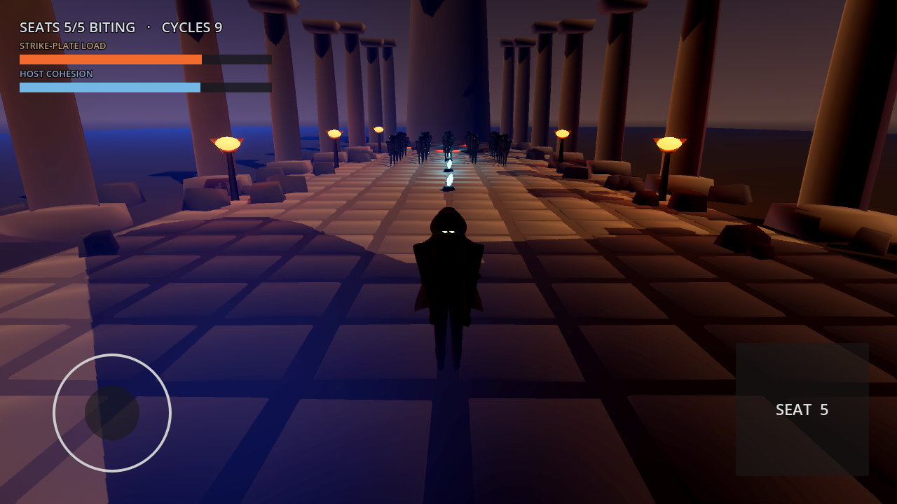
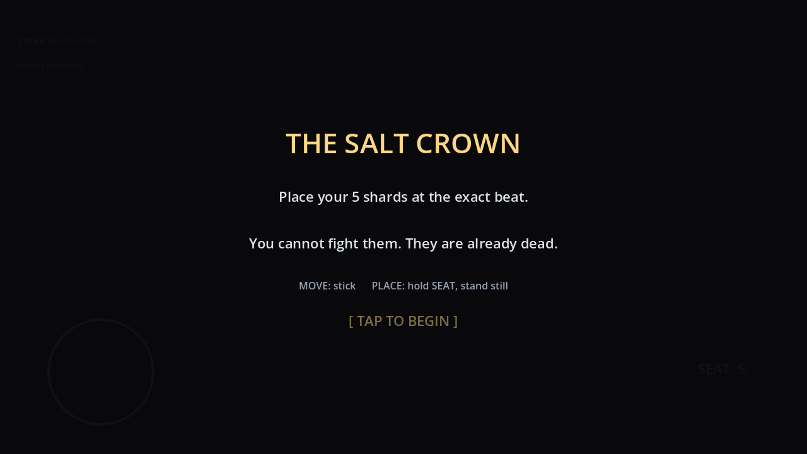
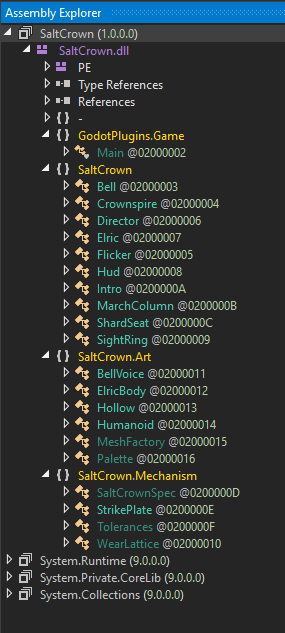
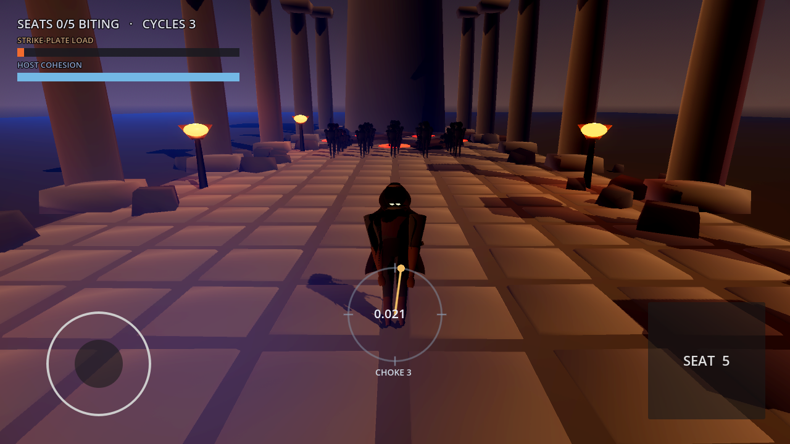

<br>

<br>

<font size='5'>Salt Crown</font>

16<sup>th</sup> July 2026

Prepared By: lawbyte

Challenge Author: lawbyte

Difficulty: <font color='red'>Hard</font>

<br>

<br>

<br>

## Synopsis

Salt Crown is a hard Reversing challenge built as an Android game. Players get one APK. The game is written in Godot with C#, so the first instinct is to open the assembly in dnSpy and read the logic. That works, up to a point. The C# gives you the rule but holds none of the answers, because the part that decides everything was moved into a native library. To finish, you have to reverse stripped ARM64 in Ghidra.

The idea it teaches is that a value can be inside a binary without being stored in it. The numbers the challenge needs are grown at runtime from a small data file, by running an integer lattice 4096 times. There is nothing to grep for and no algorithm to recognise. You reimplement it exactly or you do not get the flag.

## Description

Alyss has threaded the dead of Crownspire to the city bell. It strikes, they step, all together. You play Elric Ashspar, an engineer with no weapon and no way to fight them. The bell's strike-plate is a counterfeit, and counterfeits fail under repetition. Break the march, force the bell to work, and read the failure.

## Skills Required

- Basic Android APK inspection
- Reading decompiled C# in dnSpy
- Static analysis of stripped ARM64 in Ghidra
- Porting an algorithm from disassembly to a script

## Skills Learned

- Splitting a Godot game across managed and native code, and knowing which tool reads which
- Following a GDExtension entry symbol to an unnamed function through its registration strings
- Spotting constants that are built at runtime instead of stored
- Handling signed and unsigned 32-bit values when porting to Python

## Analysis

Play it for a few minutes first. The game is short and it shows you the shape of the problem.



Elric has one button, `SEAT`, and no attack. The dead climb out of drains in the road and march toward the city behind him. Two readouts move as they come: `STRIKE-PLATE LOAD` climbs, `HOST COHESION` falls. Shards that took sit in the road glowing cyan.

The briefing sets the rule.



Place five shards on the exact beat. It never says which beat, and nothing in the game ever will.

### Unpacking the APK

An APK is a ZIP file, so list it.

```bash
$ unzip -l SaltCrown.apk | sort -rn | head -14
 81414520   lib/x86_64/libgodot_android.so
 76461152   lib/arm64-v8a/libgodot_android.so
  3269544   lib/x86_64/libmonosgen-2.0.so
  3103832   lib/arm64-v8a/libmonosgen-2.0.so
   836552   lib/x86_64/libSystem.IO.Compression.Native.so
   759248   lib/arm64-v8a/libSystem.IO.Compression.Native.so
   430080   lib/arm64-v8a/libashvault.android.template_release.arm64.so
   409600   lib/x86_64/libashvault.android.template_release.x86_64.so
   117760   assets/.godot/mono/publish/x86_64/SaltCrown.dll
   117760   assets/.godot/mono/publish/arm64/SaltCrown.dll
     8036   AndroidManifest.xml
     1024   assets/native/ashvault.gdextension
      256   assets/rubbings/ashvault.dat
```

Four things are worth picking out.

The two `libgodot_android.so` files are the stock Godot engine, one per architecture. They hold no challenge code. Ruling them out now saves a long detour into a 76 MB binary. The `libmonosgen` files beside them say the game runs a Mono runtime, so there is managed code somewhere.

`SaltCrown.dll` matches the package name and is small. That is the game logic. The two copies are identical, because IL does not care about the CPU.

`libashvault.*.so` is not part of Godot. It is small, it ships per architecture, and nothing in the engine is called that. A custom native library inside a C# game is the first hint that the logic is split in two.

`assets/rubbings/ashvault.dat` is 256 bytes and matches no engine convention. Godot only exports raw files like this if the author asked for them by name. It also shares a name with that native library.

### Reading the managed half

Pull the DLL out and check what it is.

```bash
$ unzip -j SaltCrown.apk 'assets/.godot/mono/publish/arm64/SaltCrown.dll' -d .
$ file SaltCrown.dll
SaltCrown.dll: PE32+ executable (DLL) (console) Aarch64 Mono/.Net assembly, for MS Windows, 2 sections
```

```bash
$ xxd SaltCrown.dll | grep -i bsjb | head -1
00011530: 072a 0000 4253 4a42 0100 0100 0000 0000  .*..BSJB........
```

`BSJB` is the signature of the CLI metadata header. It means the file holds CIL bytecode, the .NET intermediate language, and no native machine code. A native decompiler cannot read it. Pointing Ghidra at it goes about how you would expect:

```
INFO  Using Loader: Portable Executable (PE) (AutoImporter)
INFO  Using Language/Compiler: AARCH64:LE:64:v8A:windows (AutoImporter)
ERROR Failed to markup Constant: Cannot read field "streamIndex" because "blob" is null (CliStreamMetadata)
```

Ghidra guesses a CPU that is not there, then chokes on the metadata. It can describe the PE wrapper, but it has no CIL decompiler. Keep it open though. There is a file in this APK it is right for.

For managed code we use dnSpy.

```bash
$ dnSpy.exe SaltCrown.dll
```



It decompiles cleanly. No obfuscation, no renamed symbols, no packer. Everything below is dnSpy's output rather than my source, so the variable names are the decompiler's (`num`, `array`, `x`) and some constants have been folded. Read them as they appear, because a couple of those differences matter later.

Three namespaces show up: `SaltCrown`, `SaltCrown.Mechanism`, and `SaltCrown.Art`. `Art` builds the characters and scenery and can be ignored. `Mechanism` is the challenge.

## The vulnerability

`Director.Forge` is where the flag comes from.

```csharp
private void Forge()
{
	uint measured = 2166136261u;
	foreach (ShardSeat seat in _seats.Where((ShardSeat s) => s.Bites).OrderBy((ShardSeat s) => s.ChokeIndex))
	{
		measured = SaltCrownSpec.Measure(measured, seat.ChokeIndex, Tolerances.PhaseBucket(seat.ChokeIndex));
	}
	Crown = SaltCrownSpec.Unseal(measured);
	State = Phase.Forged;
}
```

Two things fall out of this straight away. Only seats where `Bites` is true get folded in. And the fold takes two values per seat: `ChokeIndex`, and `Tolerances.PhaseBucket(ChokeIndex)`. Where the seat physically sits never enters. So the whole challenge is those two numbers, for every choke that bites.

Now look at what `Unseal` does.

```csharp
public static class SaltCrownSpec
{
	private static readonly byte[] SealedSpec = new byte[24]
	{
		117, 201, 171, 107, 154, 83, 207, 191, 31, 233,
		126, 74, 147, 148, 37, 224, 41, 207, 135, 169,
		194, 128, 222, 220
	};

	private const string Frame = "HTB";

	public const uint Unmeasured = 2166136261u;

	public static uint Measure(uint acc, int chokeIndex, uint phaseBucket)
	{
		acc = Mix(acc, (uint)chokeIndex);
		acc = Mix(acc, phaseBucket);
		return acc;
	}

	public static string Unseal(uint measured)
	{
		byte[] array = new byte[SealedSpec.Length];
		uint num = measured;
		for (int i = 0; i < SealedSpec.Length; i++)
		{
			num = Mix(num, (uint)i);
			array[i] = (byte)(SealedSpec[i] ^ (byte)(num >> 24));
		}
		return "HTB{" + Encoding.ASCII.GetString(array) + "}";
	}
```

The flag is not in the assembly. There is a 24 byte blob and a keystream built from `measured`. Searching for the flag confirms it. .NET string literals are UTF-16, so `strings` needs `-e l` or it finds nothing and proves nothing:

```bash
$ strings -a -e l SaltCrown.dll | grep "HTB{"
HTB{
$ strings -a -e l SaltCrown.dll | grep "p3rf3ct"
$
```

The frame is there because the compiler folded `Frame + "{"` into one literal. The contents are not, and they do not exist until `Unseal` computes them.

`Unseal` also never validates and cannot fail. Give it the wrong `measured` and it still returns something flag shaped: `HTB{` followed by garbage. That is deliberate. Patch the game to force a win and you get a plausible looking flag that is wrong.

So one question is left. What is `measured`?

### The face and the spine

`Tolerances` decides whether a seat bites. It checks two conditions, and only one of them decides anything.

```csharp
	public static bool SeatsAtChoke(Vector3 pos, out int index)
	{
		index = -1;
		float num = float.MaxValue;
		for (int i = 0; i < 8; i++)
		{
			float num2 = ChokeZ(i);
			if (!(HalfWidthAt(num2) > 8.1f))
			{
				float num3 = new Vector2(pos.X, pos.Z - num2).Length();
				if (num3 < 2.6f && num3 < num)
				{
					num = num3;
					index = i;
				}
			}
		}
		return index >= 0;
	}
```

This is a position check. It is readable, it looks like the rule, and it is not enough on its own. It is the decoy. The condition that actually matters is timing:

```csharp
	public static uint PhaseBucket(int index)
	{
		return WearLattice.AdmitBucket(index);
	}

	public static uint BeatBucket(float phase)
	{
		return (uint)(Frac(phase) * 256f) & 0xFF;
	}

	public static bool EngagesCleanly(int index, float phaseAtBedding)
	{
		return BucketDistance(BeatBucket(phaseAtBedding), PhaseBucket(index)) <= 8;
	}
```

`ShardSeat.Resolve` shows both together:

```csharp
		bool flag = Tolerances.SeatsAtChoke(pos, out var index);
		ChokeIndex = index;
		Bites = flag && Tolerances.EngagesCleanly(index, phase);
```

Put a shard on a perfect choke at the wrong moment and it seats without complaint, contributes nothing, and the march walks over it. A perfect face on a wrong spine, which is the theme of the challenge and also the flag.

The gauge in game is the same idea. Standing in a choke raises it.



It names the choke and reads out the current beat as a number, here `0.021`. There is no target arc and no colour change when you are right. It tells you where the beat is. It never tells you which beat you want.

### Where the managed code stops

`PhaseBucket` forwards to `WearLattice.AdmitBucket`, and that is where the DLL runs out.

```csharp
public static class WearLattice
{
	public const string RubbingPath = "res://rubbings/ashvault.dat";

	private static GodotObject _vault;

	private static byte[] _rubbing;

	public static uint AdmitBucket(int choke)
	{
		if (_vault == null)
		{
			_vault = ClassDB.Instantiate("AshVault").AsGodotObject();
		}
		if (_rubbing == null)
		{
			_rubbing = LoadRubbing();
		}
		byte[] array = new byte[_rubbing.Length];
		Array.Copy(_rubbing, array, _rubbing.Length);
		Variant result = _vault.Call("admit_bucket", array, choke);
		return (uint)(int)result;
	}
```

No algorithm. It reads a file, hands the bytes to something called `AshVault`, and returns the answer. `ClassDB.Instantiate` is how Godot builds a class the C# side has no binding for, which means `AshVault` comes from a GDExtension. That is native code, and it explains the `.so` we spotted while unpacking.

This is the point of the challenge. The managed half gives you the rule and no answers. Reading C# gets you this far and no further.

## Solution

### 1. Confirm the native target

```bash
$ unzip -j SaltCrown.apk 'lib/arm64-v8a/libashvault.android.template_release.arm64.so' -d .
$ file libashvault.android.template_release.arm64.so
ELF 64-bit LSB shared object, ARM aarch64, version 1 (SYSV), dynamically linked, stripped
```

Stripped, so Ghidra will not name anything for us. What survives is more useful than symbols:

```bash
$ nm -D --defined-only libashvault.android.template_release.arm64.so | grep ' T '
000000000002292c T saltcrown_library_init
```

One exported function. That is the GDExtension entry point, and the config file shipped beside it says so:

```bash
$ unzip -p SaltCrown.apk assets/native/ashvault.gdextension
[configuration]
entry_symbol = "saltcrown_library_init"
compatibility_minimum = "4.7"
reloadable = false
...
```

GDExtension registers its classes by name at runtime, so the registration strings survive stripping:

```bash
$ strings libashvault.android.template_release.arm64.so | grep -E "admit_bucket|AshVault|rubbing|choke"
choke
admit_bucket
rubbing
N9saltcrown8AshVaultE
```

That is the way in. The method name is a string literal, and the function pointer that implements it is registered next to that string.

### 2. Find admit_bucket in Ghidra

Open the `.so` in Ghidra. The ELF loader picks `AARCH64:LE:64:v8A` on its own. Say yes to auto-analysis and wait for it to finish.

The binary is stripped, so the Symbol Tree has almost nothing in it. There is one entry that matters: `saltcrown_library_init`. Go to it and look at the decompiler.

```c
void saltcrown_library_init(undefined8 param_1,undefined8 param_2,undefined8 param_3)

{
  undefined1 auStack_30 [32];

  FUN_00124dd0(auStack_30,param_1,param_2,param_3);
  FUN_00124e9c(auStack_30,FUN_0012290c);
  FUN_00124ea8(auStack_30,FUN_00122928);
  FUN_00124eb4(auStack_30,2);
  FUN_00124ee4(auStack_30);
  return;
}
```

Five calls and no names. It looks like a dead end, but this function is completely readable once you know the shape every GDExtension entry point has. It always does the same five things in the same order:

```cpp
GDExtensionBinding::InitObject init_obj(get_proc_address, library, initialization);  // FUN_00124dd0
init_obj.register_initializer(some_function);                                        // FUN_00124e9c
init_obj.register_terminator(some_other_function);                                   // FUN_00124ea8
init_obj.set_minimum_library_initialization_level(level);                            // FUN_00124eb4
return init_obj.init();                                                              // FUN_00124ee4
```

Line them up. `auStack_30` is the `InitObject`, built in the first call from the three parameters. The next two calls hand it two function pointers. The fourth passes the constant `2`, which is `MODULE_INITIALIZATION_LEVEL_SCENE`.

That gives you the two addresses worth following:

- `FUN_0012290c` is the **initializer**. This is where classes get registered, so this is the one to follow.
- `FUN_00122928` is the terminator, which is cleanup. Ignore it.

Double-click `FUN_0012290c`:

```c
void FUN_0012290c(int param_1)

{
  if (param_1 == 2) {
    FUN_0012298c(0,1,0);
    return;
  }
  return;
}
```

It checks the initialization level and calls one thing. Keep following. A few calls down you reach `FUN_00121970`, which is the class's `_bind_methods`. It is obvious the moment you see it, once the stack declarations are skipped:

```c
void FUN_00121970(void)

{
  ...
  FUN_0012d704(auStack_8,"admit_bucket",0);
  FUN_0012d704(auStack_50,"rubbing",0);
  FUN_00121b68(auStack_48,auStack_8,auStack_50,"choke");
  FUN_001307b4(auStack_38);
  uVar1 = FUN_001220f0(FUN_001217b0,0);
  FUN_00126fcc(1,uVar1,auStack_48,0,0);
  ...
}
```

There are the strings we found with `strings` earlier. It builds the method name `"admit_bucket"` and the two argument names `"rubbing"` and `"choke"`, then wraps a function pointer and registers the lot.

That function pointer is the answer:

```
uVar1 = FUN_001220f0(FUN_001217b0,0);
```

**`FUN_001217b0` is `admit_bucket`.** The name and the code that implements it are registered in the same call, so the string leads you to the function even with every symbol stripped.

If you would rather not walk the chain, go the other way. Open Window > Defined Strings, filter for `admit_bucket`, click the hit at `0010635f`, then press `Ctrl+Shift+F` for references. The single reference lands inside `FUN_00121970`, at the same line.

### 3. Read the lattice

Open `FUN_001217b0`. It takes three parameters, which matches `(this, rubbing, choke)`, and it declares a very large stack frame. That frame is the two 64-entry `uint32_t` buffers the algorithm swaps between.

Ghidra prints about forty lines of `undefined8 uStack_...` declarations before any code, and an unrolled block of assignments in the middle where the compiler inlined the buffer swap. Skip both. What is left is short, and it is the whole algorithm:

```c
ulong FUN_001217b0(undefined8 param_1,undefined8 param_2,int param_3)

{
  ...
  uVar3 = FUN_001568f0(param_2);            // rubbing.size()
  if (0 < (int)uVar3) {
    pbVar4 = (byte *)FUN_001303b8(param_2); // rubbing.ptr()
    lVar6 = 0;
    do {
      uVar8 = 0x811c9dc5;
      pbVar9 = pbVar4;
      uVar10 = (ulong)uVar3;
      do {
        uVar10 = uVar10 - 1;
        uVar8 = ((uint)*pbVar9 + (int)lVar6 ^ uVar8) * 0x1000193;
        uVar8 = uVar8 ^ uVar8 >> 0xb;
        pbVar9 = pbVar9 + 1;
      } while (uVar10 != 0);
      *(uint *)((long)&local_130 + lVar6 * 4) = uVar8;
      lVar6 = lVar6 + 1;
    } while (lVar6 != 0x40);
    iVar5 = 0;
    iVar7 = 0;
    do {
      uVar10 = 0;
      do {
        uVar1 = uVar10 + 1;
        uVar3 = *(uint *)((long)&local_130 + (uVar1 & 0x3f) * 4);
        uVar8 = *(uint *)((long)&local_130 + ((ulong)((int)uVar10 - 1) & 0x3f) * 4);
        uVar2 = *(uint *)((long)&local_130 + uVar10 * 4);
        uVar3 = iVar5 + (int)uVar10 +
                ((uVar3 >> 5 | uVar3 << 0x1b) ^ (uVar8 >> 0x19 | uVar8 << 7) ^ uVar2) * -0x7a143589;
        uVar3 = (uVar3 ^ uVar3 >> 0xf) * -0x3d4d51c3 ^ (uVar2 >> 0x13 | uVar2 << 0xd);
        *(uint *)((long)&local_230 + uVar10 * 4) = uVar3 ^ uVar3 >> 0x10;
        uVar10 = uVar1;
      } while (uVar1 != 0x40);
      iVar7 = iVar7 + 1;
      iVar5 = iVar5 + -0x61c88647;
      ...                                    // unrolled buffer swap, ignore
    } while (iVar7 != 0x1000);
    ...
```

Read the loop bounds first. `0x40` is 64, so there are 64 cells. `0x1000` is 4096, so the outer loop runs 4096 times. `local_130` and `local_230` are the two buffers.

Now the constants. The seeding loop starts at `0x811c9dc5` and multiplies by `0x1000193`, which is 16777619. Those are the FNV-1a offset basis and prime. Recognising FNV buys nothing though, because it only seeds the lattice. The settle loop is the part that matters and it is not a named algorithm.

Three constants in the settle loop are printed as negative because the multiply is signed in the IL. Add 2<sup>32</sup> to each to get the real unsigned value:

| Ghidra shows | Unsigned | Note |
|---|---|---|
| `-0x7a143589` | `0x85EBCA77` = 2246822519 | mixing constant |
| `-0x3d4d51c3` | `0xC2B2AE3D` = 3266489917 | mixing constant |
| `-0x61c88647` | `0x9E3779B9` | golden ratio, added once per round |

Both mixing constants are well known, which is a good sign the conversion is right.

The shifts are rotates that Ghidra did not fold. `uVar3 >> 5 | uVar3 << 0x1b` is a right rotate by 5, because `0x1b` is 27 and 5 + 27 = 32. By the same reasoning `uVar8 >> 0x19 | uVar8 << 7` is a left rotate by 7, and `uVar2 >> 0x13 | uVar2 << 0xd` is a left rotate by 13.

`uVar8` is the cell to the left, `uVar3` is the cell to the right, and `uVar2` is the current cell. So every cell mixes with both of its neighbours, once per round, 4096 times.

Written out, the recovered algorithm is:

```c
#define CELLS  64
#define SETTLE 4096

static uint32_t rotl(uint32_t x, int n) { return (x << n) | (x >> (32 - n)); }
static uint32_t rotr(uint32_t x, int n) { return (x >> n) | (x << (32 - n)); }

// seed: fold every rubbing byte into every cell
for (int i = 0; i < CELLS; i++) {
    uint32_t v = 0x811C9DC5u;
    for (int k = 0; k < rub_len; k++) {
        v ^= (uint32_t)(rub[k] + i);
        v *= 16777619u;
        v ^= v >> 11;
    }
    cell[i] = v;
}

// settle: 4096 rounds, each cell mixed with both neighbours
for (int c = 0; c < SETTLE; c++) {
    for (int i = 0; i < CELLS; i++) {
        uint32_t l = cell[(i - 1) & (CELLS - 1)];
        uint32_t r = cell[(i + 1) & (CELLS - 1)];
        uint32_t m = cell[i];

        uint32_t v = m ^ rotl(l, 7) ^ rotr(r, 5);
        v = (v * 2246822519u) + (uint32_t)(c * 0x9E3779B9u) + (uint32_t)i;
        v ^= v >> 15;
        v = (v * 3266489917u) ^ rotl(m, 13);

        next[i] = v ^ (v >> 16);
    }
    swap(cell, next);
}

// sample: two cells, far apart, folded together
uint32_t a = w[(choke * 7  + 3)  & (CELLS - 1)];
uint32_t b = w[(choke * 23 + 41) & (CELLS - 1)];
uint32_t v = a ^ rotl(b, 11);
return ((v >> 13) ^ (v >> 5)) & 0xFF;
```

There is no way to skip the 4096 rounds, and the multiplies are why. Take them out and the update becomes affine over GF(2), which means you could build a transition matrix, raise it to the 4096th power, and jump straight to the settled state. With them, the carry chain makes each round non-linear. You run every round or you learn nothing.

Everything is integer, on purpose. IEEE 754 only guarantees correct rounding for `+ - * / sqrt`. Transcendental functions sit outside the standard, and Microsoft documents `Math.Pow` as possibly differing across operating systems and architectures. This APK ships arm64 and x86_64. A float trajectory would settle to different values on a phone than on an emulator, and the challenge would have two flags, or none.

### 4. Work out which chokes bite

Back in `SeatsAtChoke`, a choke is skipped unless `HalfWidthAt(z) <= 8.1`. The constants are all in the DLL:

```csharp
	public const float ChokeSpacing = 6f;
	public const float ChokeNear = 14f;
	public const int ChokeCount = 8;
	public const float ChokeRadius = 2.6f;
	public const float MaxBitingHalfWidth = 8.1f;
	public const uint BucketTolerance = 8u;

	public static float HalfWidthAt(float z)
	{
		float value = Mathf.InverseLerp(14f, -40f, z);
		return Mathf.Lerp(9.5f, 5.2f, Mathf.Clamp(value, 0f, 1f));
	}

	public static float ChokeZ(int index)
	{
		return 14f - (float)index * 6f;
	}
```

The road narrows toward the bell, so evaluate all eight:

| Choke | z | Half-width | Bites |
|---|---|---|---|
| 0 | 14.0 | 9.50 | no |
| 1 | 8.0 | 9.02 | no |
| 2 | 2.0 | 8.54 | no |
| 3 | -4.0 | 8.07 | yes |
| 4 | -10.0 | 7.59 | yes |
| 5 | -16.0 | 7.11 | yes |
| 6 | -22.0 | 6.63 | yes |
| 7 | -28.0 | 6.16 | yes |

Chokes 3 to 7, which matches the five shards the game hands you.

### 5. Extract the rubbing

```bash
$ unzip -p SaltCrown.apk assets/rubbings/ashvault.dat > ashvault.dat
$ xxd ashvault.dat | head -3
00000000: a75b 3f06 3f32 1130 ad51 1108 3514 072a  .[?.?2.0.Q..5..*
00000010: ae72 160f 3e23 3019 a458 2029 041d 0e03  .r..>#0..X )....
00000020: b559 2d24 2d30 0322 af43 331a 3736 1528  .Y-$-0.".C3.76.(
```

The banding looks like a rubbing taken off a stone, which is what it is meant to be. What it looks like does not matter. What matters is that every byte feeds the seed.

### 6. Reimplement and run

We now have all four pieces: the rubbing from the APK, the growth rule from the native library, the biting chokes from the DLL constants, and the fold and blob from `SaltCrownSpec`.

One thing will quietly ruin the port: masking. C and C# `uint` wrap at 32 bits. Python integers do not. Every multiply and every add needs `& 0xFFFFFFFF`. Miss one and the low bits stay correct while the right shifts read garbage. The lattice drifts and the flag comes out as noise, with nothing to tell you where it went wrong.

The signed constants from step 3 are the other trap, and they are already converted below.

```python
#!/usr/bin/env python3
import sys

M = 0xFFFFFFFF
CELLS = 64
SETTLE = 4096

def rotl(x, n): return ((x << n) | (x >> (32 - n))) & M
def rotr(x, n): return ((x >> n) | (x << (32 - n))) & M

def grow(rubbing):
    cell = []
    for i in range(CELLS):
        v = 0x811C9DC5
        for k in rubbing:
            v = (v ^ ((k + i) & M)) & M
            v = (v * 16777619) & M
            v ^= v >> 11
        cell.append(v)

    for c in range(SETTLE):
        nxt = [0] * CELLS
        for i in range(CELLS):
            l = cell[(i - 1) & (CELLS - 1)]
            r = cell[(i + 1) & (CELLS - 1)]
            m = cell[i]
            v = (m ^ rotl(l, 7) ^ rotr(r, 5)) & M
            v = (v * 2246822519 + (c * 0x9E3779B9) + i) & M
            v ^= v >> 15
            v = ((v * 3266489917) & M) ^ rotl(m, 13)
            nxt[i] = (v ^ (v >> 16)) & M
        cell = nxt
    return cell

def admit_bucket(w, choke):
    a = w[(choke * 7 + 3) & (CELLS - 1)]
    b = w[(choke * 23 + 41) & (CELLS - 1)]
    v = (a ^ rotl(b, 11)) & M
    return ((v >> 13) ^ (v >> 5)) & 0xFF

def mix(h, v):
    h = (h ^ v) & M
    h = (h * 16777619) & M
    h ^= h >> 15
    h = (h * 2246822519) & M
    h ^= h >> 13
    return h & M

def choke_z(i): return 14.0 - i * 6.0

def half_width(z):
    t = max(0.0, min(1.0, (z - 14.0) / (-40.0 - 14.0)))
    return 9.5 + (5.2 - 9.5) * t

SEALED = bytes([
    117, 201, 171, 107, 154, 83, 207, 191, 31, 233,
    126, 74, 147, 148, 37, 224, 41, 207, 135, 169,
    194, 128, 222, 220,
])

def main():
    rubbing = open(sys.argv[1] if len(sys.argv) > 1 else "ashvault.dat", "rb").read()
    w = grow(rubbing)

    biting = [i for i in range(8) if half_width(choke_z(i)) <= 8.1]
    print(f"[*] biting chokes: {biting}")
    for i in biting:
        print(f"    choke {i}: admits bucket {admit_bucket(w, i)}")

    acc = 2166136261
    for i in biting:
        acc = mix(acc, i)
        acc = mix(acc, admit_bucket(w, i))
    print(f"[*] measured seed: 0x{acc:08X}")

    out = bytearray()
    s = acc
    for i, b in enumerate(SEALED):
        s = mix(s, i)
        out.append(b ^ ((s >> 24) & 0xFF))
    print(f"[+] HTB{{{out.decode()}}}")

if __name__ == "__main__":
    main()
```

```bash
$ python3 solve.py ashvault.dat
[*] biting chokes: [3, 4, 5, 6, 7]
    choke 3: admits bucket 178
    choke 4: admits bucket 26
    choke 5: admits bucket 6
    choke 6: admits bucket 101
    choke 7: admits bucket 234
[*] measured seed: 0x75F944D2
[+] HTB{REDACTED}
```

## Result

`HTB{REDACTED}`

The flag drops out without playing, which is the intended path. The game is winnable with the same numbers if you want to watch it happen. A bucket `b` is a gauge reading of `b / 256`, so choke 3 admits at 178/256, or 0.695. Walk to each biting choke, hold `SEAT` until the gauge reads the right value, and the shard bites. Five shards break the march, the bell has to work harder to pull it back together, the counterfeit strike-plate cracks, and the game prints the same string.
