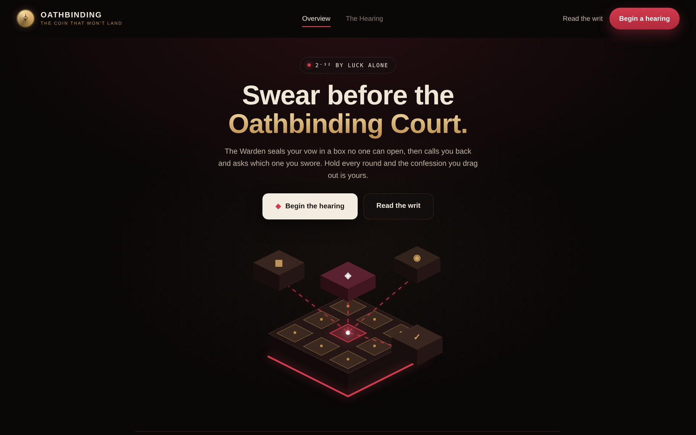
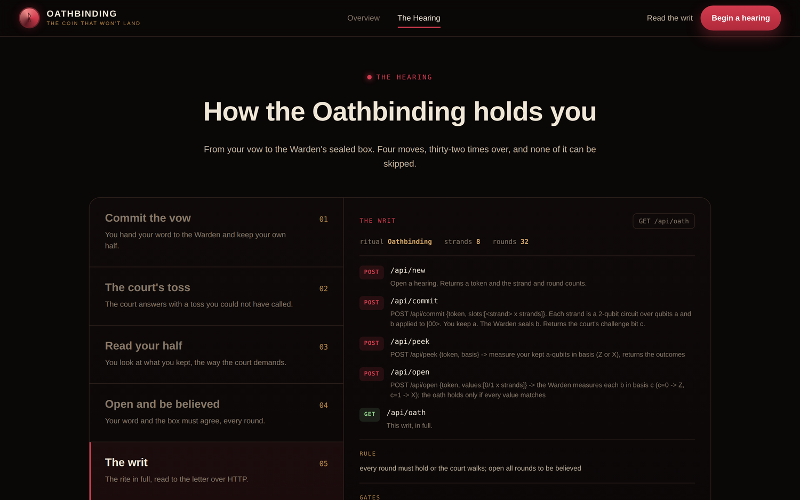

 <font size='10'>The Coin That Won't Land</font><br>
20<sup>th</sup> June 2026<br>
Prepared By: `KailashS`<br>
Challenge Author(s): `KailashS`<br>
Difficulty: <font color='orange'>Medium</font>
<br><br>

# Synopsis

We get a single website, the Oathbinding court, and no files, just the live site. It is a game played over 32 rounds. Each round we make a promise (a "vow"), the court seals part of it away, then flips a coin and asks us to reveal our vow in a way that has to match. Play honestly and we can only win about half the rounds, and we need all 32. The trick is that the sealed half the court holds contains no real information about our vow. A known result, the Mayers-Lo-Chau theorem, says that when a commitment hides that well it cannot actually be binding, which means we are allowed to decide our answer after we see the coin. We do that by handing over entangled qubits (Bell pairs) instead of fixed ones. After each coin flip we measure our own half in the matching way and report what we saw, and the court always agrees. Win all 32 rounds and it gives up the flag.

## Description

After the realm cracked apart, nobody trusted a word anyone said, so the Registry built the Oathbinding to settle disputes for good. You swear a vow before the court, the Warden seals it in a box nobody can open, and later they call you back and ask what you swore. Lie about it and the box catches you. Lands, titles, old debts, it is all decided this way now, because it is the one thing nobody can argue with.

Or so they say. The court throws question after question at you, round after round, waiting for you to fold. Get through every round without a slip and the confession you drag out is your flag.

## Skills Required

- Quantum basics: qubits, entanglement, and measuring in the Z and X bases.
- The idea, from Mayers and Lo-Chau, that a perfectly hiding quantum commitment cannot be binding.
- Reading a web app's traffic and scripting a multi-step HTTP protocol.

## Skills Learned

- Why a commitment that hides perfectly can always be opened both ways.
- The EPR (Bell-pair) trick: commit halves of entangled pairs, wait, then answer once you see the question.
- That measuring your half of a Bell pair lets you predict the other half, as long as both use the same basis.

# Enumeration

## First look at the site

We only get a live instance, a URL and nothing else. The page is the "OATHBINDING" court. The hero text lays the game out plainly: the Warden seals your vow in a box no one can open, then calls you back and asks which vow you swore, and you have to hold every round. A small badge even shows the odds, "2^-32 by luck alone", which tells us there are 32 rounds and no guessing your way through.



There are two buttons, "Begin a hearing" and "Read the writ", and both talk to the API. Watch the Network tab on load and you see `GET /api/oath`, and the "Begin a hearing" button sends `POST /api/new`. The site documents its own protocol.

## Reading the writ

The page has a "How the Oathbinding holds you" section with five tabs. The last one, "The writ", shows the full API, pulled from `GET /api/oath`.



```bash
curl -s http://<host>:<port>/api/oath
```

```json
{
  "ritual": "Oathbinding",
  "strands": 8,
  "rounds": 32,
  "rule": "every round must hold or the court walks; open all rounds to be believed",
  "commit": "POST /api/commit {token, slots:[<strand> x strands]}. Each strand is a 2-qubit circuit over qubits a and b applied to |00>. You keep a. The Warden seals b. Returns the court's challenge bit c.",
  "peek": "POST /api/peek {token, basis} -> measure your kept a-qubits in basis (Z or X), returns the outcomes",
  "open": "POST /api/open {token, values:[0/1 x strands]} -> the Warden measures each b in basis c (c=0 -> Z, c=1 -> X); the oath holds only if every value matches",
  "gates": "single-qubit I X Y Z H S SDG on a or b, e.g. ['H','a']; and CX with control,target among a,b, e.g. ['CX','a','b']"
}
```

Two details here decide the whole attack:

- Each strand is a full two-qubit circuit over qubits `a` and `b`, and we keep `a`. So we are allowed to link the qubit we keep to the qubit we hand over.
- The challenge bit `c` is only returned by `commit`, which means it arrives *after* we commit. We cannot aim our commitment at the question. But nothing stops us from aiming our answer, as long as the qubit we kept still holds something useful.

## The two bases, and one trick

The writ measures things in basis Z or X (in `peek` and `open`), and its gate list includes H and CX. So we need two small facts before going on. They are the same two facts most of these quantum challenges lean on.

First, the bases. A qubit measured in the Z basis reads as `|0>` or `|1>`. There is also an X basis, whose two options are `|+>` and `|->`. If a qubit is set cleanly in one basis, measuring it in the other basis is a coin flip. So `|0>` read in Z is always `|0>`, but read in X it is 50/50.

Second, entanglement. If we build a Bell pair, `(|00> + |11>)/sqrt(2)`, across two qubits and measure both in the same basis, they always give the same answer, whichever basis we pick. There is no fixed pair of bits hidden inside; the match is created at the moment we measure.

Both of these come straight from what the writ lets us do: build a two-qubit circuit (so we can make a Bell pair) and measure in Z or X.

## Trying the honest way

Start a hearing:

```bash
curl -s -XPOST http://<host>:<port>/api/new
# {"token": "...", "strands": 8, "rounds": 32}
```

Commit the obvious way. Leave `b` as `|0>`, a plain Z vow, by sending empty circuits:

```bash
curl -s -XPOST http://<host>:<port>/api/commit \
  -d '{"token":"...","slots":[[],[],[],[],[],[],[],[]]}' -H 'content-type: application/json'
# {"round": 0, "challenge": 1}
```

The challenge came back `c = 1`, so the Warden will measure each `b` in the X basis. Our `b` is `|0>`, which has no fixed X value, so whatever we say only matches by luck:

```bash
curl -s -XPOST http://<host>:<port>/api/open \
  -d '{"token":"...","values":[0,0,0,0,0,0,0,0]}' -H 'content-type: application/json'
# {"round_held": false, "rounds_done": 1, "passes": 0, "total": 32}
```

The round fails. A fixed Z vow can only answer `c = 0`. Over 32 random challenges this honest play holds about half of them and never reaches all 32.

# Solution

## Finding the vulnerability

This is a quantum bit commitment, and it is perfectly hiding. Whether we commit a 0-vow (Z states) or a 1-vow (X states), the single qubit the Warden holds looks exactly the same either way, so the Warden learns nothing before we open. Mayers and Lo-Chau proved that a commitment which hides this well cannot also be binding, and their proof is basically the attack itself.

Instead of a fixed state, we commit a Bell pair on each strand: H on `a`, then CX `a->b`, which makes `(|00> + |11>)/sqrt(2)`. We keep `a`, the Warden keeps `b`. The Warden's half still looks the same as before, so this passes as a normal commitment. But now, from the second fact, our `a` and their `b` match in any basis. So when the challenge `c` arrives, we measure our `a` in that basis, and we already know what their `b` will give. We report those values and the round holds every time.

An honest fixed commitment cannot do this. There, `a` and `b` are separate, so measuring `a` says nothing about `b`, and no single state of `b` is fixed in both Z and X at once. Only entanglement lets us wait for the question and still answer it.

## Exploitation

Each round is the same four steps:

1. commit a Bell pair on all 8 strands
2. read the challenge `c`
3. peek our `a` qubits in basis `c` (Z if `c = 0`, X if `c = 1`)
4. open with those exact values

```
POST /api/commit {slots: <8 Bell pairs>}   ->  {"round": 0, "challenge": 1}
POST /api/peek   {basis: "X"}              ->  {"a_outcomes": [1,0,0,1,1,0,1,0]}
POST /api/open   {values: [1,0,0,1,1,0,1,0]}
   ->  {"round_held": true, "rounds_done": 1, "passes": 1, "total": 32}
```

As one function, a round commits the Bell pairs, reads the challenge, peeks in the matching basis, and opens:

```python
def play_round(s, api, tok, bell):
    c = s.post(f"{api}/api/commit", json={"token": tok, "slots": bell}).json()["challenge"]
    basis = "Z" if c == 0 else "X"                                        # answer in whatever basis is asked
    mine = s.post(f"{api}/api/peek", json={"token": tok, "basis": basis}).json()["a_outcomes"]
    return s.post(f"{api}/api/open", json={"token": tok, "values": mine}).json()  # report our matching halves
```

### Getting the flag

Put together, the attack is:

1. Open a session.
2. Build one Bell pair per strand.
3. Play every round with `play_round`; the last round carries the flag.

That is the whole body of `pwn`:

```python
def pwn(host, port):
    api = f"http://{host}:{port}"
    s = requests.Session()
    start = s.post(f"{api}/api/new").json()
    tok, strands, rounds = start["token"], start["strands"], start["rounds"]
    bell = [[["H", "a"], ["CX", "a", "b"]] for _ in range(strands)]   # a Bell pair per strand
    res = {}
    for _ in range(rounds):
        res = play_round(s, api, tok, bell)                          # hold this round
    print(res.get("flag") or res)
```

A run:

```
round  0  c=1  held=True  1/32
round  1  c=0  held=True  2/32
...
round 31  c=0  held=True  32/32
HTB{...}
```

Every round holds, because we answer after the coin is flipped instead of before. Thirty-two rounds later the court is out of questions, and it hands over the flag.
