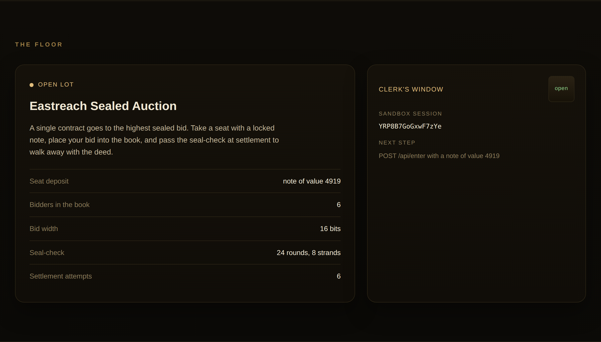
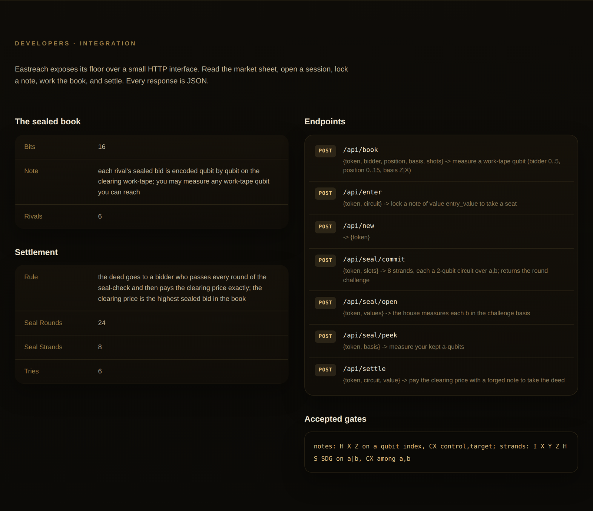

 <font size='10'>The Counting House</font><br>
21<sup>st</sup> June 2026<br>
Prepared By: `KailashS`<br>
Challenge Author(s): `KailashS`<br>
Difficulty: <font color='red'>Hard</font>
<br><br>

# Synopsis

We get a single website, the Eastreach Counting House, a quantum auction hall. There is no source code and no files, just the live site. To get the flag we have to do three things, in order: fake an entry ticket to get a seat, read a book of secret bids we are not allowed to see, and beat a final security check the house claims is unbeatable.

Each of the three is a known quantum idea, and in each one the house leaves the door open for us. The ticket is Aaronson-Christiano subspace money, but the site publishes the formula for its own secret key, so we can print our own tickets. The book uses a BB84-style encoding, but the house uses the same key for every bid, which is the quantum version of reusing a nonce. The final check is a quantum bit commitment, and a known result (the Mayers-Lo-Chau theorem) says such a scheme can hide perfectly or bind perfectly, but not both. This one hides perfectly, so it cannot bind, and that is the gap the Bell-pair trick uses. Read the secret winning price out of the book, pay it with a second fake ticket, and the house hands over the flag.

## Description

Eastreach is where the rich houses go to buy the things that actually matter: lands, titles, old war debts. The Gilded Knife runs the place and built it so you cannot cheat it. You show a note to get a seat, your bid goes into a sealed book nobody reads, and when it is done you pay the winning price exactly. No haggling, no getting out of it.

Or so they say. You cannot afford a seat, so you will fake one. There is a sealed book you are not allowed to read; you will read it anyway. And there is a seal at the end nobody has ever beaten; you are going to beat it, and walk out with the deed.

## Skills Required

- Quantum computing: qubits, superposition, entanglement, and measurement in the Z and X bases.
- Subspace (CSS) states and how to prepare a uniform superposition over a linear code.
- The Mayers-Lo-Chau result that unconditionally secure quantum bit commitment is impossible.
- Linear algebra over GF(2) and scripting against a multi-step JSON API.

## Skills Learned

- How public-key quantum money from hidden subspaces can be forged once the subspace is no longer secret.
- Why reusing one encoding basis across a whole register lets you read every value with a two-basis test.
- The EPR (Bell-pair) trick against a perfectly hiding commitment, and why an honest player cannot pass it.
- How to chain three separate quantum attacks where each one is needed for the next.

# Enumeration

## First look at the site

We only get a live instance, a URL and nothing else, so everything starts in the browser. Open it and you land on the Eastreach Counting House: an auction site with a price chart, a top menu, and, usefully, a Developers tab.


Scroll down to the Floor section and the site does some of the setup for us. It opens a session on its own (open the Network tab and you will see it send `POST /api/new`), shows the token in the "Clerk's Window", and lists the rules of the auction: a seat costs a note of value 4919, six houses are bidding, each bid is 16 bits, the final check runs 24 rounds over 8 strands, and we get 6 tries to settle. It even prints our next step: `POST /api/enter with a note of value 4919`.



That is a lot for free. There is also a full spec sheet.

## Reading the market sheet

The Developers section is the API reference. It lists the note scheme, the book rules, the settlement rules, the endpoints, and the gates we are allowed to use. All of it comes from one route, `GET /api/market`.



Let us read that route ourselves, since it explains the whole challenge (trimmed to the parts that matter):

```bash
curl -s http://<host>:<port>/api/market
```

```json
{
  "note": {
    "qubits": 8, "checks": 4, "entry_value": 4919,
    "scheme": "a note of value v is the subspace state |A_v>, A_v = ker(H_v); the public parity-check H_v has 4 rows over 8 bits, row i = sha256('eastreach-note-v{v}-{i}') truncated to 8 bits, skipping rows that do not raise the rank",
    "verify": "lock a note by submitting a circuit on 8 qubits; the house prepares it and checks every Z-basis reading lies in A_v and every X-basis reading lies in A_v^perp"
  },
  "book": { "rivals": 6, "bits": 16,
    "note": "each rival's sealed bid is encoded qubit by qubit on the clearing work-tape; you may measure any work-tape qubit you can reach" },
  "settlement": { "seal_strands": 8, "seal_rounds": 24, "tries": 6,
    "rule": "the deed goes to a bidder who passes every round of the seal-check and then pays the clearing price exactly; the clearing price is the highest sealed bid in the book" },
  "endpoints": {
    "/api/new": "POST -> {token}",
    "/api/enter": "POST {token, circuit} -> lock a note of value entry_value to take a seat",
    "/api/book": "POST {token, bidder, position, basis, shots} -> measure a work-tape qubit (bidder 0..5, position 0..15, basis Z|X)",
    "/api/seal/commit": "POST {token, slots} -> 8 strands, each a 2-qubit circuit over a,b; returns the round challenge",
    "/api/seal/peek": "POST {token, basis} -> measure your kept a-qubits",
    "/api/seal/open": "POST {token, values} -> the house measures each b in the challenge basis",
    "/api/settle": "POST {token, circuit, value} -> pay the clearing price with a forged note to take the deed"
  },
  "gates": "notes: H X Z on a qubit index, CX control,target; strands: I X Y Z H S SDG on a|b, CX among a,b"
}
```

The response splits into three parts: `note`, `book`, and `settlement`. Those are the three things we have to get past. Every number we will need is right here (8 qubits, 4 checks, entry value 4919, 6 bidders, 16-bit bids, 8 strands, 24 rounds, 6 tries), so we never have to guess a constant. One number is missing on purpose: the clearing price. That is the number we steal in Stage 2.

## The two bases everything uses

Before touching anything, look at that sheet again and ask what keeps showing up. It is two letters. The note is checked with a Z reading and an X reading. The book lets us measure in Z or X. The seal challenges us in one basis, and the gate list starts with H. So the whole challenge runs on two bases, Z and X, plus the H gate. It is worth a moment to be clear on what those are, because the rest of the writeup leans on them.

A qubit is just a vector. In the Z basis (the normal one) the two options are written `|0>` and `|1>`. In the X basis the two options are `|+>` and `|->`, where `|+> = (|0> + |1>)/sqrt(2)` and `|-> = (|0> - |1>)/sqrt(2)`. The H (Hadamard) gate switches between the two: `H|0> = |+>`, `H|1> = |->`, and running H again brings you back.

Two facts about measuring do most of the work later:

- If a qubit is set in one basis, reading it in the *other* basis is random. Measure `|0>` or `|1>` in Z and you get the same answer every time. Measure the same qubit in X and it is 50/50, because `|0>` is an equal mix of `|+>` and `|->`. It works the same way round the other way. We use this in Stage 2.
- A Bell pair matches in any basis. Take two qubits in the state `(|00> + |11>)/sqrt(2)`. If both are measured in the same basis, they always give the same result, whichever basis that is. There is no fixed pair of bits stored inside; the match only happens at the moment you measure. We use this in Stage 3.

Keep both of those handy.

# Solution

## Finding the vulnerability

The house makes three claims: the ticket cannot be faked, the book cannot be read, the final seal cannot be beaten. All three are wrong, and each one is wrong because of something the site itself gives away.

**The ticket.** A ticket of value `v` is a quantum state `|A_v>`, an equal mix of all 8-bit strings that `H_v` maps to zero (the kernel of `H_v`). Normally you would need the secret matrix `H_v` to build that state. But the `note.scheme` field prints exactly how `H_v` is built: row `i` is `sha256("eastreach-note-v{v}-{i}")` cut to 8 bits, skipping rows that do not add rank. SHA-256 is public and we choose `v`, so we can rebuild `H_v` ourselves and make a ticket for any value. This is the known Aaronson-Christiano money scheme, except the secret is printed in the manual.

**The book.** Each bid bit is one qubit, stored in either the Z or the X basis (we will confirm this by testing it). From the first fact above, reading it in the correct basis gives the bit, and reading it in the wrong basis is random, so testing both bases tells us which one was used. The mistake is that the house uses the same 16-position basis for every bid and every bidder. Find it once and you can read the whole book. Reusing one key everywhere is a common real-world bug, the same shape as reusing a nonce.

**The seal.** The final check is a quantum bit commitment. We lock in a value now and reveal it later, and we should not be able to change it in between. Mayers and Lo-Chau proved that such a scheme cannot both hide perfectly and stay binding. This one hides perfectly (the qubit the house keeps tells it nothing about our value), so it cannot be binding, and that is what lets us change our answer later using entanglement.

These three are stacked on purpose. The book and the seal both require a seat, so the fake ticket has to come first. Settlement at the very end needs three things at once: the seal already passed, a ticket worth exactly the clearing price, and the clearing price itself, which is never printed and can only come from the book. We cannot guess the price either, since bids are 16 bits and we only get 6 tries. So we really do have to do all three, in order.

## Exploitation

### Stage 1: forge a seat

To get a seat we submit a ticket worth the entry value. Written out, a ticket of value `v` is:

```
|A_v> = (1 / sqrt(|A_v|)) * sum over a in A_v of |a>,   A_v = ker(H_v)
```

In plain terms: take every 8-bit string that `H_v` sends to zero, and add them all together with equal weight. With 8 bits and 4 checks, 4 of the bits are free, so there are `2^4 = 16` such strings.

How does the house check our ticket? From `note.verify`, it runs our circuit on 8 qubits and checks two things: every Z reading is in `A_v`, and every X reading is in `A_v^perp` (the dual space). A real ticket passes both, because putting H on every qubit turns `|A_v>` into `|A_v^perp>`. This also explains why a lazy guess fails. The all-zeros state passes the Z check for free (zero is in every kernel), but H turns it into an equal spread over all 256 strings, which almost never lands in the small dual space, so it fails the X check. One handy side effect: sending the empty circuit and watching it get rejected proves the house really is checking both bases.

Now we build the real circuit, using only the gates the sheet allows for notes (H, X, Z, CX). It is all GF(2) linear algebra, so we start with two helpers. `dot` is an inner product mod 2; we use it in a moment when solving for the kernel. `rref` is Gaussian elimination that returns a map from pivot column to row; we use it twice, once to build `H_v` and once to clean up the kernel. Bit-vectors are plain Python ints, one bit per qubit.

```python
def dot(a, b):
    return bin(a & b).count("1") & 1          # inner product of two bit-vectors, mod 2

def rref(vecs):
    # Gaussian elimination over GF(2) -> {pivot_column: reduced_row}
    piv = {}
    for v in vecs:
        cur = v
        for col in sorted(piv, reverse=True):
            if (cur >> col) & 1:
                cur ^= piv[col]
        if cur == 0:
            continue
        col = (cur & -cur).bit_length() - 1
        for c in list(piv):
            if (piv[c] >> col) & 1:
                piv[c] ^= cur
        piv[col] = cur
    return piv
```

Next we rebuild `H_v` from the SHA-256 formula. We keep a new hash row only if it adds rank. The reason is simple: a row that is just a combination of rows we already have adds no new constraint on the kernel, so it is useless and we drop it. Stop once we have four independent rows. This function is the actual forgery; it makes the "secret" key for any value we ask for.

```python
def H_for_value(v):
    rows, ctr = [], 0
    while len(rows) < K:                       # K = 4 check rows
        h = hashlib.sha256(("eastreach-note-v%d-%d" % (v, ctr)).encode()).digest()
        r = int.from_bytes(h, "big") & ((1 << N) - 1)   # N = 8 bits
        ctr += 1
        if r and len(rref(rows + [r])) == len(rows) + 1:  # keep it only if it raises the rank
            rows.append(r)
    return rows
```

Last, turn `H_v` into a circuit. We find the kernel, run `rref` on it, then put an H on each pivot qubit and a CX from that pivot to each dependent bit.

Why `rref`, and not just any basis of the kernel? Here is the point. To build the state as a circuit, we want each of the 4 free bits to be controlled by its own single qubit, with the other qubits copying it. A plain kernel basis mixes the free bits across many qubits, and then there is no clean qubit to attach a gate to. `rref` fixes that: it gives each basis vector one unique pivot column, so exactly one qubit controls each free bit. That is why the pivots are the qubits that get the H gates. They are the free bits we are spreading over.

After that the circuit is short. An H on a pivot puts that free bit into an equal 0/1 mix. Each CX copies the pivot onto the qubits that have to match it. Do that for every pivot and you have built `|A_v>`.

```python
def note_circuit(value):
    rows = H_for_value(value)
    pivH = rref(rows)
    basis = []                                 # solve H_v x = 0 -> a basis for the kernel A_v
    for free in range(N):
        if free in pivH:
            continue
        x = 1 << free
        for col, row in pivH.items():
            if dot(row ^ (1 << col), x):
                x |= 1 << col
        basis.append(x)
    piv = rref(basis)                          # unique pivot per basis vector
    ops = [["H", p] for p in piv]              # H on each free/pivot qubit
    for p, vec in piv.items():
        for c in range(N):
            if c != p and (vec >> c) & 1:      # CX pivot -> each dependent bit
                ops.append(["CX", p, c])
    return ops
```

Submit `note_circuit(4919)` and we are seated. Send the empty circuit first if you want to watch it fail:

```
POST /api/enter {token, circuit: []}                   ->  {"seated": false}
POST /api/enter {token, circuit: <note_circuit(4919)>} ->  {"seated": true}
```

We have a seat.

### Stage 2: read the book

The clearing price is just the highest of the six bids. The only tool we get is `/api/book`, which measures one qubit at a time: pick a bidder (0 to 5), a position (0 to 15), a basis (Z or X), and a number of shots, and it returns the results.

The sheet says each bid is stored qubit by qubit but not how, so we have to figure it out. Each bit is stored either as a Z state (`|0>`/`|1>`) or an X state (`|+>`/`|->`). From the first fact earlier: read it in the right basis and it is steady, read it in the wrong basis and it is random. So we measure the same qubit several times in Z, then several times in X, and whichever one is always the same tells us the basis and the bit. Here is a real test of bidder 0's first two positions:

```
POST /api/book {bidder:0, position:0, basis:"Z", shots:8}  ->  {"outcomes": [1,1,1,1,1,1,1,1]}
POST /api/book {bidder:0, position:0, basis:"X", shots:8}  ->  {"outcomes": [0,0,0,0,0,1,0,1]}   # position 0: Z, bit 1

POST /api/book {bidder:0, position:1, basis:"Z", shots:8}  ->  {"outcomes": [1,1,1,1,1,1,1,0]}
POST /api/book {bidder:0, position:1, basis:"X", shots:8}  ->  {"outcomes": [0,0,0,0,0,0,0,0]}   # position 1: X, bit 0
```

Position 0 is steady in Z and jumpy in X, so it is a Z bit with value 1. Position 1 is the other way round. But look closely at position 1's Z column: `[1,1,1,1,1,1,1,0]`. That is one flip away from looking steady. A wrong-basis column is just coin flips, and with 8 shots the chance of all 8 matching by luck is `2^-7`, about 1 in 128. Across 96 qubits that is far too risky. With 24 shots that chance drops to `2^-23`, about 1 in 8 million, which is safe. That is why the solver uses 24: safe, without wasting requests.

Now the shortcut. We do not have to test all 96 qubits. The house uses the same 16-position basis for everyone, so we only test one bidder (bidder 0) to learn all 16 basis choices, then read every other bidder with a single measurement per qubit. As one function that returns the price:

```python
def read_book(s, api, tok, rivals, bits):
    theta = []                                 # recover the reused 16-position basis from bidder 0
    for j in range(bits):
        z = s.post(f"{api}/api/book", json={"token": tok, "bidder": 0, "position": j, "basis": "Z", "shots": 24}).json()["outcomes"]
        theta.append("Z" if all(o == z[0] for o in z) else "X")   # steady in Z -> Z-encoded, else X
    bids = []
    for r in range(rivals):                    # read every bidder in the known basis, pack to an int
        v = 0
        for j in range(bits):
            o = s.post(f"{api}/api/book", json={"token": tok, "bidder": r, "position": j, "basis": theta[j], "shots": 24}).json()["outcomes"]
            v = (v << 1) | o[0]
        bids.append(v)
    return max(bids)                           # clearing price = highest bid
```

That gives us `P`.

### Stage 3: settle

Two steps are left: pass the seal check, then pay exactly `P`. The seal check runs 24 rounds over 8 strands, and we only get 6 tries total. Each round we commit 8 small two-qubit circuits (on qubits `a` and `b`); the house keeps every `b`, then tells us a random basis; we peek at our `a` qubits in any basis we want, then open by sending values, which the house compares against measuring each `b` in the announced basis.

An honest player is stuck here. Any fixed state they commit is steady in one basis and random in the other, so about half the time the announced basis is the wrong one and they fail. Surviving 24 rounds that way is hopeless. Our way out is the second fact from earlier. On each strand we commit a Bell pair: H on `a`, then CX `a->b`, which makes `(|00> + |11>)/sqrt(2)`. We keep `a`, the house keeps `b`, and the two are now linked. A Bell pair matches in any basis, so we wait for the house to announce the basis, measure our `a` qubits in that same basis, and send back what we saw. The house's `b` will match every time. One way to think about it: we are not locking in an answer early, we are answering after we have seen the question. One round:

```
POST /api/seal/commit {slots: <8 Bell pairs>}   ->  {"challenge": 1, "round": 0}
POST /api/seal/peek   {basis: "X"}              ->  {"a_outcomes": [0,1,1,0,1,1,1,1]}
POST /api/seal/open   {values: [0,1,1,0,1,1,1,1]}
   ->  {"held": true, "passes": 1, "rounds_done": 1, "sealed": false, "total": 24}
```

We loop until the server says `sealed`. That flag only turns true after all 24 rounds have passed, so it is the signal that we are done. Because a Bell pair passes every round, the loop always ends after 24 rounds.

```python
def break_seal(s, api, tok, strands):
    bell = [[["H", "a"], ["CX", "a", "b"]] for _ in range(strands)]   # a Bell pair per strand
    while True:
        c = s.post(f"{api}/api/seal/commit", json={"token": tok, "slots": bell}).json()["challenge"]
        basis = "Z" if c == 0 else "X"                                # answer in whatever basis is asked
        a = s.post(f"{api}/api/seal/peek", json={"token": tok, "basis": basis}).json()["a_outcomes"]
        out = s.post(f"{api}/api/seal/open", json={"token": tok, "values": a}).json()
        if out["sealed"]:
            return
```

Now we pay. Forge a second ticket, this time worth `P`, and send it with the price to `/api/settle`:

```
POST /api/settle {token, circuit: <note_circuit(P)>, value: P}   ->  {"settled": true, "deed": "HTB{...}"}
```

The ticket checks out as a real note of value `P`, the price is exactly right, the seal is already passed, and the house returns the deed. The deed is the flag.

### Getting the flag

Put together, the full attack is:

1. Open a session and take a seat with `note_circuit(4919)`.
2. Read every bid with `read_book` to get the price `P`.
3. Pass the seal with `break_seal`, then settle by paying `P` with `note_circuit(P)`.

That is the whole body of `pwn`, which just calls the functions built above:

```python
def pwn(host, port):
    api = f"http://{host}:{port}"
    s = requests.Session()
    tok = s.post(f"{api}/api/new").json()["token"]
    m = s.get(f"{api}/api/market").json()

    s.post(f"{api}/api/enter", json={"token": tok, "circuit": note_circuit(ENTRY)})   # Stage 1
    P = read_book(s, api, tok, m["book"]["rivals"], m["book"]["bits"])                 # Stage 2
    break_seal(s, api, tok, m["settlement"]["seal_strands"])                           # Stage 3
    res = s.post(f"{api}/api/settle", json={"token": tok, "circuit": note_circuit(P), "value": P}).json()
    print(res.get("deed") or res)
```

A run:

```
[*] seated: True
[*] book: [40009, 21092, 38482, 4635, 39540, 58326]  clearing price P = 58326
[*] seal-check passed 24 / 24
HTB{...}
```

Three stages, one flag: a ticket we made ourselves, a book we were not supposed to read, and a seal that hid so well it could not hold.
