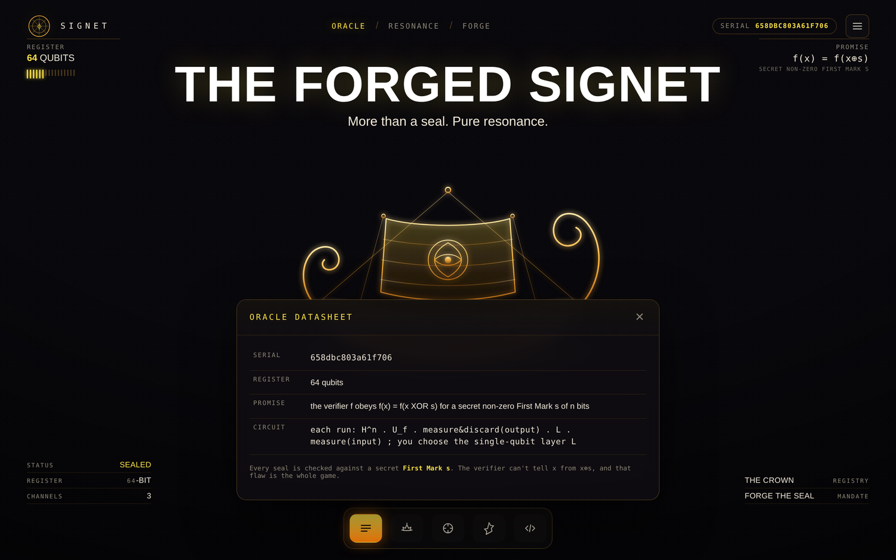
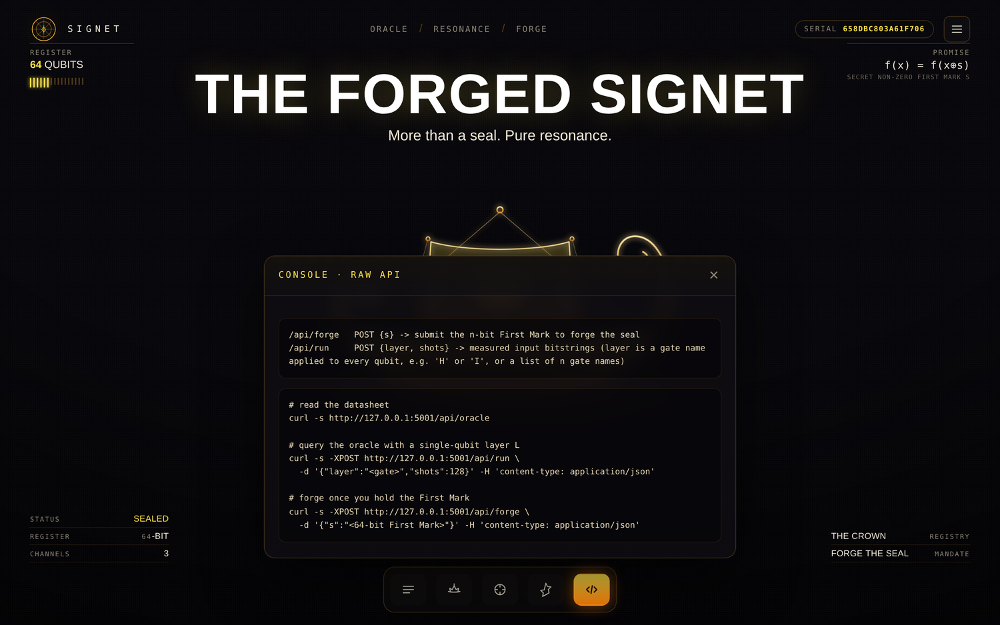
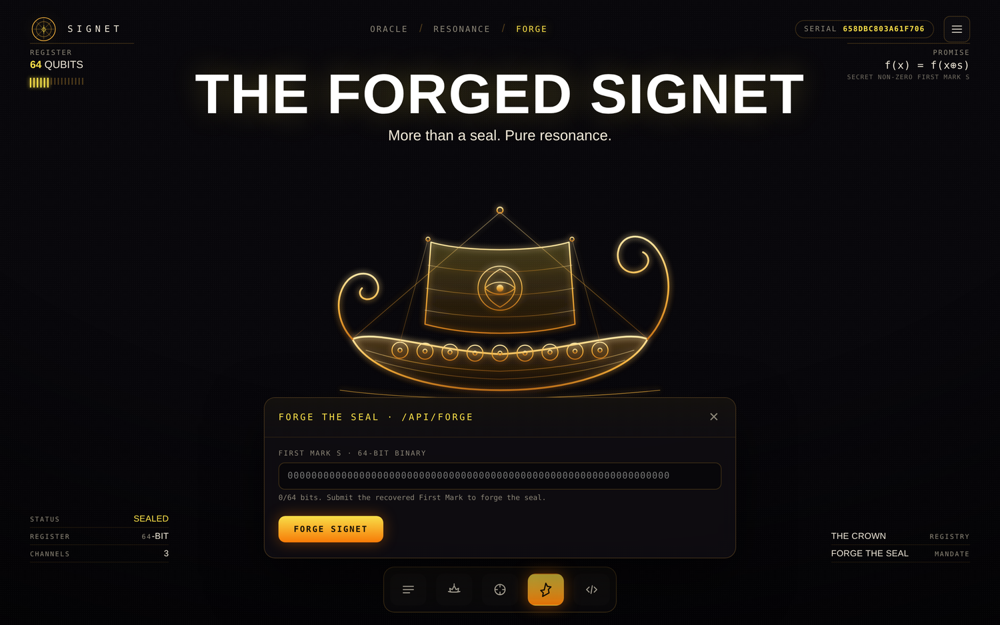

 <font size='10'>The Forged Signet</font><br>
20<sup>th</sup> June 2026<br>
Prepared By: `KailashS`<br>
Challenge Author(s): `KailashS`<br>
Difficulty: <font color='green'>Easy</font>
<br><br>

# Synopsis

We get one website and nothing else. It calls itself the Resonance Oracle of the Brine Signet, a machine that checks seals against a hidden 64-bit secret called the First Mark. The site openly tells us the checker has a strange property: `f(x) = f(x XOR s)` for that secret `s`. That one line is the whole challenge. A function with a hidden XOR period like this is exactly Simon's problem, and Simon's algorithm cracks it quickly. The site lets us run its quantum circuit and pick one gate layer. If we pick the Hadamard layer, every result it gives back is a bitstring `y` with `y·s = 0`. Collect enough of those, solve the linear system, and the one nonzero answer is the First Mark. Hand it to the forge endpoint and we get the flag.

## Description

A long time ago the Brine Signet was the one thing nobody could fake; it was how the Crown proved a seal was real. Then it broke, and everything went bad. Every seal is still checked against a secret called the First Mark, a hidden string `s` that lives inside the verifier. The verifier has a flaw it was never meant to have: if two inputs differ by exactly the Mark, it cannot tell them apart, so `f(x)` and `f(x XOR s)` always look the same to it. The Registry hid the verifier behind a quantum oracle and swore the Mark was safe. It is not.

## Skills Required

- Basic quantum computing: what a qubit is, what a measurement does, and what the Hadamard gate does.
- Linear algebra over GF(2): solving a system of equations and reading off the answer.
- Reading a web app's traffic (browser dev tools) and scripting HTTP requests against a JSON API.

## Skills Learned

- How Simon's algorithm turns a hidden XOR secret into measurements that are all "perpendicular" to that secret.
- Why the Hadamard layer is the one that gives useful results, and why every other layer gives noise.
- How to recover a secret bitstring from a pile of parity equations using Gaussian elimination over GF(2).

# Enumeration

## First look at the site

We only get a live instance, a URL and nothing else, so we start in the browser. The page is a dark "SIGNET" console with a Norse longship in the middle. The decorations are not just for show; they leak the important facts. The top-left readout says a 64-qubit register. The top-right prints the promise `f(x) = f(x⊕s)` with the note "secret non-zero First Mark s". There is a serial number up top, and a row of buttons along the bottom.


Where do those numbers come from? Open the Network tab and reload. The page makes one request, `GET /api/oracle`, and fills itself in from the reply. That is our first endpoint, handed to us for free.

## Reading the oracle datasheet

The dock at the bottom has an Oracle button. It shows the same data in a panel.



We can read the raw version ourselves:

```bash
curl -s http://<host>:<port>/api/oracle
```

```json
{
  "serial": "658dbc803a61f706",
  "n": 64,
  "promise": "the verifier f obeys  f(x) = f(x XOR s)  for a secret non-zero First Mark s of n bits",
  "circuit": "each run: H^n . U_f . measure&discard(output) . L . measure(input) ; you choose the single-qubit layer L",
  "endpoints": {
    "/api/run": "POST {layer, shots} -> measured input bitstrings (layer is a gate name applied to every qubit, e.g. 'H' or 'I', or a list of n gate names)",
    "/api/forge": "POST {s} -> submit the n-bit First Mark to forge the seal"
  }
}
```

There is even a raw API console in the dock that just prints the endpoints and ready-made `curl` commands, so the site basically documents itself.



Three things in this reply matter:

- **`n = 64`.** The secret and the register are both 64 bits.
- **`promise`: `f(x) = f(x XOR s)`.** Two different inputs give the same output whenever they differ by `s`. This is the exact setup of Simon's problem.
- **`circuit`.** Each run does `H^n`, then the secret checker `U_f`, then measures and throws away the output, then applies a layer `L` that we choose, then measures the input. That layer `L` is the only thing we control, and it is the whole game.

## The run and forge endpoints

The Resonance panel is the front end for `/api/run`. It lets us pick the layer `L` from the allowed gates (`I X Y Z H S SDG`) and a number of shots, then shows the measured bitstrings.


Try the "do nothing" layer first, so we know what junk looks like. Send layer `I`:

```bash
curl -s -XPOST http://<host>:<port>/api/run \
  -d '{"layer":"I","shots":4}' -H 'content-type: application/json'
```

```json
{
  "layer": "I",
  "shots": 4,
  "samples": [
    "1011000000010001000100101000010111001011011001001000100011111101",
    "0000110001111100110101011101111001110010010100001010100111101111",
    "0011010101100111110010001011011100010011111100010000000000001110",
    "0100011110100110000100011100110011001100110000010011011000101010"
  ]
}
```

With the identity layer we just read a random string, and the strings have nothing to do with each other. There is no structure to work with here.

Now send the layer Simon's algorithm wants, `H`:

```bash
curl -s -XPOST http://<host>:<port>/api/run \
  -d '{"layer":"H","shots":4}' -H 'content-type: application/json'
```

```json
{
  "layer": "H",
  "shots": 4,
  "samples": [
    "0111010001101101010001110011001101101001011000000111111010100000",
    "0010001000111101001001011111110100010110100110110010011000111100",
    "0100001011001110010110111001011001100001010101001011010010011100",
    "1101000100010100001000011100110110100100001101111000000001010010"
  ]
}
```

These look just as random, but they are not. Every one of them satisfies `y·s = 0`. We cannot see it yet, because we do not know `s`, but that hidden rule is exactly what we solve for.

The Forge panel is the front end for `/api/forge`. It takes a 64-bit string and submits it as a guess for the First Mark.



Guessing is pointless, but it is worth a quick check. Send all zeros:

```bash
curl -s -XPOST http://<host>:<port>/api/forge \
  -d '{"s":"0000000000000000000000000000000000000000000000000000000000000000"}' \
  -H 'content-type: application/json'
```

```json
{"forged": false}
```

No hint, nothing to grind on. There are 64 unknown bits, and the oracle never lets us feed an input to `f` directly, so the classical trick of hunting for a collision would need about `2^32` tries. The intended path is Simon's algorithm.

# Solution

## Finding the vulnerability

The promise `f(x) = f(x XOR s)` means `f` is two-to-one: inputs pair up, and every pair differs by the same hidden `s`. That is Simon's problem, and Simon's algorithm recovers `s` in about `n` runs.

Here is what one Hadamard run actually does. The circuit first puts the input into a full superposition, applies the secret checker `f`, then measures and throws away `f`'s output. Because `f` pairs `x` with `x XOR s`, throwing the output away leaves the input in an equal mix of just two strings: some random `x0` and `x0 XOR s`. Then our layer `L = H` is applied and the input is measured. Running H across a two-string mix like this makes the two pieces interfere, and the interference is picky about which results survive:

```
P(y) = 0                if  y . s = 1     (these cancel out)
P(y) = 2^-(n-1)         if  y . s = 0     (these are all equally likely)
```

So every Hadamard measurement is a random string `y` that happens to satisfy `y·s = 0`. One way to read that: each sample is one equation, `y·s = 0`, in the unknown bits of `s`. Collect enough independent equations and only a single nonzero `s` fits all of them.

This is also why the other layers are useless. With the identity layer you read the two-string mix directly and learn nothing about `s` unless you happen to see the same output twice, and that collision takes about `2^32` tries. The Hadamard layer is the one that turns the hidden pairing into equations we can actually solve.

## Exploitation

### Recovering the First Mark

The plan is short:

1. Ask `/api/run` for a batch of samples with `layer = "H"`.
2. Drop any all-zero samples (they only say `0 = 0`, which tells us nothing) and remove duplicates.
3. Keep pulling batches until we have a bit more than `n` distinct samples, which is plenty to get 63 independent equations.
4. Treat the samples as rows of a matrix over GF(2) and find the one nonzero vector that is perpendicular to all of them. That is `s`.

Step 4 is Gaussian elimination over GF(2). Each sample is a row, and we want the vector `s` that every row is perpendicular to, which is the null space of the matrix. We reduce the rows to a clean form, and because we have `n - 1` independent equations there is exactly one free bit left. We set that free bit and back-substitute the rest to read off `s`.

```python
def nullspace(rows, n):
    rows = [r for r in rows if r]              # drop all-zero rows; they carry no equation
    piv = {}
    for r in rows:
        for c in sorted(piv, reverse=True):    # reduce this row against the pivots we have
            if (r >> c) & 1:
                r ^= piv[c]
        if not r:
            continue
        c = (r & -r).bit_length() - 1
        for k in list(piv):
            if (piv[k] >> c) & 1:
                piv[k] ^= r
        piv[c] = r
    free = [c for c in range(n) if c not in piv]   # the one bit no equation pins down
    if not free:
        return None
    s = 1 << free[0]                           # set that free bit, then back-substitute the rest
    for c, r in piv.items():
        if bin((r ^ (1 << c)) & s).count("1") & 1:
            s |= 1 << c
    return s
```

We also need the samples. One small function pulls Hadamard batches, throws away the all-zero and duplicate ones, and stops when we have more than enough:

```python
def collect_samples(s, url, n):
    rows, seen = [], set()
    while len(rows) < n + 16:                  # a few more than n, to be sure of n-1 independent rows
        for bits in s.post(f"{url}/api/run", json={"layer": "H", "shots": 128}).json()["samples"]:
            y = int(bits, 2)
            if y and y not in seen:            # skip all-zero and repeated samples
                seen.add(y)
                rows.append(y)
    return rows
```

If you want to be careful, check the answer before forging: every sample `y` should satisfy `popcount(y AND s)` even. If one fails, we did not have enough independent rows yet, so pull another batch.

### Getting the flag

Write `s` as a 64-bit string and send it:

```
POST /api/forge {"s": "<recovered 64-bit First Mark>"}   ->  {"forged": true, "flag": "HTB{...}"}
```

Put together, the attack is:

1. Read `n` from `/api/oracle`.
2. Collect Hadamard samples with `collect_samples`.
3. Solve for `s` with `nullspace`, then forge it.

That is the whole body of `pwn`, which just calls the two functions above:

```python
def pwn(host, port):
    url = f"http://{host}:{port}"
    s = requests.Session()
    n = s.get(f"{url}/api/oracle").json()["n"]         # register size, 64
    rows = collect_samples(s, url, n)                  # Hadamard samples, each with y.s = 0
    mark = format(nullspace(rows, n), f"0{n}b")        # the one nonzero vector they all agree on
    r = s.post(f"{url}/api/forge", json={"s": mark}).json()
    print(r.get("flag") or f"forge failed: {r}")
```

A run:

```
n = 64
samples: 128
first mark: 0001001001100100000101010000100110001111001111000111101111001011
HTB{...}
```

One batch of 128 Hadamard samples is enough to pin down all 64 bits, the solve is instant, and the forge call returns the flag.
