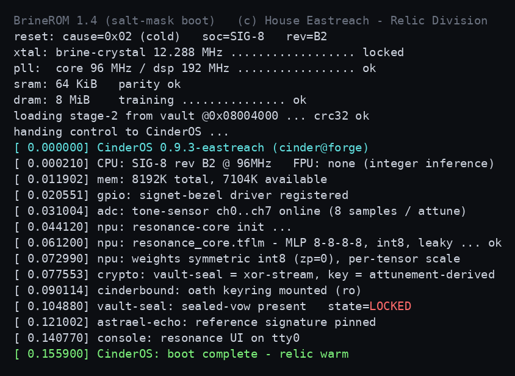
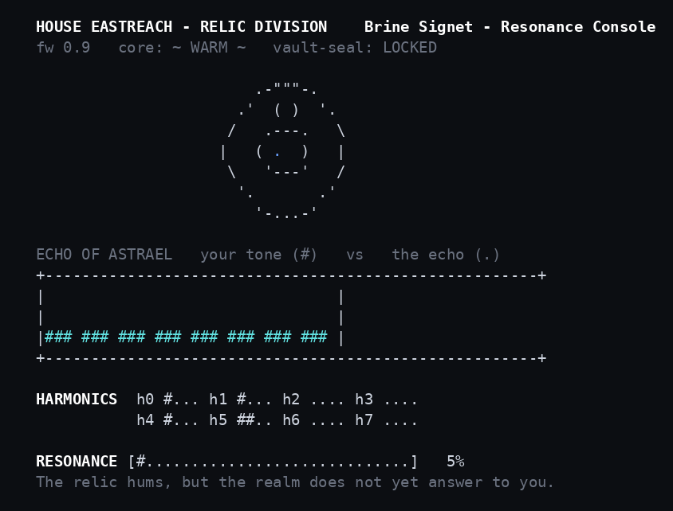

 <font size='10'>Ringtrue</font><br>
21<sup>st</sup> June 2026<br>
Prepared By: `Kailash S`<br>
Challenge Author(s): `Kailash S`<br>
Difficulty: <font color='green'>Very Easy</font>
<br><br>


# Synopsis

Ringtrue is an easy reversing challenge that requires the player to recognise the binary's authentication check as a 3-layer int8-quantized neural network with an invertible leaky activation, extract the weights, biases, and target output from the unstripped ELF, and invert the network layer by layer to recover the eight-sample input, which both authenticates the relic and derives the key that decrypts the flag.

## Description

House Eastreach found one of the broken Signet's shards. Instead of melting it down, they put it to work. The shard still holds a bit of the dragon Astrael's power, so Eastreach built a small device around it and taught it to listen for one voice. Play the right eight tones and the shard rings true: the vow sealed inside opens, and it can carry a king's command again. Play anything else and nothing happens.

Sera can't guess the tones. There are eight of them, each can be any value, and far too many to try one by one. But Eastreach was careless and left the device open to read, with everything it was taught still written plainly inside. That carelessness is the whole opening she needs. Find the one voice it was built to obey, and the shard answers to her instead of Eastreach.

## Skills Required

- Static analysis of an unstripped Linux ELF (a disassembler such as Ghidra, and reading the symbol table).
- Recognising quantized neural-network inference: dense layers, int8 weights, integer accumulators, and an activation.
- Linear algebra: solving a square linear system exactly.

## Skills Learned

- How quantized (int8) MLP inference appears in a compiled binary.
- Inverting a neural network layer by layer when every layer is invertible (a model-inversion attack).
- Inverting a leaky activation, including the negative (even) branch.

## MITRE Mappings

- `T1606` Forge Authentication Material: reconstructing the exact eight-sample input the authentication network accepts recovers the First Mark credential the relic requires.
- `T1027` Obfuscated Files or Information: the flag is stored as an XOR-stream ciphertext inside the binary and only exists in plaintext after decryption.
- `T1140` Deobfuscate/Decode Files or Information: recovering the flag requires deriving the keystream from the recovered input and decrypting the sealed vow.

# Enumeration

## Initial analysis

We are given a single binary, `ringtrue`, extracted from the release archive. Let's identify it:

```bash
$ file ringtrue
ringtrue: ELF 64-bit LSB pie executable, x86-64, dynamically linked, not stripped
```

We can observe that the binary is **not stripped**, so its function and data symbols are intact, which will let us read the check and its data directly.

Running the binary plays a firmware boot sequence before presenting a console:



The boot log is effectively a roadmap, because it names the model and the flag scheme:

```
[ 0.061200] npu: resonance_core.tflm - MLP 8-8-8-8, int8, leaky ... ok
[ 0.072990] npu: weights symmetric int8 (zp=0), per-tensor scale
[ 0.077553] crypto: vault-seal = xor-stream, key = attunement-derived
```

Looking at these lines, we can observe three things:

1. The authentication check is an **8-8-8-8 MLP** (a neural network) with **int8** weights and a **leaky** activation.
2. The weights use symmetric int8 quantization with zero-point 0.
3. The flag ("vault-seal") is an **XOR stream keyed by the input** ("attunement-derived"), so the flag is decrypted from the input rather than simply gated by it.

The console then asks for eight tone samples:



Submitting an arbitrary input only moves a resonance meter and never accepts. The input space is `256^8`, so brute force is infeasible. This means we need to reverse the model and compute the one input it accepts.

## Static analysis

Because the binary is not stripped, the symbols expose the network directly. The check reduces to a stack of dense (matrix) layers with an activation between them:

```c
int64_t leaky(int64_t x) { return x >= 0 ? x : 2 * x; }

void dense(const int8_t W[8][8], const int32_t B[8],
           const int64_t in[8], int64_t out[8]) {
    for (int i = 0; i < 8; i++) {
        int64_t acc = B[i];
        for (int j = 0; j < 8; j++)
            acc += (int64_t)W[i][j] * in[j];   // int8 weight * activation
        out[i] = acc;
    }
}

int nn_forward(const int32_t X[8], int64_t out[8]) {
    int64_t a[8], h[8], in[8];
    for (int i = 0; i < 8; i++) in[i] = X[i];
    dense(L0_W, L0_B, in, a); for (i) h[i] = leaky(a[i]);
    dense(L1_W, L1_B, h,  a); for (i) h[i] = leaky(a[i]);
    dense(L2_W, L2_B, h,  out);
    return out == ECHO_S;   // accept iff the output equals the target
}
```

In other words, the relic accepts an input `X` if and only if:

```
a0 = L0_W . X  + L0_B ;  h0 = leaky(a0)
a1 = L1_W . h0 + L1_B ;  h1 = leaky(a1)
out = L2_W . h1 + L2_B ;  out == ECHO_S
```

This is genuine integer neural-network inference: three dense layers, int8 weights accumulated into int64, with a nonlinear activation between them. The named globals provide everything needed: `L0_W`, `L1_W`, `L2_W` (int8 8x8 matrices), `L0_B`, `L1_B`, `L2_B` (int32 bias vectors), and `ECHO_S` (the int64 target). These can be dumped from the decompiler, from the data section (`objdump -s -j .data`), or read from the symbol table.

The flag is not a simple pass/fail gate. On success the binary derives a keystream from the input and decrypts a stored ciphertext:

```c
uint8_t key[8], ks[32];
for (i = 0; i < 8; i++) key[i] = X[i] & 0xFF;   // the eight samples, low byte of each
sha256(key || counter, ks);                     // keystream = SHA-256 of the samples
for (i = 0; i < VOW_LEN; i++) out[i] = VOW_CIPHER[i] ^ ks[i];
```

This means forcing the success branch with a wrong `X` (or patching the comparison) produces a wrong key and therefore garbage. Because the keystream is a cryptographic hash of the samples, the ciphertext cannot be unsealed without the exact `X`, so we must recover it rather than bypass the check.

# Solution

## Finding the vulnerability

The network is exactly invertible, for two reasons:

1. **Each dense layer is invertible.** Each weight matrix is square and non-singular, so `Y = W . V + B` can be solved for `V` as `V = W^-1 . (Y - B)`.
2. **The activation is invertible.** `leaky(x) = x` for `x >= 0` and `2x` for `x < 0`, so its inverse is `h` for `h >= 0` and `h / 2` for `h < 0`. A negative activation output is `2 * (negative)` and therefore even, so the division is exact, and positive and negative ranges never overlap, so the map is a clean bijection.

Because every step is invertible, the entire forward pass can be run backwards. Starting from the known target `ECHO_S`, we recover `h1`, then `a1`, then `h0`, then `a0`, then `X`. Reconstructing the input a model accepts directly from its weights is a model-inversion attack, made exact here by the invertible architecture.

## Exploitation

Two helpers are needed. `lin_solve` solves a layer exactly over the rationals (the intermediate values are integers, so an exact solver avoids floating-point error), and `leaky_inv` undoes the activation:

```python
from fractions import Fraction

def lin_solve(W, y):
    # exact solve of W . v = y ; v is integer
    n = len(W)
    a = [[Fraction(W[i][j]) for j in range(n)] + [Fraction(y[i])] for i in range(n)]
    for c in range(n):
        p = next(r for r in range(c, n) if a[r][c] != 0)
        a[c], a[p] = a[p], a[c]
        a[c] = [v / a[c][c] for v in a[c]]
        for r in range(n):
            if r != c and a[r][c]:
                a[r] = [a[r][k] - a[r][c] * a[c][k] for k in range(n + 1)]
    return [int(a[i][n]) for i in range(n)]

def leaky_inv(h):
    return [v if v >= 0 else v // 2 for v in h]    # negative outputs are even, so v//2 is exact
```

With the matrices, biases, and target read from the ELF symbols (`L0_W`, `L1_W`, `L2_W`, `L0_B`, `L1_B`, `L2_B`, `ECHO_S`), the inversion walks the forward pass backwards:

```python
h1 = lin_solve(L2_W, [ECHO_S[i] - L2_B[i] for i in range(8)])   # out -> h1
a1 = leaky_inv(h1)                                              # h1  -> a1
h0 = lin_solve(L1_W, [a1[i] - L1_B[i] for i in range(8)])       # a1  -> h0
a0 = leaky_inv(h0)                                              # h0  -> a0
X  = lin_solve(L0_W, [a0[i] - L0_B[i] for i in range(8)])       # a0  -> X
```

This recovers `X = [83, 97, 108, 116, 67, 114, 119, 110]`, which is ASCII `SaltCrwn`, the lost First Mark. The one point to be careful about is ordering: the activation on a layer's output must be undone before the previous layer is solved, and the negative branch must divide by 2. Getting the order or the sign wrong makes every subsequent layer produce nonsense.

### Getting the flag

With `X` recovered, we submit the eight samples to the binary, which authenticates and then decrypts and prints the sealed vow:

```python
import subprocess, re

def pwn(binpath, X):
    line = " ".join(str(x) for x in X) + "\n"
    out = subprocess.run([binpath], input=line, capture_output=True, text=True).stdout
    out = re.sub(r"\x1b\[[0-9;]*m", "", out)          # strip ANSI colour codes
    m = re.search(r"HTB\{[^}]*\}", out)
    print("flag:", m.group(0) if m else "(not found)")
```

The full solver reads the int8/int32/int64 arrays straight from the ELF symbol table, inverts the three layers with exact rational arithmetic, and runs the binary:

```
$ python3 htb/solver.py
[*] recovered 3-layer int8 MLP from ELF symbols
[+] First Mark samples : [83, 97, 108, 116, 67, 114, 119, 110]
[+] as ASCII           : SaltCrwn
[+] FLAG: HTB{...}
```
